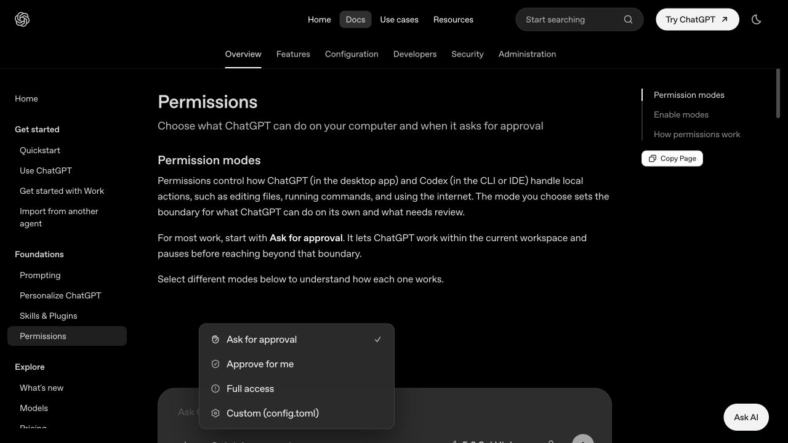

# Codex 能做什么和不能做什么：按现行官方文档核对能力边界、四个使用条件和完成验证方法

> 本文在线版：[codexguide.io/guides/codex-neng-zuo-shen-me](https://codexguide.io/guides/codex-neng-zuo-shen-me)

> 核对依据：2026-11-25 打开的 [Features](https://learn.chatgpt.com/docs/features)、[Working with agents](https://learn.chatgpt.com/docs/working-with-agents)、[Permissions](https://learn.chatgpt.com/docs/permission-modes) 和 [Codex Cloud](https://learn.chatgpt.com/docs/cloud)。没有打开桌面应用，没有跑 Cloud 任务，没有新截图。文中那张权限页图片是知识库里已有的官方页截图。

## 这篇文章适合谁

这篇文章写给准备把真实任务交给 Codex 的读者。

[Codex 是什么](./01-Codex是什么.md) 讲了它和普通对话的差别。[哪些人适合使用 Codex](./02-Codex适合哪些人.md) 讲了判断标准。接下来要把能力边界讲清楚：它能执行哪些工作，完成这些工作需要什么条件，哪些判断仍然必须由人负责。做完之后如果结果经常失控，接着看 [新手常见误区](./08-Codex新手常见误区.md)。

## 先说结论

Codex 可以理解你允许它读取的项目、修改文件、运行命令、调用浏览器和外部工具，并按你给出的方法检查结果。它也可以在 Cloud 里跑编码任务。它能否完成某个具体任务，还取决于四件事：有没有足够的上下文、是否获得必要权限、当前环境能不能运行，以及有没有明确的验证方法。

[Working with agents](https://learn.chatgpt.com/docs/working-with-agents) 把代理写成三件事放在一起：用来理解和计划的模型、用来收集信息或采取动作的工具，以及用来划定边界的护栏和人的监督。你仍然负责决定结果能不能用。写得流畅的总结，不能单独证明任务已经做成。

“Codex 能修改代码”是一项能力。“这次代码修改正确”是一个需要证据的结论。

这两句话不能混在一起。

## 判断能力时要看四个条件


少了其中任何一项，任务都可能停在中间。

例如，Codex 可以阅读测试失败信息并修改相关代码。但如果依赖没有安装、测试环境无法启动，或者报错只出现在生产环境，它就无法在当前环境中证明问题已经解决。

Working with agents 在交给代理之前问三件事：能不能说清结果和“做完”是什么意思，代理能不能拿到需要的信息和工具，你能不能评估结果并在出错时恢复。三个问题对上上面这四个条件。

## Codex 能做什么

### 理解项目和查找信息

Codex 可以读取你允许访问的项目文件，分析目录结构、依赖、配置、源码、测试和文档。

常见任务包括：

- 说明项目解决什么问题，以及本地如何启动。
- 找到某个页面、接口或功能的主要入口。
- 追踪一个函数、配置项或数据结构在哪里被使用。
- 根据 README、依赖文件和代码整理技术栈。
- 比较当前实现与项目规则是否一致。

它的结论来自能够读取的内容。如果关键文档没有放进项目、代码由远程服务动态生成，或者真实逻辑在另一个仓库，回答就可能不完整。

### 修改代码和文件

在授权范围内，Codex 可以新增、编辑和删除文件。它适合处理范围明确的功能开发、Bug 修复、重构、文档和配置任务。

例如：

- 修改一个前端组件及其样式。
- 给现有接口增加参数校验。
- 修复能够稳定复现的错误。
- 补充单元测试和使用说明。
- 调整构建配置或自动化脚本。
- 批量修改格式一致的文件。

大范围修改需要更清楚的限制。没有说明哪些目录不能动、哪些接口必须保持兼容时，Codex 可能选择一个技术上可行、但不符合项目预期的方案。

### 运行命令和开发工具

Codex 可以在权限允许时执行终端命令，例如安装依赖、运行测试、构建项目、执行 Lint 和查看 Git 状态。

这类能力让它可以形成完整过程：先查找问题，再修改文件，随后运行检查。如果命令失败，它还可以根据输出继续排查。

命令能否执行取决于当前环境。缺少运行时、系统依赖、网络、账号或环境变量时，Codex 只能说明缺少什么，不能凭空补出真实环境。终端里并排看对话和命令输出，见 [终端工作区](../12-官方工具与集成/27-Codex终端工作区-并排side-chat多标签页与重启后恢复.md)。2026-11-25 打开的 Features 落地页没有一张名叫「终端」的卡片，这一篇是 CLI 界面，不是那张功能目录上的入口。

### 调试问题和补充测试

当你能提供报错、日志、复现步骤或失败测试时，Codex 可以沿着代码路径查找原因，并提出修改。

它还可以：

- 把一个问题整理成稳定的复现步骤。
- 根据已有测试风格补充回归测试。
- 比较修改前后的错误信息。
- 检查边界条件和异常分支。
- 运行相关测试，确认原问题是否消失。

如果问题无法复现，正确做法是记录假设和未确认部分，而不是把最可能的猜测写成确定原因。

### 阅读差异和辅助代码审查

Codex 可以查看 Git diff、提交历史和 Pull Request 修改，寻找明显的逻辑错误、测试缺口、安全风险和维护问题。

代码审查适合用它做第一轮扫描，但不应该省略项目负责人或领域专家的判断。很多问题与业务规则、历史兼容和线上数据有关，这些信息未必存在于代码中。

### 浏览器、Computer Use、文件、定时任务和 Cloud

根据使用入口和配置，Codex 可以使用浏览器、网络搜索、MCP、插件或其他集成读取外部信息并采取操作。

这些能力不是默认无限开放的。能否使用某个工具，取决于工具是否安装、是否完成认证、当前权限策略和组织要求。

2026-11-25 的 [Features](https://learn.chatgpt.com/docs/features) 把一批入口分成工作流和能力。下面只列和「动手完成一件工作」直接相关、站内已经有专文的几项。表中「文档里的范围」是该入口页面或 Cloud 页的主题，不是本文实测过的点击路径。

| 入口 | 文档里的范围 | 站内文章 |
| --- | --- | --- |
| Browser | 让 ChatGPT 浏览网站并采取动作，同时你保持控制 | [浏览器操作与登录态](../12-官方工具与集成/02-Codex浏览器操作与登录态功能.md) |
| Computer use | 让 ChatGPT 通过视觉界面与应用交互 | [Computer Use](../12-官方工具与集成/03-Codex使用Computer-Use操作桌面应用.md) |
| Scheduled tasks | 安排重复工作，并查看已经完成的结果 | [定时任务](../12-官方工具与集成/06-Codex-Automations定时任务.md) |
| Work with files | 创建、预览和修改文档及其他生成的文件 | [生成文档、表格、幻灯片和 PDF](../08-插件工作流/02-Codex文档交付工作流.md) |
| Codex Cloud | 在云端环境里检查代码、做出改动，并运行命令或测试 | [Cloud 云端环境](../12-官方工具与集成/12-Codex-Cloud云端环境-创建发布环境-联网与密钥设置.md) |

Cloud 不在 Features 落地页的那组卡片里，它有单独的 [Codex Cloud](https://learn.chatgpt.com/docs/cloud) 页。该页写：可以从网页、手机或桌面应用查看改动并继续；每条任务有自己的工作区，电脑休眠时任务仍可以继续；如果默认环境可用，可以不先选仓库就开始。它没有写 Cloud 会自动比本机更正确。

桌面端把相关对话和文件夹放进项目的方式，见 [桌面端项目](../12-官方工具与集成/35-Codex桌面端项目-ChatGPT项目与本地项目-多文件夹锁定对话与Quick-chat.md)。

## Codex 不能做什么

“不能”有两种情况。一种是技术条件不具备，另一种是风险和责任不应该交给它。

### 不能读取没有提供或没有授权的数据

Codex 不会自动知道私人仓库、线上数据库、内部文档和第三方账号中的内容。需要访问这些信息时，必须先通过项目文件、授权连接或明确的工具配置提供上下文。

即使工具已经连接，也只能在授予的权限范围内操作。

### 不能保证生成的代码一定正确

Codex 可能误解需求、遗漏边界条件、使用不合适的 API，或者写出能够通过部分测试但仍有问题的代码。

代码看起来合理、命令返回成功、页面能够打开，这些都只是证据的一部分。最终还需要结合测试范围、实际业务和人工审查判断。Working with agents 写明：流畅的文字或自信的总结，不足以确立任务已经成功。

### 不能替你补全没有说出口的需求

如果任务只写“把登录功能优化一下”，Codex 无法确定你关注的是页面体验、登录速度、安全策略还是代码结构。

它可以根据代码提出建议，但不能替产品和业务负责人决定真正目标。需求越模糊，生成无关修改的概率越高。

### 不能在缺少环境时完成真实验证

没有数据库、浏览器、依赖、测试账号或线上日志时，Codex 无法复现依赖这些条件的问题。

它可以检查静态代码并给出推断，但需要明确写出验证范围。例如：“已通过代码检查和单元测试，尚未连接真实支付环境。”

Cloud 也一样。云端任务使用的是那个环境里的仓库、依赖和工具。环境里没有的服务，不会因为任务跑在 Cloud 上就出现。

### 不能绕过权限边界

[Permissions](https://learn.chatgpt.com/docs/permission-modes) 写：权限决定桌面端里的 ChatGPT，以及 CLI 或 IDE 里的 Codex，如何处理编辑文件、运行命令和使用网络这类本地动作。你选择的模式划定它可以自己做的范围，以及什么需要复查。

多数工作从 **Ask for approval** 开始。它让 ChatGPT 在当前工作区内工作，在越过这个边界之前停下来。

**Approve for me** 把符合条件的审批请求交给自动审查。更换谁来审查，并不会扩大沙箱。该页写明，Approve for me 保持和 Ask for approval 相同的工作区边界，只是把越过边界的请求送去自动审查。

有某个模式可用，不等于当前对话已经选中它。可用模式还取决于应用版本、执行环境、本地配置和组织要求。托管要求也可以限制 Ask for approval。CLI 里调整权限的命令，该页写的是 `/permissions`。

页面插图的说明文字里能看到 Full access 可以被打开。2026-11-25 的正文没有定义 Full access 会改工作区外的哪些文件、会不会联网。本文不补写文档里没有的那一档行为。



> 图片来源：[OpenAI Permissions](https://learn.chatgpt.com/docs/permission-modes)。这是知识库里已有的官方页截图。2026-11-25 该页正文比图中可能显示的模式列表更短，上面的段落以当天的正文为准。

为了少点几次确认而放宽边界，扩大的是行动范围，不会让 Codex 的判断自动变得更准确。权限怎么收紧，见 [权限、沙箱与审批](../02-核心概念与任务方法/06-权限沙箱与审批-什么时候放行什么时候收紧.md)。

### 不能承担最终责任

生产发布、数据库迁移、支付、安全、合规和客户数据处理都需要明确负责人。

Codex 可以帮助准备变更、执行检查和整理风险，但不能替团队承担业务后果。高风险操作应该有备份、审批、回滚方案和人工确认。Working with agents 写明：代理没有同事那种对结果的责任，你仍然要决定工作能不能用。

## 常见任务的能力边界

| 任务 | Codex 可以做什么 | 需要哪些条件 | 人需要检查什么 |
|---|---|---|---|
| 阅读陌生项目 | 分析结构、依赖和主要入口 | 能读取项目文件 | 结论是否遗漏外部服务和其他仓库 |
| 实现小功能 | 修改相关代码和测试 | 需求、范围和运行环境清楚 | 业务逻辑、兼容性和代码差异 |
| 修复 Bug | 根据复现和日志定位并修改 | 能复现问题或运行失败测试 | 原问题是否消失，是否引入回归 |
| 代码审查 | 查找错误、风险和测试缺口 | 有明确 diff 和项目规则 | 业务背景、历史约束和优先级 |
| 修改配置 | 编辑配置并运行检查 | 知道目标环境和配置优先级 | 密钥、权限和不同环境的差异 |
| 操作外部服务 | 通过浏览器、Computer Use、MCP、插件或集成调用工具 | 已安装、认证并获得授权 | 写操作范围、数据影响和撤销方式 |
| 定时重复的工作 | 按计划运行已经稳定的流程 | 项目、提示词、周期和运行环境已经定下来 | 失败时怎样发现，结果是否仍然有人看 |
| 在 Cloud 里改代码 | 在云端环境中检查、修改并运行命令或测试 | 环境里有需要的仓库、依赖和工具 | 改动、检查结果，以及要不要提交或开 PR |
| 发布到生产环境 | 准备命令、检查清单和变更说明 | 完整发布环境与团队流程 | 必须由负责人确认并保留回滚方案 |

这张表里没有“完全自动、无需检查”的任务。任务越接近生产环境和重要数据，人工检查越不能省。

## 怎样判断 Codex 是否真的完成了任务

不要只看最后一句“已完成”。Working with agents 把复查写成工作的一部分：看看得见的步骤、来源、工具动作和结果，再对照任务说明检查是否完整、重要说法有没有依据、要求的动作是否真的发生。可以按下面的顺序检查。

### 查看它实际改了什么

- 查看 `git status` 和 `git diff`。
- 确认没有修改无关文件。
- 检查是否删除了原有逻辑、注释或配置。
- 注意新依赖、环境变量和权限变化。

### 查看它实际运行了什么

- 测试是否真的执行，而不是只建议你执行。
- 构建、Lint 和类型检查是否成功。
- 页面或接口是否在正确环境中验证。
- 命令是否只覆盖了部分模块。

### 查看还有什么没有验证

- 是否缺少真实账号、数据库或生产数据。
- 是否只测试了正常流程，没有覆盖异常情况。
- 是否存在跨平台、浏览器或版本差异。
- 是否有需要产品、设计、安全或业务人员确认的决定。

可靠的结果会把这些限制写出来。只汇报成功、不说明检查范围的结果，需要继续追问。

## 一个更稳妥的任务写法

下面是一段任务写法，用来说明怎样把能力和验证条件放在一起。它不是某次会话的实录。

```text
请修复用户资料页在邮箱为空时出现的报错。

开始前先定位相关组件、接口和现有测试，不要修改其他页面。
请先复现问题，再进行最小范围修改。
完成后运行相关测试和类型检查，并告诉我：
1. 原因是什么；
2. 修改了哪些文件；
3. 运行了哪些检查；
4. 还有哪些情况没有验证。
```

这段任务没有要求 Codex“保证没有任何问题”，而是要求它提供可以检查的过程和证据。

## 什么时候应该先停下来

出现下面情况时，不要继续扩大权限或让 Codex 反复尝试。

- 它准备修改与任务无关的大量文件。
- 它无法解释修改原因，却建议直接发布。
- 测试持续失败，但它开始删除测试或降低检查标准。
- 它需要访问密钥、生产数据库或客户数据。
- 它把没有验证的推断写成确定结论。
- 你已经看不懂变化，也没有其他人可以审查。

此时应该缩小任务、恢复工作区，或者先补充环境和资料。

## 下一步学习

权限边界的具体开关，见 [权限、沙箱与审批](../02-核心概念与任务方法/06-权限沙箱与审批-什么时候放行什么时候收紧.md)。容易让任务失控的做法，见 [新手常见误区](./08-Codex新手常见误区.md)。

准备实际操作的读者，可以进入 [安装与首次使用](../01-安装与首次使用/)；想先学会怎样描述任务，可以进入 [核心概念与任务方法](../02-核心概念与任务方法/)。

## 参考资料

- [Features](https://learn.chatgpt.com/docs/features)
- [Working with agents](https://learn.chatgpt.com/docs/working-with-agents)
- [Permissions](https://learn.chatgpt.com/docs/permission-modes)
- [Codex Cloud](https://learn.chatgpt.com/docs/cloud)
- [Prompting](https://learn.chatgpt.com/docs/prompting)
- [Sandbox](https://learn.chatgpt.com/docs/sandboxing)
- [Code review](https://learn.chatgpt.com/docs/code-review)

具体能力会因使用入口、账号、项目配置、权限策略和功能成熟度而变化。
