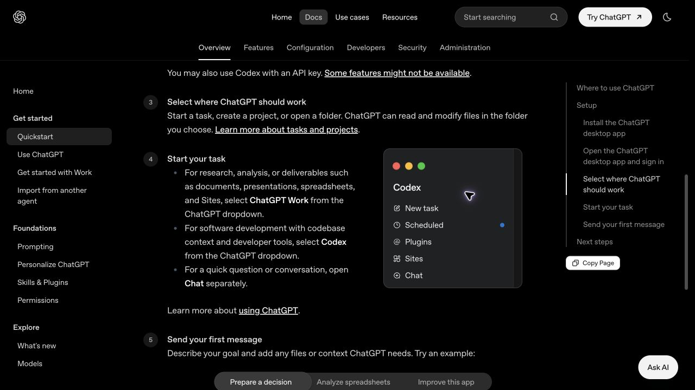
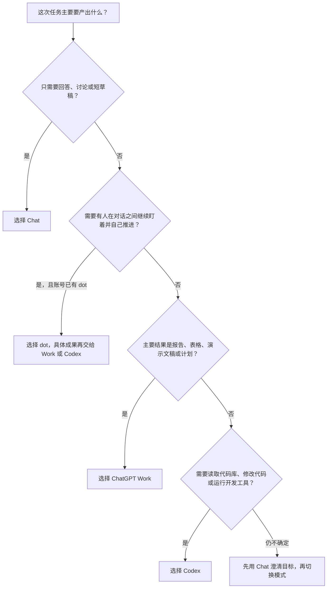

# Chat、ChatGPT Work 和 Codex 怎么选：加上 dot、跨设备继续 Work 任务和 ChatGPT Space，哪些任务交给谁

> 本文在线版：[codexguide.io/guides/chat-work-he-codex-zen-me-xuan](https://codexguide.io/guides/chat-work-he-codex-zen-me-xuan)

> 难度：基础
>
> 类型：使用入口选择

## 这篇文章适合谁

这篇文章写给已经打开 ChatGPT 或 Codex，却不确定应该选择 Chat、ChatGPT Work 还是 Codex 的读者。

三个入口都能接收自然语言任务，也都可以使用一定的上下文和工具。真正需要判断的是：这次任务要产出什么，以及结果应该怎样检查。

## 先说结论

选择模式时，先看主要交付物。

- 想获得回答、解释、讨论或短草稿，选择 Chat。
- 想完成一份可以审阅和继续使用的报告、演示文稿、表格、计划或持续任务，选择 ChatGPT Work。
- 想修改软件项目、运行开发工具、调试代码、补测试或审查 Pull Request，选择 Codex。
- 想把一件事长期交给代理，让它在对话之间自己继续推进，并在需要决定时回来找你，选择 dot。dot 可以把具体任务再交给 Work 或 Codex。

不要先问“我是什么职业”，先问“这次任务最终要交付什么”，以及这件事是否需要有人在你离开对话之后继续盯着。

> 图片来源：[OpenAI Quickstart](https://learn.chatgpt.com/docs/quickstart)。本图与上一篇文章共用，因为它直接展示了三种模式的官方分工。

## 三种模式的核心区别

OpenAI 当前在 Use ChatGPT 文档中给出的定位可以概括成下面这张表。

| 模式 | 主要目的 | 常见结果 | 典型任务 |
|---|---|---|---|
| Chat | 和 ChatGPT 一起思考问题 | 回答、解释、讨论、短草稿 | 问概念、搜索资料、头脑风暴、改写一段话 |
| ChatGPT Work | 定义一个结果，让 ChatGPT 完成较完整的工作 | 报告、演示文稿、电子表格、计划、可重复工作流 | 分析多份资料、制作汇报、整理决策、定期更新 |
| Codex | 完成软件和技术任务 | 代码差异、测试结果、构建结果、PR 审查 | 修 Bug、实现功能、运行测试、审查代码 |
| dot | 承担一项持续责任，并在对话之间继续推进 | 跟进结果、需要你决定时的提醒，以及它交给 Work 或 Codex 的任务 | 盯着一份会变的计划、在截止日期变化时回来找你 |

这个表描述的是主要用途，不是绝对限制。Chat 可以读取文件，Work 也能使用工具，Codex 也能写文档。dot 那一行来自官方 [Meet dots](https://learn.chatgpt.com/docs/dots) 的对照表：它适合「让代理盯着一项持续责任，事情变化时自己想下一步，并在对话之间跟进」；官方写它可以在 ChatGPT、Slack 或 Teams 里通知你，并把任务交给 ChatGPT Work 或 Codex。选择的关键是哪个入口更贴近主要工作过程和最终结果。

2026-11-17 的 [Use ChatGPT](https://learn.chatgpt.com/docs/use-chatgpt) 仍是三列：Chat、ChatGPT Work、Codex。dot 写在 Meet dots，不在那张三列表里。下面一节说明 11 月要一起看的几个概念各自放在哪。

## 2026-11 新增的几个概念：dot、Work 跨设备继续、ChatGPT Space 各自放在哪

这三件都是官方 What's new 和对应文档里的能力。它们不取代 Chat、Work、Codex 三选一，而是加在已经选中的工作方式旁边。套餐、地区和灰度以你打开文档当天的原文为准；下面只引用 2026-11-17 打开的页面，两处说法不一致的地方并列写出。

### dot：对话之间还要自己继续推进的事

[What's new](https://learn.chatgpt.com/codex/whats-new) 的 DevDay 2026 一节写：

> Give your dot ongoing responsibility. Dots keep making progress between conversations and are rolling out gradually to eligible accounts.

September 28–October 2, 2026 那一周的 “Delegate ongoing work to your dot” 写：Dots continue work between conversations and bring back results for review. Access is rolling out gradually to eligible accounts.

[Meet dots](https://learn.chatgpt.com/docs/dots) 写：dot 是一直在线的代理，住在云端，有自己的电脑和浏览器；你的电脑关掉时它仍可以继续云端工作。它能研究、分析数据、准备文档、构建软件，并使用以往对话和你的偏好。它也可以在已连接的电脑上创建 Work 或 Codex 任务，继续已有的本地 Codex 任务；需要仓库和现成环境的云端编程，可以使用你已经创建的 Codex cloud environment。连接你的电脑，和把电脑连到 Codex、或打开 Work Sync，是不同的权限。官方写明：Connecting your computer to Codex or enabling Work Sync doesn’t give your dot local access。多台电脑怎么指定，见[《Codex 与 dot 连接多台电脑》](../12-官方工具与集成/24-Codex与dot-连接多台电脑-指定电脑运行本地Codex任务.md)。在 iOS 通知里回复，见[《Codex 与 Dot：在 iOS 通知里回复》](../12-官方工具与集成/21-Codex与Dot-iOS通知回复与分享继续任务.md)。

创建入口：October 5–9, 2026 的 What's new 写可以在 ChatGPT 手机应用里创建 dot、起名、改外观并连接插件。Meet dots 和帮助中心都写还可以在桌面应用或桌面浏览器里创建。手机网页不支持。

自定义指令：November 9–13, 2026 的 What's new 写 “Set custom instructions for your dot”，你可以在对话里让它更新指令，或在 Customize → Behavior 里编辑。[Control your dot](https://learn.chatgpt.com/docs/dots/controls) 把 Customize > Behavior 写在手机上，并且要 Behavior 可用、编辑已打开；也可以直接在对话里告诉 dot 一条长期指令。该页写桌面和网页的 Custom rules 在 Settings > Personalization。What's new 的一句没有区分手机和桌面。本文不把 Customize → Behavior 写成所有客户端都有的菜单。

资格，两份官方页面不完全一样，这里都保留：

- Meet dots 的 Access：Dots are rolling out gradually to eligible Pro and Business Premium accounts。Pro 100、Pro 200、Pro 500 面向 18 岁及以上、欧洲经济区、英国和瑞士以外的用户。Business Premium 在支持的 ChatGPT 地区，并受工作区资格限制。Enterprise、Edu、Healthcare 在符合条件的工作区一般可用；管理员预览期间由管理员按角色打开；自 2026-11-18 起，除非工作区选择退出，否则默认打开。Pro 和 Business Premium 与 dot 的对话不计入 ChatGPT 用量；dot 在 Work 或 Codex 里启动或管理的任务仍计入那些产品的用量。
- 帮助中心 [Getting started with your dot](https://help.openai.com/en/articles/20001530-getting-started-with-your-dot)（页面写 Updated: 5 days ago，2026-11-17 打开）写的是 Pro users aged 18 and older，市场不包括欧洲经济区、瑞士和英国，没有再拆 Pro 100／200／500。Business Premium、Enterprise／Edu／Healthcare 的句子和上面接近，并多写了：UAE 数据或推理驻留的工作区不可用；每位成员可以创建一个个人 dot；个人和 Business Premium 是逐步开放，可能要几天才会出现在你的账号上。Enterprise 预览计费写的是 2026-11-04 至 2026-11-18 可预览，11 月 18 日起对已启用的 dot 开始计费；dot 交给 Work 或 Codex 线程的工作另按那些产品的标准费率。

官方没有写成「所有 Plus 都有」或「所有地区都有」。账号里没有 dot 时，按这两页的资格和灰度理解，不要从其中一页推断另一页没写的限制。

### Work 跨设备继续：还是 Work，只是换设备接着做

September 28–October 2, 2026 的 What's new 写：

> Continue Work across devices. With Local computer access with Work Cloud enabled, continue eligible tasks from desktop, web, or mobile. Keep your computer online for steps that need its local resources.

[Get started with Work](https://learn.chatgpt.com/docs/get-started-with-work) 写得更具体：工作区提供了 Work Cloud 和本地电脑访问后，在每台设备上用同一个 ChatGPT 账号和工作区登录；在桌面端的输入区选择 Cloud，开始一项新的 Work 任务，然后可以在桌面、手机或网页上继续。需要用到电脑上的文件或工具的步骤，保持那台电脑在线并连接。电脑在新的一轮开始时不可用，符合条件的任务可以改在云端容器里继续，但那个容器用不了这台电脑的文件、工具，也不能执行它的本地要求；正在跑的一轮不能从本地切到云端。关掉本地电脑访问会打断正在跑的轮次。没有这项访问时，需要电脑的任务选 Local，不需要电脑的任务选 Cloud。

这仍然是 ChatGPT Work。它不把一项代码修改变成 Codex，也不等于 dot。入口还是 Work，条件是官方写的 Local computer access with Work Cloud。

### ChatGPT Space：放页面和协作，不是第四种编程模式

What's new 同一周写：

> Work together in ChatGPT Space. Create and share Pages in Space. Mention ChatGPT or your dot and use slash commands while editing.

[ChatGPT Space](https://learn.chatgpt.com/docs/space) 把 Space 写成页面、幻灯片、文件和协作的入口。页面可以自己改，也可以交给 ChatGPT 改。[Work with agents in Space](https://learn.chatgpt.com/docs/space/agents) 写：在页面里输入 `@ChatGPT` 或 `@dot` 再写要求；输入 `/` 打开斜杠菜单，其中有 Generate、Visualize 和 Image。可用的代理和已连接工具取决于你的访问权限。

Space 适合「一份要和别人一起改的页面」。要的是一次做完的报告或表格，仍从 Work 开始，做完可以放进 Space。要改仓库里的代码，仍用 Codex。官方没有把 Space 写成 Chat、Work、Codex 之外的第四种任务类型。

## 一个简单的选择流程

这条流程先看主要交付物，再看这件事要不要在你离开对话之后继续被盯着。一个任务同时包含资料研究和代码修改时，可以拆成两个阶段，不需要强行从头到尾只用一个模式。dot 那一支只在账号里已经有 dot 时走；没有资格时，长期跟进仍拆成 Work 的定时任务或你自己回来打开的 Codex 线程。

## 什么时候选择 Chat

Chat 适合快速进入一个问题，并通过对话逐步想清楚。

常见场景包括：

- 解释一个不熟悉的概念。
- 搜索并比较几个公开选项。
- 讨论文章角度、产品想法或会议议题。
- 改写一段消息、简介或说明。
- 总结一小段文本或一份文件。
- 在开始大型任务前梳理目标和约束。

Chat 的优势是轻。你不需要先建立完整任务，也不必要求它生成一个正式交付物。

例如，你只是想弄清楚“单元测试和集成测试有什么区别”，直接使用 Chat 更快。为了这个问题打开整个代码仓库并启动 Codex，没有增加多少价值。

### Chat 不太适合什么

如果任务需要处理很多来源、持续运行较长时间，或者最终要交付一份结构完整的文件，普通对话会逐渐变得难以管理。此时更适合切换到 Work。

如果任务需要真正修改项目、执行命令和验证代码，应该切换到 Codex。

## 什么时候选择 ChatGPT Work

Work 适合结果明确、步骤较多，并且最终产物需要审阅、编辑或反复使用的任务。

OpenAI 官方文档给出的典型产物包括 brief、演示文稿、分析结果、电子表格、项目计划、持续更新和工作流。

适合使用 Work 的场景有：

- 阅读多份研究资料并形成决策报告。
- 把采访笔记和调查数据整理成演示文稿。
- 比较多个方案并生成电子表格。
- 根据文件和插件中的信息更新项目周报。
- 制作活动计划、预算和邀请页面。
- 建立需要定期执行或更新的工作任务。

Work 可以使用文件、插件和经过批准的工具获取信息、生成交付物并运行工作流。你可以查看进度、中途补充信息，并在重要操作前审批。

### Work 不太适合什么

只想问一句话时，Work 会显得过重。主要任务是修改代码、调试和测试时，Codex 的代码库上下文和开发工具更匹配。

Work 可以处理技术资料，也可以生成与技术有关的文档。但如果最终验收标准是“代码通过测试并形成可审查的修改”，应该把实现阶段交给 Codex。

## 什么时候选择 Codex

Codex 适合软件开发和技术任务，尤其是需要读取代码库、修改文件、运行命令并验证结果的工作。

常见场景包括：

- 阅读陌生项目，说明结构和启动方式。
- 实现一个范围清楚的功能。
- 根据报错和日志修复 Bug。
- 运行测试、类型检查、Lint 和构建。
- 补充测试、文档、脚本和配置。
- 阅读 Git diff 或 Pull Request，检查错误和风险。
- 处理依赖升级、重构和开发环境问题。

Codex 的最终结果通常不是一段回答，而是一组可以检查的项目变化。检查方法包括 Git diff、测试输出、构建结果、页面效果和代码审查。

### Codex 不太适合什么

如果你只需要讨论想法，没有代码、文件或技术操作，Chat 更直接。

如果主要结果是研究报告、演示文稿或电子表格，Work 的交付物工作流更合适。Codex 可以协助处理 Markdown、脚本和仓库文件，但不需要为了“显得专业”把所有任务都放进 Codex。

## 混合任务应该怎样拆分

真实工作经常跨越三个模式。可以按阶段拆开。

### 从市场研究到功能上线

1. 用 Chat 讨论要解决的问题和初步方向。
2. 用 Work 收集资料、比较方案并形成需求说明。
3. 用 Codex 在项目中实现功能、补测试并检查代码差异。
4. 回到 Work 整理发布说明、培训材料或对外汇报。

### 从知识库选题到 GitHub 发布

1. 用 Chat 讨论读者问题和文章角度。
2. 用 Work 整理官方资料、来源表和文章计划。
3. 用 Codex 创建 Markdown 文件、维护目录、检查链接并提交到 GitHub。

### 从线上报错到复盘报告

1. 用 Codex 读取日志和代码，复现并修复问题。
2. 用 Work 汇总影响范围、处理过程和改进计划。
3. 用 Chat 讨论一个具体技术概念或措辞。

需要长期跟进时，可以在某一阶段改交给 dot。例如研究结论已经在 Work 里写成报告，之后让 dot 盯着计划里的日期和未决问题，有变化再回来；真正改仓库的那一步仍打开 Codex。官方写 dot 可以创建 Work 或 Codex 任务，也可以继续已有的本地 Codex 任务。它不会自动把所有聊天都变成持续责任。

拆分的好处是每个阶段都有清楚的结果。切换模式时，把上一阶段的结论、文件和未解决问题带到下一阶段。同一项 Work 任务要换到手机或网页上继续，用上一节的跨设备条件，不必为了换设备再开一个模式。一份要和同事一起改的页面，可以放进 ChatGPT Space，在页面里 @ChatGPT 或 @dot。

## 常见任务应该选哪个

| 任务 | 推荐模式 | 原因 |
|---|---|---|
| “解释一下 MCP 是什么” | Chat | 主要需要概念解释 |
| “比较三款项目管理工具并给出建议” | Chat 或 Work | 简单讨论用 Chat，需要正式报告用 Work |
| “读取十份访谈记录并制作汇报” | Work | 多来源分析并生成可审阅交付物 |
| “每周整理 Slack 和 Drive 中的项目更新” | Work | 需要插件、持续执行和固定产物 |
| “帮我看懂这个 GitHub 项目的结构” | Codex | 需要代码库上下文 |
| “修复登录页面报错并补测试” | Codex | 需要修改代码和运行验证 |
| “审查当前 PR 是否有明显风险” | Codex | 需要 diff、项目规则和测试上下文 |
| “给产品名称想十个备选” | Chat | 适合快速讨论和迭代 |
| “把项目数据整理成电子表格” | Work | 最终产物是可复用表格 |
| “修改知识库目录并检查 Markdown 链接” | Codex | 需要操作仓库文件并运行检查 |
| “这份计划会变，截止日期一动就告诉我” | dot | 官方示例是持续责任：盯着计划和对它有影响的更新，需要决定时再来找你。账号要已有 dot |
| “电脑上开了的 Work 任务，换到手机上看结果” | ChatGPT Work | 官方的跨设备继续：要已启用 Local computer access with Work Cloud，需要本机文件的步骤保持电脑在线 |
| “和同事一起改一页笔记，并在页内 @ 助手” | ChatGPT Space | 官方写可以创建、分享 Page，编辑时提及 ChatGPT 或 dot，并用斜杠命令 |

## 容易选错的几个地方

### 任务很长，所以一定要用 Work

时长不是唯一判断标准。一个持续数小时的大型代码重构仍然属于 Codex；一个十分钟完成的正式决策表也可能更适合 Work。

### 任务包含文件，所以一定要用 Codex

文件类型和最终结果更重要。分析 PDF 并生成报告通常适合 Work；修改项目中的源代码和测试适合 Codex。

### Codex 更强，所以所有任务都用 Codex

工具入口不是能力排名。Chat 更轻，Work 更适合交付物，Codex 更适合软件项目。选择贴近任务的入口，通常更省沟通成本。

### 选对模式后就不需要检查

三个模式的结果都需要检查。Chat 的事实和引用要核对，Work 生成的文件需要逐页查看，Codex 的代码需要看差异并运行测试。

## 不确定时怎么开始

不确定时可以先用 Chat，用几轮对话把目标说清楚。

可以先回答下面四个问题：

1. 最终要得到回答、文件，还是项目修改？
2. 任务主要依赖公开信息、业务资料，还是代码仓库？
3. 结果由什么方式验收？
4. 是否需要长期运行、外部工具或开发命令？

答案逐渐清楚后，再决定留在 Chat、进入 Work，还是打开 Codex。

## 下一步学习

下一篇会比较 Codex App、CLI、IDE 和 Cloud，解决“已经决定使用 Codex，但应该从哪个入口开始”的问题。2026-11 起，CLI 也可以连接 Cloud，见[《App、CLI、IDE 和 Cloud 怎么选》](./05-App-CLI-IDE和Cloud怎么选.md)。

准备开始安装的读者，可以进入 [安装与首次使用](../01-安装与首次使用/)；希望进一步学习任务写法，可以进入 [核心概念与任务方法](../02-核心概念与任务方法/)。

## 参考资料

- [OpenAI Quickstart](https://learn.chatgpt.com/docs/quickstart)
- [Use ChatGPT](https://learn.chatgpt.com/docs/use-chatgpt)
- [Get started with Work](https://learn.chatgpt.com/docs/get-started-with-work)
- [What's new](https://learn.chatgpt.com/codex/whats-new)
- [Meet dots](https://learn.chatgpt.com/docs/dots)
- [Control your dot](https://learn.chatgpt.com/docs/dots/controls)
- [Getting started with your dot（帮助中心）](https://help.openai.com/en/articles/20001530-getting-started-with-your-dot)
- [ChatGPT Space](https://learn.chatgpt.com/docs/space)
- [Work with agents in Space](https://learn.chatgpt.com/docs/space/agents)
- [Codex Manual](https://learn.chatgpt.com/docs/codex-manual.md)
- [OpenAI Prompting](https://learn.chatgpt.com/docs/prompting)

ChatGPT 和 Codex 的界面、模式名称与可用功能可能随版本、账号和工作区设置变化。
