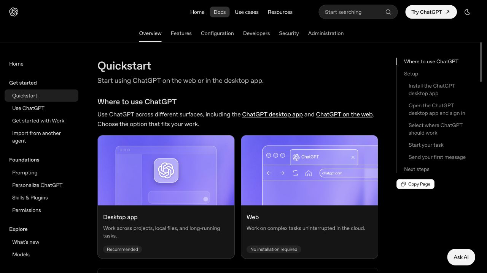
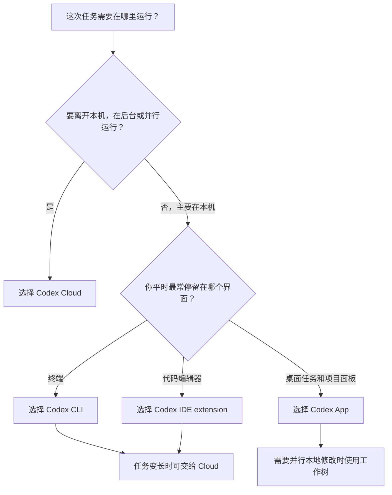
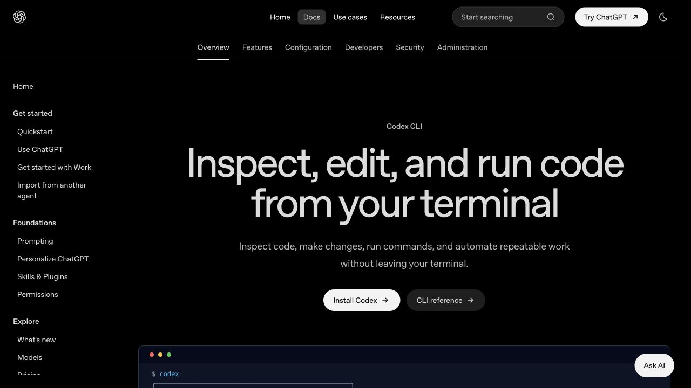

# Codex App、CLI、IDE 和 Cloud 怎么选（2026-11 更新）：CLI 现在能在终端连 Cloud、开终端工作区，可复用 Cloud 环境怎么影响选择

> 本文在线版：[codexguide.io/guides/app-cli-ide-he-cloud-zen-me-xuan](https://codexguide.io/guides/app-cli-ide-he-cloud-zen-me-xuan)

> 难度：基础
>
> 类型：使用入口选择

## 这篇文章适合谁

这篇文章写给已经决定使用 Codex，却被 App、CLI、IDE extension 和 Cloud 几个入口弄糊涂的读者。

你可能会遇到这些问题：第一次应该安装哪个？本地任务和云端任务有什么区别？已经在 VS Code 里用了 Codex，还需要 App 或 CLI 吗？

## 你会学到什么

读完后，你应该能够：

- 判断一次任务适合在本机还是云端运行。
- 根据自己的主要工作界面选择 App、CLI 或 IDE。
- 知道什么时候需要切换入口，而不是一次安装所有工具。
- 理解四个入口可以组合，但不应该同时修改同一份代码。

## 先说结论

如果只记住一件事，请记住下面这组判断：

- **Codex App**：适合在 ChatGPT 桌面应用里管理项目、任务、工作树、代码差异和 Git 操作。
- **Codex CLI**：适合习惯终端、需要运行命令、编写脚本或接入 CI 的开发者。0.169.0 起，CLI 还可以开 opt-in 的终端工作区，并在 macOS 和 Linux 上使用 opt-in 的 Cloud connection。
- **Codex IDE extension**：适合边看代码边提问、做局部修改和原地审查差异。
- **Codex Cloud**：适合把任务交给隔离的云端环境，在后台或并行运行，稍后回来审查结果。默认环境可用时可以不选仓库；要反复使用同一套依赖和工具，就发布可复用环境。

它们不是从弱到强的四个等级。前三个首先回答“你想在哪里和 Codex 交互”，Cloud 主要回答“任务要在哪里运行”。CLI 也可以把任务交到 Cloud，不必先换一个图形入口。

## 先分清 App、CLI、IDE 和 Cloud

本文中的 App，指 ChatGPT 桌面应用里的 Codex 工作方式，不是手机 App。官方[桌面应用页](https://learn.chatgpt.com/docs/app)讲的是整个 ChatGPT 桌面应用，里面可以选择 ChatGPT 或 Codex。下面的 App 只讨论在这个应用里用 Codex 管项目和任务。

App、CLI 和 IDE 都可以成为你在本机发起技术任务的入口，但界面和工作习惯不同。Cloud 会为任务准备云端工作区。2026-11-17 的 [Cloud](https://learn.chatgpt.com/docs/cloud) 和 [Cloud environments](https://learn.chatgpt.com/docs/environments/cloud-environments) 写明：看得到默认环境时，可以不选仓库就提交任务；要让以后的任务复用仓库、依赖和工具，就创建并发布环境。发布保存的是准备好的文件系统，每个新任务仍在自己的隔离工作区里开始。

CLI 也不只停在本机仓库。官方 CLI 页写了 `codex cloud`：浏览云端对话、把任务提交到已配置的环境、再把结果应用到本地。0.169.0 的更新日志另外写了 macOS 和 Linux 上 opt-in 的 Cloud connection。两套说法都保留在下一节，不合成一个没有出处的菜单名。

> 图片来源：[OpenAI Quickstart](https://learn.chatgpt.com/docs/quickstart)。本图与第 01 篇共用，用来说明 Codex 可以从不同工作界面进入。

## 四种入口对照表

| 入口 | 主要工作位置 | 最适合的任务 | 你会直接看到什么 | 需要注意什么 |
|---|---|---|---|---|
| App | ChatGPT 桌面应用里的 Codex；本地项目或工作树 | 多任务管理、本地项目修改、查看 diff、Git 操作 | 任务列表、项目文件、工作树、差异和终端 | 桌面任务仍会占用本机环境；不要把 App 自动等同于 Cloud |
| CLI | 本机终端；也可以用 `codex cloud`，或在 macOS / Linux 上使用 opt-in 的 Cloud connection | 命令密集型开发、调试、代码审查、脚本和 CI；终端工作区里的 side chat；在 agent command center 里按名称、提示预览或工作目录搜索旧任务 | 命令、输出、权限请求、代码差异；可选的侧边对话和任务搜索 | 需要熟悉目录、命令行和 Git。终端工作区和 Cloud connection 在 0.169.0 更新日志里写成 opt-in，日志没有给出配置键名 |
| IDE | VS Code、Cursor、Windsurf、Visual Studio Code Insiders、Xcode 或 JetBrains | 阅读当前文件、局部修改、边写边问、原地审查 | 打开的文件、选中代码、Codex 对话和 diff | 长任务会占用编辑器注意力。官方 IDE 页写任务需要更多时间和空间时 connect Codex web |
| Cloud | 隔离的云端工作区；可复用的已发布环境 | 后台任务、并行任务、远程任务、同一套依赖要反复使用 | 任务日志、结果摘要、diff 和 Pull Request 入口 | 默认环境可用时可以不选仓库。检出已有仓库要连接 GitHub，或在环境里选择 GitLab.com。每个任务的工作区彼此隔离 |

表中说的是最典型的工作方式，不是硬性限制。例如，CLI 和 IDE 都可以把较长任务交给 Cloud；App 也有本地终端、工作树和 Git 控件。

## 2026-11 的变化

这一节只写 2026-11-17 能在官方页面上对上的变化。没有写出配置键的功能，下面不编开关名称。

### CLI 0.169.0：终端工作区、任务搜索、终端里的 Cloud connection

[changelog](https://learn.chatgpt.com/codex/changelog) 把 Codex CLI 0.169.0 标在 2026-11-13。[GitHub Release rust-v0.169.0](https://github.com/openai/codex/releases/tag/rust-v0.169.0) 的发布时间是 2026-11-13T08:37:05Z。和入口选择直接相关的 New Features 是这三条：

- opt-in 的终端工作区支持多个 side-chat 标签页。可以用键盘或鼠标切换，重启 Codex 后可以重新打开已保存的本地 side chat。
- 在 agent command center 里按名称、提示预览或工作目录搜索旧任务。本机 0.169.0 的 `codex agents --help` 把这个子命令说明为 “Open the agent command center to browse and switch sessions”。命令中心本身更早就在更新日志里出现；按这三项搜索是 0.169.0 新写上的。
- 在 macOS 和 Linux 上，opt-in 的 Cloud connection 可以在终端里发图片、选择模型和推理强度、归档或恢复 Cloud 对话。

更新日志用了 “opt-in terminal workspace” 和 “opt-in Cloud connection”，没有写出对应的配置键。本机 `codex features list` 里有一些 stage 仍是 under development、当前为 false 的 flag。更新日志没有把它们写成这两个功能的开关，所以这里不建议读者打开某一个 flag。

官方 [CLI 页](https://learn.chatgpt.com/docs/codex/cli) 还写了另一条已经存在的路径：`codex cloud` 可以浏览进行中和已完成的云端对话，把任务提交到已配置的环境，再把结果应用到本地仓库。0.169.0 的 `codex cloud --help` 第一行是 `[EXPERIMENTAL]`，子命令包括 `exec`、`status`、`list`、`apply` 和 `diff`。这和上面的 opt-in Cloud connection 是两处官方文字，本文都保留。CLI 页插图里有一处写着 v0.143.0，那是插图上的版本号；本文核对命令时安装的是 `codex-cli 0.169.0`。

这些能力在本环境没有登录、也没有桌面端，所以没有打开终端工作区或 Cloud 对话。上面的句子来自更新日志和 `--help`。

### 可复用的 Cloud 环境

[What's new](https://learn.chatgpt.com/codex/whats-new) 在 September 28–October 2, 2026 这一周写：

> Prepare reusable Codex Cloud environments. Prepare and publish a cloud environment once, then reuse its filesystem in isolated workspaces for new tasks.

同一周还有 “Continue Work across devices”，那是 ChatGPT Work 的跨设备继续，放在[Chat、Work 和 Codex 怎么选](./04-Chat-Work和Codex怎么选.md)，不写进 Codex Cloud 的选择条件。

当前 Cloud environments 页的操作是：在网页或桌面端选择 **Work in > Cloud**；看得到默认环境就选它，可以不选仓库；要复用仓库、依赖、工具和访问设置，就 **Create environment**，让 Codex 检查仓库、安装依赖并测试，你看完设置报告后 **Publish**。新任务从这份准备好的文件系统开始，已有任务保持自己的文件。桌面端项目里的默认环境可以自动使用已连接 GitHub.com 上、和该项目关联的仓库；文档写明这个自动设置不包含 GitLab。要在仓库选择器里检出 GitLab.com 仓库，需要在网页或桌面端创建可复用环境。

联网、安装脚本、启动说明和网络密钥的字段，见[《Codex Cloud 云端环境配置》](../12-官方工具与集成/12-Codex-Cloud云端环境-创建发布环境-联网与密钥设置.md)。桌面端怎样管理任务，见[《Codex 桌面端任务工作流》](../12-官方工具与集成/08-Codex桌面端任务工作流.md)。

### 这些变化怎样影响选择

- 任务要在云端跑，不一定先装 CLI。[Quickstart](https://learn.chatgpt.com/docs/quickstart) 把桌面应用标成 Recommended，并写网页可以不安装，在 Cloud 里做。看得到默认环境时，可以不选仓库就提交一个任务。
- 人已经在终端里时，不必为了离开本机而改用图形入口。可以用 `codex cloud`。macOS 和 Linux 上，再看 opt-in 的 Cloud connection 是否已经对这次安装打开。Windows 不在 0.169.0 这条 Cloud connection 的句子里。
- 团队要减少「只有我的电脑能跑」，优先发布可复用环境。环境没准备好，Cloud 仍会卡在依赖、权限和网络上。

## 一个简单的选择流程

这条流程没有要求你永久选定一个入口。它只是在帮你决定：当前这次任务从哪里开始最顺手。2026-11 之后，选了 CLI 仍可以把任务交给 Cloud；选了 Cloud，也不一定要先连接一个 GitHub 仓库才能做不依赖现有代码的任务。准备安装时看[安装路线总览](../01-安装与首次使用/01-安装路线总览.md)。

## 什么时候选择 Codex App

Codex App 适合希望把项目、任务、文件、终端和 Git 变化集中在一个桌面工作台中的读者。

比较合适的场景有：

- 同时跟进几个项目或几个持续时间较长的任务。
- 不想一直在多个终端窗口之间切换。
- 希望直接查看文件变化，并对 diff 留下修改意见。
- 需要使用工作树隔离并行修改。
- 想在界面中完成暂存、提交、推送和创建 Pull Request 等常见 Git 操作。

OpenAI 的本地环境文档说明，Codex App 可以为项目配置 setup scripts 和常用 actions。新工作树创建时可以自动安装依赖或执行构建，常用的启动、测试命令也可以放到顶部操作区。

### App 的限制

App 不是“所有任务自动放到云端”。你打开本地文件夹、在本地工作树中运行任务时，代码、依赖和开发工具仍来自自己的电脑。

如果你喜欢通过管道、脚本和大量命令组织工作，CLI 往往更直接。如果你一整天都在编辑器里逐行阅读代码，IDE extension 的上下文切换更少。

## 什么时候选择 Codex CLI

Codex CLI 适合终端优先的工作方式。它可以在当前仓库中读取文件、修改代码、运行本机已经安装的工具，并把交互式任务和现有命令行流程放在一起。

> 图片来源：[Codex CLI 官方文档](https://learn.chatgpt.com/docs/codex/cli)。页面将 CLI 定位为在终端中检查、编辑、运行代码并自动化重复工作。

CLI 比较适合：

- 在终端中阅读项目、执行测试、查看日志和处理 Git。
- 调试必须连续运行多条命令的问题。
- 使用 `codex exec` 建立非交互式流程。
- 把 Codex 放入脚本、自动化任务或 CI 管道。
- 在提交前审查未提交修改、某个提交或相对基础分支的变化。
- 从终端用 `codex cloud` 发起或查看 Cloud 任务，或在 macOS 和 Linux 上使用已经打开的 opt-in Cloud connection。
- 在 opt-in 的终端工作区里开多个 side chat，重启后重新打开已保存的本地 side chat。
- 在 agent command center 里按名称、提示预览或工作目录找回旧任务。

### CLI 的限制

CLI 会把很多信息放进文本界面。刚接触命令行的读者可能不容易看出当前目录、分支、权限和命令影响范围。

这不代表新手不能使用 CLI，但开始前至少要会进入项目目录、查看 Git 状态、运行项目测试，并能读懂最常见的报错。涉及页面布局和逐行修改时，IDE 或 App 的可视化差异会更省力。

## 什么时候选择 Codex IDE extension

IDE extension 适合“代码就在眼前”的任务。

官方文档强调，它可以使用已经打开的文件、选中的代码和近期任务作为上下文。你可以在编辑器旁边提问，让 Codex 修改相关文件，再在原位置查看摘要和差异。

比较合适的场景有：

- 解释当前文件、函数或一段选中代码。
- 修复范围明确的小问题。
- 边写代码边补测试、类型或文档。
- 学习陌生项目时围绕当前符号连续提问。
- 不离开编辑器就审查和接受修改。

2026-11-17 的官方 IDE 页列出的安装入口包括 Visual Studio Code、Cursor、Windsurf、Visual Studio Code Insiders、Xcode 和 JetBrains IDE。不同编辑器的安装方式与界面可能不同，应以对应平台的官方说明为准。

### IDE 的限制

IDE extension 最舒服的范围通常是当前正在阅读和修改的部分。需要跨很多模块调查、运行较长测试或并行比较多种方案时，把任务一直留在侧边栏里未必轻松。

官方 IDE 页现在的说法是：小步修改留在编辑器里，任务需要更多时间和空间时 connect Codex web，回来再看可审查的结果。

## 什么时候选择 Codex Cloud

Codex Cloud 适合不需要持续盯着、可以交给独立环境完成的任务。

提交任务后，Codex 在云端工作区里编辑代码、运行命令并尝试验证。使用已发布环境时，新任务从那份准备好的文件系统开始；需要现有仓库时，再检出环境能够访问的仓库。完成后，你会看到摘要和文件差异，可以继续追问或创建 Pull Request。

比较合适的场景有：

- 一个任务需要运行较长时间，你还要继续做别的工作。
- 想同时尝试几种修复方案或并行处理多个独立任务。
- 当前不在开发电脑旁，但需要从网页、手机或 CLI 发起、查看任务。手机上官方写的是打开 Codex。
- 工作从 GitHub Pull Request、Issue、Linear 或 Slack 中开始。
- 团队希望通过统一环境减少“我的电脑可以运行”的差异。

### Cloud 的限制

Cloud 不是把本机环境原样搬过去。它使用云端工作区里已经准备好的仓库、依赖、变量和允许访问的网络。默认环境可用时，官方示例是先做一件不需要仓库的事，例如写一段用样例文件做测试的脚本；任务后来需要现有代码，再让 Codex 克隆环境能够访问的仓库。

因此，Cloud 的使用质量很依赖环境配置。项目如果缺少安装说明、锁文件、测试命令或 `AGENTS.md`，Codex 可能无法稳定复现你的本地开发流程。要反复使用同一套底座，就发布可复用环境，而不是每次从空的默认环境开始。

联网要看你打开的是哪一页。2026-11-17 的 [Cloud environments](https://learn.chatgpt.com/docs/environments/cloud-environments) 把公网写成环境配置：可以打开全部公网访问，或关掉之后只允许包管理器域名和额外域名。同一天仍能打开的 [Codex Cloud (Legacy)](https://learn.chatgpt.com/docs/environments/cloud-environment) 写的是另一套：setup script 可以联网，agent 阶段默认关闭，需要时再开有限或不受限访问；该页写明 Legacy 继续服务 Code Review 以及 Linear、GitHub 集成，当前网页、手机和桌面体验以 Cloud environments 为准。密钥不要写进仓库或任务提示。字段级说明见[云端环境一文](../12-官方工具与集成/12-Codex-Cloud云端环境-创建发布环境-联网与密钥设置.md)。

## 本地和 Cloud 到底怎样区分

判断本地还是 Cloud，可以问自己四个问题：

1. 任务是否依赖本机尚未提交的文件、数据库或专用工具？
2. 我是否需要实时观察命令并频繁改变方向？
3. 任务运行时，我是否还要继续使用这台电脑和这个仓库？
4. 其他人是否需要在一致的环境里复现和审查结果？

依赖本机状态、需要高频互动时，先选择 App、CLI 或 IDE 的本地工作方式。任务边界清楚、环境能够复现、适合后台运行时，再选择 Cloud。

本地任务的优势是上下文贴近当前电脑，反馈快；Cloud 的优势是隔离、并行和可离开。两者解决的问题不同。

## 四种入口怎样组合使用

### IDE + Cloud

在 IDE 中选中代码、澄清问题并完成小修改。遇到跨模块调查或长时间测试时，把任务交给 Cloud，回来后在编辑器中审查结果。

### CLI + Cloud

在终端中复现问题、整理命令和验收标准，再通过 CLI 发起 Cloud 任务。完成后把结果应用到本地仓库，继续运行本机检查。

### App + 工作树

在 App 中为几个互不依赖的本地任务创建不同工作树。每个任务有独立目录和分支，完成后分别检查差异，避免多个任务直接争用同一份文件。

### App + IDE 或 CLI

可以用 App 管理任务和查看整体变化，再用 IDE 阅读代码，或用 CLI 执行特殊命令。不过，同一个工作目录不要同时交给多个 Codex 任务修改。切换入口前先看 `git status`，确认当前变化来自哪里。

## 容易选错的几个地方

### 第一次使用就把四个入口全部装好

入口越多，初学阶段越难判断任务和上下文在哪里。先选择最贴近日常工作习惯的一个本地入口，真正遇到后台或并行任务后再配置 Cloud。

### Cloud 一定比本地更强

Cloud 的主要价值是隔离和并行，不是自动提高任务质量。环境缺少依赖、权限或验收命令时，云端任务反而更容易卡住。

### CLI 只能做本机上的事

CLI 的日常工作仍然在当前仓库里。与此同时，官方 CLI 页已经有 `codex cloud`，0.169.0 又在 macOS 和 Linux 上增加了 opt-in 的 Cloud connection。选 CLI 是因为你愿意在终端里工作，不是因为任务永远不能离开这台电脑。

### CLI 只适合命令行高手

CLI 确实要求基本终端知识，但很多日常任务只需要进入正确目录、启动 `codex` 并审查命令。它是否合适，主要取决于你是否愿意在文本界面中工作。

### IDE 只能做简单补全

Codex IDE extension 不是传统的单行补全工具。它可以理解文件上下文、修改代码、审查差异，并把更大的任务交给 Cloud。只是对于命令密集型工作，CLI 的信息流通常更清楚。

### 同时打开多个入口会更快

并行任务只有在目录或环境隔离时才安全。几个入口同时修改同一个工作目录，很容易出现内容覆盖、测试结果失效和 Git 状态混乱。

## 不同读者从哪里开始

| 你的情况 | 建议的第一个入口 | 原因 |
|---|---|---|
| 第一次接触 Codex，喜欢图形界面 | App | 项目、任务、差异和 Git 状态更直观 |
| 每天主要使用 VS Code、Cursor、Xcode 或 JetBrains | IDE extension | 可以直接利用当前打开的代码上下文 |
| 熟悉终端、Git、测试和脚本 | CLI | 与已有开发流程结合最自然 |
| 需要同时处理多个仓库任务 | Cloud | 适合隔离、后台和并行运行 |
| 暂时没有稳定开发环境 | App 或 IDE 先学习，Cloud 后配置 | 先掌握任务和审查方法，再处理云端环境问题 |
| 维护 Markdown 知识库或文档仓库 | App、IDE 或 CLI | 按自己的编辑习惯选择；需要批量检查链接时 CLI 很方便 |

如果仍然拿不准，可以从 App 或 IDE 开始。完成一个小任务后，再尝试用 CLI 运行同样的检查，最后把一个边界清楚的任务交给 Cloud。亲自比较一次，比记住产品介绍更有用。

## 下一步学习

选定入口后，下一篇会整理第一次使用 Codex 前需要准备的账号、项目、Git、权限和验证条件。

准备安装的读者可以进入 [安装与首次使用](../01-安装与首次使用/)。已经有项目并想改善任务写法，可以进入 [核心概念与任务方法](../02-核心概念与任务方法/)。

## 参考资料

- [OpenAI Quickstart](https://learn.chatgpt.com/docs/quickstart)
- [ChatGPT desktop app](https://learn.chatgpt.com/docs/app)
- [Codex CLI](https://learn.chatgpt.com/docs/codex/cli)
- [Codex IDE extension](https://learn.chatgpt.com/docs/codex/ide)
- [Codex cloud](https://learn.chatgpt.com/docs/cloud)
- [Cloud environments](https://learn.chatgpt.com/docs/environments/cloud-environments)
- [Codex Cloud (Legacy)](https://learn.chatgpt.com/docs/environments/cloud-environment)
- [Local environments](https://learn.chatgpt.com/docs/environments/local-environment)
- [What's new](https://learn.chatgpt.com/codex/whats-new)
- [ChatGPT & Codex changelog](https://learn.chatgpt.com/codex/changelog)（0.169.0，2026-11-13）
- [rust-v0.169.0](https://github.com/openai/codex/releases/tag/rust-v0.169.0)
- [Codex Manual](https://learn.chatgpt.com/docs/codex-manual.md)

Codex 的入口、支持的编辑器、安装方式和账号可用功能可能随版本、地区与工作区设置变化。
