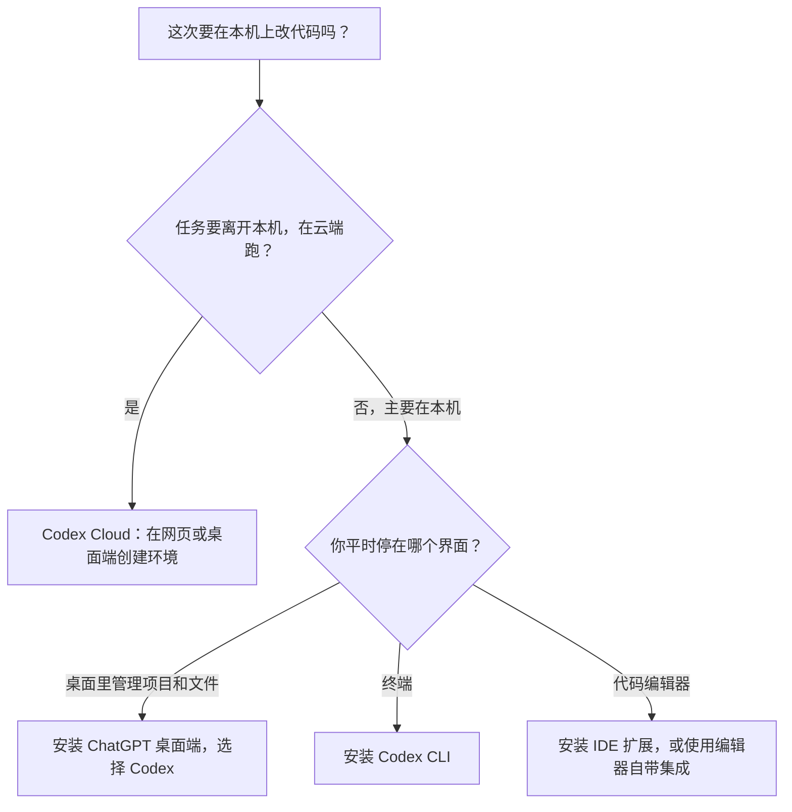

# 安装路线总览

> 核对依据：2026-10-26 阅读的官方文档为 Quickstart、ChatGPT desktop app、Linux desktop app、Codex CLI、Codex IDE extension、Authentication、Cloud environments。这些页面位于 developers.openai.com/codex，文档内链使用 learn.chatgpt.com。下文不写本环境没有复验过的菜单截图，逐步安装以各专文和官方页为准。

先选定一个入口，再打开本栏目里对应的安装文。ChatGPT 桌面端、Codex CLI、编辑器里的 Codex，以及 Codex Cloud，回答的是不同问题；第一次不需要全部装上。

## 这篇文章适合谁

适合还没安装 Codex，或者已经看到 App、CLI、IDE、网页和 Cloud 几个名字，但不知道从哪一条开始的读者。

已经能打开 App 或 CLI 的读者，不必再把每个入口装一遍。登录之后按 [登录 Codex](./07-登录Codex.md)、[打开第一个本地项目](./08-打开第一个本地项目.md) 和 [完成第一次修改并检查结果](./09-完成第一次修改并检查结果.md) 往下做；也可以直接做 [快速上手：完成第一个本地网页任务](../快速上手/)。

## 读完可以做什么

- 说出每个入口官方怎么定位，以及它适合谁。
- 按自己的系统和日常界面，打开本栏目里已经写好的安装文。
- 分清 ChatGPT 登录和 API Key 登录，并知道 Codex Cloud 要使用 ChatGPT 登录。

## 一句话结论

要在本机上看项目、改文件：用 ChatGPT 桌面端里的 Codex、Codex CLI，或编辑器里的 Codex。任务要离开本机、在云端跑：用 Codex Cloud，在网页或桌面端创建可复用环境。网页上的 Chat 和 Work 不用安装，用来问答和完成文档类交付。

## 五个入口分别适合谁

官方 Quickstart 把使用面分成桌面端和网页，并单独指出：要在终端或代码编辑器里用 Codex，安装 Codex CLI 或 Codex IDE 扩展；要做远程编程，在网页或桌面端创建 Codex Cloud 环境。

| 入口 | 官方怎么定位 | 适合谁 | 本栏目接着读 |
|---|---|---|---|
| ChatGPT 桌面端里的 Codex | 桌面端用于项目、本地文件和较长时间的任务。软件开发时，从 ChatGPT 下拉菜单选择 Codex。macOS、Windows 可从下载页安装；Linux 目前是预览。 | 希望在一个桌面里看项目、文件和长时间任务 | [macOS 安装 Codex App](./02-macOS安装Codex-App.md)、[Windows 安装 Codex App](./03-Windows安装Codex-App.md)。Linux 见下方说明 |
| Codex CLI | 在终端里查看代码、修改文件、运行本机已有命令；也可以把 `codex exec` 放进脚本和 CI | 主要工作在终端，或需要非交互、流水线 | [macOS 安装 Codex CLI](./04-macOS安装Codex-CLI.md)、[Windows 和 WSL 安装 Codex CLI](./05-Windows和WSL安装Codex-CLI.md) |
| 编辑器里的 Codex | 带着已经打开的文件和选中代码提问，就地看 diff；任务变长时可以交到云端。VS Code 及兼容编辑器安装扩展；Xcode 和 JetBrains 用各自的集成 | 人已经在编辑器里，希望边看代码边改一小块 | [VS Code 和兼容编辑器](./06-VS-Code和兼容编辑器安装Codex.md)、[JetBrains](./11-JetBrains中使用Codex.md)。[Xcode](./10-Xcode中使用Codex.md) 仍是待实操 |
| ChatGPT 网页 | 打开 chatgpt.com 并登录即可。Chat 用来问答和把一个题目聊清楚；Work 用来研究并做成文档、演示、表格或 Sites | 当前不改本机仓库，只在浏览器里使用 ChatGPT | 本栏目不展开网页版 Chat / Work |
| Codex Cloud | 在网页或桌面端为远程编程准备可复用环境。新任务里选择 **Work in** > **Cloud**，再 **Select environment** > **Create environment**。环境发布后，任务可在网页、手机或桌面端继续 | 任务要在云端跑，本机可以离开；也可以从 CLI 或 IDE 把变长的任务交出去 | 本栏目没有 Cloud 安装文。配置见 [Codex Cloud 云端环境](../12-官方工具与集成/12-Codex-Cloud云端环境-创建发布环境-联网与密钥设置.md) |

这张图只帮你决定**这一次从哪里开始**。官方文档也写明，CLI 和 IDE 都可以把变长的任务交到 Cloud；桌面端同样可以打开本地文件夹。

## 桌面端：macOS、Windows，以及 Linux 预览

ChatGPT 桌面端的官方下载页是 [chatgpt.com/download](https://chatgpt.com/download/)。macOS 和 Windows 的点击过程分别在本栏目的两篇安装文里。装好后打开应用，用 ChatGPT 账号登录；官方也允许改用 API Key，并说明部分功能可能不可用。需要写代码时，从 ChatGPT 下拉菜单选择 **Codex**，然后开始对话、创建项目，或打开一个文件夹。官方写明：ChatGPT 可以读取并修改你选中的文件夹里的文件。

Linux 桌面端目前是**预览**。官方指南列出的桌面发行版是 Ubuntu 24.04 LTS 与 26.04 LTS、Debian 13、Fedora 43 与 44，以及保持最新的 Arch Linux；x64 和 ARM64 都有对应包。本栏目还没有 Linux 桌面端专文，安装以 [ChatGPT desktop app for Linux](https://learn.chatgpt.com/docs/linux/linux-app) 为准。

## CLI：终端、脚本和 CI

官方 CLI 页把安装分成四条：macOS／Linux 的独立脚本、Windows 的 PowerShell 脚本、npm，以及 Homebrew。本栏目没有把四条命令再抄一遍：

- macOS 上的脚本、npm 和 `brew install --cask codex`，见 [macOS 安装 Codex CLI](./04-macOS安装Codex-CLI.md)。
- Windows 原生和 WSL 是两套彼此独立的环境，见 [Windows 和 WSL 安装 Codex CLI](./05-Windows和WSL安装Codex-CLI.md)。

装好后，在项目目录运行 `codex`。第一次运行时选择 **Sign in with ChatGPT**，或其他可用的登录方式。官方建议在任务前后做 Git 检查点，以便回退。

CLI 页把适合的用法收成四类：人在终端里工作；需要脚本或 CI；要在本地做代码审查；要把任务交到 Cloud。

## IDE：扩展和编辑器自带集成

官方 IDE 页把编辑器分成两类。VS Code 和兼容编辑器使用 Codex 扩展，列出的是 Visual Studio Code、Cursor、Windsurf、Visual Studio Code Insiders。Xcode 和 JetBrains 使用各自的集成，不走这条扩展。

打开方式也按这个分法写：

- **VS Code、Cursor 或 Windsurf**：点 Codex 图标。看不到图标时，打开命令面板，运行 **Codex: Open Codex Sidebar**。逐步安装见 [VS Code 和兼容编辑器安装 Codex](./06-VS-Code和兼容编辑器安装Codex.md)。
- **Xcode**：打开 coding assistant，新建对话，选择 Codex 作为 agent。本栏目的 [Xcode 中使用 Codex](./10-Xcode中使用Codex.md) 与这句官方说明一致，但篇幅很短，仍含计划中的配图清单，目录里继续标为「待实操与编写」。它不能当作已经在 Xcode 里逐步验证过的跟做教程。
- **JetBrains**：打开 AI Chat，选择 Codex。逐步操作见 [JetBrains 中使用 Codex](./11-JetBrains中使用Codex.md)。

官方把 IDE 里的 Codex 对应到这些情况：做范围清楚的修改、阅读还不熟悉的代码、就地审查改动，以及把更大的任务交到云端。

## 网页和 Codex Cloud

网页本身不用安装。官方 Quickstart 的 Web 步骤是打开 [chatgpt.com](https://chatgpt.com) 并登录，然后选择 Chat 或 Work。这是 ChatGPT 在浏览器里的用法。

远程编程走 Codex Cloud。官方 Quickstart 的创建路径是：在网页或桌面端的新任务里选择 **Work in** > **Cloud**，打开 **Select environment**，再选择 **Create environment**。Codex 会检查仓库，并帮助准备和测试，之后再发布。发布后的环境可以在网页、手机或桌面端里继续；手机上打开 Codex，选择已发布的环境。

Cloud environments 文档把一次云端任务写成：创建容器，按选定的分支或提交检出仓库，运行安装脚本，再由 agent 改代码和做检查。安装脚本阶段可以联网；agent 阶段默认不联网，需要时再单独打开。环境变量在整个任务期间可用；密钥只在安装脚本阶段可用，agent 阶段开始前会被移除。这些配置的中文说明见 [Codex Cloud 云端环境](../12-官方工具与集成/12-Codex-Cloud云端环境-创建发布环境-联网与密钥设置.md)。

## 登录先选一种

官方认证页写明两条本地登录路线：

- **用 ChatGPT 登录**：走订阅权益。桌面端、CLI 和 IDE 扩展都会打开浏览器完成登录。
- **用 API Key 登录**：按量计费，密钥从 OpenAI 平台控制台获取。桌面端、CLI 和 IDE 扩展都可以这样登录。依赖 ChatGPT 工作区或云服务的功能会受限或不可用。

Codex Cloud 要使用 ChatGPT 登录。API Key 不能代替这次登录。

使用 Cloud 前，官方还要求看账号的多因素认证：用邮箱和密码登录的账号，要先在账号上设置 MFA；如果账号同时有邮箱密码和其他登录方式，即使用另一种方式登录，也要先设置 MFA。使用 Google、Microsoft 或 Apple 登录时，不要求在 ChatGPT 账号上打开 MFA。通过 SSO 进入时，由组织的 SSO 管理员对用户要求 MFA。

按钮名称和本机上实际出现的登录选项，以 [登录 Codex](./07-登录Codex.md) 和官方认证页为准。登录完成，只说明这个入口可用，还不等于已经打开了练习目录。

## 选定入口之后

本地入口（桌面端、CLI、IDE）装好并登录后，下一步是同一条：

1. [登录 Codex](./07-登录Codex.md)，确认你选的那一个入口可用。
2. [打开第一个本地项目](./08-打开第一个本地项目.md)，只把明确的目录交给 Codex。
3. [完成第一次修改并检查结果](./09-完成第一次修改并检查结果.md)，看 diff，再决定是否保留。

装好之后还会用到的相邻文章，不在这次选择里展开：[Codex 更新与卸载](./12-Codex更新与卸载.md)、[安装登录常见问题](./13-安装登录常见问题.md)、[斜杠命令与快捷键](./14-斜杠命令与快捷键.md)、[从 Claude Code 或 Cursor 迁移](./15-从Claude-Code或Cursor迁移到Codex-用import导入配置与对话.md)。

若还要按工作习惯比较 App、CLI、IDE 和 Cloud，见 [App、CLI、IDE 和 Cloud 怎么选](../00-从这里开始/05-App-CLI-IDE和Cloud怎么选.md)。

## 参考资料

- [Quickstart](https://learn.chatgpt.com/docs/quickstart)（同页：[developers.openai.com/codex/quickstart](https://developers.openai.com/codex/quickstart)）
- [ChatGPT desktop app](https://learn.chatgpt.com/docs/app)
- [ChatGPT desktop app for Linux](https://learn.chatgpt.com/docs/linux/linux-app)
- [下载 ChatGPT 桌面端](https://chatgpt.com/download/)
- [Codex CLI](https://learn.chatgpt.com/docs/codex/cli)
- [Codex IDE extension](https://learn.chatgpt.com/docs/codex/ide)
- [Authentication](https://learn.chatgpt.com/docs/auth)
- [Cloud environments](https://learn.chatgpt.com/docs/environments/cloud-environments)
