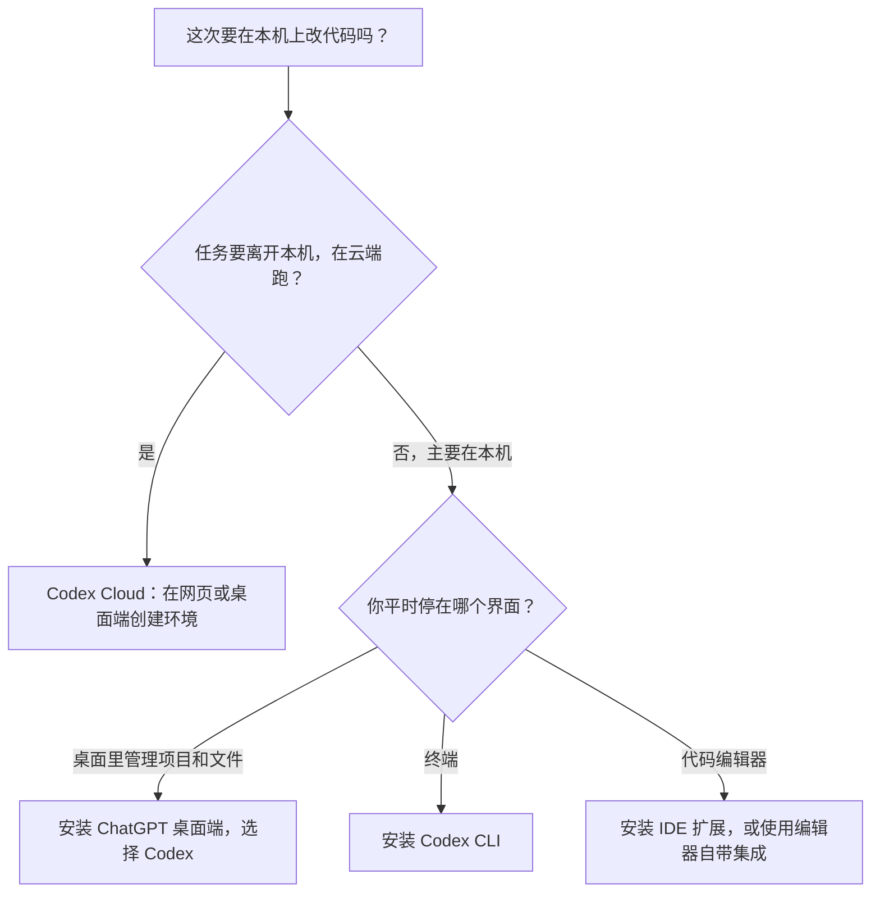

# Codex 安装路线总览（2026-11 更新）：补上 Linux App 专文，按系统选 App／CLI／IDE／Cloud

> 本文在线版：[codexguide.io/guides/codex-install-path-overview](https://codexguide.io/guides/codex-install-path-overview)

> 核对依据：2026-11-07 重读的官方文档为 [Quickstart](https://learn.chatgpt.com/docs/quickstart)、[ChatGPT desktop app](https://learn.chatgpt.com/docs/app)、[ChatGPT desktop app for Linux](https://learn.chatgpt.com/docs/linux/linux-app)、[Codex CLI](https://learn.chatgpt.com/docs/codex/cli)、[Codex IDE extension](https://learn.chatgpt.com/docs/codex/ide)、[Authentication](https://learn.chatgpt.com/docs/auth)、[Cloud environments](https://learn.chatgpt.com/docs/environments/cloud-environments)。这些页面位于 developers.openai.com/codex 时会跳到 learn.chatgpt.com。下文不写本环境没有复验过的菜单截图。逐步安装以各专文为准。

先选定一个入口，再打开本栏目里对应的安装文。ChatGPT 桌面端、Codex CLI、编辑器里的 Codex，以及 Codex Cloud，回答的是不同问题。第一次不需要全部装上。

## 这篇文章适合谁

适合还没安装 Codex，或者已经看到 App、CLI、IDE、网页和 Cloud 几个名字，但不知道从哪一条开始的读者。

已经能打开 App 或 CLI 的读者，不必再把每个入口装一遍。登录之后按 [登录 Codex](./07-登录Codex.md)、[打开第一个本地项目](./08-打开第一个本地项目.md) 和 [完成第一次修改并检查结果](./09-完成第一次修改并检查结果.md) 往下做。也可以直接做 [快速上手：完成第一个本地网页任务](../快速上手/)。

## 读完可以做什么

- 说出每个入口官方怎么定位，以及它适合谁。
- 按自己的系统和日常界面，打开本栏目里已经写好的安装文，包括 Linux 桌面端。
- 分清 ChatGPT 登录和 API Key 登录，并知道 Codex Cloud 要使用 ChatGPT 登录。

## 一句话结论

要在本机上看项目、改文件：用 ChatGPT 桌面端里的 Codex、Codex CLI，或编辑器里的 Codex。任务要离开本机、在云端跑：用 Codex Cloud，在网页或桌面端创建可复用环境。网页上的 Chat 和 Work 不用安装，用来问答和完成文档类交付。

## 五个入口分别适合谁

官方 Quickstart 把使用面分成桌面端和网页，并单独指出：要在终端或代码编辑器里用 Codex，安装 Codex CLI 或 Codex IDE 扩展；要做远程编程，在网页或桌面端创建 Codex Cloud 环境。2026-11-07 的 Quickstart 仍写明桌面端可用于 macOS、Windows 和 Linux，Linux 的支持范围指向 Linux 桌面端指南。

| 入口 | 官方怎么定位 | 适合谁 | 本栏目接着读 |
|---|---|---|---|
| ChatGPT 桌面端里的 Codex | 桌面端用于项目、本地文件和较长时间的任务。macOS、Windows 从下载页安装；Linux 目前是预览，有单独的安装指南。 | 希望在一个桌面里看项目、文件和长时间任务 | [macOS](./02-macOS安装Codex-App.md)、[Windows](./03-Windows安装Codex-App.md)、[Linux](./17-Linux安装Codex-App-Ubuntu-Debian-Fedora与Arch.md) |
| Codex CLI | 在终端里查看代码、修改文件、运行本机已有命令；也可以把 `codex exec` 放进脚本和 CI | 主要工作在终端，或需要非交互、流水线 | [macOS 安装 Codex CLI](./04-macOS安装Codex-CLI.md)、[Windows 和 WSL 安装 Codex CLI](./05-Windows和WSL安装Codex-CLI.md)。Linux 上的 CLI 与桌面端怎么分开，见 [Linux 专文](./17-Linux安装Codex-App-Ubuntu-Debian-Fedora与Arch.md) 的「和 CLI 怎么选」 |
| 编辑器里的 Codex | 带着已经打开的文件和选中代码提问，就地看 diff；任务变长时可以交到云端。VS Code 及兼容编辑器安装扩展；Xcode 和 JetBrains 用各自的集成 | 人已经在编辑器里，希望边看代码边改一小块 | [VS Code 和兼容编辑器](./06-VS-Code和兼容编辑器安装Codex.md)、[Xcode](./10-Xcode中使用Codex.md)、[JetBrains](./11-JetBrains中使用Codex.md) |
| ChatGPT 网页 | 打开 chatgpt.com 并登录即可。Chat 用来问答和把一个题目聊清楚；Work 用来研究并做成文档、演示、表格或 Sites | 当前不改本机仓库，只在浏览器里使用 ChatGPT | 本栏目不展开网页版 Chat / Work |
| Codex Cloud | 在网页或桌面端为远程编程准备可复用环境。新任务里选择 **Work in** > **Cloud**，再 **Select environment** > **Create environment**。环境发布后，任务可在网页、手机或桌面端继续 | 任务要在云端跑，本机可以离开；也可以从 CLI 或 IDE 把变长的任务交出去 | 本栏目没有 Cloud 安装文。配置见 [Codex Cloud 云端环境](../12-官方工具与集成/12-Codex-Cloud云端环境-创建发布环境-联网与密钥设置.md) |

这张图只帮你决定这次从哪里开始。官方文档也写明，CLI 和 IDE 都可以把变长的任务交到 Cloud。桌面端同样可以打开本地文件夹。

## 桌面端：macOS、Windows 和 Linux 预览

ChatGPT 桌面端的官方下载页是 [chatgpt.com/download](https://chatgpt.com/download/)。2026-11-07 的桌面端文档把安装写成：macOS 或 Windows 从下载页安装，Linux 按 [Linux 安装指南](https://learn.chatgpt.com/docs/linux/linux-app)。发第一条消息时选择 ChatGPT 或 Codex。在 Codex 里从 New chat 开始。官方写明 ChatGPT 可以读取并修改你选中的文件夹里的文件。官方也允许改用 API Key，并说明部分依赖 ChatGPT 工作区或云服务的功能会受限或不可用。

三条系统专文：

- [macOS 安装 Codex App](./02-macOS安装Codex-App.md)
- [Windows 安装 Codex App](./03-Windows安装Codex-App.md)
- [Codex App Linux 版安装教程：Ubuntu、Debian、Fedora 和 Arch](./17-Linux安装Codex-App-Ubuntu-Debian-Fedora与Arch.md)

Linux 桌面端目前是预览。2026-11-07 的 Linux 文档列出的桌面发行版仍是 Ubuntu 24.04 LTS 与 26.04 LTS、Debian 13、Fedora 43 与 44，以及保持完整更新的 Arch Linux。x64 和 ARM64 都有对应包。安装、更新和 Computer Use 尚未覆盖 Linux 预览，都写在这篇专文里，不在总览里重复命令。

## CLI：终端、脚本和 CI

官方 CLI 页把安装分成四条：macOS／Linux 的独立脚本、Windows 的 PowerShell 脚本、npm，以及 Homebrew。本栏目没有把四条命令再抄一遍：

- macOS 上的脚本、npm 和 `brew install --cask codex`，见 [macOS 安装 Codex CLI](./04-macOS安装Codex-CLI.md)。
- Windows 原生和 WSL 是两套彼此独立的环境，见 [Windows 和 WSL 安装 Codex CLI](./05-Windows和WSL安装Codex-CLI.md)。
- Linux 上只想用终端时，可以不装桌面端。桌面包的命令是 `chatgpt`，终端里的 `codex` 另装。分界和官方脚本的位置见 [Linux 专文](./17-Linux安装Codex-App-Ubuntu-Debian-Fedora与Arch.md) 的「和 CLI 怎么选」。

装好后，在项目目录运行 `codex`。第一次运行时选择 **Sign in with ChatGPT**，或其他可用的登录方式。官方建议在任务前后做 Git 检查点，以便回退。

CLI 页把适合的用法收成这些情况：人在终端里工作；需要脚本或 CI；要在本地做代码审查；要把任务交到 Cloud。0.167.0 的命令中心和登录子菜单见 [Codex CLI 0.167.0](../12-官方工具与集成/22-Codex-CLI-0.167-agent命令中心本机图片与GCP登录.md)，那是升级之后的能力，不是安装路线的第一步。

## IDE：扩展和编辑器自带集成

官方 IDE 页把编辑器分成两类。VS Code 和兼容编辑器使用 Codex 扩展，列出的是 Visual Studio Code、Cursor、Windsurf、Visual Studio Code Insiders。Xcode 和 JetBrains 使用各自的集成，不走这条扩展。

打开方式也按这个分法写：

- **VS Code、Cursor 或 Windsurf**：点 Codex 图标。看不到图标时，打开命令面板，运行 **Codex: Open Codex Sidebar**。逐步安装见 [VS Code 和兼容编辑器安装 Codex](./06-VS-Code和兼容编辑器安装Codex.md)。
- **Xcode**：打开 coding assistant，新建对话，选择 Codex 作为 agent。设置页的入口在 Apple 文档里是 Xcode > Settings 的 Intelligence，或 coding assistant 侧栏里的 “Get Started with Agents”。逐步说明、和 “ChatGPT in Xcode” 的差别，见 [Xcode 中使用 Codex](./10-Xcode中使用Codex.md)。那篇按官方文档整理，没有在 Xcode 里逐步验证，也没有操作截图。
- **JetBrains**：打开 AI Chat，选择 Codex。逐步操作见 [JetBrains 中使用 Codex](./11-JetBrains中使用Codex.md)。

官方把 IDE 里的 Codex 对应到这些情况：做范围清楚的修改、阅读还不熟悉的代码、就地审查改动，以及把更大的任务交到云端。

## 网页和 Codex Cloud

网页本身不用安装。官方 Quickstart 的 Web 步骤是打开 [chatgpt.com](https://chatgpt.com) 并登录，然后选择 Chat 或 Work。桌面端文档把 Chat / Work 的切换写在 ChatGPT 模式里，位于输入框上方。这是 ChatGPT 在浏览器或桌面里的用法，不是 Codex 的安装步骤。

远程编程走 Codex Cloud。2026-11-07 的 Quickstart 和 Cloud environments 文档仍是：在网页或桌面端的新任务里选择 **Work in** > **Cloud**，打开 **Select environment**，再选择 **Create environment**。发布后的环境可以在网页、手机或桌面端里继续。手机上打开 Codex，选择已发布的环境。

Cloud environments 文档把一次云端任务写成：创建容器，按选定的分支或提交检出仓库，运行安装脚本，再由 agent 改代码和做检查。安装脚本阶段可以联网。agent 阶段默认不联网，需要时再单独打开。环境变量在整个任务期间可用。密钥只在安装脚本阶段可用，agent 阶段开始前会被移除。这些配置的中文说明见 [Codex Cloud 云端环境](../12-官方工具与集成/12-Codex-Cloud云端环境-创建发布环境-联网与密钥设置.md)。

## 登录先选一种

官方认证页写明两条本地登录路线：

- **用 ChatGPT 登录**：走订阅权益。桌面端、CLI 和 IDE 扩展都会打开浏览器完成登录。
- **用 API Key 登录**：按量计费，密钥从 OpenAI 平台控制台获取。桌面端、CLI 和 IDE 扩展都可以这样登录。依赖 ChatGPT 工作区或云服务的功能会受限或不可用。

Codex Cloud 要使用 ChatGPT 登录。API Key 不能代替这次登录。认证页写明：Codex cloud 直接接触代码库，需要多因素认证。用 Google、Microsoft 或 Apple 登录时，不要求在 ChatGPT 账号上打开 MFA，可以在社交登录提供商那边设置。通过 SSO 进入时，由组织的 SSO 管理员对用户要求 MFA。用邮箱和密码登录的账号，要先在账号上设置 MFA。账号同时有邮箱密码和其他登录方式时，即使用另一种方式登录，也要先设置 MFA。

按钮名称和本机上实际出现的登录选项，以 [登录 Codex](./07-登录Codex.md) 和官方认证页为准。登录完成，只说明这个入口可用，还不等于已经打开了练习目录。

## 选定入口之后

本地入口（桌面端、CLI、IDE）装好并登录后，下一步是同一条：

1. [登录 Codex](./07-登录Codex.md)，确认你选的那一个入口可用。
2. [打开第一个本地项目](./08-打开第一个本地项目.md)，只把明确的目录交给 Codex。
3. [完成第一次修改并检查结果](./09-完成第一次修改并检查结果.md)，看 diff，再决定是否保留。

装好之后还会用到的相邻文章，不在这次选择里展开：[Codex 更新与卸载](./12-Codex更新与卸载.md)、[安装登录常见问题](./13-安装登录常见问题.md)、[斜杠命令与快捷键](./14-斜杠命令与快捷键.md)、[从 Claude Code 或 Cursor 迁移](./15-从Claude-Code或Cursor迁移到Codex-用import导入配置与对话.md)。

若还要按工作习惯比较 App、CLI、IDE 和 Cloud，见 [App、CLI、IDE 和 Cloud 怎么选](../00-从这里开始/05-App-CLI-IDE和Cloud怎么选.md)。

## 参考资料

- [Quickstart](https://learn.chatgpt.com/docs/quickstart)（同页：[developers.openai.com/codex/quickstart](https://developers.openai.com/codex/quickstart)）
- [ChatGPT desktop app](https://learn.chatgpt.com/docs/app)
- [ChatGPT desktop app for Linux](https://learn.chatgpt.com/docs/linux/linux-app)
- [下载 ChatGPT 桌面端](https://chatgpt.com/download/)
- [Codex CLI](https://learn.chatgpt.com/docs/codex/cli)
- [Codex IDE extension](https://learn.chatgpt.com/docs/codex/ide)
- [Authentication](https://learn.chatgpt.com/docs/auth)
- [Cloud environments](https://learn.chatgpt.com/docs/environments/cloud-environments)
