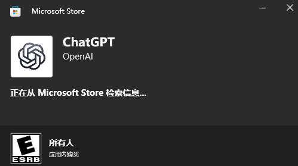
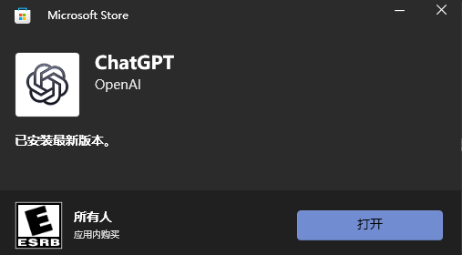
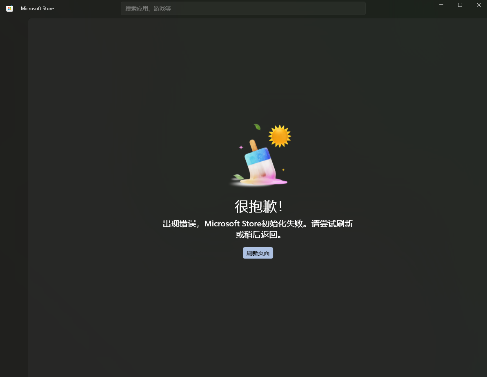
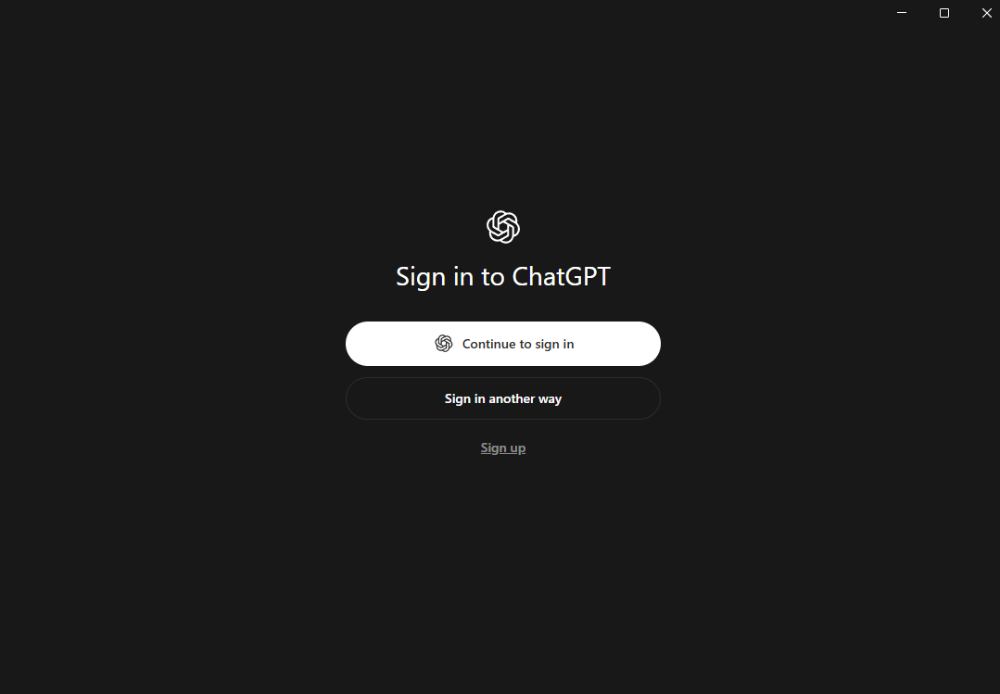

# Windows 安装 Codex App（2026-11 更新）：Microsoft Store、winget 和离线 MSIX，原生与 WSL2 怎么选

> 本文在线版：[codexguide.io/guides/windows-install-codex-app](https://codexguide.io/guides/windows-install-codex-app)

> 核对依据：OpenAI 文档 [ChatGPT desktop app for Windows](https://learn.chatgpt.com/docs/windows/windows-app) 和 [Deploy the Windows app and Codex CLI](https://learn.chatgpt.com/docs/enterprise/windows-deployment)（2026-11-03 抓取）。文中的 Windows 界面图是仓库里已有的真实截图，不是这次在 Windows 上重新安装得到的。右上角账号图标已打掉。本文没有在 Windows 上重新执行 Store、winget 或 MSIX 安装。

Windows 上的 Codex 在 ChatGPT 桌面端里。官方 Windows 应用页写的能力包括 worktree、定时任务、Git、内置浏览器、文件预览、插件和 Skills。Agent 可以跑在原生 Windows（PowerShell 和 Windows 沙箱），也可以改到 WSL2。

普通个人电脑用 Microsoft Store 或 `winget`。公司电脑访问不了商店时，用部署文档里的离线 MSIX。终端里的 `codex` 命令是另一条安装，见 [Windows 和 WSL 安装 Codex CLI](./05-Windows和WSL安装Codex-CLI.md)。

## 系统要求：文档没有写最低 Windows 版本

2026-11-03 的 Windows 应用页没有列出“Windows 10”或“Windows 11”这样的最低版本。安装走 Microsoft Store 或 MSIX，能不能装上，取决于这台系统是否接受该商店包。x64 和 Arm64 的离线包是分开的，先确认任务管理器或 `systeminfo` 里的系统类型，再选包。

部署文档写明：离线包仍然要联网才能使用 ChatGPT。没有单独的 MSI，也没有商店之外的 EXE。

## 方法一：Microsoft Store

打开 [ChatGPT 下载页](https://chatgpt.com/download)，核对地址栏是 ChatGPT 官方域名，再点 Windows。页面通常会进到 Microsoft Store。安装前确认应用名是 **ChatGPT**、发布者是 **OpenAI**。


图 1：仓库里已有的官方下载页截图，同时有 macOS 和 Windows 按钮。页面文案会变，下载前仍核对域名。



图 2：商店已经显示 ChatGPT 和 OpenAI，页面还停在“正在从 Microsoft Store 检索信息”。这是打开商店页时的中间状态。


图 3：详情里的发布者是 OpenAI。图上的星级和评价数只属于截图当时，不能当成现在的评分。

看到“已安装最新版本”和“打开”之后，安装完成。



图 4：安装完成后的商店页。点“打开”启动应用。

商店产品 ID 是 `9PLM9XGG6VKS`。企业用 Intune 从商店部署时，官方部署页也用这个 ID 搜索 “ChatGPT from OpenAI”。

## 方法二：winget

Windows 应用页和部署页给的命令相同：

```powershell
winget install --id 9PLM9XGG6VKS -s msstore
```

`-s msstore` 指定 Microsoft Store 源。部署页写明：安装程序会自动更新；安装或更新过程中可能出现 Microsoft Store 组件，用户不必自己在商店里浏览。个人电脑上如果商店客户端可用，这条命令和在商店里点安装是同一条通道。

更新和卸载的界面步骤见 [Codex 更新与卸载](./12-Codex更新与卸载.md) 的 Windows 一节，其中包含 `winget upgrade --id 9PLM9XGG6VKS -s msstore`。

## 方法三：离线 MSIX

商店打不开、或设备访问不了 Microsoft 的分发服务时，用 [Deploy the Windows app](https://learn.chatgpt.com/docs/enterprise/windows-deployment) 上的离线包。文档说这些链接下载的是该架构的最新版本，不是某一个历史版本。管理员在能联网的机器上下载，再拷到目标电脑。

自助安装的步骤，按部署页 “Install from an offline package”：

1. 下载 x64 或 Arm64 的 MSIX，以及离线许可证。把包改名为 `ChatGPT.msix`，和许可证放在同一文件夹。
2. 在该文件夹用管理员身份打开 Windows PowerShell，执行：

```powershell
Add-AppxProvisionedPackage -Online `
  -PackagePath .\ChatGPT.msix `
  -LicensePath .\ChatGPT-License.xml `
  -Regions all
```

3. 如果开始菜单里还没有应用，注销再登录，然后打开 ChatGPT，用工作账号登录。

部署页写明，这项安装要由管理员来做。Intune 和 Configuration Manager 的批量部署在同一页，产品 ID 同样是 `9PLM9XGG6VKS`。本文不展开 Intune 的点击路径。

## 商店初始化失败时

仓库里保存过一张真实的失败界面：文案是“出现错误，Microsoft Store 初始化失败。请尝试刷新或稍后返回。”按钮是“刷新页面”。



图 5：商店初始化失败。右上角原来的账号图标已用标题栏颜色盖住。

可以先点“刷新页面”，关掉商店再开，或换一次网络后从官方下载页重新进入。这些只能处理客户端或网络暂时异常。仍然失败时，改用上一节的官方离线 MSIX。

不要为了搜到应用去改 Windows 的国家或地区。不要打开第三方“商店链接生成器”去下载 `.msix`。那些站点不在 OpenAI 的安装文档里，文件来源和签名都不由官方页面保证。

## 首次打开并进入 Codex

安装后从开始菜单打开 ChatGPT。未登录时会看到登录页。仓库里已有的英文界面是：Continue to sign in、Sign in another way、Sign up。



图 6：已有的英文登录页，没有邮箱或头像。中文界面的同一页见 [登录 Codex](./07-登录Codex.md)。

登录方式、API Key 和浏览器授权的差别都在那篇文章里。本文没有新的“已经进入 Codex 工作区”截图。

官方 Windows 页还写了：如果 Codex 要运行需要提权的命令，把 ChatGPT 桌面端本身以管理员身份启动（开始菜单里对该应用选“以管理员身份运行”）。Agent 会继承这个权限级别。没有这种需要时，用普通身份打开。

## Agent 跑在原生 Windows 还是 WSL2

Windows 应用页的设置里有 Agent environment：

| 选项 | 含义 |
| --- | --- |
| Windows native | Agent 直接跑在 Windows 上，用 PowerShell 和 Windows 沙箱 |
| Windows Subsystem for Linux | Agent 跑在 WSL 里，使用 Linux 沙箱 |

在设置里从原生 Windows 改到 WSL 之后，必须重启应用，切换才会生效。文档写明重启后项目应仍在。

WSL1 支持到 Codex `0.114`。从 `0.115` 起，Linux 沙箱改为 `bubblewrap`，WSL1 不再支持。需要 WSL 时安装 WSL2。

集成终端和 Agent 是分开的。可以让 Agent 在 WSL、终端仍用 PowerShell，或两边都用 WSL。终端选项见应用里的开发环境设置，不在本文展开。

选哪边，看项目在哪：

- 仓库在 `C:\` 或 `D:\`，工具是 Git for Windows、PowerShell、`npm`：用原生 Windows。
- 仓库和命令一直在 Ubuntu/WSL 里：把 Agent 设为 WSL2。

官方页写了一条边界：原生 Windows 的 Agent 打开 `\\wsl$\` 上的项目时，Git 功能可能识别不到。要把仓库放在 Windows 盘上，再在 WSL 里通过 `/mnt/<盘符>/...` 访问。

沙箱在原生 Windows 上怎么开、MXC 和 elevated 回退，见 [Codex Windows 沙箱](../10-配置模型与权限安全/09-Codex-Windows沙箱-启用MXC与elevated-unelevated回退.md)。应用页提醒：在输入框下方选 Ask for approval，沙箱才会套用；Full access 时 Codex 不受项目目录限制。

## 准备开发工具

Windows 应用页列出 Agent 常用的工具，并用 `winget` 安装：

```powershell
winget install --id Git.Git
winget install --id OpenJS.NodeJS.LTS
winget install --id Python.Python.3.14
winget install --id Microsoft.DotNet.SDK.10
winget install --id GitHub.cli
```

装完 GitHub CLI 后运行 `gh auth login`，桌面端里的 GitHub 功能才可用。文档说，如果要别的 Python 或 .NET 版本，换成对应的包 ID。上面的 `Python.Python.3.14` 和 `Microsoft.DotNet.SDK.10` 是 2026-11-03 文档页上的 ID，不是“必须用这个语言版本才能打开 Codex”。

Git 没装在 Windows 上时，应用的部分 Git 功能不可用。在 PowerShell 或 `cmd.exe` 里执行 `winget install Git.Git`。

PowerShell 若从未跑过 `npm`，可能出现执行策略错误。文档举的例子是：

```text
npm.ps1 cannot be loaded because running scripts is disabled on this system.
```

文档给的常见改法是：

```powershell
Set-ExecutionPolicy -ExecutionPolicy RemoteSigned
```

改之前先看 Microsoft 的 [about_Execution_Policies](https://learn.microsoft.com/powershell/module/microsoft.powershell.core/about/about_execution_policies)。这是系统策略，不是 Codex 的配置项。

## 配置目录和 CODEX_HOME

Windows 应用和 Windows 上的原生 Codex 使用同一个目录：`%USERPROFILE%\.codex`。

WSL 里的 Codex CLI 默认用 Linux 家目录，因此不会自动带上 Windows 的配置、登录缓存和会话记录。官方页给的共用办法有两种：把 WSL 的 `~/.codex` 和 `%USERPROFILE%\.codex` 同步，或在 WSL 里指定：

```bash
export CODEX_HOME=/mnt/c/Users/<windows-user>/.codex
```

要每次打开 shell 都生效，把这行放进 `~/.bashrc` 或 `~/.zshrc`。把 `<windows-user>` 换成 Windows 用户目录名。这个路径会出现在环境变量里，截图和日志里不要带上真实用户名。

## 常见安装问题

**winget 找不到这个 ID。** 确认命令里有 `-s msstore`，并且本机允许访问 Microsoft Store。商店源被策略关掉时，winget 不会装出这个应用，改用离线 MSIX。

**装完开始菜单里没有图标。** 离线安装后，部署页写的是注销再登录。仍然没有，再核对 MSIX 架构是不是和这台电脑一致。

**Cmder 不在打开对话框里。** 官方页的处理是：右键 Cmder，选 Add to Start，然后重启 Codex 或重启电脑。

**和 CLI 抢同一份登录。** 桌面端写的是 Windows 的 `%USERPROFILE%\.codex`。WSL 里的 CLI 要共用时才设置 `CODEX_HOME`。两边各用各的家目录时，登录状态不会自动同步，这是文档描述的默认行为。

## 下一步

登录见 [登录 Codex](./07-登录Codex.md)。只装终端里的 `codex`，走 [Windows 和 WSL 安装 Codex CLI](./05-Windows和WSL安装Codex-CLI.md)。原生 Windows 上的沙箱见 [Codex Windows 沙箱](../10-配置模型与权限安全/09-Codex-Windows沙箱-启用MXC与elevated-unelevated回退.md)。

## 参考资料

- [ChatGPT desktop app for Windows](https://learn.chatgpt.com/docs/windows/windows-app)
- [Deploy the Windows app and Codex CLI](https://learn.chatgpt.com/docs/enterprise/windows-deployment)
- [ChatGPT 下载页](https://chatgpt.com/download)
- [about_Execution_Policies](https://learn.microsoft.com/powershell/module/microsoft.powershell.core/about/about_execution_policies)
