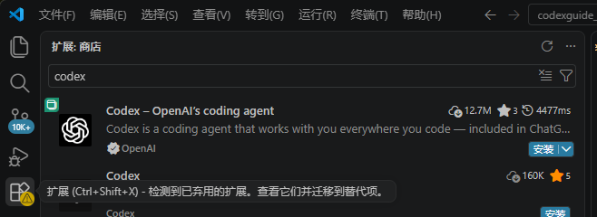
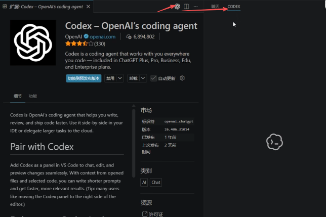
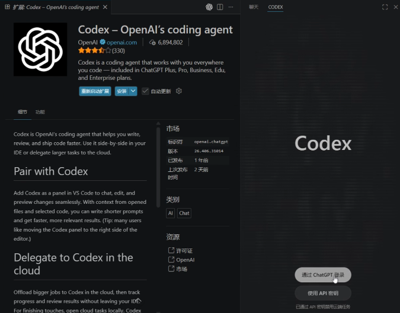
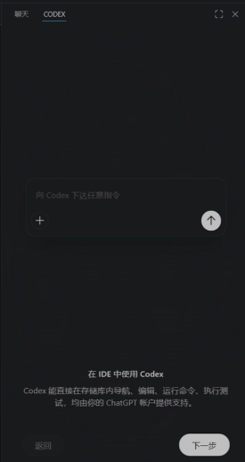
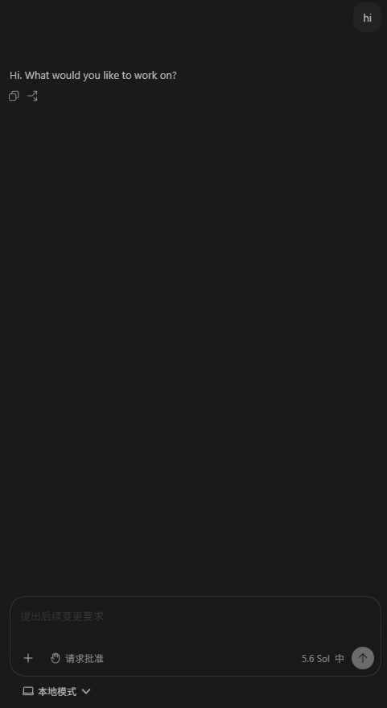
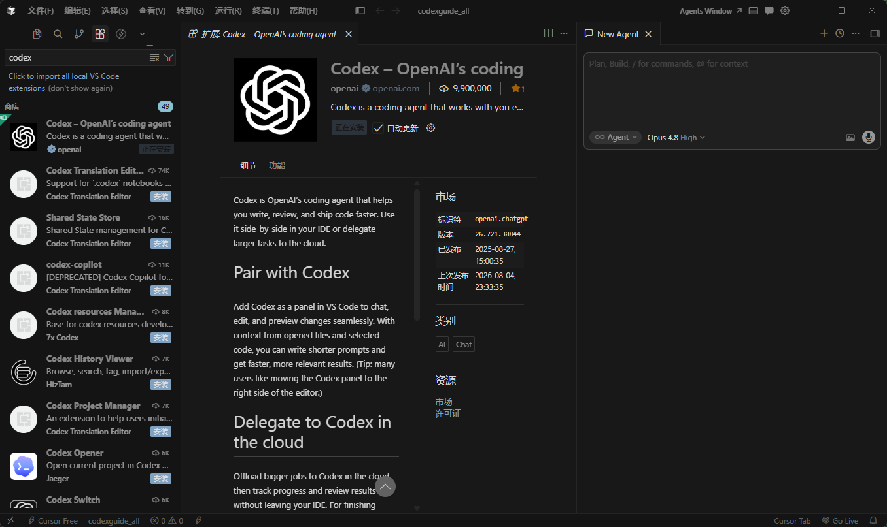
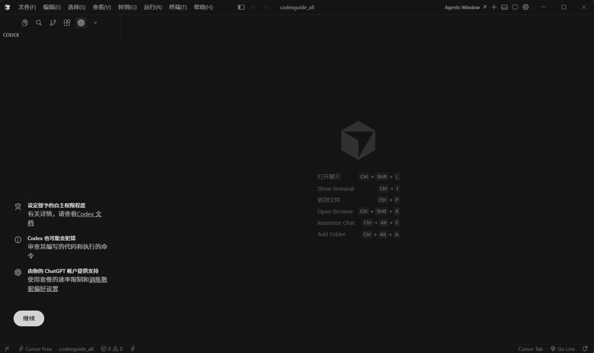
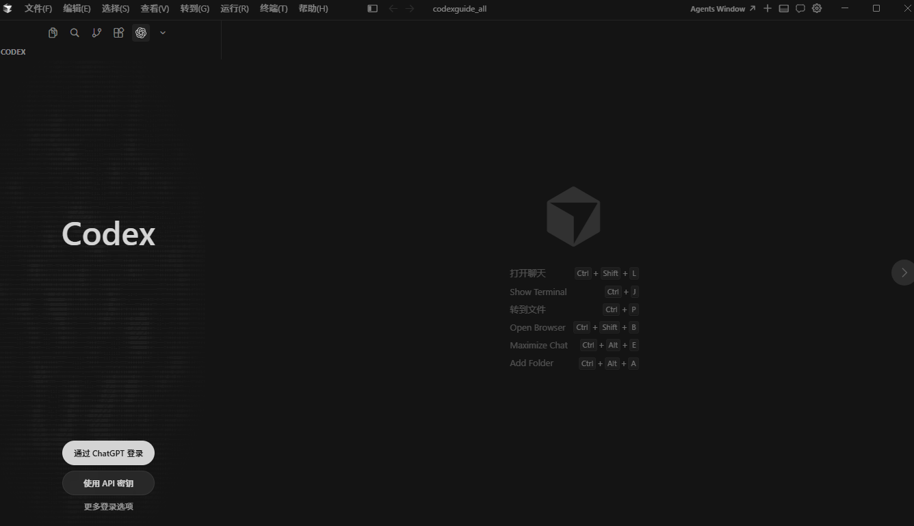

# VS Code 和兼容编辑器安装 Codex

> 本文按当前界面整理。编辑器更新后，按钮名称和位置可能会变化，请以你看到的实际界面为准。

Codex 可以直接安装到 VS Code、Cursor 等兼容编辑器中。安装完成后，打开 Codex 侧栏，完成登录，就可以在项目文件的上下文中使用它。

## 先说结论

- **VS Code**：从扩展市场搜索 Codex，核对发布者 OpenAI、认证标志和标识符 `openai.chatgpt` 后安装。
- **Cursor**：操作方式与 VS Code 接近，扩展市场和 Codex 入口的位置可能略有不同。官方文档列出的兼容编辑器还包括 Windsurf。
- **第一次使用**：安装后可以通过 ChatGPT 登录，也可以使用 API 密钥，然后按引导完成首次设置。
- **开始处理项目**：先打开项目文件夹。当前打开的文件和选中的代码会作为上下文，其他参考文件可以另外添加。

> **安全提醒**：密钥、令牌和其他敏感信息不要加入 Codex 上下文。安装扩展时，也要先核对官方发布者和认证标志。

---

## 一、在 VS Code 中安装 Codex

### 1. 打开扩展市场

打开 VS Code 的扩展市场。扩展图标通常在左侧边栏，图标是四个小方块。

搜索 `Codex`，搜索结果里可能有多个同名扩展。官方扩展的名称是“Codex – OpenAI's coding agent”，发布者是带认证标志的 OpenAI。

### 2. 核对扩展详情并安装

点击搜索结果，进入扩展详情页。确认发布者是 OpenAI，右侧“市场”信息里的标识符是 `openai.chatgpt`，再点击“安装”。

安装完成后，编辑器右上方和侧栏顶部会出现 Codex 入口，也就是图中箭头指向的位置。

### 3. 打开 Codex 侧栏

点击 Codex 图标打开侧栏。没有看到图标时，打开命令面板（Windows 上按 `Ctrl+Shift+P`，macOS 上按 `Cmd+Shift+P`），运行 `Codex: Open Codex Sidebar`。

### 4. 登录

网络正常时，侧栏会显示登录界面，可以选择“通过 ChatGPT 登录”或“使用 API 密钥”。

点击“通过 ChatGPT 登录”后，浏览器会打开登录页面。完成登录和授权后，回到 VS Code，侧栏会刷新为已登录状态。

如果侧栏没有显示登录界面，或者登录页面打不开，先检查网络和代理设置再重试。扩展已经安装，并不代表登录服务一定能够正常连接。

> **登录时不要急着关页面**：如果浏览器没有自动切回编辑器，直接返回原来的 VS Code 窗口，重新查看 Codex 侧栏。登录完成前，不要关闭浏览器或编辑器。

### 5. 完成首次设置

登录后，侧栏会显示首次使用的说明，按引导点击“下一步”。

设置完成后，侧栏会进入对话界面，可以发送第一条消息。

---

## 二、打开项目并添加上下文

### 1. 打开项目文件夹

从左上角的“文件”菜单选择“打开文件夹”，打开要处理的项目。Codex 只能看到你打开的项目里的文件。

### 2. 先发一个只读请求

打开项目后，当前打开的文件和选中的代码会作为上下文。需要其他参考文件时，可以通过输入框左下角的“+”添加。

第一次使用时，建议先让 Codex 只读了解项目，或者解释一个函数，并在请求里写明“不要修改文件”。

> **建议的第一次任务**：先让 Codex 解释一个函数，或完成一个范围很小的修改。确认修改、检查和撤销流程都正常后，再交给它更大的任务。

---

## 三、在 Cursor 中安装 Codex

Cursor 的操作方式与 VS Code 接近，扩展市场和 Codex 入口的位置会随版本变化。

### 1. 搜索并安装 Codex

打开 Cursor 的扩展市场，搜索 `Codex`。和 VS Code 一样，核对发布者 OpenAI 和标识符 `openai.chatgpt` 后点击“安装”。

### 2. 找到 Codex 入口

安装后，Codex 入口可能收在侧栏顶部的下拉菜单里。点击下拉箭头，选择 Codex。

仍然没有看到 Codex 时，先切换到其他面板再切回来；还是没有，就重启 Cursor。

### 3. 阅读说明并登录

第一次打开时，侧栏会先显示权限、可能出错和账户用量的说明，点击“继续”。

然后点击“通过 ChatGPT 登录”，按浏览器中的提示完成登录，再回到 Cursor。VS Code 和 Cursor 可以使用同一个 ChatGPT 账号。

---

## 四、常见问题

- **安装后找不到入口**：确认扩展已经安装，再运行命令面板里的 `Codex: Open Codex Sidebar`。也可以重启编辑器，让扩展重新加载。
- **搜索结果里有多个 Codex**：只安装发布者为 OpenAI、带认证标志、标识符为 `openai.chatgpt` 的扩展。
- **没有显示登录页面**：先检查网络和代理设置。页面打不开时，反复点击登录不会解决问题。
- **浏览器登录后编辑器仍未登录**：回到原来的编辑器窗口，重新打开 Codex 侧栏；还是没有变化，就重启编辑器。
- **Windows 上提示“完成 Windows 设置以继续”**：点击提示里的“继续”，按引导完成设置后，Codex 才能创建文件、编辑代码或执行操作。
- **Codex 看不到项目文件**：确认打开的是项目文件夹，并在请求中添加需要参考的文件或当前文件。

## 小结

安装完成后，先确认登录状态，再打开项目文件夹并添加上下文。第一次使用从小任务开始，确认流程正常后，再逐步扩大任务范围。

## 参考资料

- [OpenAI：Codex IDE extension](https://learn.chatgpt.com/docs/codex/ide)
- [Visual Studio Marketplace：Codex – OpenAI's coding agent](https://marketplace.visualstudio.com/items?itemName=OpenAI.chatgpt)
