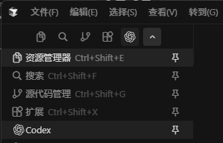
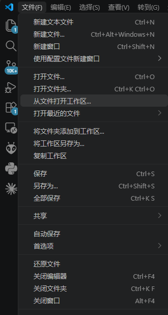

# VS Code、Cursor 和 Windsurf 安装 Codex（2026-10 更新）：核对官方扩展 openai.chatgpt、登录与首次设置

> 本文在线版：[codexguide.io/guides/vs-code-jian-rong-bian-ji-qi-an-zhuang-codex](https://codexguide.io/guides/vs-code-jian-rong-bian-ji-qi-an-zhuang-codex)

> 核对依据：[Codex IDE extension](https://learn.chatgpt.com/docs/codex/ide)、[Visual Studio Marketplace](https://marketplace.visualstudio.com/items?itemName=openai.chatgpt) 页面与 Gallery API、[Open VSX API](https://open-vsx.org/api/openai/chatgpt)、[Authentication](https://learn.chatgpt.com/docs/auth)、[VS Code 扩展市场文档](https://code.visualstudio.com/docs/configure/extensions/extension-marketplace)。市场数字核对于 2026-10-31。本文没有在编辑器里重新走完安装，保留的三张图是仓库里已有的实拍，图注写明画面里实际有什么。版本号以市场页面为准，不以旧截图上的版本为准。

Codex 可以装进 VS Code，以及官方文档列出的 Cursor、Windsurf 和 VS Code Insiders。装之前先认出官方扩展，再登录、打开项目。

2026 年 10 月 29 日 Cursor 扩展市场出现过被篡改的 Claude Code 扩展。没有证据表明 Codex 扩展受影响。自查命令和失陷指标写在 [Codex IDE 扩展安全自查](../10-配置模型与权限安全/19-Codex-IDE扩展安全自查-确认官方openai.chatgpt与扩展投毒防范.md)。下面的安装步骤把来源核对放进每一步。

## 先说结论

- 官方标识符是 `openai.chatgpt`，发布者在 Visual Studio Marketplace 上是已验证域名 openai.com 的 OpenAI。
- 2026-10-31 的版本是 `26.51021.22027`。Marketplace 上这条版本的更新时间是 2026-10-23 21:27 UTC（北京时间 2026-10-24 05:27）。
- 登录可以用 ChatGPT 账号，也可以用 API 密钥。官方认证文档对桌面应用、CLI 和 IDE 扩展都列出了这两种。
- 开始改项目之前，先打开文件夹。当前文件和选中的代码会作为上下文。

密钥和令牌不要放进 Codex 的上下文。

## 装之前：怎么认出官方扩展

同时满足下面几项再点安装：

| 核对项 | 官方值 |
|---|---|
| 标识符 | `openai.chatgpt` |
| 显示名 | Codex – OpenAI’s coding agent |
| Marketplace 发布者 | OpenAI，域名 openai.com，已验证 |
| 当前版本 | `26.51021.22027`（2026-10-31） |
| 最低引擎 | `^1.96.2` |

Marketplace 页面同一天显示 16,214,174 次安装，说明文字是不含更新。Gallery API 的 `install` 字段是 16,181,564。两个数不一致，都会变，不能用来判断真伪。

Open VSX 上同一标识符 `verified` 为 true，版本相同，时间戳 `2026-10-26T20:54:33Z`（北京时间 2026-10-27 04:54），下载量 12,919,792。API 里的发布记录是 GitHub 用户 `shijie-oai`，命名空间是 `openai`。看命名空间、verified 和版本，不要只看显示名。

搜索 “Codex” 会遇到其他扩展。名字像，标识符不是 `openai.chatgpt`，就不要装。

## VS Code

官方文档的按钮是 `vscode:extension/openai.chatgpt`，对应市场页面：

[https://marketplace.visualstudio.com/items?itemName=openai.chatgpt](https://marketplace.visualstudio.com/items?itemName=openai.chatgpt)

也可以在 Quick Open（Ctrl+P，macOS 为 Cmd+P）里粘贴市场页面给出的命令：

```text
ext install openai.chatgpt
```

装完后点 Codex 图标。图标不在侧栏时，打开命令面板（Ctrl+Shift+P，macOS 为 Cmd+Shift+P），运行：

```text
Codex: Open Codex Sidebar
```

这是官方 IDE 文档写的命令，VS Code、Cursor 和 Windsurf 共用这一句。

## Cursor

官方入口是 `cursor:extension/openai.chatgpt`。Cursor 有自己的扩展市场。2026-10-29 的安全事件发生在那个市场里的 Claude Code 包上，通告写明审计后没有其他扩展被篡改。安装时仍然要看本机详情里的标识符是不是 `openai.chatgpt`。

活动栏的图标有时收在溢出菜单里。下面这张图是此前在 Cursor 里拍的，菜单中有一项 Codex，没有版本号。你的版本里，图标可能直接在活动栏上，也可能还在这个菜单里。



图中菜单项包括资源管理器、搜索、源代码管理、扩展和 Codex。找不到时，用上一节的 `Codex: Open Codex Sidebar`，或重启 Cursor 后再看。

## Windsurf 和 VS Code Insiders

官方 IDE 文档把这两个也列在安装入口里：

- Windsurf：`windsurf:extension/openai.chatgpt`
- VS Code Insiders：打开同一条 Marketplace 页面 `itemName=openai.chatgpt`，不是另一个扩展 ID

Windsurf 是否只从 Open VSX 拉取，官方这篇 IDE 文档没有写。无论它打开的是哪一个市场页面，详情里都要看到标识符 `openai.chatgpt`。Open VSX 上的核对项见上一节。

Insiders 和稳定版 VS Code 可以各装一份。两边都用 `code-insiders --list-extensions --show-versions` 或稳定版的 `code --list-extensions --show-versions` 分开看。`code-insiders` 这条是按 VS Code 文档里 `code --list-extensions` 的同一类命令来写的，本文没有在 Insiders 里执行。

## 登录和首次设置

官方认证文档写明，IDE 扩展支持：

- **ChatGPT 登录**：使用 ChatGPT 订阅或工作区里的 Codex 权限。
- **API 密钥**：按 OpenAI Platform 的 API 用量计费。

更完整的登录差异见 [登录 Codex](./07-登录Codex.md)。

下面这张图是此前在 Cursor 里拍的 Codex 侧栏。画面上有两个主按钮：「通过 ChatGPT 登录」和「使用 API 密钥」，下面还有一行「更多登录选项」。本文只把前两个按钮对应到官方认证文档。第三行以你当前版本的界面为准，不把它写成必须使用的第三种登录方式。


点 ChatGPT 登录后，浏览器会打开授权页。完成后回到原来的编辑器窗口，再看侧栏。登录没有完成时，不要关掉浏览器或编辑器。

侧栏没有出现登录按钮时，先看网络和代理。扩展已经安装，只说明编辑器加载了扩展，不说明登录服务一定连得上。登录失败的其他情况见 [安装登录常见问题](./13-安装登录常见问题.md)。

仓库里还有几张更早的首次引导和对话截图，上面的扩展版本或模型名已经不是 2026-10-31 的市场版本，这次改写没有继续使用。首次引导的按钮文字以你打开侧栏后看到的为准。

## 打开项目并添加上下文

官方 IDE 文档写明：打开项目后再开始对话，当前打开的文件和选中的代码可以放进 composer。改完可以在编辑器旁边看 diff。任务变大时，可以从 IDE 交给云端，再回到可审查的结果。文档还建议在任务前后做 Git checkpoint，方便回退。

VS Code 里从文件菜单打开文件夹。下面这张图是文件菜单：能看到「打开文件夹」，快捷键显示为 Ctrl+K Ctrl+O。高亮的是下一项「从文件打开工作区」，不要把高亮那一项当成打开文件夹。



第一次先发一个只读请求，例如解释当前函数，并写明不要修改文件。确认侧栏、上下文和撤销都符合预期之后，再交给它会改文件的任务。

Codex 只能读到你打开的工作区。多根工作区时，官方 [Projects and chats](https://learn.chatgpt.com/docs/projects) 写明：IDE 扩展把当前打开的文件夹或工作区当作本地项目，要为对话选中工作区根。扩展不提供网页和桌面应用里的 ChatGPT Projects 视图。

## 怎么看已装版本、怎么更新

VS Code 文档中的命令：

```bash
code --list-extensions --show-versions
```

输出里应有 `openai.chatgpt`。2026-10-31 的市场版本是 `26.51021.22027`。之后可以更新，标识符不能变成别的。

Cursor、Windsurf 若提供兼容命令行，常见写法是在对应命令上加 `--list-extensions --show-versions`。本文没有在这两款编辑器里执行。

自动更新由 VS Code 的 `extensions.autoUpdate` 控制，也可以对单个扩展右键切换 Auto Update。默认会延迟约 12 小时（`extensions.autoUpdateDelay`）。这不是“Codex 已受市场投毒影响”的结论。要不要关，见安全自查那篇。更新时仍然只接受标识符为 `openai.chatgpt` 的包。

扩展页上的 Update 会立刻安装，不等那 12 小时。

## 常见问题

**安装后没有图标。** 运行 `Codex: Open Codex Sidebar`。仍没有，重启编辑器，并确认扩展列表里是 `openai.chatgpt` 而不是另一个名字里带 Codex 的扩展。

**Windows 提示先完成 Windows 设置。** 按编辑器里的提示做完，否则 Codex 不能创建或修改文件。这条来自旧文记录的界面提示，2026-10-31 没有在 Windows 上重装验证。提示文字变了，以当前界面为准。

**浏览器授权完，编辑器仍是未登录。** 回到原来的窗口重新打开侧栏。还是未登录，重启编辑器。不要在授权页没完成时反复点登录。

**Codex 看不到项目文件。** 确认打开的是文件夹或工作区，不是单个文件。需要别的文件时，按侧栏里添加上下文的控件把它加进这一轮。控件的图标会随版本变化，官方文档写的是可以把打开的文件、选区和最近的对话放进 composer。

## 下一步

登录方式的差别看 [登录 Codex](./07-登录Codex.md)。装完仍连不上，看 [安装登录常见问题](./13-安装登录常见问题.md)。要核对这次 Cursor 市场事件和本机扩展，看 [Codex IDE 扩展安全自查](../10-配置模型与权限安全/19-Codex-IDE扩展安全自查-确认官方openai.chatgpt与扩展投毒防范.md)。

## 参考资料

- [OpenAI：Codex IDE extension](https://learn.chatgpt.com/docs/codex/ide)
- [OpenAI：Authentication](https://learn.chatgpt.com/docs/auth)
- [OpenAI：Projects and chats](https://learn.chatgpt.com/docs/projects)
- [Visual Studio Marketplace：openai.chatgpt](https://marketplace.visualstudio.com/items?itemName=openai.chatgpt)
- [Open VSX API：openai/chatgpt](https://open-vsx.org/api/openai/chatgpt)
- [VS Code：Extension Marketplace](https://code.visualstudio.com/docs/configure/extensions/extension-marketplace)
