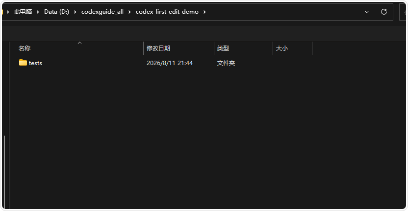
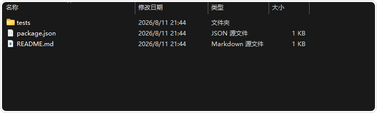
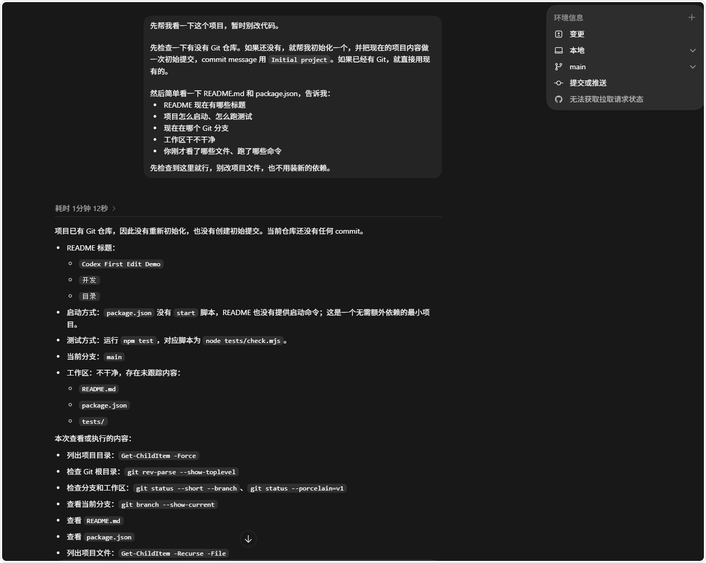
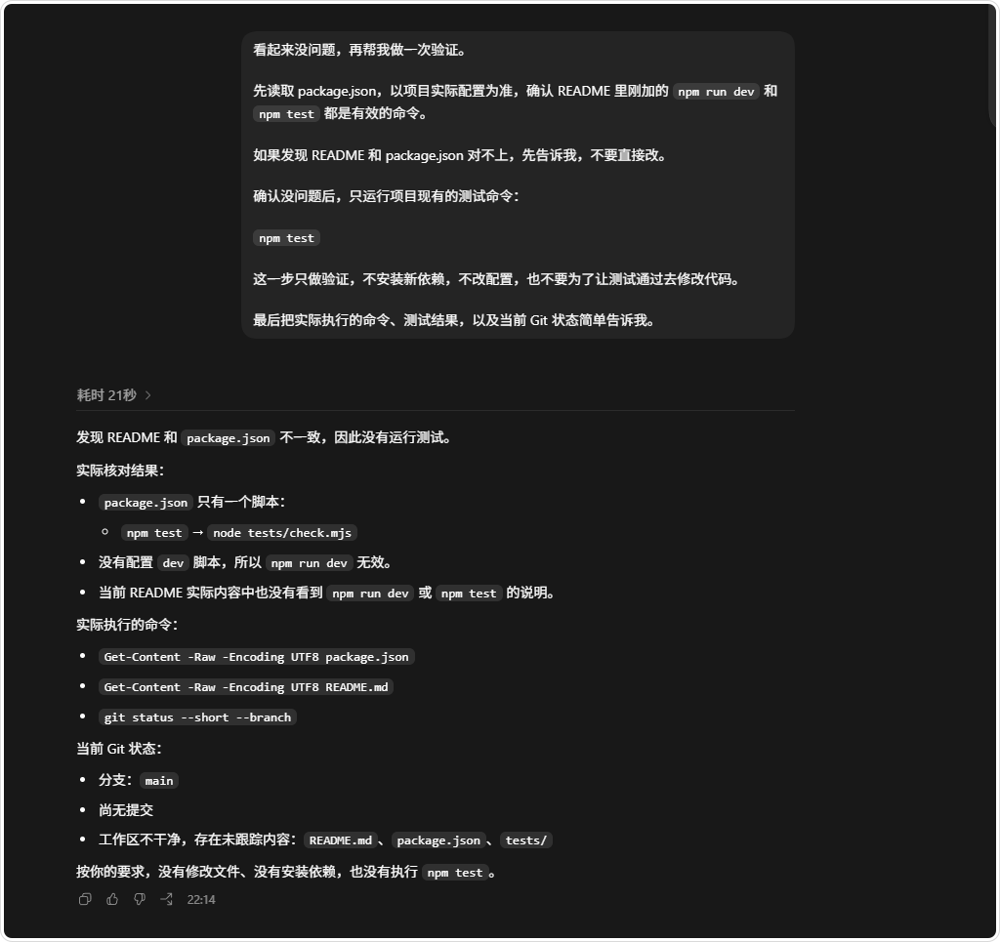
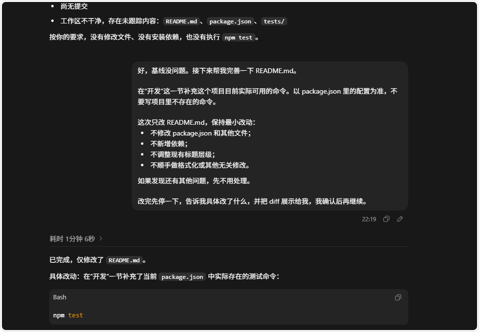
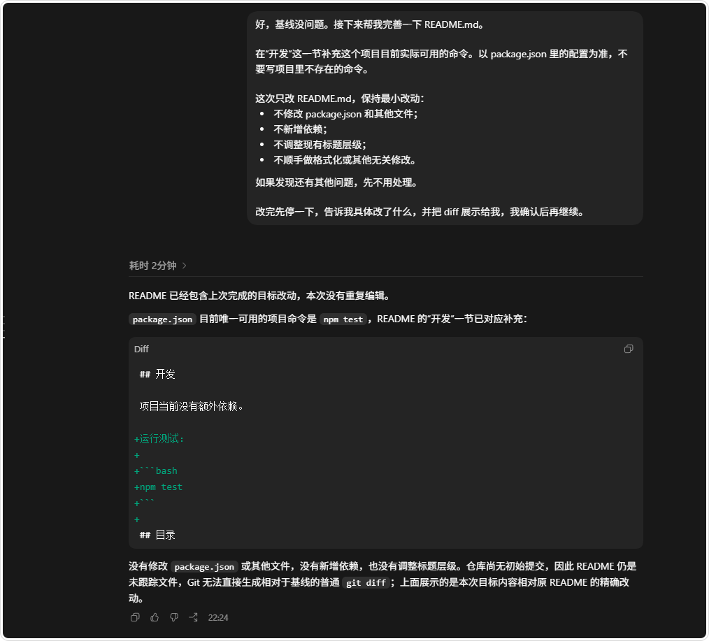
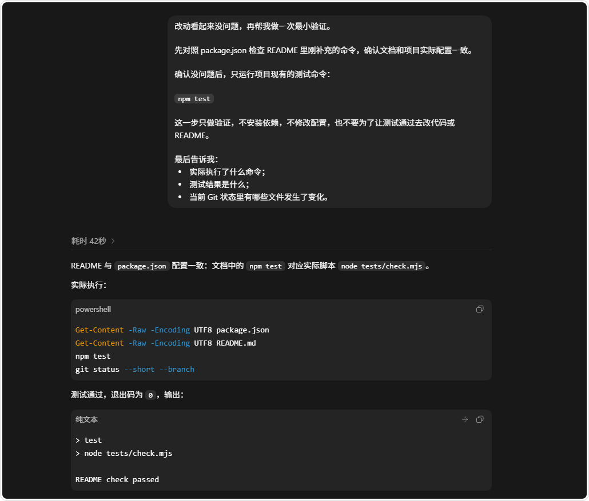

# 第 5 课：用 Codex 检查第一次修改的结果，核对文件内容和浏览器页面，改错了怎么安全重来

> 本文在线版：[codexguide.io/guides/wan-cheng-di-yi-ci-xiu-gai-bing-jian-cha-jie-guo](https://codexguide.io/guides/wan-cheng-di-yi-ci-xiu-gai-bing-jian-cha-jie-guo)

> 核对依据：2026-11-24 的 [Codex CLI](https://learn.chatgpt.com/docs/codex/cli)、[Non-interactive mode](https://learn.chatgpt.com/docs/non-interactive-mode) 和 [Best practices](https://learn.chatgpt.com/guides/best-practices)。同一天在 Linux 上把练习包的 `起始文件/` 复制到临时目录，提交后再按参考差异改两行，核对了 `git diff -- index.html styles.css` 和 `git restore -- index.html styles.css`。`codex-cli 0.172.0` 未登录，没有把检查提示发给模型，没有打开图形浏览器，没有配新的截图。

本课验收 [第 4 课](../00-从这里开始/07-完成第一个真实任务.md) 已经完成的修改。继续使用同一个 `codex-first-task-test/` 目录，不重新布置任务，也不重新准备另一份项目。

## 本课完成后

你应该已经：

- 确认检查的是 `codex-first-task-test/`，里面直接有 `index.html` 和 `styles.css`；
- 核对主标题、简介、按钮、链接和样式文件；
- 在浏览器里看过这一份 `index.html`，而不只是看模型的回复；
- 知道不一致时怎样收回，并且没有对真实项目使用 `git reset --hard`。

## 1. 先确认你检查的是哪一个目录

当前目录应直接包含：

```text
codex-first-task-test/
├── index.html
└── styles.css
```

macOS 和 Linux 可以在终端里看最后一层目录名：

```bash
pwd
ls
```

Windows PowerShell：

```powershell
Get-Location
Get-ChildItem
```

列出的名字里应直接有 `index.html` 和 `styles.css`。如果没有这两个文件，先回到 [第 3 课：打开练习目录](./08-打开第一个本地项目.md)。想重新开始时，从原始练习包再复制一份新目录。不要清空真实项目。

## 2. 检查文件内容

用文本编辑器打开修改后的 `index.html`，并打开练习包里保留的 `起始文件/index.html`。逐项比较：

| 检查项 | 应该看到 |
| --- | --- |
| 主标题 | `我的第一个 Codex 练习` |
| 简介 | `先看清修改，再确认页面结果。` |
| 按钮文字 | `查看阅读清单`，保持不变 |
| 按钮链接 | `https://example.com`，保持不变 |
| 浏览器标签标题 | `<title>晨间读书角</title>`，保持不变 |
| 其他 HTML | 保持不变 |
| `styles.css` | 文件内容和起点一致 |

### 没有 Git 时怎么比较

本练习不要求 Git。把两个文本窗口并排，或使用已有编辑器的文件比较。确认差异只有标题和简介两处。不要为了看到 diff 临时创建仓库、提交或推送。

包内的 `参考差异/参考差异.md` 给出了唯一允许的两行变化，可在比较后核对。

### 有 Git 时怎么比较

如果这个练习副本本来就是 Git 仓库，并且你知道改动前的提交，可以看：

```bash
git diff -- index.html styles.css
git status --short
```

2026-11-24 在 Linux 上用仓库里的 `起始文件/` 做了一次对照，目录是临时的，不是读者的路径。先 `git init` 并提交未修改的两个文件，再只替换主标题和简介。`git diff -- index.html styles.css` 只出现这两行：

```diff
-    <h1>晨间读书角</h1>
-    <p class="intro">用十分钟记录今天读到的一段话，慢慢建立自己的阅读清单。</p>
+    <h1>我的第一个 Codex 练习</h1>
+    <p class="intro">先看清修改，再确认页面结果。</p>
```

`styles.css` 没有出现在 diff 里。`git status --short` 当时是 ` M index.html`。这是手工改文件后的 Git 输出，用来核对命令本身，不是 Codex 的回复。

[Best practices](https://learn.chatgpt.com/guides/best-practices) 写：在 ChatGPT 桌面应用里打开 diff 面板，直接查看本地改动，点某一行可以把反馈送进下一轮 Codex。同一页的 `/review` 包括审查未提交的改动、相对基线分支、某一个提交，以及自定义审查说明。本文没有桌面应用，没有运行 `/review`，所以不写面板里的按钮名字。

## 3. 在浏览器检查实际页面

在文件管理器中找到当前测试目录的 `index.html`，用浏览器打开它，或把文件拖进浏览器窗口。检查地址栏路径属于 `codex-first-task-test/`，刷新后分别确认：

1. 页面正文的大标题（h1）显示「我的第一个 Codex 练习」；
2. 简介显示「先看清修改，再确认页面结果。」；
3. 按钮仍显示「查看阅读清单」；
4. 点击前可以看到按钮仍指向 `https://example.com`；
5. 页面布局、颜色和字体与原始页面一致。

文件内容正确和浏览器显示正确是两项检查。2026-11-24 没有打开图形浏览器，所以上面五条是对照 `index.html` 和 `styles.css` 应看到的内容，不是一次浏览器截图。

## 4. 不一致时如何处理

- **标题或简介不对**：回到第 4 课，确认提示词和当前目录，再只修正目标文字。
- **按钮、链接或样式变了**：保留这份目录作为记录，从原始 `起始文件/` 再复制一份。不要在原始练习包上改。
- **页面打不开**：确认浏览器打开的是当前 `index.html`，不是原始 starter 或另一个目录。
- **Codex 要求安装、构建或部署**：拒绝这些与静态练习无关的动作。

让 Codex 收回时，可以在同一会话发送：

```text
请只把 index.html 恢复成这两句以外都不动的状态：
主标题是「我的第一个 Codex 练习」，简介是「先看清修改，再确认页面结果。」。
按钮、链接、title 和 styles.css 若被改过，改回练习开始时的内容。
不要安装依赖，不要删除目录。
```

这是提示词示例。2026-11-24 没有登录，没有发送它。

练习副本已经是 Git 仓库、而且你确认工作区里只有这次练习的改动时，可以放弃这两份文件上尚未提交的修改：

```bash
git restore -- index.html styles.css
git diff -- index.html styles.css
git status --short
```

2026-11-24 在上面的临时目录里执行了 `git restore -- index.html styles.css`。随后 `git diff` 没有输出，`git status --short` 为空，`<h1>` 回到「晨间读书角」，简介回到原来的那一句，`<title>` 仍是「晨间读书角」。按钮链接仍是 `https://example.com`。

如果目录里还有这次练习以外的未提交修改，不要恢复整个文件。先看 `git diff` 里哪些行属于这次任务，再决定。本课不把 `git reset --hard` 当作默认操作，也不要删除整个项目目录。

真实项目里的审查和提交，见 [Git 协作与代码审查](../05-Git协作与代码审查/README.md)。

## 5. 课程完成

满足下面条件，就完成了这条五课短课程：

- [ ] 选定并准备好一个 Codex 入口；
- [ ] 完成认证，并知道凭据和文件权限是两件事；
- [ ] 在正确目录中只读确认 `index.html` 和 `styles.css`；
- [ ] 修改了标题和简介，没有混入其他文件或依赖；
- [ ] 通过文件对照和浏览器页面两层检查；
- [ ] 知道需要重来时应重新复制练习目录，或在确认安全的练习副本上用 `git restore` 收回这两份文件。

[返回快速上手：课程完成](../快速上手/README.md)。接下来可以按需要选择：

- [项目理解与上下文](../03-项目理解与上下文/README.md)：把只读调查迁移到真实仓库；
- [代码修改与开发实战](../04-代码修改与开发实战/README.md)：练习范围明确的代码任务；
- [Git 协作与代码审查](../05-Git协作与代码审查/README.md)：在真实仓库里看 diff、审查和提交；
- [完整教程目录](../学习路线.md)：按读者目标选择其他主题；
- [故障排查 FAQ](https://codexguide.io/guides/faq)：遇到登录、权限、Git 或验证问题时使用。

本课不自动跳转到其他专题，也不把下面的历史案例当作课程必修。

## 参考资料

- [Codex CLI](https://learn.chatgpt.com/docs/codex/cli)
- [Non-interactive mode](https://learn.chatgpt.com/docs/non-interactive-mode)
- [Best practices](https://learn.chatgpt.com/guides/best-practices)
- 同库：[第 4 课](../00-从这里开始/07-完成第一个真实任务.md)、[第 3 课](./08-打开第一个本地项目.md)、[第 1 课](../00-从这里开始/06-第一次使用前要准备什么.md)

官方资料核对日期：2026-11-24（Asia/Shanghai）。`git diff` 与 `git restore` 在临时练习副本上跑过。没有打开图形浏览器，没有配图。

<a id="历史案例README文档修改"></a>

## 选读附录：历史案例：README 文档修改

这一节是选读，不是必做。它需要另行准备项目，不是本课程的静态网页练习，也不要把它当成第 5 课的完成标准。

下面保留 codex-handbook 此前发布的 Node.js/README 文档案例，署名统一为 CodexGuide，保留原始发表信息。它保留原有来源、截图和锚点，用来说明真实项目中的命令核对、diff 审查和测试验证。

### 开始前确认

准备一个可以随时恢复的练习项目，并确认：

- 当前目录是项目根目录；
- 项目中没有密码、Token、客户资料或生产配置；
- 你知道当前 Git 分支和工作区状态；
- 第一次练习只改一个文件。

本次示例项目的目录如下：

```text
codex-first-edit-demo/
├─ README.md
├─ package.json
└─ tests/
   └─ check.mjs
```


图一：打开练习项目，确认 README、配置文件和测试目录

### 先做只读检查

先让 Codex 读取项目，不要修改文件。可以直接发送：

```text
请先只读取项目配置和 Git 状态，不要修改文件。

请告诉我：
1. README.md 当前有哪些标题；
2. 项目的启动命令和测试命令；
3. 当前 Git 分支和工作区是否有未提交修改；
4. 完成下一步任务前，你准备读取哪些文件、运行哪些命令。
```


图二：先确认项目结构、脚本和 Git 状态

这一步的价值在于先看事实，再写任务。示例项目的 `package.json` 只有 `npm test`，没有 `npm run dev`。如果 README 写入不存在的启动命令，文档就会误导读者。


图三：项目配置没有 dev 脚本，不能把 npm run dev 当成可用命令

### 发送范围明确的修改请求

确认项目现状后，再发送修改请求。下面的写法同时限定了目标文件、禁止事项和验收方式：

```text
请只修改 README.md。

在“开发”这一节补充项目当前实际可用的命令，以 package.json 的配置为准。

限制：
- 不修改 package.json 和其他文件；
- 不新增依赖；
- 不调整现有标题层级；
- 不运行会修改数据或删除文件的命令。

如果发现我要求的命令不存在，请先说明，不要自行修改配置。
修改完成后先告诉我改了什么，并展示 diff，等我确认后再验证。
```

看到 Codex 请求写入文件或执行命令时，只批准与这次任务直接相关的操作。如果请求扩大到删除目录、覆盖大量文件或安装依赖，先停止并重新确认范围。


图四：再次强调只修改 README，避免任务范围扩大

### 查看修改摘要和 diff

Codex 完成编辑后，先看它的摘要，再打开编辑器的 Changes 面板。示例中最终只增加了 `npm test`，没有修改 `package.json` 或其他文件。


图五：修改摘要应说明文件、内容和依据

还可以让 Codex 只审查本次修改：

```text
请只审查刚才的改动：列出修改文件、每处修改的目的，以及是否违反了“只改 README.md”的限制。不要继续编辑。
```

重点检查三件事：

1. 修改文件是否只有预期文件；
2. 命令是否来自项目实际配置；
3. 是否混入格式化、重命名或无关内容。


图六：通过 diff 确认新增内容和未改动内容

如果项目已经有其他未提交修改，不要直接恢复整个文件。先区分哪些内容属于本次任务，再决定是否撤销。

### 做最小验证

diff 看起来正确后，再验证命令确实存在并运行项目已有的测试：

```text
请读取 package.json，确认 README.md 中写入的命令与项目配置一致。

确认没有问题后，只运行项目已有的测试命令 npm test。
不要安装依赖，不要修改配置，不要清理缓存。

请报告实际执行的命令、测试结果和当前 Git 状态。
```

示例项目的测试输出为 `README check passed`，退出码为 `0`。这说明本次 README 修改没有破坏已有检查。


图七：运行项目已有测试，确认结果可复现

如果项目没有自动化测试，就做 Markdown、命令名称和 diff 的人工检查，并在记录中说明“未运行自动化测试”。不要为了验证一个小改动擅自升级依赖、清理缓存或修改项目配置。

### 最后检查 Git 状态

在终端中执行：

```powershell
git diff --check
git status --short
git diff -- README.md
```

`git diff --check` 用来发现多余空格等基础问题；`git status --short` 确认没有意外改动；最后一条只查看目标文件的完整差异。

### 不符合预期时如何回退

发现修改超出范围或内容不对时，优先使用编辑器撤销，或者在确认目标文件没有其他人的改动后，精确恢复这次修改。不要删除整个项目目录，也不要把 `git reset --hard` 当作第一次练习的默认操作。

### 完成标准

- [ ] 目标文件和修改范围与任务描述一致；
- [ ] 已查看完整 diff，没有无关格式化或敏感信息；
- [ ] 已运行项目提供的最小检查，或记录了未运行原因；
- [ ] `git diff --check` 通过，工作区状态符合预期；
- [ ] 知道如何只撤销本次修改。

第一次修改的重点不是让 Codex 一次做很多事，而是建立一套可重复的节奏：描述目标，批准操作，检查 diff，运行验证，确认状态。后面的开发、修 Bug 和文档更新，都可以沿用这套流程。

接下来可以进入 [核心概念与任务方法](../02-核心概念与任务方法/) 和 [项目理解与上下文](../03-项目理解与上下文/)，继续学习任务拆分与项目规则。
