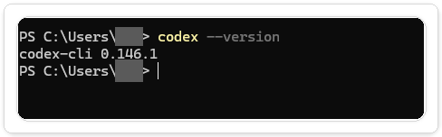
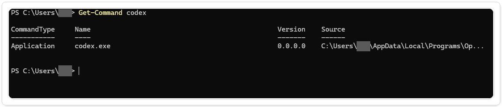
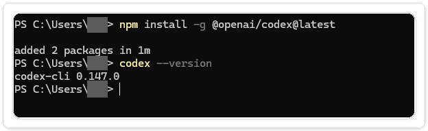
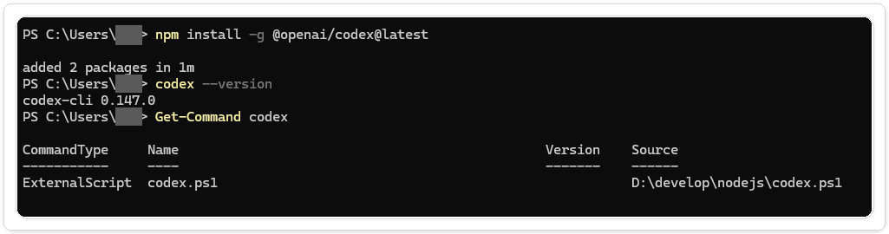
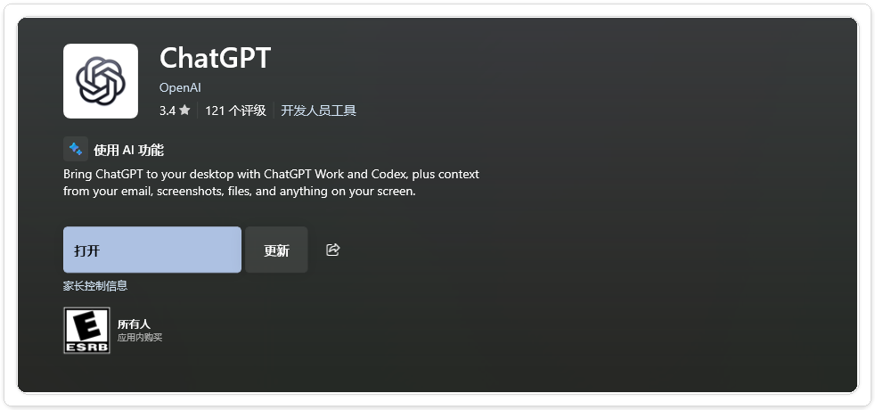
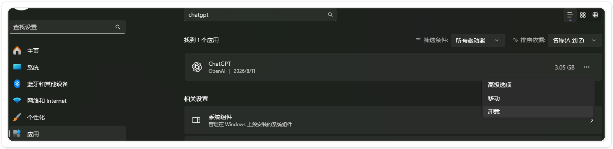
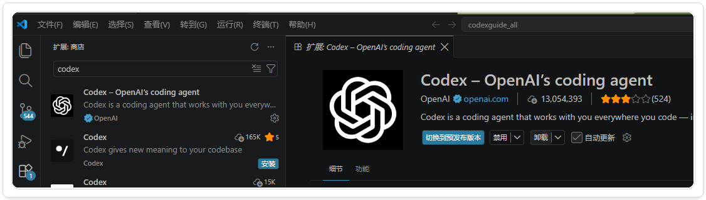

# Codex 怎么更新和卸载（2026-11 更新）：CLI 用 codex update、桌面 App 与 IDE 扩展，按安装来源处理

> 本文在线版：[codexguide.io/guides/codex-geng-xin-yu-xie-zai](https://codexguide.io/guides/codex-geng-xin-yu-xie-zai)

> 核对依据：官方 [Codex CLI](https://learn.chatgpt.com/docs/codex/cli)、[ChatGPT desktop app](https://learn.chatgpt.com/docs/app)、[ChatGPT desktop app for Linux](https://learn.chatgpt.com/docs/linux/linux-app)、[Manage app updates](https://learn.chatgpt.com/docs/enterprise/manage-app-updates)、[Codex IDE extension](https://learn.chatgpt.com/docs/codex/ide) 文档，官方安装脚本 install.sh 和 install.ps1（2026-11-13 下载），以及 [openai/codex](https://github.com/openai/codex) rust-v0.167.2 源码。2026-11-13 核对时 CLI 最新正式版是 0.167.2。截图来自 2026-08 在 Windows 上的实操，界面里的版本号比现在旧，终端截图里的 Windows 用户名已打码；macOS、Linux、Homebrew、`codex update` 和企业更新管控部分依据官方文档和源码整理，没有逐项实机操作。

更新和卸载 Codex，最容易出问题的不是命令本身，而是**用错了渠道**：用 npm 装的却去跑安装脚本，结果电脑上有两份 CLI，更新完 `codex --version` 还是旧的。所以先判断安装来源，再沿原渠道处理。

本文覆盖 Codex CLI、ChatGPT 桌面端（Codex 已集成在里面）和 VS Code 扩展。

## 先看结论

| 你用的是 | 更新 | 卸载 |
|---|---|---|
| CLI（任何渠道） | `codex update` | 按安装来源，见下文 |
| CLI（npm） | `npm install -g @openai/codex` | `npm uninstall -g @openai/codex` |
| CLI（Homebrew） | `brew upgrade --cask codex` | `brew uninstall --cask codex` |
| CLI（官方安装脚本） | 重新运行安装命令 | 手动删除安装目录和 PATH 设置 |
| 桌面端（Windows） | Microsoft Store 或 winget | Windows 设置 → 应用 |
| 桌面端（macOS） | 应用自动更新 | 拖到废纸篓 |
| 桌面端（Linux） | apt / dnf / pacman | 用同一个包管理器移除 |
| VS Code 扩展 | 随编辑器自动更新 | 扩展页点「卸载」 |

无论卸载哪一种，`~/.codex` 里的配置、会话和登录信息都**不会**自动删除。

## 先判断你安装的是哪一种

Windows 上在 PowerShell 里执行：

```powershell
codex --version
Get-Command codex -All | Select-Object CommandType,Name,Source
npm list --global @openai/codex --depth=0
```

macOS 或 Linux 上执行：

```bash
codex --version
which -a codex
```

按结果判断：

| 看到的结果 | 安装来源 |
|---|---|
| 路径包含 `node_modules`，或 npm 列出 `@openai/codex` | npm 全局安装（bun、pnpm 全局安装同理，路径里会有对应目录） |
| Windows 路径是 `%LOCALAPPDATA%\Programs\OpenAI\Codex\bin\codex.exe`，npm 没有列出包 | 官方安装脚本（Windows） |
| macOS/Linux 路径是 `~/.local/bin/codex` | 官方安装脚本（macOS/Linux） |
| 路径在 Homebrew 目录，例如 `/opt/homebrew/bin/codex` 或 `/usr/local/bin/codex` | Homebrew |
| 在 Ubuntu/WSL 终端里执行 | WSL 是独立环境，要在 WSL 里单独检查和处理 |

`Get-Command codex -All` 或 `which -a codex` 列出多个路径，说明同一台电脑上有两份 CLI。排在前面的那份才是实际运行的。

## 更新前检查

先保存或提交项目改动，再记下当前版本和命令路径：

```powershell
codex --version
Get-Command codex
```





用的是桌面端或 IDE 扩展的话，直接跳到后面对应小节。

## CLI 更新

### 推荐：用 `codex update`

当前版本的 Codex CLI 自带更新命令：

```text
codex update
```

按 rust-v0.167.2 源码，它会先识别 CLI 的安装来源，再调用对应的更新方式：npm、bun、pnpm 等全局安装就调用对应包管理器更新 `@openai/codex`；Homebrew 安装执行 `brew upgrade --cask codex`；官方安装脚本安装就重新运行安装脚本。所以一般不用自己判断渠道。

如果提示无法判断安装方式，或者 CLI 版本太旧没有这个命令，就按下面的方式手动更新。

### 手动更新：npm 全局安装

官方文档给的更新命令和安装命令相同：

```bash
npm install -g @openai/codex
```

装完重新打开一个终端窗口，再查版本和路径：





上面两张截图正好演示了「两份 CLI」的情况：更新前运行的是官方安装脚本装的 `codex.exe`，npm 更新后运行的变成了 npm 目录下的 `codex.ps1`。这时两份都在，建议只留一份，另一份按下文「按安装来源卸载 CLI」删掉。

版本没有变化时，先看 `Get-Command codex -All` 的结果，确认是不是仍指向旧位置，再查 npm 全局目录（`npm prefix --global`）在不在 PATH 里。不要在项目目录里直接删旧文件。

### 手动更新：官方安装脚本

重新运行安装命令就是更新。Windows（新开一个 PowerShell 窗口）：

```powershell
powershell -ExecutionPolicy ByPass -c "irm https://chatgpt.com/codex/install.ps1 | iex"
```

macOS 和 Linux：

```bash
curl -fsSL https://chatgpt.com/codex/install.sh | sh
```

两点变化值得知道：

- 安装脚本如果发现电脑上已有 npm、bun（macOS/Linux 脚本还会识别 Homebrew）装的 Codex，会询问是否先卸载那一份（例如 `Uninstall the existing npm-managed Codex now?`），选「是」就能避免两份并存。
- Windows 脚本发现旧版目录结构时，会询问是否替换，并把旧目录改名为 `...\bin.backup.<时间戳>` 留作备份。

装完关掉旧终端，重新打开，再运行 `codex --version`。

### 手动更新：Homebrew

```bash
brew upgrade --cask codex
```

### 固定版本或回退

需要暂时避开某个版本时，npm 安装可以指定版本号：

```bash
npm install -g @openai/codex@<版本号>
```

可用的版本号见 [GitHub Releases](https://github.com/openai/codex/releases)。官方安装脚本默认装最新版，要长期固定版本，用 npm 管理更方便。不要从第三方下载来历不明的二进制文件。

## 桌面端更新与卸载

Codex 现在集成在 **ChatGPT 桌面端** 里，更新和卸载的是整个 ChatGPT 桌面端，不走 npm。

### Windows

Windows 版通过 Microsoft Store 安装。也可以用 winget：

```powershell
winget install --id 9PLM9XGG6VKS -s msstore
```

在 Microsoft Store 里搜索 ChatGPT，打开详情页。已安装的应用会显示「打开」，有新版本时旁边会出现「更新」：



点「更新」，等商店装完再重新打开应用。用命令行也可以：

```powershell
winget upgrade --id 9PLM9XGG6VKS -s msstore
```

卸载：打开「设置 → 应用 → 已安装的应用」，搜索 ChatGPT，点右侧的「…」，选「卸载」。



### macOS

macOS 版用官方的 `ChatGPT.dmg` 安装包安装（从 [chatgpt.com/download](https://chatgpt.com/download/) 下载），应用会自己检查和安装更新。卸载时先完全退出应用，再从「应用程序」文件夹把 ChatGPT 移到废纸篓。

### Linux

Linux 版目前是预览版，支持 Ubuntu 24.04/26.04、Debian 13、Fedora 43/44 和 Arch Linux。安装时会配置 OpenAI 签名的软件源，之后用系统包管理器更新：

```bash
# Ubuntu / Debian
sudo apt update
sudo apt install --only-upgrade chatgpt

# Fedora
sudo dnf upgrade --refresh chatgpt

# Arch Linux（随整机升级）
sudo pacman -Syu
```

官方文档没有单独写卸载命令。按上面的包名 `chatgpt`，用同一个包管理器移除即可（`sudo apt remove chatgpt`、`sudo dnf remove chatgpt` 或 `sudo pacman -R chatgpt`）。安装方法见 [Linux 安装 Codex App](./17-Linux安装Codex-App-Ubuntu-Debian-Fedora与Arch.md)。

### 公司电脑：更新可能被管理员接管

企业管理员可以在 `requirements.toml` 里关掉桌面端自带的更新器，改由 MDM 或软件分发平台推送审核过的版本：

```toml
[features]
in_app_updates = false
```

生效后，在桌面端打开 **Settings > General**，**In-app updates** 一项会显示 **Managed** 和「Your organization has turned off in-app updates.」。官方提醒：菜单里的 **Check for Updates** 可能仍然显示，以 Managed 标记为准。关掉应用内更新不影响 Microsoft Store、Intune、MDM 或包管理器的更新；老版本也不会单独获得安全补丁，管理员要及时推新版本。

## VS Code 扩展

在扩展市场搜索 Codex，打开发布者为 OpenAI、标识符为 `openai.chatgpt` 的扩展页。扩展默认随编辑器自动更新；要卸载就点「卸载」，然后重启编辑器，确认侧栏入口消失。Cursor、Windsurf 等兼容编辑器操作相同。



JetBrains IDE 里的 Codex 是 JetBrains 自己的集成（在 AI Chat 里选择 Codex），更新和移除按 JetBrains 的说明处理，不在本文范围内。

## 卸载 CLI

### 先退出登录

```text
codex logout
```

然后按原安装方式移除程序或扩展。不要直接删除整个 `~/.codex` 或 `%USERPROFILE%\.codex`，除非确认不再需要里面的配置、会话、Skill 和登录数据。

### 按安装来源卸载

npm 安装：

```bash
npm uninstall -g @openai/codex
```

bun 安装：

```bash
bun remove -g @openai/codex
```

Homebrew 安装：

```bash
brew uninstall --cask codex
```

官方安装脚本装的 CLI 没有卸载命令，要手动删除脚本放下的文件。先关掉正在运行的 Codex 和终端，再按系统处理：

- **Windows**：命令文件在 `%LOCALAPPDATA%\Programs\OpenAI\Codex\bin`，程序本体在 `%USERPROFILE%\.codex\packages\standalone`。删掉这两个目录（以及更新时留下的 `bin.backup.*` 备份目录），再到「编辑账户的环境变量」里，从用户 PATH 里删掉 `...\OpenAI\Codex\bin` 这一项。
- **macOS/Linux**：命令文件是 `~/.local/bin/codex` 和 `~/.local/bin/codex-code-mode-host`，程序本体在 `~/.codex/packages/standalone`。安装脚本还会在 shell 启动文件里写一段以 `# >>> Codex installer >>>` 开头的 PATH 设置，写在哪个文件取决于系统和 shell：macOS 的 zsh 是 `~/.zprofile`，macOS 的 bash 是 `~/.bash_profile`，Linux 的 zsh 是 `~/.zshrc`，Linux 的 bash 是 `~/.bashrc`，其他情况是 `~/.profile`。把这段删掉即可。

如果设置过 `CODEX_INSTALL_DIR` 或 `CODEX_HOME`，以你设置的目录为准。删完重新打开终端，用 `Get-Command codex -All`（Windows）或 `which -a codex`（macOS/Linux）确认没有残留的第二份 CLI。

### 要不要清理本地数据

`codex logout` 只处理登录状态，不会删除配置和会话。要彻底清理，先备份有用的配置，再看看这个目录里有什么：

```powershell
Test-Path "$HOME\.codex"
Get-ChildItem "$HOME\.codex" -Force -ErrorAction SilentlyContinue
```

不要把含令牌、Cookie、项目路径或会话内容的文件上传到工单、仓库或截图里。Windows 和 WSL 的 `~/.codex` 互相独立，清理一边不影响另一边。

## 更新失败时的排查顺序

1. 重新打开终端，确认没有旧的 `codex` 进程占着文件。
2. 运行 `Get-Command codex -All` 或 `which -a codex`，确认实际运行的路径。
3. npm 安装的，运行 `npm prefix --global`，检查全局目录在不在 PATH 里。
4. 官方脚本安装的，重新运行安装脚本，留意网络、代理和执行策略报错。
5. 运行 `codex doctor`，它会检查安装、配置、登录和运行环境，详见 [Codex doctor 自检](../15-故障排查与常见问题/04-Codex-doctor自检-安装配置登录与网络排查.md)。
6. 还是判断不了，保留完整报错、版本号、操作系统和安装路径，再查[官方 CLI 文档](https://learn.chatgpt.com/docs/codex/cli)。

## 完成后检查

- 桌面端：应用不再出现在系统应用列表和启动入口里。
- CLI：找不到 `codex` 命令，或者返回的路径已经不是旧位置。
- IDE：扩展管理器里 Codex 显示已卸载，重启后侧栏入口消失。
- 项目：项目文件、Git 分支和未提交的改动没有被更新或卸载流程改动。

## 延伸阅读

- [macOS 安装 Codex CLI](./04-macOS安装Codex-CLI.md)
- [Windows 安装 Codex App](./03-Windows安装Codex-App.md)
- [Codex doctor 自检：安装、配置、登录与网络排查](../15-故障排查与常见问题/04-Codex-doctor自检-安装配置登录与网络排查.md)
