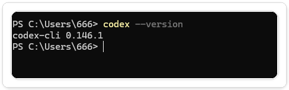
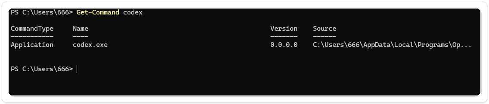
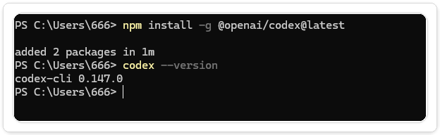
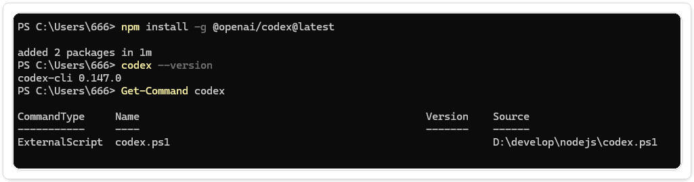
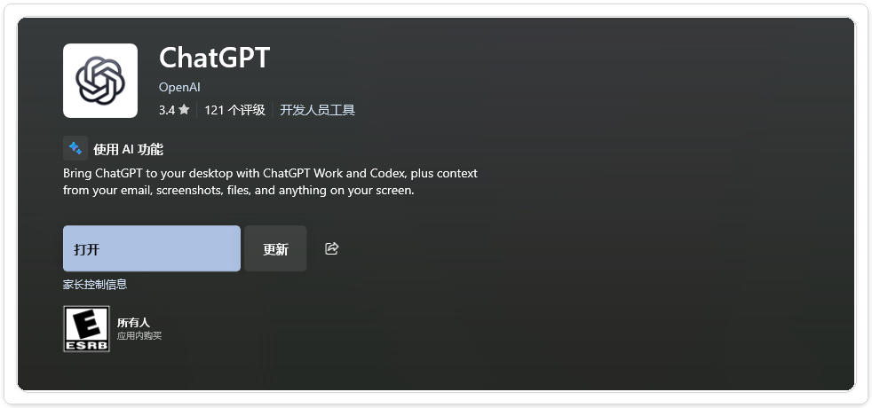
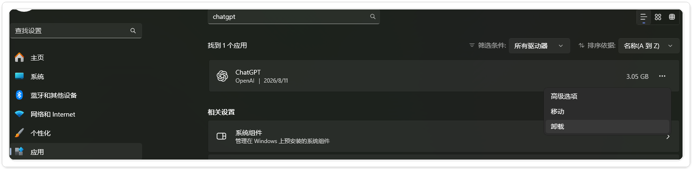
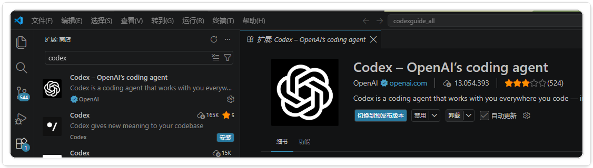
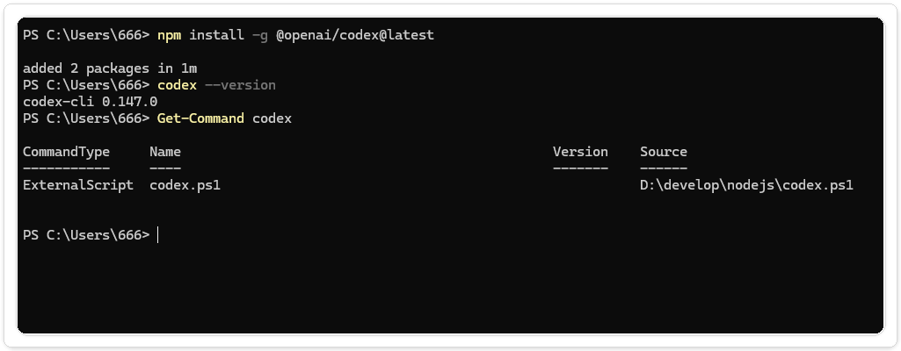

# Codex 更新与卸载

> 本文在线版：[codexguide.io/guides/codex-geng-xin-yu-xie-zai](https://codexguide.io/guides/codex-geng-xin-yu-xie-zai)

更新前先记下当前安装方式和版本。卸载时，再把“删除程序”和“删除本地登录、配置、会话”分开处理；前者不等于后者。

本文覆盖 Codex CLI、ChatGPT 桌面 App 和 VS Code 扩展。截图来自 Windows，macOS 和 Linux 的命令差异单独列在对应小节里。先确认自己用的是哪一种，再沿着原来的渠道更新或卸载，能少走很多弯路。

> 核验日期：2026-10-30，当时 Codex CLI 的最新版本为 0.166.0。截图来自 2026-08 在 Windows 上的实操，界面中的版本号会比现在旧。`codex update`、macOS、Homebrew 和安装脚本卸载这几部分依据官方文档、官方安装脚本和 openai/codex 源码整理，没有逐项实机操作。

## 先判断你安装的是哪一种

更新和卸载必须沿用原来的渠道。Windows 上先在 PowerShell 中执行：

```powershell
codex --version
Get-Command codex -All | Select-Object CommandType,Name,Source
npm list --global @openai/codex --depth=0
```

macOS 或 Linux 上执行：

```bash
codex --version
which -a codex
```

按结果判断：

| 看到的结果 | 安装来源 |
|---|---|
| 路径包含 `node_modules`，或 npm 列出 `@openai/codex` | npm 全局安装 |
| Windows 路径类似 `%LOCALAPPDATA%\Programs\OpenAI\Codex\bin\codex.exe`，npm 没有列出包 | 官方安装脚本（Windows） |
| macOS/Linux 路径是 `~/.local/bin/codex` | 官方安装脚本（macOS/Linux） |
| macOS 路径位于 Homebrew 目录，例如 `/opt/homebrew/bin/codex` | Homebrew |
| 在 Ubuntu/WSL 终端执行命令 | WSL 独立环境，在 WSL 内单独检查和处理 |

同一台电脑同时存在两份 CLI 时，`Get-Command codex -All` 或 `which -a codex` 会列出多个路径。更新后仍显示旧版本，通常就是 PATH 仍指向另一份安装。

## 更新前检查

先保存或提交项目改动，再记录当前版本和命令路径：

```powershell
codex --version
Get-Command codex
```





如果使用的是 App 或 IDE 扩展，跳到后面的“App 更新与卸载”和“VS Code 扩展”。

## CLI 更新

### 推荐：用 `codex update`

当前版本的 Codex CLI 自带更新命令：

```text
codex update
```

它会先识别 CLI 是怎么装的，再调用对应的更新方式：npm 安装会执行 `npm install -g @openai/codex`，Homebrew 安装会执行 `brew upgrade --cask codex`，官方安装脚本安装会重新运行安装脚本（pnpm、bun 安装也能识别）。所以一般不用自己判断渠道，直接运行即可。

如果提示无法判断安装方式，或者你的 CLI 版本太旧、没有这个命令，就按下面的方式手动更新。

### 手动更新：npm 全局安装

```powershell
npm install -g @openai/codex@latest
```

安装完成后重新打开一个终端窗口，再检查版本和命令路径：

```powershell
codex --version
Get-Command codex
```





如果版本没有变化，先确认 `Get-Command codex` 返回的路径是否仍指向旧安装位置，再检查 npm 的全局安装目录和终端环境变量。不要在项目目录里直接删除旧文件。

### 手动更新：官方安装脚本

Windows 上重新运行官方安装脚本，会覆盖到同一安装位置：

```powershell
powershell -ExecutionPolicy ByPass -c "irm https://chatgpt.com/codex/install.ps1 | iex"
```

macOS 和 Linux 上：

```bash
curl -fsSL https://chatgpt.com/codex/install.sh | sh
```

安装完成后关闭旧终端，重新打开，再运行 `codex --version`。

### 手动更新：Homebrew（macOS）

```bash
brew upgrade --cask codex
```

### 固定版本或回退

需要暂时避开某个版本时，npm 安装可以指定版本号：

```powershell
npm install -g @openai/codex@<版本号>
```

可用的版本号见 [GitHub Releases](https://github.com/openai/codex/releases)。回退前先记下 `codex --version` 和命令路径。官方安装脚本默认安装最新版；要长期固定版本，改用 npm 管理更方便。不要从第三方下载不明二进制文件。

## App 更新与卸载

### Windows

Windows 上的 ChatGPT 桌面 App 通过 Microsoft Store 安装，更新和卸载也由 Microsoft Store 或 Windows 设置管理，不走 npm。官方给出的 winget 安装命令是：

```powershell
winget install --id 9PLM9XGG6VKS -s msstore
```

打开 Microsoft Store 搜索 ChatGPT，如果应用已经安装，搜索结果会显示“已安装”状态。



需要更新时，在应用详情页点击“更新”，等待商店完成安装，再重新打开 App。



习惯用命令行的话，也可以用 winget 更新：

```powershell
winget upgrade --id 9PLM9XGG6VKS -s msstore
```

需要卸载时，打开 `设置 → 应用 → 已安装的应用`，搜索 ChatGPT，展开右侧菜单并选择“卸载”。



### macOS

macOS 版从官方页面下载 `Codex.dmg` 安装（官方下载目前面向 Apple 芯片的 Mac）。卸载时退出应用，再从“应用程序”文件夹把它移到废纸篓。和 Windows 一样，删掉应用不会删除 `~/.codex` 里的配置和会话。

## VS Code 扩展

在扩展市场中搜索 Codex，打开发布者为 OpenAI、标识符为 `openai.chatgpt` 的扩展详情页。扩展默认随 VS Code 自动更新；需要卸载时点击“卸载”，然后重启 IDE，确认侧栏入口已经消失。Cursor、Windsurf 等兼容编辑器的操作相同。



## 卸载时保留数据

先退出登录：

```text
codex logout
```

然后按照原安装方式移除程序或扩展。不要直接删除整个 `~/.codex` 或 `%USERPROFILE%\.codex`，除非你已经确认不再需要其中的配置、会话、技能和认证数据。需要清理本地数据时，先备份，再逐项删除。

### 按安装来源卸载 CLI

npm 安装：

```powershell
npm uninstall -g @openai/codex
```

Homebrew 安装：

```bash
brew uninstall --cask codex
```

官方安装脚本安装的 CLI 没有卸载命令，需要手动删除安装脚本放下的文件。先关闭正在运行的 Codex 和终端窗口，再按系统处理：

- **Windows**：命令文件在 `%LOCALAPPDATA%\Programs\OpenAI\Codex\bin`，程序本体在 `%USERPROFILE%\.codex\packages\standalone`。删除这两个目录，再到“编辑账户的环境变量”里，从用户 PATH 中移除 `...\OpenAI\Codex\bin` 这一项。
- **macOS/Linux**：命令文件是 `~/.local/bin/codex` 和 `~/.local/bin/codex-code-mode-host`，程序本体在 `~/.codex/packages/standalone`。安装脚本还会在 `~/.zshrc`、`~/.bashrc` 或 `~/.profile` 中写入一段以 `# >>> Codex installer >>>` 开头的 PATH 设置，可以一并删掉。

如果设置过 `CODEX_INSTALL_DIR` 或 `CODEX_HOME`，以你设置的目录为准。删除后重新打开终端，用 `Get-Command codex -All`（Windows）或 `which -a codex`（macOS/Linux）确认没有残留的第二份 CLI。

### 是否清理本地数据

`codex logout` 只处理登录状态，不等于删除配置和会话。需要彻底清理时，先备份有用的配置，再检查这个目录：

```powershell
Test-Path "$HOME\.codex"
Get-ChildItem "$HOME\.codex" -Force -ErrorAction SilentlyContinue
```

不要把包含令牌、Cookie、项目路径或会话内容的文件上传到工单、仓库或截图中。Windows 和 WSL 的 `~/.codex` 彼此独立，清理一边不会影响另一边。

## 更新失败时的排查顺序

1. 重新打开终端，确认是否仍有旧的 `codex` 进程占用文件。
2. 运行 `Get-Command codex -All` 或 `which -a codex`，确认实际执行的路径。
3. 对 npm 安装运行 `npm prefix --global`，检查全局目录是否在 PATH 中。
4. 对官方安装脚本安装，重新执行安装脚本，并检查网络、代理和执行策略错误。
5. 运行 `codex doctor`，它会检查安装、配置、认证和运行环境。
6. 仍无法判断时，保留完整错误文字、版本号、操作系统和安装路径，再查阅[官方 CLI 文档](https://learn.chatgpt.com/docs/codex/cli)。

## 完成后检查

- App：应用不再出现在系统应用列表或启动入口中。
- CLI：找不到 `codex` 命令，或返回的路径已不是旧安装位置。
- IDE：扩展管理器中 Codex 状态为已卸载；重启 IDE 后侧栏入口消失。
- 项目：项目文件、Git 分支和未提交改动没有被更新或卸载流程修改。

## 参考资料

- [Codex CLI](https://learn.chatgpt.com/docs/codex/cli)
- [Codex App（Windows）](https://learn.chatgpt.com/docs/app/windows)
- [Codex IDE extension](https://learn.chatgpt.com/docs/codex/ide)
- [openai/codex 安装说明](https://github.com/openai/codex#installing-and-running-codex-cli)
- [Codex Changelog](https://learn.chatgpt.com/docs/changelog)
