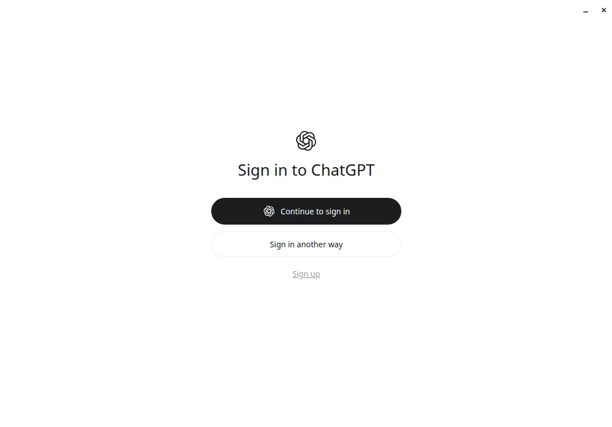

# Codex App Linux 版安装教程：Ubuntu、Debian、Fedora 和 Arch 的装法、更新与限制

> 本文在线版：[codexguide.io/guides/linux-install-codex-app](https://codexguide.io/guides/linux-install-codex-app)

> 核对依据：OpenAI 文档 [ChatGPT desktop app for Linux](https://learn.chatgpt.com/docs/linux/linux-app)（2026-11-03 抓取）。Ubuntu 24.04.5 LTS、x86_64 上实际下载并安装了文档页给出的 amd64 `.deb`，包版本 `26.1027.51404`，并打开到登录页。Debian、Fedora、Arch 和 Wayland 的命令引自同一篇文档，这台机器没有执行。Codex CLI 的安装不在本文范围内。

Linux 上要用 Codex 改本地项目，入口是 ChatGPT 桌面端，不是再找一个名叫 Codex 的独立安装包。官方把这个 Linux 应用标成预览。macOS 的装法见 [macOS 安装 Codex App](./02-macOS安装Codex-App.md)。

## 哪些发行版在支持列表里

文档列出的桌面版发行版：

| 发行版 | 文档中的版本 |
| --- | --- |
| Ubuntu | 24.04 LTS、26.04 LTS |
| Debian | 13 |
| Fedora | 43、44 |
| Arch Linux | 当前、已经完整更新的滚动版本 |

x64 和 ARM64 都有包。其他发行版文档的原话是也许能用，但没有正式支持。

先看架构：

```bash
uname -m
```

`x86_64` 是 x64。`aarch64` 或 `arm64` 是 ARM64。本机输出是 `x86_64`，系统是 Ubuntu 24.04.5 LTS，在支持列表里。

## Ubuntu 和 Debian：安装 .deb

打开 [Linux 应用文档](https://learn.chatgpt.com/docs/linux/linux-app)，用页上的按钮下载对应架构的包。2026-11-03 从这页解析到的 x64 地址是：

```text
https://persistent.oaistatic.com/codex-app-prod/linux/deb/latest/chatgpt_amd64.deb
```

ARM64 把文件名换成 `chatgpt_arm64.deb`。路径里的 `latest` 会变，以下载页当时给出的按钮为准。

本机下载到的文件是 535,323,606 字节，响应头里的 `Last-Modified` 是 2026-10-31 23:45:36 GMT。包控制信息：

| 字段 | 值 |
| --- | --- |
| Package | chatgpt |
| Version | 26.1027.51404 |
| Architecture | amd64 |
| Maintainer | OpenAI（support@openai.com） |

进入下载目录后按文档安装。x64：

```bash
cd ~/Downloads
sudo apt install ./chatgpt_amd64.deb
```

ARM64 把文件名换成 `chatgpt_arm64.deb`。前面的 `./` 要留着，这样 apt 才会安装本地文件。

本机在 `/tmp` 执行了同一条 `sudo apt install ./chatgpt_amd64.deb`。apt 补上了包声明的依赖，结束后 `dpkg` 的状态是：

```text
ii  chatgpt  26.1027.51404  amd64  ChatGPT by OpenAI
```

`command -v chatgpt` 是 `/usr/bin/chatgpt`。`chatgpt --version` 打印 `26.1027.51404`。

Debian 13 用同一条 apt 命令。本文没有在 Debian 上安装。

## Fedora：安装 .rpm

文档给的 x64 命令：

```bash
cd ~/Downloads
sudo dnf install ./chatgpt.x86_64.rpm
```

ARM64 把文件名换成 `chatgpt.aarch64.rpm`。2026-11-03 文档页上的地址分别是 `.../linux/rpm/latest/chatgpt.x86_64.rpm` 和 `chatgpt.aarch64.rpm`。本文没有在 Fedora 上执行。

## Arch：用官方脚本，它会升级整个系统

Arch 不提供单独让你双击的包。文档要求下载官方脚本再运行：

```bash
curl --proto '=https' --tlsv1.2 -fL -o install-arch.sh \
  https://persistent.oaistatic.com/codex-app-prod/linux/install-arch.sh
sudo bash install-arch.sh
```

文档写明：脚本会检测架构、配置带签名的 OpenAI 软件源并安装 ChatGPT；安装会做一次完整的系统升级，并提示你确认。

2026-11-03 我读了这个脚本，没有执行。脚本检查 `pacman`、`curl`、`gpg` 和 `uname`，校验 OpenAI 的签名密钥，再把软件源写进 pacman 配置。文件末尾的注释写着保留 pacman 的正常确认提示并做完整系统升级；实际命令在一份临时 pacman 配置上执行 `pacman -Syu --needed`，软件包名来自变量。也就是说，它不只安装 ChatGPT，还会按 Arch 的方式升级系统里已有的包。只想先看看 Codex 的话，不要在一台不能接受全量升级的机器上跑它。

x64 和 ARM64 用同一条命令，脚本自己看 `uname`。文档写了不支持的架构会失败。

## 首次打开并登录

文档说从应用菜单打开 ChatGPT，或在终端运行 `chatgpt`，然后用 ChatGPT 账号登录，再按桌面端快速开始做。

本机执行 `chatgpt` 后出现登录窗口，没有输入账号：



图 1：2026-11-03，Ubuntu 24.04.5 上 chatgpt 26.1027.51404 的首次窗口。按钮是 Continue to sign in、Sign in another way 和 Sign up。没有登录，所以没有邮箱、头像或套餐信息。

登录方式的选择见 [登录 Codex](./07-登录Codex.md)。本文到登录页为止，没有进入 Codex 工作区，也没有打开本地文件夹。

## 更新

安装会配置带签名的 OpenAI 软件源。之后用发行版自己的包管理器更新。

Ubuntu 或 Debian：

```bash
sudo apt update
sudo apt install --only-upgrade chatgpt
```

Fedora：

```bash
sudo dnf upgrade --refresh chatgpt
```

Arch 把应用更新放进全量升级：

```bash
sudo pacman -Syu
```

这三条都来自官方 Linux 页。本机装完即是刚下载的包，没有再执行更新。CLI 的 npm 更新、Windows 商店更新和 macOS 更新见 [Codex 更新与卸载](./12-Codex更新与卸载.md)，不要拿来更新这个 Linux 桌面包。

官方 Linux 页没有单独的卸载章节。软件包名是 `chatgpt`。要移除时用该发行版移除软件包的普通命令。本文没有在这台机器上卸载。

## 已知限制

**Computer Use。** 文档写：Computer Use 在 macOS 和 Windows 上可用，Linux 预览还没有，以后的版本会加上。Linux 主机能不能用手机远程控制，这篇官方文档没有写，这里不补充社区里的说法。

**Wayland。** 原生 Wayland 被标成实验性支持，还会继续改。Wayland 会话里，有 XWayland 时应用会用 XWayland。要明确选择原生 Wayland，先完全退出应用，再从终端启动：

```bash
chatgpt --ozone-platform=wayland
```

文档说，在原生 Wayland 成熟之前，浮动窗口、窗口位置、焦点和快捷键可能不完整。本机是 X11 会话（`DISPLAY` 已设置），没有加这个参数，因此没有验证 Wayland。

输入法是否正常，官方这篇文档没有写。遇到输入问题时，先确认自己用的是文档列出的发行版，再看是 X11 还是 Wayland，然后把版本号一起记下来。

## 和 CLI 怎么选

桌面包的用户命令是 `chatgpt`。它启动的是图形界面。终端里的 `codex` 命令来自 Codex CLI，用官方 CLI 的安装方式单独装，例如各平台文档里的安装脚本或 npm。两边的更新通道不同。

只想在终端里改仓库，可以不装桌面端。[CLI 文档](https://learn.chatgpt.com/docs/cli) 给 macOS 和 Linux 的安装命令是：

```bash
curl -fsSL https://chatgpt.com/codex/install.sh | sh
```

文档里的更新命令与这条相同。npm 和 Homebrew 在同一页的其他标签下。本机的 `codex` 是用 npm 装的 0.166.0，没有再跑这条脚本。macOS 与 Windows 的 CLI 步骤见 [macOS 安装 Codex CLI](./04-macOS安装Codex-CLI.md) 和 [Windows 和 WSL 安装 Codex CLI](./05-Windows和WSL安装Codex-CLI.md)。装好之后如果命令、登录或网络异常，用 [Codex doctor](../15-故障排查与常见问题/04-Codex-doctor自检-安装配置登录与网络排查.md) 收集本机状态。doctor 检查的是 CLI，不是这个桌面包。

## 常见问题

**apt 说找不到 chatgpt 软件包。** 第一次安装要用 `sudo apt install ./chatgpt_amd64.deb`，文件名前面有 `./`。不带路径时，apt 会去软件源里找，而签名源是这条本地安装配上的。

**架构下错了包。** `uname -m` 是 `x86_64` 就用 `chatgpt_amd64.deb` 或 `chatgpt.x86_64.rpm`。`aarch64` 用文件名里带 `arm64` 或 `aarch64` 的包。

**Arch 脚本想升级很多包。** 这是文档和脚本写明的行为。不想做全量升级，就不要运行 `install-arch.sh`。

**打开后只有登录页。** 这是未登录时的预期界面。登录步骤不在本文。

## 下一步

登录并打开第一个本地项目，按 [登录 Codex](./07-登录Codex.md) 继续。桌面端和 CLI 要分开更新。遇到 CLI 的安装或网络问题，再跑 [doctor](../15-故障排查与常见问题/04-Codex-doctor自检-安装配置登录与网络排查.md)。

## 参考资料

- [ChatGPT desktop app for Linux](https://learn.chatgpt.com/docs/linux/linux-app)
- [ChatGPT desktop app](https://learn.chatgpt.com/docs/app)
- [Codex CLI](https://learn.chatgpt.com/docs/cli)
