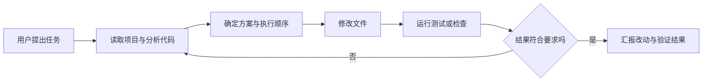
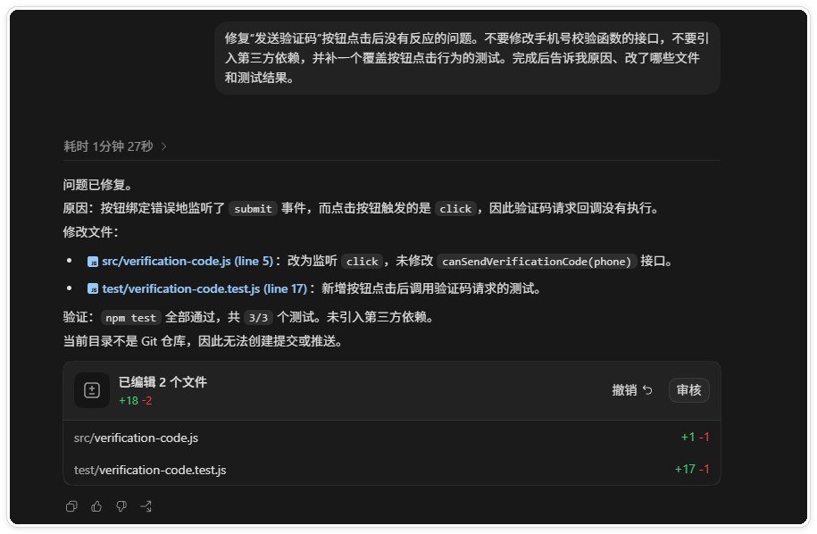
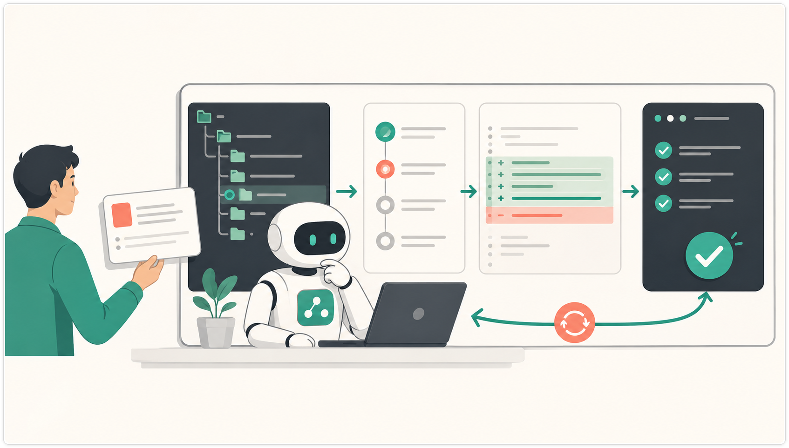
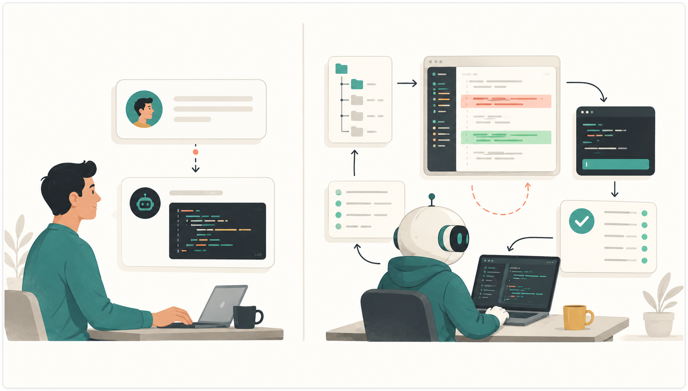

# Codex 是如何工作的

> 本文在线版：[codexguide.io/guides/codex-shi-ru-he-gong-zuo](https://codexguide.io/guides/codex-shi-ru-he-gong-zuo)

> 核对依据：2026-11-27 打开的 [Sandbox](https://learn.chatgpt.com/docs/sandboxing)、[Permissions](https://learn.chatgpt.com/docs/permission-modes)、[Prompting](https://learn.chatgpt.com/docs/prompting)、[Working with agents](https://learn.chatgpt.com/docs/working-with-agents)、[Quickstart](https://learn.chatgpt.com/docs/quickstart)，以及同一天的 [AGENTS.md](https://learn.chatgpt.com/docs/agent-configuration/agents-md) 和 [Build skills](https://learn.chatgpt.com/docs/build-skills)。下面的五步是阅读用的工作模型，不是这几页里的官方流程图。没有重跑文中的任务，没有新截图。原有图片保留。

> 难度　基础
>
> 类型　核心概念

## 这篇文章适合谁

第一次看 Codex 工作，很容易把它理解成“会写代码的 ChatGPT”。你输入一句话，等一会儿，它就改好了几个文件。

关键区别藏在中间那段看不见的工作里。Codex 会进入项目，查看代码，调用工具，修改文件，再用测试或构建结果检查改动。理解这套过程以后，你会更清楚任务该怎样描述，也知道什么时候该让它停下来解释，什么时候可以直接执行。

## 先记住这个工作模型

可以先把 Codex 理解成一个能使用开发工具的编码 Agent。模型负责判断下一步该做什么，工具负责把动作落到真实环境中。

一次典型任务大致经过下面几个阶段。



这条流程经常要走好几遍。测试失败后，Codex 可能重新读代码，修正判断，再次修改和验证。小任务有时不会单独展示计划，分析和安排依然存在，只是没有专门写成清单。

## 第一步　用户提出任务

Agent 首先要把自然语言转成可执行目标。

例如，你可以这样写。

> 修复登录页面中“发送验证码”按钮点击后没有反应的问题，不要改变登录接口，并补一个相关测试。

这句话交代了故障现象、修改边界和完成标准。Codex 接下来会先寻找登录页面、按钮事件、验证码请求和现有测试，然后再决定改哪里。



<p align="center">图一　Codex 根据任务边界定位问题、修改文件，并用测试结果完成交付。CodexGuide 实测</p>

如果任务只有“登录坏了，修一下”，Codex 也可以开始调查，但需要探索的范围更大。它可能先检查浏览器报错、最近改动或相关接口。目标越具体，Agent 越容易把时间花在真正的问题上。

**这一步的控制手段**：把要的行为、不能动的边界和怎么验收写进任务。写法见 [提示词怎么写](./09-Codex提示词怎么写-目标上下文边界与官方示例.md)。Working with agents 把说明和权限分开：指令表达意图，权限控制访问。权限见 [安全与风险边界](./05-安全与风险边界-到底该不该放手让它碰你的代码.md)。

## 第二步　分析代码和项目上下文

Codex 并不会在开始任务时把整个仓库一次性塞进模型。真实项目可能有几万甚至几十万个文件，这样做既慢，也会带来大量无关信息。

它通常先查看项目结构和规则，再通过文件名、代码搜索、依赖关系逐步缩小范围。对于刚才的例子，它可能会做下面几件事。

- 读取项目根目录的 `AGENTS.md`、`package.json` 和测试配置；
- 搜索“发送验证码”对应的组件与点击处理函数；
- 查看请求函数、状态管理和相邻测试的写法；
- 用 `git status` 判断工作区是否已有未提交改动。

这个过程叫收集上下文。Codex 需要拿到足够的证据，弄清问题发生在哪里、项目采用什么写法、修改会影响谁，以及该用什么命令验证。单纯增加阅读量没有多少帮助。

Codex 还会受到项目指令和权限限制。比如 `AGENTS.md` 要求使用 `pnpm`、禁止修改生成文件，Agent 应把这些规则带入后续判断。当前工作区里如果已经有你的改动，它也不应随意覆盖。官方文档写明，Codex 在做任何工作之前就会读取 `AGENTS.md`。指令仍然不能代替沙箱。

**这一步的控制手段**：上下文按需要收集，不是一次塞进整个仓库。Prompting 页写，IDE 扩展会自动带上当前打开的文件；在 CLI 里要写出路径，或用 `/mention` 和 `@` 补全附上文件。窗口和压缩见 [上下文窗口与压缩](./07-Codex上下文窗口与压缩-compact自动压缩与何时新开会话.md)。

## 第三步　制定计划

计划用来安排动作，一份好看的待办清单本身没有价值。

修复一个拼写错误时，Codex 可能读完文件就直接修改并检查差异。涉及多个模块、数据库迁移或行为不明确时，它通常需要先确定修改范围和验证顺序。一个合理的内部思路可能是下面这样。

1. 复现或定位按钮事件没有触发的原因。
2. 用项目现有模式修复组件，不改接口契约。
3. 增加一个能覆盖故障场景的测试。
4. 运行聚焦测试，再检查代码差异。

执行中发现原判断不成立，计划也会变化。例如按钮事件已经触发，问题出在表单校验提前返回，那么 Codex 应回到代码证据重新判断，及时放弃第一版计划中的错误路径。

这也是 Agent 和一次性代码生成的重要区别。它能根据工具返回的新信息继续决策。

**这一步的控制手段**：多步骤任务可以在应用输入框里输入 `/plan`，让 Codex 先调查并提出做法，然后再编辑。见 [Plan 模式](./08-Codex-Plan模式-先出计划再动手.md)。Prompting 页还写，Goal 模式可用时，可以在计划之后用 `/goal` 设定一个持续目标。那是计划之后的另一步，不是计划本身。

## 第四步　修改文件

找到原因后，Codex 会通过文件编辑工具把改动写入项目。它可能修改组件、测试或配置，也可能新建文件。模型无法隔空“碰到”硬盘，它发起的是一次次明确的工具调用，例如读取某个路径、应用补丁或运行格式化命令。

好的修改一般有下面几个特点。

- 范围和任务一致，不顺手重构无关代码；
- 遵循仓库已有的命名、组件和测试模式；
- 保留用户现有改动，不把脏工作区恢复成自己的理想状态。

你仍然应该查看最终差异。Codex 能操作文件，不代表每次判断都正确。尤其是公共接口、依赖升级、权限配置和数据迁移，改动本身比聊天中的解释更值得审查。

**这一步的控制手段**：本地命令跑在沙箱里。要越出边界才进入审批。Auto-review 只换谁来审，不扩大沙箱。见 [权限沙箱与审批](./06-权限沙箱与审批-什么时候放行什么时候收紧.md)、[安全与风险边界](./05-安全与风险边界-到底该不该放手让它碰你的代码.md) 和 [Auto-review 怎么用](../10-配置模型与权限安全/33-Codex-Auto-review怎么用-哪些审批会交给审阅者-拦什么-被拒绝后怎么办与策略调整.md)。

## 第五步　验证结果

“文件已经改了”还不能算完成。Codex 需要拿出可以观察的证据。

根据项目类型，可以选择下面这些验证方式。

- 运行与改动相关的单元测试或集成测试；
- 执行类型检查、lint 或构建；
- 启动应用，实际点击页面并查看浏览器状态；
- 检查 `git diff`，确认没有混入无关文件；
- 对照任务要求，检查接口和行为是否保持不变。

如果测试失败，Agent 要先分辨失败是否由本次修改引起。相关失败通常需要继续修复；无关的既有失败应该如实报告，不能为了让输出变绿而随便改测试。

验证也有成本。改一个文案没有必要默认跑十几分钟的全量测试，修改共享认证逻辑却不能只看格式检查。合适的做法是先运行最贴近改动的检查，再根据影响范围决定是否扩大验证。

**这一步的控制手段**：Sandbox 页写明，`git`、包管理器和测试命令都继承同一套沙箱。验证命令要联网或写出工作区时，仍走审批策略，不会因为「这是在测试」就自动放开。

## 沙箱、审批、Plan 模式、Skills 和 AGENTS.md 落在哪一步

上面五步是用来读一次任务的顺序。官方文档没有用这五个名字给它们编号。按 2026-11-27 打开的页面，这几样控制分别压在不同动作上。

- **AGENTS.md** 在动手之前。官方写：Codex 开始时就组建指令链，做任何工作之前会读取 `AGENTS.md`。全局文件在 Codex 主目录（默认 `~/.codex`），项目文件从项目根走到当前目录，更靠近当前目录的文件出现在后面，因此覆盖更早的说明。它影响后面每一步的判断，但不授予文件或网络权限。
- **Skills** 先进入上下文，再在被选中时展开。Build skills 写明：ChatGPT 和 Codex 一开始只有每个 skill 的名字和描述；决定使用某个 skill 时，才加载完整的 `SKILL.md`。在 Codex 里，这份初始名单还包括文件路径。默认最多占用上下文窗口的 2%，上下文窗口未知时是 8,000 个字符。所以它首先作用在收集上下文这一步。Prompting 页的一个云端重构例子是在做计划时显式调用 `$plan`。那是计划阶段的一种用法，不是每个任务都会自动跑某个 skill。
- **Plan 模式** 在改文件之前。Prompting 页写：多步骤任务在应用输入框输入 `/plan`，让 Codex 先调查并提出做法，然后再编辑。对应上面的第三步。`/goal` 是计划之后、Goal 模式可用时才有的命令。
- **沙箱** 作用在真正碰机器的时候。本地对话在 ChatGPT 桌面端、Codex CLI 或 IDE 扩展里跑命令时，命令在受限环境里执行。读文件、编辑和工作区内的常规命令可以留在边界内。`git`、安装依赖和测试都算这类命令。所以它主要落在分析和改文件、跑验证的那些动作上，而不是落在「把任务说清楚」那一句上。
- **审批** 在要越过沙箱的时候。`on-request` 是越界才问。`never` 不再为审批停下来。Permissions 页写明，**Approve for me** 和 **Ask for approval** 是同一套工作区边界，差别只是谁来审。Auto-review 的生命周期见 [Auto-review 怎么用](../10-配置模型与权限安全/33-Codex-Auto-review怎么用-哪些审批会交给审阅者-拦什么-被拒绝后怎么办与策略调整.md)。

Working with agents 把这件事收成一句：指令表达意图，权限控制访问。任务说明、`AGENTS.md` 和 skill 属于前一半。沙箱和审批属于后一半。

## Codex Agent 实际上在反复做什么

从内部行为看，一次任务可以简化成一个循环。Codex 先观察当前状态，选择下一步动作，读取动作结果，再决定后续动作。

```text
目标
  ↓
观察　任务、项目规则、文件内容、命令输出
  ↓
判断　现在缺什么信息，下一步风险是什么
  ↓
行动　搜索、读取、编辑、运行命令或请求确认
  ↓
新结果回到“观察”，直到达到完成标准
```



<p align="center">图二　Agent 根据新结果反复观察、行动和验证，逐步得到答案。CodexGuide 原创示意图</p>

因此，同一句提示词在两个项目中可能产生不同步骤。React 项目和 Django 项目的目录、命令、测试方式不同；即使技术栈一样，仓库规则和当前代码状态也会改变 Agent 的选择。

## Codex 和普通 ChatGPT 对话有什么区别

这里说的“普通 ChatGPT 对话”，指主要通过文字问答获得解释、建议或代码片段的使用方式。ChatGPT 的产品能力还在扩展，某些模式同样可以处理文件或使用工具。因此，更值得关注的是两者面对的工作对象和最终交付方式。

| 对比项 | 普通 ChatGPT 对话 | Codex 任务 |
|---|---|---|
| 主要对象 | 你在对话中提供的文字、图片或附件 | 选定的项目、代码、配置和开发工具 |
| 常见输出 | 解释、建议、示例代码 | 项目中的实际改动和验证记录 |
| 获取上下文 | 主要依赖你主动提供 | 可以按需搜索和读取工作区 |
| 执行方式 | 通常由你把答案复制到项目并运行 | Agent 可以编辑文件、运行命令，再根据结果继续处理 |
| 完成判断 | 回答是否解决了问题 | 代码是否改对、检查是否通过、边界是否遵守 |



<p align="center">图三　普通对话通常交付回答，Codex 会进入项目并沿着工具反馈继续工作。CodexGuide 原创示意图</p>

举个简单例子。你问普通对话“React 按钮为什么点了没反应”，它可以列出常见原因并给出示例。你把一个项目交给 Codex 并要求修复，它可以找到真实组件，检查事件绑定，修改对应文件，运行项目里的测试，最后告诉你改了什么。

普通对话更适合学习概念、比较方案或讨论尚未落地的想法。目标已经位于某个项目中，并且希望得到可审查的文件改动时，Codex 更合适。

## 为什么 Codex 能操作项目文件

因为你把一个运行环境和一组受控工具交给了它。模型本身并不知道你的电脑里有什么。

Quickstart 把入口写成这几处。要在终端或编辑器里写代码，用 **Codex CLI** 或 **Codex IDE 扩展**。远程工作在网页或桌面端选择 **Work in** > **Cloud**，或在手机上打开 **Codex**。ChatGPT 桌面端可以开始一次对话、创建一个项目，或打开一个文件夹；它能读写你选中的那个文件夹。Working with agents 把 **Codex Cloud** 写成：在云端环境里查看代码、做出修改，并运行命令或测试。

Sandbox 页写：本地对话在 **ChatGPT 桌面端**、**Codex CLI** 或 **IDE 扩展**里跑命令时，这些命令在受限环境里执行，而不是默认拥有完整访问。这个环境规定能改哪些文件、命令能不能用网络。`git`、包管理器和测试命令继承同一套边界。留在边界内就可以继续；要越出去，审批接手。沙箱管技术边界，审批策略决定越界前要不要停下来问。

按同一页，常见沙箱模式是：

- `read-only`：可以查看文件，但不能在没有审批的情况下编辑文件或运行命令。
- `workspace-write`：可以读文件、在工作区内编辑，并在这个边界里运行常规本地命令。文档把它写成本地工作的默认低摩擦模式。
- `danger-full-access`：去掉沙箱限制，包括文件系统和网络边界。只在你确实要完整访问时使用。

常见审批策略是 `on-request`（默认在沙箱里工作，越界才问）和 `never`（不再为审批停下来）。交互式审批还可以选审阅者：`user` 是默认，`auto_review` 把符合条件的请求交给审阅 agent。Full access 在该页写成 `sandbox_mode = "danger-full-access"` 再加上 `approval_policy = "never"`。审批如果提供不同范围，例如批准一次或整个会话，文档建议选能让任务继续的最窄范围。

项目指令是另一层。`AGENTS.md` 在动手之前被读入，告诉 Codex 在权限允许的范围内还要遵守什么。它不扩大沙箱。


<p align="center">图四　项目文件位于受控工作区内，工具和外部访问需要经过沙箱与审批边界。CodexGuide 原创示意图</p>

权限会直接改变 Codex 能做的事。`read-only` 下不能在没有审批时落盘或跑命令。`workspace-write` 允许工作区内的编辑和常规本地命令；要越过文件或网络边界时，`on-request` 会停下来问。`danger-full-access` 去掉这些边界。给出更高权限会减少中途确认，也会扩大错误操作的影响范围。

所以，第一次把项目交给 Codex 时，不要用“它能不能操作电脑”来笼统判断风险。应该具体看任务在哪个环境运行、当前允许访问哪些路径，以及什么动作需要审批。

## 一次任务怎样才算真正完成

可以用下面四个问题检查 Codex 的交付。

- 它是否找到了真实原因，有没有停留在表面现象？
- 修改是否只覆盖任务需要的范围？
- 是否运行了与风险相称的验证，并报告实际结果？
- 有没有说明未完成、无法验证或需要人工决定的部分？

Codex 的最后一条消息只是摘要。真正的结果在文件差异、测试输出和运行行为里。把这些证据看明白，比研究它用了多少步更重要。

## 参考资料

- [Sandbox](https://learn.chatgpt.com/docs/sandboxing)（2026-11-27）
- [Permissions](https://learn.chatgpt.com/docs/permission-modes)（2026-11-27）
- [Prompting](https://learn.chatgpt.com/docs/prompting)（2026-11-27）
- [Working with agents](https://learn.chatgpt.com/docs/working-with-agents)（2026-11-27）
- [Quickstart](https://learn.chatgpt.com/docs/quickstart)（2026-11-27）
- [Custom instructions with AGENTS.md](https://learn.chatgpt.com/docs/agent-configuration/agents-md)（2026-11-27）
- [Build skills](https://learn.chatgpt.com/docs/build-skills)（2026-11-27）
- [提示词怎么写](./09-Codex提示词怎么写-目标上下文边界与官方示例.md)
- [Plan 模式](./08-Codex-Plan模式-先出计划再动手.md)
- [权限沙箱与审批](./06-权限沙箱与审批-什么时候放行什么时候收紧.md)
- [Auto-review 怎么用](../10-配置模型与权限安全/33-Codex-Auto-review怎么用-哪些审批会交给审阅者-拦什么-被拒绝后怎么办与策略调整.md)
