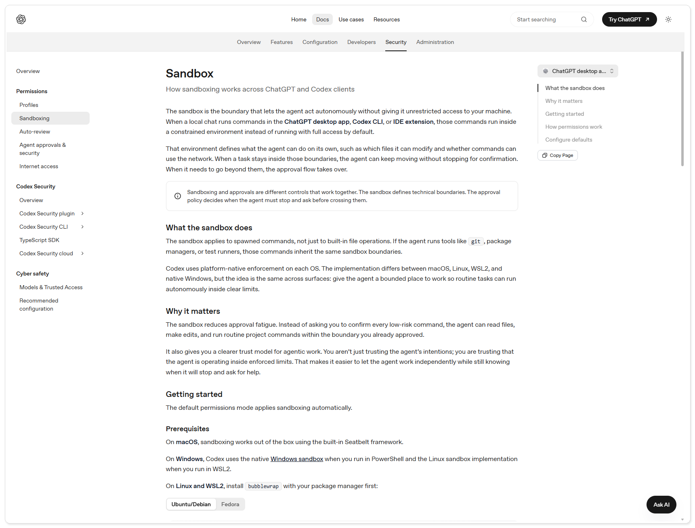

# Codex 安全与风险边界（2026-11 更新）：什么时候该收紧权限，误删事故复盘和四个判断问题

> 本文在线版：[codexguide.io/guides/codex-an-quan-yu-feng-xian-bian-jie](https://codexguide.io/guides/codex-an-quan-yu-feng-xian-bian-jie)

> 核对依据：ChatGPT Learn《[Permissions](https://learn.chatgpt.com/codex/permission-modes)》《[Sandbox](https://learn.chatgpt.com/codex/sandboxing)》《[Auto-review](https://learn.chatgpt.com/codex/sandboxing/auto-review)》《[Windows sandbox](https://learn.chatgpt.com/codex/windows/windows-sandbox)》，2026-11-01 打开。本机 `codex --version` 为 Codex CLI 0.166.0。没有交互式 TUI，所以没有 `/permissions` 菜单截图。此前正文里的「Windows 11、CLI 0.147.0、2026-08-20」不再作为当前环境。

这篇回答：默认用哪种模式、两类警告怎么分开、Full access 出过什么事、怎样判断一次任务能不能放手、出事以后先做什么。模式怎么配、permission profiles 怎么写，见 [权限、沙箱与审批](./06-权限沙箱与审批-什么时候放行什么时候收紧.md)。还不熟悉 Codex 怎样接任务、跑命令，先看 [Codex 是如何工作的](./01-Codex是如何工作的.md)。

## 先看结论

Permissions 文档把 **Ask for approval** 写成大多数工作的起点：在当前工作区内继续，越界前暂停。

**Approve for me** 使用同一个 workspace-write 沙箱。变化的是谁来审越界请求：交给自动审查，而不是每次都弹出人工确认。官方原句：Changing who reviews a request doesn't expand the sandbox.

**Full access** 的界面说明是不受限地联网，并访问电脑上的任何文件。Sandbox 文档把对应配置写成 `sandbox_mode = "danger-full-access"` 加上 `approval_policy = "never"`。

**Custom（config.toml）** 使用配置文件里的权限。

CLI 里查看和切换的命令是 `/permissions`。实际出现哪些模式，取决于应用版本、执行环境、本地配置和组织要求。某个模式可以因不可用而被关掉或隐藏。

## 两类警告不要混为一谈

一类是内容或风控拒绝。常见原文是：Invalid prompt: your prompt was flagged as potentially violating our usage policy。它表示这段提示没有被接受。它不等于 Codex 已经执行了危险命令，也不等于账号一定会被封。

处理顺序：

1. 停止当前会话，不要反复提交同一段被拦截的提示。
2. 会话里已经有敏感信息时，记下时间和错误原文，再按产品里的删除入口清理会话。
3. 检查网络是否稳定。这一步只能排除一类原因。
4. 重启后开一个内容最少的新会话。新会话仍然出现同样的政策错误时，走官方支持，停止试探。

新会话清掉的是可能已经污染的上下文。任务本身属于受限制内容、需要上传密钥或客户数据、或者账号已经触发风控时，换会话不能代替修改任务。

另一类是执行层提示：Codex 要读工作区外的文件、联网、删除目录，或提高权限。这时看命令、目标路径和影响范围。

图一　提示框写着：沙箱划定技术边界，审批策略决定代理越界前是否必须停下。2026-11-01 的 [Sandbox](https://learn.chatgpt.com/codex/sandboxing) 页仍有这段话。截图的站点外框来自更早的文档站，左侧菜单以当前页面为准。

Sandbox 页对这两件事的划分是：沙箱决定代理自己能碰哪些文件和网络；审批决定它什么时候停下来，或把请求送给自动审查。

## 现在的四种权限模式

桌面应用和 IDE 里，权限控件在输入框下方。CLI 里输入 `/permissions`。2026-11-01 的 Permissions 页列出：

| 模式 | 官方界面说明 | 和沙箱的关系 |
|---|---|---|
| Ask for approval | 编辑外部文件和使用网络之前都会询问 | 文档建议的起点：工作区内继续，越界前暂停 |
| Approve for me | 只询问被判定为可能不安全的动作 | 沙箱仍是 `workspace-write`，审批策略 `on-request`，审阅者 `auto_review` |
| Full access | 不受限地联网，并访问电脑上任何文件 | Sandbox 页：`danger-full-access` 且 `approval_policy = "never"` |
| Custom（config.toml） | 使用 config.toml 里的权限 | 由本地或托管配置决定 |

Approve for me 缺失或不可用时，看权限故障排查；组织策略可以限制 Ask for approval。选了一个模式出现在菜单里，不等于当前对话已经选中它。

Auto-review 的文档把流程写成：主代理仍在 `read-only` 或 `workspace-write` 里工作；需要越过边界时提出审批；审阅者是 `auto_review` 时，请求交给另一个审阅代理，而不是停下来等人。拒绝之后，主代理被要求改走明显更安全的路径，或者停下来问用户。同一页写明：它不会扩大 `writable_roots`，不会打开网络，也不会削弱受保护路径。它也会犯错，尤其在对抗性或异常的上下文里，不能当成确定性的安全保证。

Windows 沙箱页的 Sandbox permissions 在 2026-11-01 的文字是：Running Codex in full access mode means Codex is not limited to your project directory and might perform unintentional destructive actions that can lead to data loss。旧截图里「outside of the Windows sandbox」和 `/sandbox-add-read-dir` 的那一屏，和当前页面不一致，已从本文删除。Windows 上 MXC、elevated、unelevated 的配置见该页和 [Windows 沙箱](../10-配置模型与权限安全/09-Codex-Windows沙箱-启用MXC与elevated-unelevated回退.md)，不在这里重复命令。

## 误删事故复盘：问题出在哪几层

2026 年 7 月，当时的模型是 GPT-5.6。OpenAI Codex 工程负责人 Thibault Sottiaux 公开说明了一批意外删文件的报告。2026-11-01 仍能打开的 [Simon Willison 引语页](https://simonwillison.net/2026/Jul/16/bad-codex-bug/) 保存了 7 月 16 日的这段话，大意是：最常见的情况是开了 Full access、Codex 在没有沙箱保护的情况下运行（包括没有打开 auto review）；模型试图改写 `$HOME` 来定义临时目录；然后错误地删掉了 `$HOME`。

8 月 19 日的补充说明，本环境打开的是 [转载页](https://www.ansbl.org/post/d03f0ecb-a259-4330-901b-9fee298e00f6)，不是 X 原文。该页把帖子标为 Tibo、2026-08-19。其中写到的失败形态有两层：清理临时目录时复用了 `$HOME` 这类系统环境变量，整理后的删除命令指向了真正的用户目录；也有删除或覆盖临时路径之前没有检查路径上已经有什么。公开列出的防护包括：删除前核对目标、新建临时目录、避免挪用系统环境变量、加强高风险删除命令的执行检查、让 Full access 更不容易被误开、更新 Auto-review，以及用回放评测重放这些失败。关于效果，原文是回放评测里该行为明显减少（substantially reduced），同时 Codex 仍能完成平常的编码工作。这里没有「以后不会再发生」的承诺。

事故条件是 Full access、没有沙箱、并且关掉了 Auto-review。临时目录这四个字本身不是原因。要看的是：删除前有没有再次核对目标，以及一个本应短命的路径有没有被指到真实的用户目录。执行器允许无审批地跑破坏性命令时，一次路径判断错误就会变成真实损失。

Sottiaux 在该补充说明里给使用者的两点是：保持 Codex 应用更新；使用 Ask for approval 或 Approve for me 这类沙箱模式；只在你信任并且能够恢复的环境里使用 Full access。

## 按四个问题判断风险

1. 它会接触什么：示例代码、个人文件、凭据、客户数据，还是生产资源？
2. 能不能回退：有 Git、备份、事务，或可以丢掉的环境吗？
3. 怎么验证：有聚焦测试、构建、预览和人工复核吗？
4. 出错会怎样：影响一个分支，还是会删除、发送、发布或改动云资源？

四问里有一问答不上来，就把任务降成只读分析，或先准备隔离环境。红黄绿标签只能作提示。

## 适合放手和不适合放手的任务

代码搜索、只读解释、隔离分支上的小范围修改，以及能跑聚焦测试的修复，通常可以交给 Codex。前提是目标文件明确、变更可回退、结果有人看。

认证、支付、加密、权限、依赖升级、公共接口、大范围重构、生产库结构变更、批量删除和对外发布，保留人工检查点。检查时看实际 diff、命令和目标资源。

权限错误出现时，先缩小任务或补上明确的只读路径。不要为了让当前命令跑通而直接改成 Full access。

## 出问题后怎么止损

把下面几件当成开始任务前的习惯：

- 重要项目先提交，或留一份可恢复的副本，再让代理改动。
- 真实账号、生产数据库、客户资料和密钥不要放进一次性试验目录。
- 任务只改项目文件时，工作范围留在项目目录。
- 递归删除、覆盖、迁移、发布或外发数据的命令，人工阅读完整命令和完整目标路径。
- 测试通过之后仍看 `git diff --stat` 和 `git diff`。通过只说明被覆盖的检查通过了。

已经执行了破坏性命令时，停止当前会话，用 Git 或备份确认损失范围，再决定恢复。不要在同一会话里继续授权更大的删除。

## 和另外两篇的分工

| 文章 | 回答的问题 |
|---|---|
| 本文 | 怎样判断风险，出现警告或误删之后怎样止损 |
| [权限、沙箱与审批](./06-权限沙箱与审批-什么时候放行什么时候收紧.md) | 三种预设和 permission profiles 怎样配，审批窗口看哪些字段 |
| [沙箱与主机权限风险](../10-配置模型与权限安全/05-Codex沙箱与主机权限风险.md) | 主机层面的沙箱边界和逃逸风险 |
| [Rules](../11-自动化与高级工作流/13-Codex-Rules命令规则-用prefix_rule控制沙箱外命令.md) | 用 `prefix_rule` 允许、询问或禁止沙箱外的命令前缀 |

沙箱已经够用、只是某几条命令需要例外时，优先写规则，而不是改成 Full access。Auto-review 文档也把窄的命令前缀写成减少无关审批的办法，并提醒过宽的前缀会把边界擦掉。

## 常见问题

**菜单里没有 Approve for me？** Permissions 页写：可用模式取决于版本、执行环境、本地配置和组织要求。缺失时看该页指出的权限故障排查，不要把它理解成当前对话已经处于 Full access。

**开了 Approve for me 还要不要看 diff？** 要。自动审查替换的是越界时的审阅者。工作区内部已允许的编辑不会因此多一道人工确认。任务结束仍看 diff。

**政策拒绝和权限弹窗可以一起重试吗？** 先分开。政策拒绝停在提示内容；权限弹窗停在这一条命令。把密钥贴进警告框，对两种情况都没有帮助。

## 参考资料

- [Permissions](https://learn.chatgpt.com/codex/permission-modes)
- [Sandbox](https://learn.chatgpt.com/codex/sandboxing)
- [Auto-review](https://learn.chatgpt.com/codex/sandboxing/auto-review)
- [Agent approvals & security](https://learn.chatgpt.com/codex/agent-approvals-security)
- [Windows sandbox](https://learn.chatgpt.com/codex/windows/windows-sandbox)
- [Thibault Sottiaux，2026-07-16 引语](https://simonwillison.net/2026/Jul/16/bad-codex-bug/)
- [2026-08-19 补充说明的转载页](https://www.ansbl.org/post/d03f0ecb-a259-4330-901b-9fee298e00f6)
