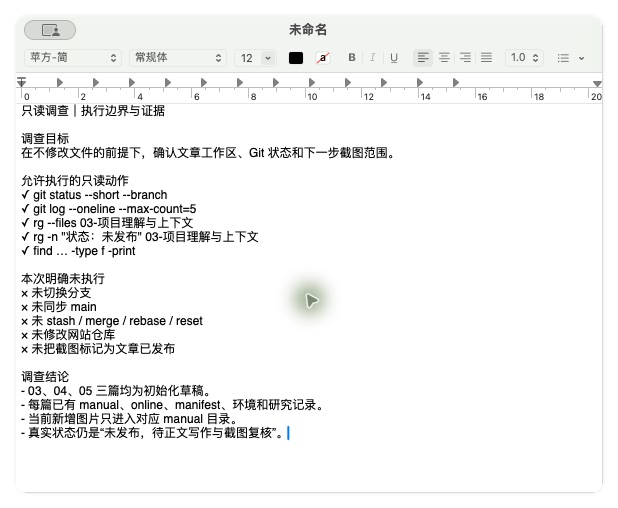
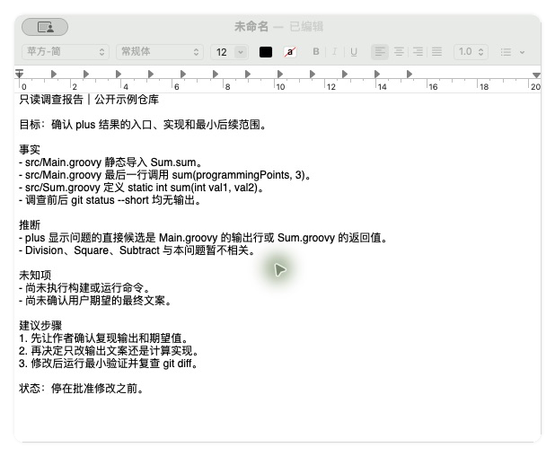
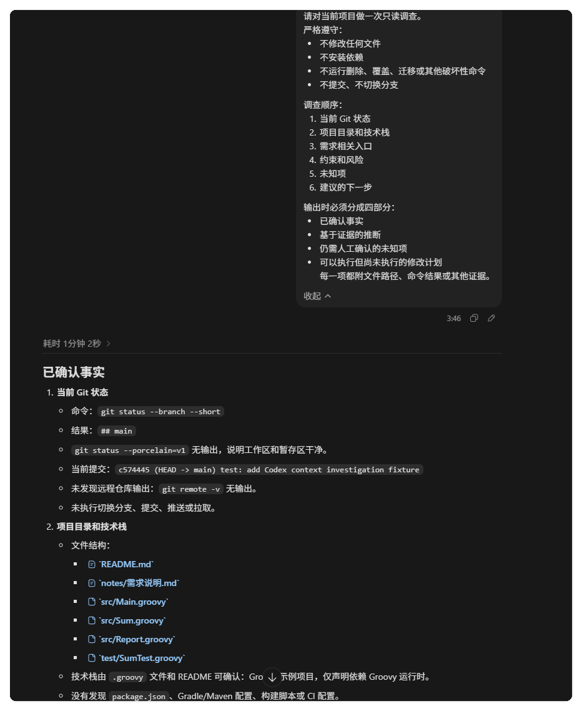
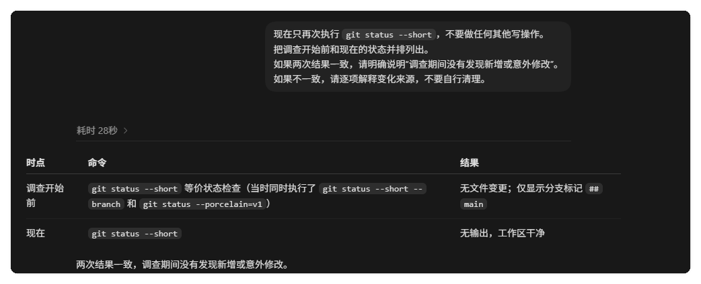

# Codex 只读调查：先把项目摸清楚再改代码，用 /plan 和只读权限把调查与修改分开

> 本文在线版：[codexguide.io/guides/codex-zhi-du-diao-cha-xian-ba-xiang-mu-mo-qing-chu-zai-gai-dai-ma](https://codexguide.io/guides/codex-zhi-du-diao-cha-xian-ba-xiang-mu-mo-qing-chu-zai-gai-dai-ma)

> 截图采集于当时版本，现行行为以官方文档为准。

> 核对依据：2026-11-26 打开的 [Permissions](https://learn.chatgpt.com/docs/permission-modes)、[Sandbox](https://learn.chatgpt.com/docs/sandboxing) 和 [Prompting](https://learn.chatgpt.com/docs/prompting)。同一天的 `codex-cli 0.172.0` 上，`codex exec --help` 把 `--sandbox` 的可选值写成 `read-only`、`workspace-write`、`danger-full-access`。没有打开 TUI，没有重跑文中的调查，没有新截图。

## 先把调查和修改分成两个任务

面对复杂或高风险的任务，直接让 Codex 动手是最贵的做法。改错了要回滚，改多了要排查，而它本来可以先只做一件事：把项目摸清楚，把证据交给你，再由你决定改不改。

这篇文章我把一次完整的只读调查走了两遍：先在本机用只读命令手动做一遍，再把同一个调查框架交给 Codex 执行。两遍都停在批准修改之前，并且用 Git 状态证明调查期间没有产生任何改动。2026-11-26 这次更新没有重跑那两遍，只把「不许改」从提示里的一句话，对照到现行的沙箱和 `/plan`。

调查和修改要分成两个任务。第一段只收集证据、写出尚未执行的计划。你批准之后，再开第二段去改。不要在同一条提示里既要求只读，又要求顺手修好。

入口该怎么从目录收到真正要改的文件，见 [从目录到入口](./03-从目录到入口-找到真正需要修改的代码.md)。上下文给多少才够，见 [给 Codex 多大上下文才够用](./04-给Codex多大上下文才够用.md)。

## 哪些任务适合先调查

不是所有任务都需要只读调查。改一行文案、加一个日志，直接做更快。值得先调查的通常是这几类：

- 涉及多个目录或模块，影响范围一眼看不全。
- 仓库里有历史代码、生成代码或你不熟悉的依赖。
- 失败代价高，比如动数据库结构、构建配置或线上脚本。
- 你对需求的理解本身还没被验证，改下去可能方向就是错的。

判断标准很简单：如果「改错了再退回来」的代价比「先花几分钟调查」高，就先调查。

## 把「不许改」落到权限上

只读调查的第一步仍然是把「不许做什么」写明白。我为本机演示整理的边界如下：允许执行的只有 `git status --short --branch`、`git log --oneline --max-count=5`、`rg --files`、`rg -n` 和 `find` 这类只读命令；明确不执行的包括切换分支、同步 main、stash/merge/rebase/reset、修改演示项目以外的目录，以及提交、推送这类状态变更。

> 图一　调查前先把允许执行的动作和明确不执行的动作逐条写下。画面是当时的笔记，不是 Codex 的权限菜单。

注意边界不只在命令层面，也包括不伪造进度。这次调查如实记录了演示项目的订单模块还没有测试覆盖，真实状态是「待补测试」。只读调查要把看到的内容完整写下来，包括那些说明「还没做完」的证据。

这些句子是提示边界。模型可以读到，但它们不是操作系统拦住写文件。2026-11-26 的权限文档把两件事分开：

- **沙箱**决定能访问哪些文件和网络。
- **审批**决定什么时候停下来，或把请求交给自动审查。

换谁来审，不会把沙箱放大。文档的例子是：**Approve for me** 和 **Ask for approval** 保持同一条工作区边界；它只是把越过边界的请求交给自动审查。桌面端和 IDE 的权限控件在输入框下面。CLI 里输入 `/permissions`。本文没有打开这些菜单。

沙箱页列出的常见模式：

- `read-only`：可以查看文件，但不能在没有审批的情况下改文件或运行命令。
- `workspace-write`：可以读文件，在工作区内编辑，并在这条边界里跑例行的本地命令。文档把它写成本地工作的默认低摩擦模式。
- `danger-full-access`：不加沙箱限制。只有你确实要它以完整权限行动时才用。

所以「只读调查」如果要落到权限上，选的是 `read-only`，而不是只在提示里写「不要改」。`read-only` 也不是「任何命令都跑不了」：文档写的是不能在没有审批的情况下改文件或运行命令。调查用的只读命令如果触发审批，你仍然要看那一条是不是真的只读，再决定放不放。

同一天的 `codex exec --help` 里，`--sandbox` 的可选值就是 `read-only`、`workspace-write`、`danger-full-access`。`--approve-for-me` 的说明是：用 `workspace-write` 沙箱，把审批交给自动审查。这和「Approve for me 不扩大沙箱」是同一方向。本文没有执行这个开关，也没有用 `--sandbox read-only` 重跑文中的演示。权限、审批和子线程的更长说明见 [权限、沙箱与审批](../02-核心概念与任务方法/06-权限沙箱与审批-什么时候放行什么时候收紧.md)。

默认的本地低摩擦组合是 `workspace-write` 配 `on-request`。那个组合适合已经决定要改的任务。调查阶段不要停在默认值上不看，就以为提示里的「不许改」已经生效。

## 先出方案：/plan 和只读调查

[Prompting](https://learn.chatgpt.com/docs/prompting) 写：多步任务要让 Codex 先调查、提出做法再编辑时，在应用的输入框里输入 `/plan`。Goal 模式可用时，计划之后再用 `/goal` 设定一个持续的目标。当前命令列表见[斜杠命令参考](https://learn.chatgpt.com/docs/reference/slash-commands)。

这句说的是桌面端输入框。它没有写 `/plan` 会把 `sandbox_mode` 改成 `read-only`。站内 [Plan 模式](../02-核心概念与任务方法/08-Codex-Plan模式-先出计划再动手.md) 按 Codex 源码里的 plan 模板说明：Plan 模式做的是读文件、搜索、静态分析这类不改仓库的操作。那是给模型的规则，不是沙箱切换。需要硬保证，Plan 和只读沙箱一起用。

只读调查仍然要你自己的报告格式。`/plan` 负责先出做法；四栏报告负责把事实和推断分开，并停在批准之前。不要用一份计划代替未知项。

## 调查报告要分四栏

调查最大的浪费，是产出一篇读起来很顺、但分不清哪些是事实的总结。我要求的报告格式固定分四栏：事实、推断、未知项、建议步骤。

> 图二　公开示例仓库的只读调查报告：事实都有命令依据，推断标注依据，未知项不猜，建议步骤停在批准修改之前。

这份针对公开示例仓库的报告里，事实栏的每一条都能对上证据：`src/Main.groovy` 静态导入 `Sum.sum`，最后一行调用 `sum(programmingPoints, 3)`，`src/Sum.groovy` 定义 `static int sum(int val1, val2)`，调查前后 `git status --short` 均无输出。推断栏只写「plus 显示问题的直接候选是 Main.groovy 的输出行或 Sum.groovy 的返回值」，并注明 Division、Square、Subtract 暂不相关。未知栏承认两件事：尚未执行构建或运行命令，尚未确认用户期望的最终文案。建议先让需求方确认复现输出和期望值，再安排修改。

这个顺序是有意为之的。只读调查的产出是一份能支持下一位维护者决策的报告，修改补丁要留到后续任务。

## 把调查框架交给 Codex

手动流程验证过之后，我把同一个框架写成指令交给 Codex，调查对象是一个涉及 `src`、`test`、`notes` 多个目录的测试项目。指令里写死四条禁令：不修改任何文件，不安装依赖，不运行删除、覆盖、迁移或其他破坏性命令，不提交、不切换分支。调查顺序固定为六步：当前 Git 状态、项目目录和技术栈、需求相关入口、约束和风险、未知项、建议的下一步。输出必须分成四部分：已确认事实、基于证据的推断、仍需人工确认的未知项、可以执行但尚未执行的修改计划，每一项都附文件路径、命令结果或其他证据。

> 图三　Codex 的只读调查报告开头：Git 状态和项目结构逐条附命令与结果，耗时 1 分 2 秒。截图采集于当时版本。

报告的事实栏完全按证据组织。Git 状态部分写明用了 `git status --branch --short`，结果是 `## main`，`git status --porcelain=v1` 无输出，说明工作区和暂存区干净；当前提交是 `c574445`，`git remote -v` 无输出，未执行切换、提交、推送或拉取。项目结构部分列出 `README.md`、`notes/需求说明.md`、`src/Main.groovy`、`src/Sum.groovy`、`src/Report.groovy`、`test/SumTest.groovy`，并根据 `.groovy` 文件和 README 判断这是 Groovy 示例项目，同时注明没有发现 `package.json`、Gradle/Maven 配置、构建脚本或 CI 配置。

每一条事实都自带「怎么知道的」。这样的报告你可以抽查任意一行，而不是只能整体信任或整体怀疑。

如果你希望这类禁令和调查顺序不用每次重写，可以把稳定的部分沉淀成项目规则，具体写法见 [AGENTS.md 怎么写](../10-配置模型与权限安全/07-AGENTS.md怎么写-项目规则继承关系与验收标准.md)。规则文件仍然不是沙箱。两样都要：规则让下一次调查还用这四栏，`read-only` 让未审批的写入走不到磁盘上。

## 调查结束后，先证明它没动过

只读调查最容易被跳过的一步，是验收「只读」本身。报告写得再规矩，也可能有意外改动混在里面。我的做法是让 Codex 在调查结束后再次执行 `git status --short`，和调查开始前的状态并列对比：两次一致就明确说明「调查期间没有发现新增或意外修改」，不一致就逐项解释变化来源，不要自行清理。

> 图四　调查开始前和结束后的 Git 状态对照：两次均无文件变更，确认没有新增或意外修改。画面写明耗时 28 秒。

这次验收的结果是两次输出一致，调查期间没有新增或意外修改。指令里特意写了「不要自行清理」。如果发现意外改动，应报告来源并保留现场，才能知道调查过程碰过什么。

这一步成本只有几十秒，但它把「我相信它没改」变成「有证据证明它没改」。高风险任务里，这个区别就是敢不敢授权下一步的区别。`git status` 证明的是工作区文件。它证明不了沙箱之外的网络请求或别的目录。调查如果声明了范围，验收就按那个范围再查一次。

## 从调查报告到下一轮任务

只读调查最终要形成可执行的修改计划。报告第四栏「可以执行但尚未执行的修改计划」就是下一轮的输入，其中列出要改的文件、理由、关联证据和验证方式。你批准之后，Codex 进入修改流程时不需要重新调查。

交接时建议保留三样东西：报告原文、调查前后的 Git 状态对照、你批准或否决的决定。批准了，报告就是修改任务的上下文；否决了，报告是下次讨论的依据。两种情况下调查都不算浪费。

要把这份报告收成下一个人能复核的项目理解报告，见 [把调查结果写成项目理解报告](./10-把调查结果写成项目理解报告.md)。批准后怎么把第一次修改的范围管住，见 [完成第一次网页修改](../00-从这里开始/07-完成第一个真实任务.md)。

## 小结

只读调查的完整动作是：先判断是否值得调查，再写清允许和禁止的边界，并用 `read-only` 让未审批的修改走不到文件上。多步任务在桌面端可以用 `/plan` 先出做法。然后按现状、入口、约束、风险、未知项、建议步骤收集证据，输出时把事实、推断、未知项和未执行的修改计划分开，最后用 Git 状态对照证明调查期间没有改动。

它不能替代的部分也要说清楚：调查结论里的推断仍需人来确认，修改计划仍需人来批准。Codex 负责把项目摸清楚，决定权留在你手里。

## 参考资料

- [Permissions](https://learn.chatgpt.com/docs/permission-modes)
- [Sandbox](https://learn.chatgpt.com/docs/sandboxing)
- [Prompting](https://learn.chatgpt.com/docs/prompting)
