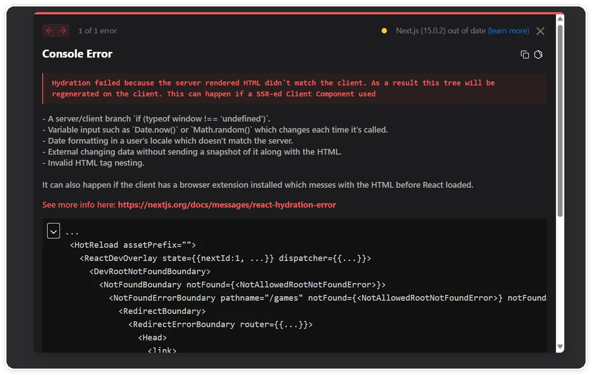
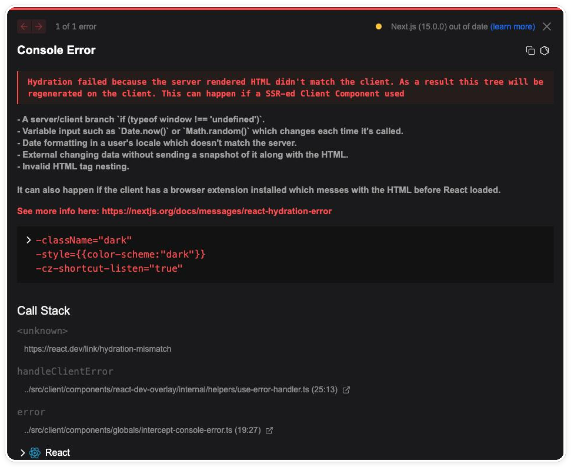

# Codex 从报错或需求反推影响范围：先只读调查，按堆栈找直接入口，查五类间接影响，再按证据给风险分级

> 本文在线版：[codexguide.io/guides/codex-cong-bao-cuo-huo-xu-qiu-fan-tui-ying-xiang-fan-wei](https://codexguide.io/guides/codex-cong-bao-cuo-huo-xu-qiu-fan-tui-ying-xiang-fan-wei)

> 核对依据：2026-11-28 打开的 [Permissions](https://learn.chatgpt.com/docs/permission-modes)、该页指向的 [Sandbox](https://learn.chatgpt.com/docs/sandboxing)、[Developer commands](https://learn.chatgpt.com/docs/developer-commands) 的 `/permissions` 与 `/plan`，以及 [Prompting](https://learn.chatgpt.com/docs/prompting) 的 Explain a codebase 和 Fix a bug。订单案例和三张报错图是 2026-08-19 的记录，环境写在文末。这次没有重跑桌面端或 CLI，没有新的命令输出。

拿到一条报错，最直接的反应是找到出错的那一行改掉。很多时候这一改确实能修好当前页面。过几天，另一个页面、另一份导出或定时任务可能暴露新的问题，原因仍然是同一个函数。

这篇文章只做一件事：把「改之前先算影响范围」变成固定动作。调查阶段怎么保持只读，见 [只读调查](./05-只读调查怎么做-先让Codex把项目摸清楚.md)。权限和沙箱的完整对照，见 [权限、沙箱与审批](../02-核心概念与任务方法/06-权限沙箱与审批-什么时候放行什么时候收紧.md)。

## 先说结论

影响范围先写成表，再决定改哪几行。表上的每一行都要有证据：文件路径、你看到的事实、准备怎么验证。没有证据的区域保持原样。

报错和需求用的是同一张表。报错从堆栈和日志往里找直接入口，需求从关键词往外找同一批文件。直接入口只是起点。接着沿调用方、共享模块、数据结构、配置、缓存五个方向看间接影响，再按证据分成直接影响、间接影响和暂不相关。

交给 Codex 时，先切到只读或先要计划，让它复述将要修改的行。改完之后按表上的验证方式逐条回归，而不是只看报错那一页已经不红了。

## 先切到只读

调查阶段的目标是列出文件和证据，不是提交补丁。2026-11-28 的 Permissions 页没有把「只读」写成一种模式的名字。它写的是两件事：

- 多数工作从 **Ask for approval** 开始。它允许在当前工作区内做事，越出这个边界之前会停下来。
- 沙箱决定能访问哪些文件和网络。审批决定什么时候暂停，或把请求交给自动审查。更换审阅者不会扩大沙箱。例如 **Approve for me** 和 **Ask for approval** 的工作区边界相同，只是越界请求改由自动审查处理。

桌面端和 IDE 用输入框下方的权限控件。CLI 输入 `/permissions`。这一页把技术细节指到 Sandbox 文档。

Sandbox 页对常见沙箱的定义里，`read-only` 是：可以查看文件，但不能在未经批准的情况下编辑文件或运行命令。`workspace-write` 是另一档：可以读、可以在工作区内编辑，并在这个边界内运行常规本地命令。调查不要从第二档开始。Developer commands 里，`/permissions` 的预设例子包括 `Auto`（少打断地跑）和 `Read Only`（用来 review edits）。选 **Read Only** 是这条命令文档里和「先看不改」最接近的预设。它没有写「连查看文件的命令也不许出现」；和 Sandbox 页对齐的理解是：编辑和运行命令在未获批准时不会发生。

还没决定要改什么时，可以先要一份计划。CLI 的 `/plan` 是切到 plan 模式，并可以顺便带上一段提示词，让 Codex 在实现开始之前给出执行计划。IDE 扩展里的 `/plan` 是切换多步规划的 plan 模式。计划模式怎么交接，见 [Plan 模式](../02-核心概念与任务方法/08-Codex-Plan模式-先出计划再动手.md)。计划通过之后再单独开一轮修改，不要在同一句里既要调查又要改文件。

下面这段提示词按 Prompting 页的写法组装：Explain a codebase 要求说明请求怎么流过、每个模块负责什么、数据在哪里校验，并给出可以核对的步骤和文件列表；Fix a bug 要求 Bug、Repro、Constraints 分开，并写明复现步骤和约束比高层描述更重要。这里没有加入文档里没有的命令行参数。

```text
Bug: 订单列表的金额有时显示为 NaN。
Repro:
1) 打开订单列表。
2) 列表里包含金额字段为 null 或字符串的订单。
3) 金额列显示 NaN。预期是格式化后的金额，或一个明确的占位。

请只读调查，不要修改、创建或删除文件，不要安装依赖，不要提交。
从报错文本、日志或复现步骤找到错误第一次产生的那一行，把它当作直接入口。
然后沿五个方向列出间接影响：调用方、共享模块、数据结构、配置、缓存。
每一行给出文件路径和你看到的证据。证据不足就写「待确认」，不要猜测。

请按 Explain a codebase 的方式收尾：
- 用编号列出从输入到错误显示的步骤
- 列出涉及的文件
- 标出改这一处时要当心的一到两个点

Constraints:
- 这一轮只输出影响范围表和验证清单。
- 不要选择业务上还没约定的行为，例如 null 显示 0 还是占位符。
- 没有证据的区域标成暂不相关或待确认，不要提出修改。
```

IDE 里先打开堆栈里属于本仓库的那一个文件，再把同一段发出去。Prompting 页写明，IDE 扩展会带上当前打开的文件；CLI 里要用路径或 `@` 把文件点出来。金额字段的文件名以你仓库里的为准，不要照抄下文案例里的 `format.js`，除非你打开的就是这个练习项目。

只读调查的步骤、怎样证明调查期间没有留下改动，见 [只读调查](./05-只读调查怎么做-先让Codex把项目摸清楚.md)。调用链从路由追到数据的写法，见 [依赖调用链](./09-依赖调用链怎么追-从接口路由到数据流.md)。

## 修对地方，只是第一步

本文用两个案例各走一遍。一个从报错出发，一个从需求出发，最后都落到同一张影响范围表上。两个案例的证据起点不同，落点一样。

案例沿用当时练习用的订单管理项目：订单列表页金额偶尔显示为 NaN。这是教学例子，用来展示表怎么填，不是一份可以拿去改生产仓库的诊断。

如果你还没让 Codex 改过项目，可以先阅读 [从目录到入口](./03-从目录到入口-找到真正需要修改的代码.md)，再回来对照这里的范围分析。

## 先把现象拆成四格

影响范围分析先从现象开始。动手之前，把报错拆成四格写下来：

- 输入：打开订单列表页，列表中包含特定订单。
- 触发条件：订单金额字段为 null 或字符串，而不是数字。
- 实际结果：金额列显示 NaN。
- 预期结果：显示格式化后的金额，或一个明确的占位。

四格写完，「偶尔」就有了具体含义。它只在特定数据形状下出现。后续应沿数据处理路径排查。渲染层如果只是把函数的返回值放进单元格，它是调用方，不是错误第一次产生的地方。

这四格和上一节提示词里的 Bug、Repro 是同一份信息。预期结果里如果还有业务没选的分支（占位符还是 0），写进 Constraints，不要在调查轮里替业务选。

## 从堆栈和日志定位直接入口

现象拆完，才轮到代码。报错类案例的证据起点是堆栈、日志和复现步骤。目标是找到直接入口，也就是错误第一次产生的那一行。

读堆栈时从上往下分三层，再决定哪一层算入口：

1. 运行时或框架的帧，例如浏览器、打包器、框架的渲染函数。它们说明错误怎样被报告出来，通常不是你要改的文件。
2. 依赖包里的帧。除非错误只在你们钉住的某个版本里出现，否则先记下来，不要在调查轮里升级依赖。
3. 本仓库里的第一帧。这一帧通常就是直接入口：你的函数收到了不该产生 NaN 的输入，并在这里做了运算。

本例中沿日志和复现步骤定位到 `src/utils/format.js` 的 `formatAmount`：它直接对金额字段做算术运算，输入不是数字时就产出 NaN。这就是直接入口。

报错证据具体长什么样，可以看另一组当时留下的截图。它来自当时另一台机器上的 Next.js 练习项目的 hydration 报错，和订单案例不是同一个项目。这次没有重拍。证据的形态仍然是：先是浏览器给出的报错文本，再是控制台里的完整原因和组件树，最后是逐层向下的调用栈。


> 图一　报错提示条：错误类型和排查文档入口（hydration 报错示例）。



> 图二　控制台完整报错：可能原因列表和组件树。



> 图三　调用栈详情：从报错入口逐层向下。

直接入口不等于唯一改动点。它只是故障传播的起点。接下来要查的是这个起点往外连着什么。把「第一帧在 `formatAmount`」写成事实；把「所以只改这一行就够了」留到五类都查完之后。

## 间接影响查五类

直接入口确定后，沿五个方向查间接影响。每查一处留下证据：文件路径、你看到的引用或「搜过但没有引用」、准备用什么方式验证。

1. **调用方。** 搜索函数名，列出每一个引用，并分成页面、接口、脚本、测试。本例里 `src/pages/OrderList.vue` 调用 `formatAmount` 渲染金额列。其他页面有没有也在调它，要逐个搜出来，不能只看堆栈里出现的那一个页面。堆栈只证明这一次渲染走到了这里。
2. **共享模块。** `format.js` 是工具模块。被 import 的次数越多，改动传导得越远。把 import 列表贴进表里。只有一个调用方时，共享风险就低，这条仍然要写，不能因为「看起来像工具函数」就直接定成高风险。
3. **数据结构。** 追到字段的生产者。本例里 `src/api/orders.js` 返回的订单金额字段类型不稳定，这才是 NaN 的数据来源。生产者没看之前，不要把修复只写成「显示层容错」。数据形状没约定时，显示层的修改只覆盖已经写进测试的那一种输入。
4. **配置。** 查构建配置、环境变量和功能开关里有没有金额格式、币种或区域设置。本例没有证据表明它们参与格式化，标记为暂不相关。标记的依据是「查过这些文件，没有金额逻辑」，不是「大概没关系」。
5. **缓存。** 查列表有没有把格式化之后的字符串存进内存、本地存储或接口缓存。本例中列表页没有金额缓存逻辑，排除。有缓存时，改了函数之后旧字符串仍可能被读出来，验证方式就要加上清缓存或等失效，而不能只刷新一次页面。

查完把结果填进影响范围表，分三档：直接影响、间接影响、暂不相关。每一档都要带证据。「没查到」和「查到并排除」是两回事，都要写下来。没查的方向写「待确认」，不要为了表好看填成暂不相关。

| 区域 | 档位 | 证据 | 验证方式 |
| --- | --- | --- | --- |
| `src/utils/format.js` 的 `formatAmount` | 直接影响 | 对非数字输入产出 NaN | 边界值单元测试 |
| `src/pages/OrderList.vue` | 间接影响 | 调用 `formatAmount` 渲染金额列 | 页面人工回归 |
| `src/api/orders.js` | 间接影响 | 金额字段可能返回 null 或字符串 | 接口数据抽查 |
| `tests/orders.spec.js` | 间接影响 | 覆盖订单列表，未覆盖异常金额 | 补充用例 |
| 路由、构建配置 | 暂不相关 | 无金额逻辑引用 | 不动 |

导出、打印、邮件模板如果也调用同一个函数，它们是调用方，应该另起一行。表上没有的文件，后面的修改提示词里就不要出现。

## 用证据给风险分级

影响范围表填完，再给每一档标风险。分级只看证据：

- `formatAmount` 被多个页面共享时，改它的行为会传导到所有调用方，定中高风险，需要回归所有调用页面。只有一个调用方时，不要沿用这个等级。
- `OrderList.vue` 只是展示调用，定低风险。低风险的意思是：这一轮可以不改它，但验证清单里仍要打开这个页面，确认它消费的是新的返回值。
- 路由和构建配置没有任何金额相关证据，不定级，不动。

分级管的是修改范围。没有证据的区域不改。看起来可疑，就继续查；查不到证据，就保持原样，并在表上留下「待确认」。

稳定下来的顺序可以写进项目规则，让以后的对话先出表再改代码。写法见 [AGENTS.md 怎么写](../10-配置模型与权限安全/07-AGENTS.md怎么写-项目规则继承关系与验收标准.md)。规则里写「先只读、先出表」，不要把某一次订单案例的文件名写成所有仓库的入口。

## 需求案例：同一张表，换一个证据起点

再看需求案例。新需求是「订单金额按千分位显示」。没有报错，没有堆栈。证据起点换成需求里的词：金额、显示、格式化。

用这些词搜索，命中的是同一个 `format.js`。报错从堆栈往里追，需求从关键词往外扩，两条路最后落在同一张表上，表的结构不变。

差别出在间接影响。千分位是展示规则的变化，所有调用 `formatAmount` 的页面都会跟着变样。项目里如果还有导出、打印这类同样展示金额的环节，也要列入检查。NaN 修复只影响异常数据的展示，正常数字的外观可以保持不变。同一张表，填出来的行不一样。

需求没有复现步骤时，Repro 改成「按需求里的词搜索，并打开每一个命中文件」。Constraints 仍然要写：这一轮不改文件；展示规则如果会影响导出文件的列宽或对账，先标成待确认。关键词搜不到时，不要改去搜一个更宽的词然后开始改代码。先把「这些词没有命中」写进待确认，再决定要不要换词。

调查结束时的文件列表和证据，可以按 [项目理解报告](./10-把调查结果写成项目理解报告.md) 收成一份别人能接着看的记录。影响范围表就是那份报告里「改哪里、为什么、怎么验证」的一节。

## 把影响范围表交给 Codex

两个案例的表填完之后，再把同一套方法写成指令。要求仍然是只读：不修改文件；先确认仓库状态；从报错文本或需求关键词出发定位直接入口；沿五个方向查间接影响；输出三档表，每一行附文件路径和证据；最后由影响范围推导出验证清单。证据不足的行写「待确认」。

有一类问题不该替业务做决定。比如「金额为 null 时显示占位符还是显示 0」，这是业务取舍。表里写上选项，以及每个选项会碰到哪些调用方，然后停下来。不要挑一个顺手的实现放进补丁。

约定已经写进表之后，修改分成两轮，不要并成一句「按表修一下」。

**改之前，让 Codex 复述范围。** 把表贴进对话，用一段只复述、不改文件的提示词：

```text
下面是已经确认的影响范围表。请只复述，不要修改文件。
1) 这一轮允许修改的文件有哪些？
2) 只回归、不修改的文件有哪些？
3) 明确不动的文件有哪些？
4) 还有哪些行是待确认，因此不能改？
如果复述和表不一致，停下来指出不一致的行。
```

复述多出来的文件，先改表或删掉，再允许它动手。复述少掉的验证行，先补上，避免修完只看了堆栈里的那一个页面。

**改的时候，把范围写进约束。** 最小补丁、先补会失败的回归测试、修完重跑复现，见 [修复可复现 Bug](../04-代码修改与开发实战/04-修复一个可复现Bug-让补丁只解决当前问题.md)。那一篇的 Constraints 用来卡住「只改约定的行为」。本篇的表用来卡住「只改表上允许的文件」。

**改完之后，按表逐条回归。** 不要用一句「相关测试已通过」代替表上的验证方式。本例至少四条：

| 表上的行 | 改完要做的事 | 怎样算这一条有结果 |
| --- | --- | --- |
| `formatAmount` | 跑边界值单元测试，包含非数字和合法的 0 | 命令、退出状态和失败断言都写出来 |
| `OrderList.vue` | 打开列表页，看异常金额和正常金额 | 记下看到的字符串，而不是「页面正常」 |
| `orders.js` | 抽查接口里金额字段的实际类型 | 写出看到的 null、字符串或数字，没有抽查就写未做 |
| 路由和构建配置 | 不改 | 用 diff 确认这些路径没有出现 |

待确认的行不参与这次回归，也不要在同一轮里顺手改掉。导出和打印如果中途才发现也调用了 `formatAmount`，把它们补进表，再决定要不要第二次修改。

影响范围表适合作为第一次真实改动的输入：范围小、证据全、验收标准写在验证方式那一列。第一次只改一个本地页面时的尺度，见 [第 4 课](../00-从这里开始/07-完成第一个真实任务.md)。

## 小结

先把现象拆成输入、触发条件、实际结果和预期结果。用只读权限或 plan 模式让 Codex 只调查不改。从堆栈里属于本仓库的那一帧，或从需求关键词，定位直接入口。沿调用方、共享模块、数据结构、配置、缓存五个方向查间接影响。结果分成直接影响、间接影响和暂不相关，每行附证据。按证据给风险分级。改之前让 Codex 复述允许修改的文件，改完按表逐条回归。

报错和需求用的是同一张表，差别只在证据起点。范围写清楚之后，改代码是按表执行，不是重新猜测该动哪里。

## 参考资料

- [Permissions](https://learn.chatgpt.com/docs/permission-modes)（2026-11-28）
- [Sandbox](https://learn.chatgpt.com/docs/sandboxing)（2026-11-28）
- [Developer commands](https://learn.chatgpt.com/docs/developer-commands)（2026-11-28）
- [Prompting](https://learn.chatgpt.com/docs/prompting)（2026-11-28）
- [Codex 只读调查](./05-只读调查怎么做-先让Codex把项目摸清楚.md)
- [Codex 权限、沙箱与审批](../02-核心概念与任务方法/06-权限沙箱与审批-什么时候放行什么时候收紧.md)

当时的记录：测试环境为 Windows 11 24H2（Build 26100）；Codex Desktop 26.814.5167.0；Codex CLI 0.147.0；2026-08-19 核验。三张图和订单案例属于那次记录。2026-11-28 没有重跑这套环境。
