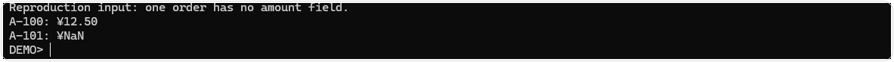
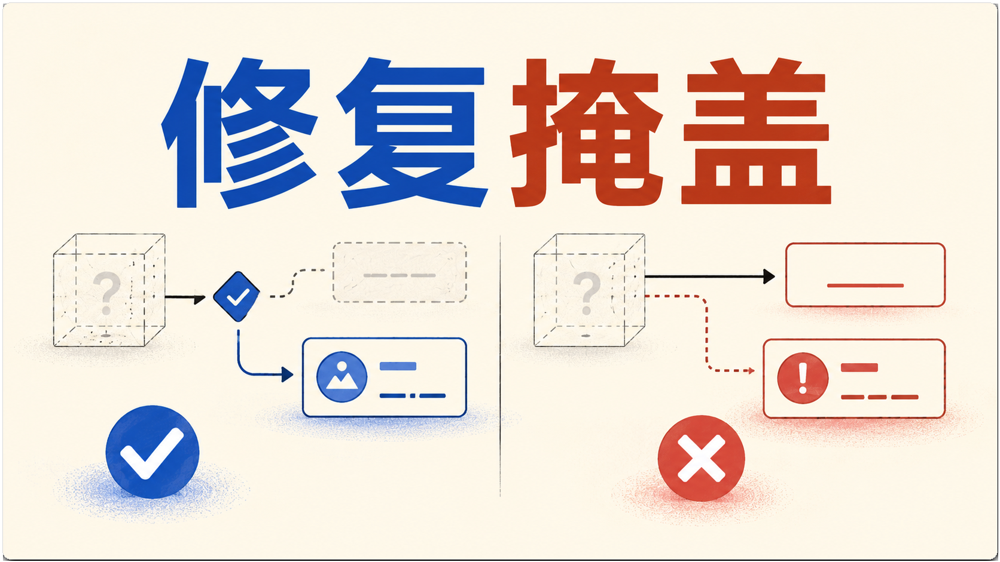

# Codex 修复可复现 Bug：先给复现步骤和约束，补回归测试，再做最小补丁，修完重跑复现并用 /review 自查

> 本文在线版：[codexguide.io/guides/codex-xiu-fu-ke-fu-xian-bug](https://codexguide.io/guides/codex-xiu-fu-ke-fu-xian-bug)

> 核对依据：2026-11-28 打开的 [Prompting](https://learn.chatgpt.com/docs/prompting)（Fix a bug、Do a local code review）、[Developer commands](https://learn.chatgpt.com/docs/developer-commands)（`/review`、`/diff`）和 [Code review](https://learn.chatgpt.com/docs/code-review)。练习里的命令输出是 2026-09-23 在 macOS 15.6、Node.js v22.11.0 的独立副本中留下的记录，这次没有重跑。没有打开桌面端或 IDE。

这是一篇完成基础课程后的选学教程。你会在一个独立的 JavaScript 练习副本中，复现订单缺少金额字段时出现的 `NaN`，先用测试固定正确期望，再让 Codex 做最小修改，最后检查差异，并确认新测试确实能抓住旧错误。

本练习只约定四件事：输入 `12.5` 显示 `¥12.50`，输入 `0` 显示 `¥0.00`，订单没有 `amount` 或格式化函数收到 `undefined` 时显示 `--`，订单顺序和接口结构保持不变。`null`、空字符串、非数字文本、币种转换和精度策略不在本次范围内。

还没把项目摸清时，先做 [只读调查](../03-项目理解与上下文/05-只读调查怎么做-先让Codex把项目摸清楚.md)。报错会牵动调用方和数据来源时，先做 [影响范围](../03-项目理解与上下文/06-从报错或需求反推影响范围.md)，再回到这里写最小补丁。

## 怎么给 Codex 下指令

Prompting 页的 **Fix a bug** 用于你能在本地复现的失败行为。它把 CLI 和 IDE 分成两条，并写明：复现步骤和约束由你提供，这些比一段高层描述更重要。Codex 侧能补上的是命令输出、它找到的调用点，以及它触发的堆栈。

CLI 示例从仓库根目录运行 `codex`，然后把现象、步骤和约束写在同一段里。官方示例原文是：

```text
Bug: Clicking "Save" on the settings screen sometimes shows "Saved" but doesn't persist the change.

Repro:
1) Start the app: npm run dev
2) Go to /settings
3) Toggle "Enable alerts"
4) Click Save
5) Refresh the page: the toggle resets

Constraints:
- Do not change the API shape.
- Keep the fix minimal and add a regression test if feasible.

Start by reproducing the bug locally, then propose a patch and run checks.

```

三段各自做什么：

- **Bug** 写观察到的现象：点了保存，界面显示已保存，刷新后开关回到原样。
- **Repro** 写能稳定走到这个现象的步骤，包括启动命令和路径。`npm run dev` 是这个示例里的启动方式，不是所有项目的命令。
- **Constraints** 写不能动什么，以及修复要小、可行时补回归测试。

最后一句要求先在本地复现，再提出补丁并跑检查。

IDE 示例是：打开你认为出错的文件和最近的调用方，然后使用：

```text
Find the bug causing "Saved" to show without persisting changes. After proposing the fix, tell me how to verify it in the UI.

```

IDE 这段比 CLI 短。Prompting 页同时写明，IDE 扩展会自动带上当前打开的文件；CLI 里要自己写出路径，或用 `/mention` 和 `@` 补上文件。短提示词成立的前提是文件已经打开。文件没打开时，仍把复现步骤和约束写全。

下面的金额练习把同一结构落到一个不依赖业务仓库的副本上：先只读追踪 `undefined` 为什么变成 `¥NaN`，再只加测试，最后只改格式化函数。

## 先固定现象

### 准备练习副本

这是基于原文案例整理的独立教学示例，不是原生产项目。你需要已完成基础课程、能打开练习目录的 Codex 入口，以及 Node.js 22 或更高版本、一个终端和可以查看文本差异的编辑器。本练习使用 Node 内置 `node:test` 和 `node:assert/strict`，不需要安装依赖、初始化 Git 或打开真实业务仓库。

[下载 Bug 修复与回归测试练习包（ZIP）](../练习材料/Codex修复Bug回归测试练习包.zip)

解压后进入 `bug-regression-lab/`。包内的 `starter/` 保留已知缺陷，`reference/` 单独放置参考测试和修复；实际操作前先复制一份起点。

```text
bug-regression-lab/
├── README.md
├── TASK.md
├── CHECKLIST.md
├── starter/
│   ├── src/formatAmount.mjs
│   ├── demo.mjs
│   └── test/formatAmount.test.mjs
└── reference/
    ├── formatAmount.fixed.mjs
    ├── formatAmount.regression.test.mjs
    └── 参考差异.md
```

在练习包根目录运行下面的命令。macOS/Linux 使用第一组，Windows PowerShell 使用第二组。

```bash
node --version
cp -R starter bug-regression-work
cd bug-regression-work
```

```powershell
node --version
Copy-Item -Recurse starter bug-regression-work
Set-Location bug-regression-work
```

2026-09-23 的记录使用的是 macOS 15.6、Node.js `v22.11.0`。如果找不到 `node` 或版本过低，先准备兼容环境；不要修改网站项目的 Node 版本和锁文件。

### 运行已有测试，再运行复现命令

“复现”是用固定输入稳定看到同一个错误；“断言”是代码对结果的明确要求，例如实际值必须等于 `¥12.50`。“回归测试”把已经确认的正确行为保存成可重复执行的检查，后续修改时继续检查它。

在 `bug-regression-work/` 内执行：

```bash
node --test test/formatAmount.test.mjs
node demo.mjs
```

已有测试只检查正常金额和合法的零值。2026-09-23 的记录是 2 条测试通过，复现命令输出：

```text
A-100: ¥12.50
A-101: ¥NaN
```

这说明旧测试覆盖的行为正常，而缺失金额的错误可以稳定出现。测试通过不等于没有 Bug。



图一：原文示意图，展示正常金额和缺失金额的输出关系；练习的真实结果以你运行的终端命令为准。

## 先问根因，再写补丁

在 Codex 中打开 `bug-regression-work/`，先发送下面的只读提示词。它是发给 Codex 的内容，不是终端命令。

```text
请只读调查当前练习，不要修改、创建或删除文件。
从 demo.mjs 的订单对象开始，追踪 amount 如何传给 src/formatAmount.mjs，说明 undefined 为什么会变成 ¥NaN。
同时读取 test/formatAmount.test.mjs，列出已有断言覆盖了什么、没有覆盖什么。
请给出最小修改文件、必须保持不变的输入输出和仍未确认的边界。
不要安装依赖、初始化 Git 或扩大到 reference/目录。
```

代码链很短：`demo.mjs` 读取缺少 `amount` 的订单，把 `undefined` 传给 `formatAmount`；起始实现执行 `Number(undefined).toFixed(2)`，得到字符串 `NaN`，再拼上货币前缀。修复应放在格式化函数入口，不能只在最终文本中替换 `NaN`。


图二：流程示意图，帮助理解复现、定位、测试和修复之间的顺序，不是 Codex 客户端截图。

## 最小修复的形状

### 先只增加回归测试

保持 `src/formatAmount.mjs` 不变，在 `test/formatAmount.test.mjs` 末尾增加下面的测试。不要删除或修改已有的 `12.5` 和 `0` 断言。

```js
test("uses the placeholder when amount is missing", () => {
  assert.equal(formatAmount(undefined), "--");
});
```

也可以把下面的提示词发送给 Codex：

```text
只修改 test/formatAmount.test.mjs。
保留现有 12.5 和 0 的断言，新增一条 formatAmount(undefined) 应返回 "--" 的回归测试。
不要修改 src/formatAmount.mjs，不要改测试期望，不要运行安装、构建或部署命令。
完成后展示修改文件和测试差异，先不要修实现。
```

在同一个 `bug-regression-work/` 目录重新运行：

```bash
node --test test/formatAmount.test.mjs
```

2026-09-23 的记录是 3 条测试中 2 条通过、1 条失败，失败原因是断言看到了 `¥NaN`，但期望是 `--`，退出状态为 `1`。如果看到路径、导入或 Node 缺失错误，先检查当前目录和版本，不要把那种失败当作回归测试生效。

### 再做最小实现修改

测试已经证明旧实现不满足约定后，再发送第三段提示词：

```text
现在只修改 src/formatAmount.mjs，并运行 node --test test/formatAmount.test.mjs 和 node demo.mjs。
当参数严格等于 undefined 时返回 "--"；其他现有数字继续使用原来的两位小数和 ¥ 前缀。
不要使用 if (!value)，不要改订单顺序、demo.mjs、测试期望或其他目录。
完成后报告修改文件、两条命令的真实输出和退出状态。
```

目标实现是：

```js
export function formatAmount(value) {
  if (value === undefined) {
    return "--";
  }

  return `¥${Number(value).toFixed(2)}`;
}
```

用同一组命令验收：

```bash
node --test test/formatAmount.test.mjs
node demo.mjs
```

2026-09-23 的记录是 3 条测试全部通过，复现命令变为：

```text
A-100: ¥12.50
A-101: --
```

这里使用 `value === undefined` 是为了保留 `0` 的合法含义。用 `if (!value)` 会把 `0` 一起当成缺失值，原有零值测试会暴露这个错误。

## 区分修复与掩盖

完成测试后，检查两个文件的差异（diff）：哪些行被增加、删除或替换。练习副本没有要求 Git，可以使用编辑器的比较功能；也可以在 Bash 中运行：

```bash
diff -u ../starter/src/formatAmount.mjs src/formatAmount.mjs
diff -u ../starter/test/formatAmount.test.mjs test/formatAmount.test.mjs
```

预期只有两类变化：格式化函数增加 `undefined` 分支，测试文件增加缺失金额断言。`diff` 发现差异时退出状态为 `1` 是正常情况；`2` 才表示执行出错。`demo.mjs`、接口字段和订单顺序都不应变化。PowerShell 可以用编辑器的文件比较功能，或用 `Compare-Object` 查看对应文件。



图三：概念示意图；真正的验收仍然依赖测试、复现输出和文件差异，不依赖图片。

## 修完怎么自查

Prompting 页对 Fix a bug 的验收写了两层。

第一层：修复之后重新跑复现步骤。金额练习就是再跑 `node demo.mjs`，确认 `A-101` 从 `¥NaN` 变成 `--`，同时 `A-100` 仍是 `¥12.50`。官方示例里的保存开关，则是按 Repro 再走一遍：启动、打开设置、切换、保存、刷新。

第二层，如果你有一套常规检查，官方提示词是：

```text
After the fix, run lint + the smallest relevant test suite. Report the commands and results.

```

意思是：修复之后运行 lint 和最小的相关测试，并报告命令和结果。练习副本没有单独的 lint 脚本，相关测试就是 `node --test test/formatAmount.test.mjs`。真实项目里把「最小相关」收在这次改动的模块上，不要为了这一处 `undefined` 去跑整仓无关的任务。命令和退出状态要出现在回答里。没有跑过的检查，不要写成通过。

第三层是看 diff，而不是只听叙述。仓库在 Git 里时：

- 在 CLI 里输入 `/review`，让 Codex 审查工作区里尚未提交的改动。Prompting 页的 **Do a local code review** 就是这条命令。可选的焦点写法是 `/review Focus on edge cases and security issues`。
- 接着输入 `/diff`，查看具体文件变化。Developer commands 写明 `/diff` 会显示已暂存的改动、尚未暂存的改动，以及 Git 还没跟踪的文件。
- `/review` 的预期是：总结工作区里的问题，关注行为变化和缺失的测试。它使用当前会话的模型，除非你在 `config.toml` 里设置了 `review_model`。Code review 页写明，这类审查报告发现，不修改工作区。

桌面端和 IDE 扩展里，`/review` 可以选择对照基准分支，或审查未提交改动，同样只报告发现。四个预设、`codex review` 的参数和 `review_model` 的写法见 [本地代码审查](../05-Git协作与代码审查/07-Codex本地代码审查-review命令与codex-review.md)。

金额练习没有要求初始化 Git。没有仓库时，用上面的 `diff -u` 看两个文件，不要为了跑 `/review` 去 `git init` 一个练习副本。有 Git 的真实项目里，`/review` 和 `/diff` 用来核对「是不是只改了约定的那两处」。

依赖升级带进来的行为变化，不要当成这个最小补丁的一部分，见 [安装或升级依赖](./07-安装或升级依赖-从package文件到兼容性确认.md)。页面上的点击和刷新要在浏览器里再看一遍时，见 [上线前的前端端到端验收](../06-测试调试与质量保障/01-Codex做上线前端到端验收.md)。

## 交付检查

### 在另一份副本中检查测试敏感性

为了确认你刚运行通过的同一组测试确实能抓住原始缺陷，在另一份临时副本中保留原始实现，只复制最终测试。从当前 `bug-regression-work/` 返回上一级 `bug-regression-lab/`，在 macOS/Linux 终端运行：

```bash
cd ..
cp -R starter sensitivity-check
cp bug-regression-work/test/formatAmount.test.mjs sensitivity-check/test/formatAmount.test.mjs
node --test sensitivity-check/test/formatAmount.test.mjs
```

Windows PowerShell 使用：

```powershell
Set-Location ..
Copy-Item -Recurse starter sensitivity-check
Copy-Item bug-regression-work/test/formatAmount.test.mjs sensitivity-check/test/formatAmount.test.mjs
node --test sensitivity-check/test/formatAmount.test.mjs
```

如果 `sensitivity-check/` 已存在，换一个新目录名，不覆盖旧副本。如果 Codex 跳过了先失败阶段，保留当前修复，再执行本节复核；无需反复重跑模型对话。

2026-09-23 的记录仍是 3 条测试中 2 条通过、缺失金额断言失败，退出状态为 `1`。这一步没有回滚 `bug-regression-work/`，也没有覆盖 ZIP 内的 `starter/`。

### 结果表

| 阶段 | 实现 | 测试 | 关键结果 | 退出状态 |
| --- | --- | --- | --- | --- |
| A 初始状态 | 原始实现 | 原有 2 条 | 正常金额和 `0` 通过；复现输出 `¥NaN` | 0 |
| B 增加回归测试 | 原始实现 | 3 条 | `¥NaN` 不等于 `--`，目标断言失败 | 1 |
| C 最小修复 | 增加 `undefined` 分支 | 3 条 | 正常金额、`0`、缺失金额全部通过 | 0 |
| D 敏感性复核 | 另一份原始实现 | 最终 3 条 | 同一缺失金额断言再次失败 | 1 |

这组结果是 2026-09-23 那次记录，用来说明测试覆盖了当时约定的缺失金额边界。它不证明 `null`、空字符串、非数字文本、币种和精度策略已经确定，也不宣称所有 Codex 客户端都完成了端到端验证。

## 常见问题、重新开始和下一步

- 新测试一加就找不到模块：确认终端在 `bug-regression-work/`，并检查文件名是否为 `.mjs`。
- 新测试没有失败：确认没有提前修改 `src/formatAmount.mjs`，且断言确实是 `formatAmount(undefined) === "--"`。
- `0` 变成 `--`：检查是否使用了 `if (!value)`，改为只判断 `value === undefined`。
- 修改超出两个文件：保留现有副本，把 ZIP 重新解压到一个全新的目录，再复制其中的 `starter/`，不要执行 `git reset --hard` 或清空真实项目。
- 想确认更广泛的金额规则：先为 `null`、空字符串、非数字文本、币种和精度分别取得产品约定，再单独增加测试。

完成本篇后，把同一顺序用到真实项目：复现、断言、最小修改、差异、再跑复现。范围不清楚时回到 [影响范围](../03-项目理解与上下文/06-从报错或需求反推影响范围.md)；未提交的 diff 用 [本地代码审查](../05-Git协作与代码审查/07-Codex本地代码审查-review命令与codex-review.md) 里的 `/review` 再看一遍。五课短课程仍保持原顺序，本篇是完成基础练习后的选学内容。

## 参考资料

- [Prompting](https://learn.chatgpt.com/docs/prompting)（2026-11-28，Fix a bug 与 Do a local code review）
- [Developer commands](https://learn.chatgpt.com/docs/developer-commands)（2026-11-28）
- [Code review](https://learn.chatgpt.com/docs/code-review)（2026-11-28）
- [OpenAI Codex Best Practices](https://learn.chatgpt.com/guides/best-practices)
- [Node.js `node:test` 文档](https://nodejs.org/api/test.html)
- [Node.js `node:assert` 文档](https://nodejs.org/api/assert.html)

原文标题为《Codex 修复可复现 Bug：让补丁只解决当前问题》，作者记录统一为 CodexGuide，原始发表时间为 2026-09-01。原文另有 Windows 11 24H2（Build 26100）、PowerShell 7.6.4、Codex CLI 0.147.0、Git 2.47.0、2026-08-30 核验的历史环境记录；本次未重跑该环境，也不据此推断原作者是否执行过新回归测试。教学示例和命令的输出记录于 2026-09-23，环境是 macOS 15.6、Node.js v22.11.0 的独立临时副本。2026-11-28 这次没有打开 App、交互式 CLI 或 IDE，没有重跑 `node --test`。
