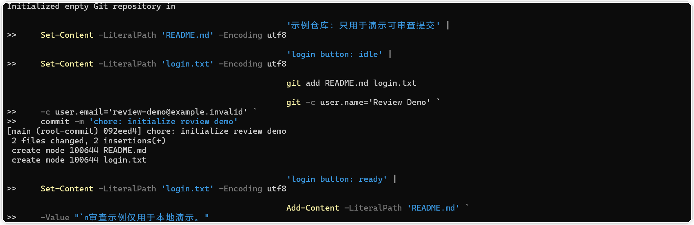
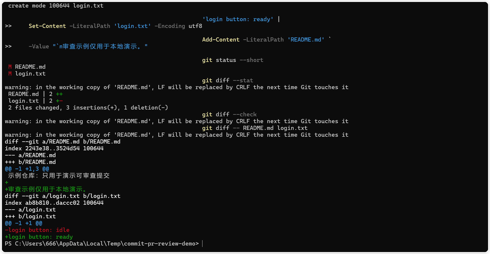
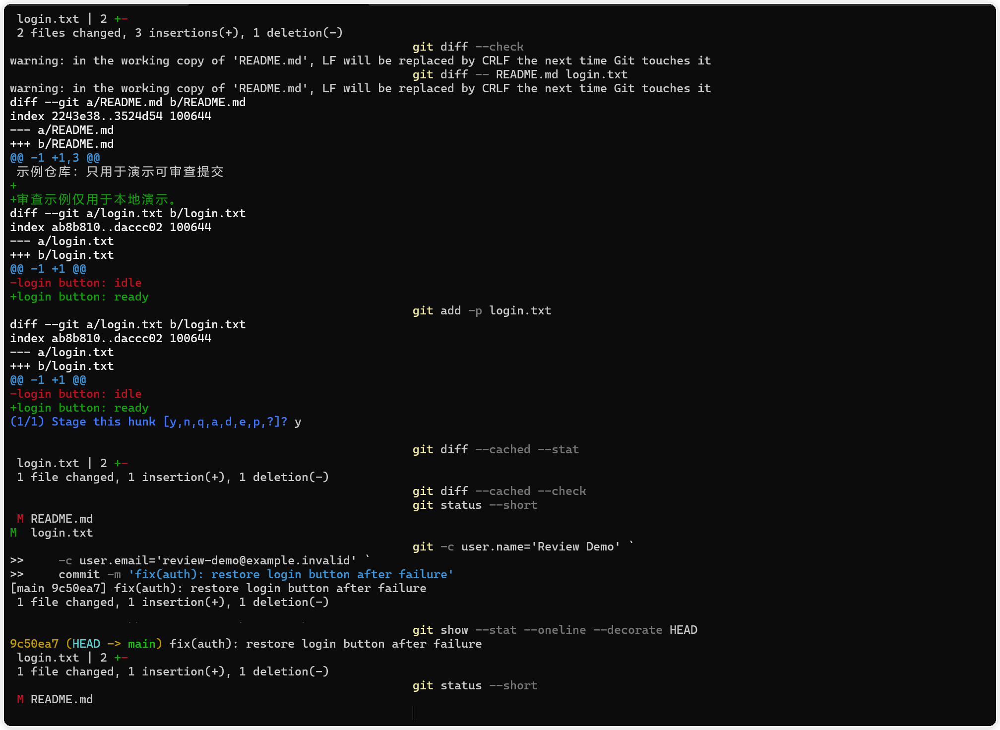
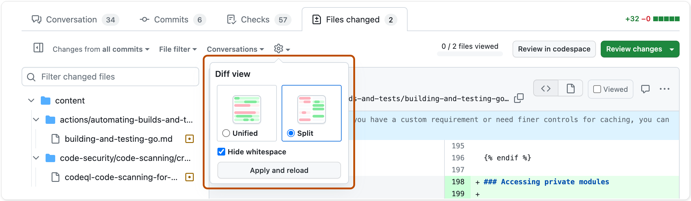

# Codex 帮你写可审查的 Commit 和 PR：按主题拆分提交、commit Skill、/review 自查与 PR 描述模板

> 本文在线版：[codexguide.io/guides/codex-reviewable-commit-pr](https://codexguide.io/guides/codex-reviewable-commit-pr)

> 核对依据：Codex 相关说法按官方 [Code review](https://learn.chatgpt.com/docs/code-review)、[Customization（Skills）](https://learn.chatgpt.com/docs/customization/overview) 和 [Sandbox and approvals](https://learn.chatgpt.com/docs/agent-approvals-security) 文档核对（2026-11-12）。文中 Git 命令截图来自 2026-09-04 的实测：Windows 10 Pro 24H2（build 26100.4652）、Git 2.47.0.windows.2，示例仓库，不含真实账号信息。

代码审查最容易卡在三件事上：

- 审查者看不出改动范围；
- 提交信息没有说明动机；
- 验证结果只剩一句「测试通过」。

让 Codex 写代码以后，这三个问题更明显：它一次能改很多文件，如果直接 `git add .` 再写个「update files」，审查者几乎没法看。可审查的提交和 PR，要把**行为、证据和风险**分开写清楚。

## 先看结论

- **一次提交只放一个行为变化**，提交信息先写行为，再写范围，比如 `fix(auth): restore login button after failure`。
- **让 Codex 按主题拆分提交**：把规则写成 Skill（官方示例第一条就是「不要运行 `git add .`」），或者在桌面应用的审查面板里按文件、按 hunk 暂存。
- **沙箱下 `git commit` 可能要审批**：workspace-write 模式下有些环境会把 `.git/` 保持只读。
- **发 PR 前先 `/review` 自查**，只报告问题，不改工作区。
- **PR 描述五段**：改了什么、为什么改、如何验证、风险与回滚、待确认。
- **「如何验证」只写真正跑过的命令**，没跑的放进「待确认」。

## 一次提交只放一个行为变化

好的提交标题有个很实际的好处：审查者在提交列表里就能判断先看哪个变化，出问题时也更容易定位要回滚哪一个。

- `fix`、`feat`、`docs`、`test`、`refactor` 这类前缀方便检索（参考 [Conventional Commits](https://www.conventionalcommits.org/)）；
- 括号里的范围要具体到模块或行为；
- 正文补充原因和验证边界；
- 标题不用写完整实现过程，过程留给 diff 和 PR。

`fix(auth): restore login button after failure` 能让人看出这是「登录失败后按钮状态」的修复；`update files` 只能说明文件动过。

提交前先看工作区的全部变化：

```powershell
git status --short
git diff --stat
git diff --check
git diff -- README.md login.txt
```

- `git diff --stat`：看变化量；
- `git diff --check`：检查空白错误；
- 最后一条：把注意力收窄到正在判断的文件。

假设登录按钮和 README 同时有改动，就不要顺手把两件事合进一个提交。



上图：初始化示例仓库后，`README.md` 和 `login.txt` 都有未提交的变化。



上图：`git diff --check` 没有报错，完整 diff 展示了两个文件的具体变化。

只暂存属于这次行为变化的部分：

```powershell
git add -p login.txt
```

输入 `y` 接受当前 hunk，`n` 跳过，`q` 退出；一个 hunk 混了两个主题时，输入 `s` 尝试拆分。每一块都问一句：它属于这次行为变化吗？

一个 hunk 同时有功能修改和格式化修改时，优先拆成两个提交，或者先撤掉无关的格式变化。格式化会扩大 diff，也会让回滚的影响范围变模糊。

暂存后再看一次范围：

```powershell
git diff --cached --stat
git diff --cached --check
git status --short
```

理想结果：暂存区只有这次提交需要的文件，其他修改仍然是未暂存。

## 让 Codex 按主题拆分提交

上面这套手动流程，可以交给 Codex 去做，但要先把规则讲清楚。

**方法一：写一个 commit Skill**

官方文档在讲 Skills 时，给的示例正好是一个 commit Skill：

```md
---
name: commit
description: Stage and commit changes in semantic groups. Use when the user wants to commit, organize commits, or clean up a branch before pushing.
---

1. Do not run `git add .`. Stage files in logical groups by purpose.
2. Group into separate commits: feat → test → docs → refactor → chore.
3. Write concise commit messages that match the change scope.
4. Keep each commit focused and reviewable.
```

四条规则的意思是：

1. 不要运行 `git add .`，按目的分组暂存文件；
2. 按 feat → test → docs → refactor → chore 拆成独立提交；
3. 提交信息简洁，和改动范围对应；
4. 每个提交保持聚焦、可审查。

放在哪里：

- 只给自己用：放在用户目录 `~/.agents/skills`；
- 团队共用：放进仓库的 `.agents/skills`，跟代码一起维护。

Codex 一开始只读 Skill 的 `name` 和 `description`，选中这个 Skill 时才加载 `SKILL.md`，所以不会白白占上下文。你说「帮我提交」「整理一下提交再推送」时，它就能按这套规则来。

**方法二：在桌面应用的审查面板里自己挑**

桌面应用的审查面板反映的是整个 Git 仓库的状态：Codex 的改动、你自己的改动、其他未提交的改动都会显示。暂存和撤销可以在三个层级做：

- **整个 diff**：用审查面板顶部的 **Stage all**、**Revert all** 等按钮；
- **单个文件**：暂存、取消暂存或撤销一个文件；
- **单个 hunk**：暂存、取消暂存或撤销一个 hunk。

想接受一部分改动就暂存，不要的就撤销。同一个文件同时出现在 Unstaged 和 Staged 里是正常的 Git 行为。

**沙箱下为什么 git commit 要审批**

官方沙箱文档说明：workspace-write 模式下，有些环境会把 `.git/`、`.agents/`、`.codex/`、`.aws/` 保持只读，即使工作区其他地方可写。所以 `git commit` 这类要写 `.git` 的命令，可能需要你批准后在沙箱外运行。不想让 Codex 在沙箱外提交的话，可以用 rules 拦住特定命令，见 [Codex Rules 命令规则](../11-自动化与高级工作流/13-Codex-Rules命令规则-用prefix_rule控制沙箱外命令.md)。

## 提交之后留下证据

提交信息要描述一个可以单独验证的动作：

```powershell
git -c user.name='Review Demo' `
    -c user.email='review-demo@example.invalid' `
    commit -m 'fix(auth): restore login button after failure'

git show --stat --oneline --decorate HEAD
git status --short
```



上图：提交后用 `git show` 和最终状态确认，提交只包含 `login.txt`，README 的修改仍未进入提交。

这里要分清两个结果：

- 提交历史回答「哪些改动已经进了版本库」；
- 工作区状态回答「哪些改动还没进」。

两者都干净，不等于代码正确；两者有差异，也不代表操作失败。发现范围不对时先停下来检查，不要用一个新的大提交把问题盖住。

## 发 PR 前用 /review 自查

改完、提交前，可以让 Codex 先审一遍。CLI 里输入 `/review` 打开审查预设，可以选：

- **Review against a base branch**：找到合并基点，审查整个分支的 diff；
- **Review uncommitted changes**：审查已暂存、未暂存和未跟踪的文件；
- **Review a commit**：审查某个提交的改动；
- **Custom review instructions**：按你给的标准审查，比如「重点看边界情况和安全问题」。

`/review` 会启动一个专门的审查者，报告按优先级排序的问题，**不改你的工作区**。想让审查用和当前会话不同的模型，可以在 `config.toml` 里设置 `review_model`。修完再跑一次 `/review`，确认问题已解决。

## PR 描述写给审查者

PR 描述不用写成周报。下面五段就能让审查者知道改了什么、为什么改、怎么验证、风险在哪里：

```markdown
## 改了什么
- 修复错误登录后的按钮状态。

## 为什么改
- 请求失败分支没有清理提交状态。

## 如何验证
- git diff --check
- 本地示例仓库检查提交范围。

## 风险与回滚
- 未改变认证接口。需要撤销时，回滚本次提交。

## 待确认
- 未覆盖真实网络超时场景。
```

写的时候注意：

- **「如何验证」只写实际执行过的命令和结果**。没运行的测试放进「待确认」，不要把计划写成通过。
- **分清「没有失败」和「已经证明正确」**。`git diff --check` 没报错，只说明没检测到空白错误，不能证明登录流程正确。
- **验证受环境、权限或测试数据限制时直接写明**，并写出下一步要补的场景。
- **风险要落到受影响的层级**：界面变化说明用户在哪个分支会看到异常；配置变化说明旧配置还能不能启动；数据库变化说明迁移是否向后兼容、回滚前要保留什么数据。
- **日志和截图先脱敏**：删掉令牌、Cookie、邮箱、内网地址和客户数据。截图不能代替测试报告。

让 Codex 起草 PR 描述时，可以把规则写在提示里：

```text
根据当前分支相对 main 的提交，起草一份 PR 描述，分五段：改了什么、为什么改、如何验证、风险与回滚、待确认。
「如何验证」只列本次会话里实际运行过的命令和结果；没运行过的检查放进「待确认」。
不要编造测试结果。
```

## 按文件检查 PR

进入 PR 的 `Files changed`，按文件看 diff。GitHub 支持切换 Unified 和 Split 视图，也可以隐藏空白差异。改动多时，先排除格式噪声，再看行为变化。



上图：在 `Files changed` 里选择 Unified 或 Split，并按需要隐藏空白差异。

看完一个文件就勾上 `Viewed`，让后面的审查者知道哪些已经看过。提交意见时打开 `Review changes`，选 Comment、Approve 或 Request changes，写清文件、位置、触发条件和可能后果。

审查者也可以按固定顺序读：

1. 先看提交标题和文件列表，确认范围；
2. 再看每个文件的 diff，确认行为；
3. 对照验证命令，看结果是否覆盖了改动；
4. 最后看风险和回滚，判断要不要补测或暂停合并。

这个顺序能避免先被一段漂亮的 PR 描述带着走。如果仓库已经开启 Codex 云端代码审查，也可以在 PR 里评论 `@codex review`，见 [GitHub 插件实战：从 Issue 到 Pull Request](../08-插件工作流/05-GitHub插件实战-从Issue到PullRequest让Codex跑完整流程.md)。

## 发出前的验收清单

- 每个提交都有清楚的行为目的。
- 暂存区只包含当前主题的改动，没有 `git add .` 带进来的无关文件。
- `git diff --check` 和 `git diff --cached --check` 没有空白错误。
- 提交前跑过 `/review`，P0、P1 问题已处理或写进「待确认」。
- PR 描述写明改动、动机、验证、风险、回滚和待确认项。
- 没执行的测试没有写成通过。
- 截图和日志里没有账号、令牌、私有路径或客户数据。

常见的模糊写法有「影响较小」「已充分测试」「按计划完成」。这些话没告诉审查者影响在哪、测试覆盖到哪、计划有没有真的执行。改成文件、命令、场景和结果，PR 才能当审查记录用。

这份清单只能减少遗漏，不能替代对 diff 的正确性、安全性和维护成本的判断。读 `git status`、`diff`、`log`、`blame` 的方法，可以接着看 [Codex 如何读懂 Git status、diff、log 与 blame](./02-Codex如何读懂Git-status-diff-log与blame.md)。

## 参考资料

- 官方：[Code review](https://learn.chatgpt.com/docs/code-review)
- 官方：[Customization（Skills 示例）](https://learn.chatgpt.com/docs/customization/overview)
- 官方：[Sandbox and approvals](https://learn.chatgpt.com/docs/agent-approvals-security)
- [GitHub 关于 Pull Request 审查](https://docs.github.com/en/pull-requests/collaborating-with-pull-requests/reviewing-changes-in-pull-requests/about-pull-request-reviews)
- [GitHub 审查 Pull Request 的改动](https://docs.github.com/en/pull-requests/how-tos/review-pull-requests/reviewing-proposed-changes-in-a-pull-request)
- [Conventional Commits 规范](https://www.conventionalcommits.org/)
