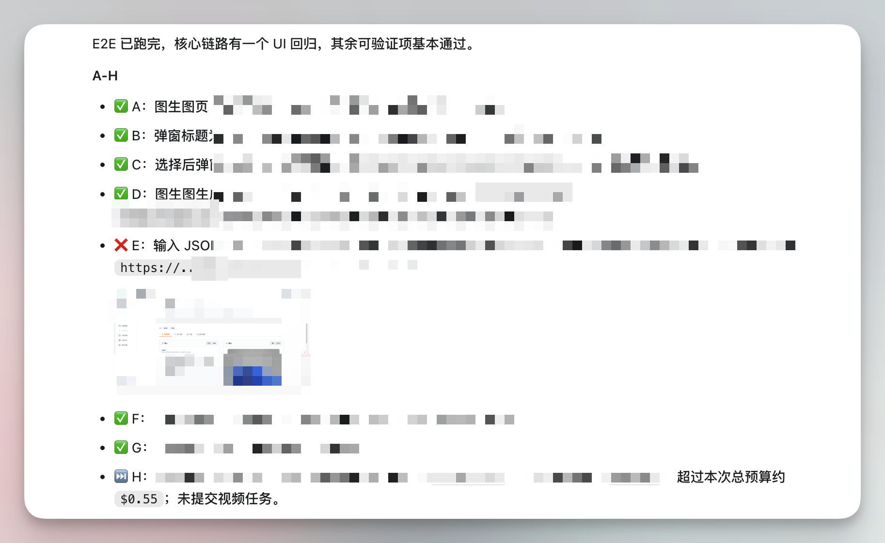
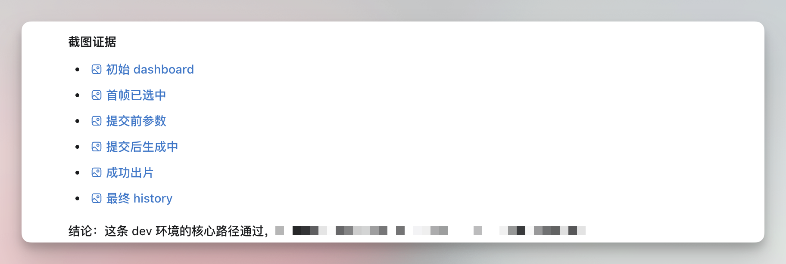

# Codex 做上线前端到端验收：用浏览器扩展接管已登录的浏览器，按测试用例逐条取证

> 本文在线版：[codexguide.io/guides/codex-browser-e2e-acceptance](https://codexguide.io/guides/codex-browser-e2e-acceptance)

> 核对依据：一次真实的上线前验收（文中两张截图来自这次验收，已对业务内容、链接和对话内容打码），以及 OpenAI 官方文档 [Browser extension](https://learn.chatgpt.com/docs/chrome-extension) 和 [Browser](https://learn.chatgpt.com/docs/browser)。界面名称和限制引自官方文档，核对日期 2026-10-25。

最近不停在上一些小功能，就需要验收。

验收时有几个麻烦点：它涉及登录态、数据、扣费、历史记录等。只看代码或者只跑单元测试都不够，最后一定要有人在真实环境里过一遍完整流程。

可以把测试用例交给 Codex，让它通过浏览器扩展控制已经登录的浏览器，按用例完成端到端验收，并把每一步的证据留下来。

## 为什么适合交给 Codex 验收

以前做这种验收，麻烦在于点击过程中要不断判断状态：

- 页面上的入口有没有出现
- 弹窗或表单里的数据能不能正常选择，选择后的状态有没有回填
- 点击提交后有没有前端校验错误
- 异步任务最终有没有结果
- 余额有没有变化，历史记录有没有新增

这些事情连在一起很容易漏。验收过程中还要截图、记录余额、记录错误文案，最好每一步结论都能留下来。

Codex 可以按测试用例一步一步执行，同时把结果反馈出来：哪一步通过了，哪一步有问题，它会直接标出来；需要证据时，它会把截图保存下来。



这张图里，A 到 H 每个断言都有状态：有些通过，有一个失败（E，一个 UI 回归），H 因为超过本次预算被跳过、没有提交视频任务。这比口头说“我测过了”可靠很多，因为过程留下来了。

## 先选对浏览器：扩展还是内置浏览器

ChatGPT 桌面端里的 Codex 有两种操作浏览器的方式，官方文档对它们的区别写得很清楚：

| | 浏览器扩展（`@Chrome` 等） | 内置浏览器（`@Browser`） |
| --- | --- | --- |
| 用的是哪个浏览器 | 你平时的 Chrome、Edge、Brave、Opera 或 Vivaldi | 桌面端里自带的浏览器 |
| 登录态 | 用你已经登录的浏览器配置和现有标签页 | 独立的浏览器配置，不自动共享你平时的标签页和登录会话，需要时在里面单独登录 |
| 适合 | 在已登录的网站和内部工具里操作 | 预览本地页面（localhost）、在页面上留评论 |

**上线验收要用已经配好权限、分好组的真实账号，选浏览器扩展。** 这也是这次验收的做法：让 Codex 接管当前已登录的浏览器，直接在现有页面上继续操作。

自动化测试也能处理登录态，但通常要维护测试账号、登录脚本和状态文件。研发阶段的人工终验，更需要直接用当前浏览器里已经登录好的账号。比如后台权限已经配好、账号已经在某个分组里、页面状态和环境刚刚调好，直接接管会比重新写一套登录和准备脚本省很多时间。

浏览器扩展的安装和网站权限设置，见 [Codex 浏览器操作与登录态功能](https://codexguide.io/guides/codex-browser-login-state)。简单说：在桌面端 **Settings > Computer Use** 里选择浏览器、安装扩展，回到 Computer Use 确认显示 **Manage**；然后在 Codex 对话里用 `@` 选择对应的浏览器。

## 官方文档里和验收相关的几条规则

- **按网站授权**：默认情况下，ChatGPT 每遇到一个新网站都会先问你，可以选 Allow once、Allow for this site、Allow for all sites 或 Decline。验收用的测试环境域名可以 Allow for this site，生产环境建议 Allow once。
- **敏感操作会确认**：提交信息、购买、修改权限、删除数据这类操作，ChatGPT 会先请求确认。扣费路径的验收会遇到这一步，确认前看清金额和参数。
- **内置浏览器不能自动上传文件**：官方文档写明 ChatGPT 不能在内置浏览器里自动完成文件上传。用例里需要上传素材的步骤，要么提前准备好，要么写成人工步骤。
- **页面内容不可信**：页面上的文字可能误导甚至有恶意指令。网站权限只代表允许它操作这个网站，不代表网站内容可信。
- **要看控制台和网络请求**：可以在 **Settings > Browser** 的 Developer mode 里打开 **Enable full CDP access**，让 Codex 查看控制台输出和网络请求。官方提醒完整 CDP 权限可能暴露敏感的浏览器内部信息；ChatGPT 用完整 CDP 检查一个网站之前会请求你明确批准。

## 测试用例越具体，Codex 执行越稳

这次感受最明显的一点是，测试用例要写得足够具体。

不要只写“测试这个功能是否可用”，这句话太宽了。更好的写法是把每一步拆清楚：打开哪个 URL、点击哪个入口、选择什么测试数据、表单里填什么，以及失败时要记录哪些信息。

流程写清楚以后，Codex 执行起来就很像一个耐心的验收同事。它不会只看页面有没有报错，而是按断言逐项收集证据。

在一次带扣费的异步任务验收里，它先记录初始余额，按用例选择素材和参数，确认页面上的预估费用，提交后检查有没有前端校验错误，再等待任务结果。任务完成后，还会回到 dashboard 和 history 页确认扣费和产物记录。



最后的报告里，它不只是说“通过了”，还列出了每张截图证据：初始 dashboard、首帧已选中、提交前参数、提交后生成中、成功出片、最终 history。以后有人要追查这个功能是不是真的验过，直接看这些证据就行。

## 一份可以直接改的用例模板

```text
用 @Chrome 在当前已登录的浏览器里做端到端验收。只验收，不修改代码。

环境：<测试环境 URL>，使用当前已登录的账号，不要退出登录、不要切换账号。
预算：本次验收扣费合计不超过 <金额>，预计超出时跳过该步骤并标记“跳过（预算）”。
禁止：删除任何数据；修改账号设置和权限；在生产环境提交真实订单。

开始前：截图记录初始状态（余额、历史记录条数）。

断言：
A. 打开 <页面>，<入口> 可见且可点击。
B. 点击后弹窗标题为 <文案>。
C. 选择 <测试数据> 后，表单回填 <字段>。
D. 提交前页面显示的预估费用为 <金额>。
E. 提交后无前端校验错误；如有，记录错误文案和截图。
F. 任务在 <时间> 内完成，结果页显示 <内容>。
G. dashboard 余额减少 <金额>。
H. history 新增一条记录，内容与本次提交一致。

输出：
- 每条断言一行：通过 / 失败 / 跳过，加一句依据。
- 每个关键步骤一张截图，列出截图清单。
- 失败项附上复现步骤和页面上看到的原文。
```

几个写法上的要点：

- **每条断言只验一件事**，结果才能写成“通过 / 失败 / 跳过”。
- **写清预算和禁止动作**。这次的 H 就是因为预计超出预算被主动跳过，没有提交任务。
- **要求区分“看到的”和“推断的”**。比如余额变化要截图对比，不要只凭页面提示。
- **失败要附原文**。前端报错文案、接口返回的提示，原样记下来，开发修的时候才对得上。

## 这类验收应该怎么分工

写代码和验收功能是两类任务。可以让一个对话负责实现，另一个对话拿着测试用例专门做验收，避免实现者自己给自己打分。

中间最重要的交接物是一份清楚的测试用例：测试环境、账号或登录方式、初始状态、每一步操作和断言，以及预算、失败证据和禁止动作。

Codex 适合放在上线前后的人工终验、一次性排查、扣费路径和复杂后台状态验证；**稳定、可重复的批量回归仍然应该交给项目现有的自动化测试**。验收中发现的问题，修好后最好补成自动化测试，下次就不用再人工过一遍。

## 参考资料

- [OpenAI 官方文档：Browser extension](https://learn.chatgpt.com/docs/chrome-extension)
- [OpenAI 官方文档：Browser](https://learn.chatgpt.com/docs/browser)
- [Codex 浏览器操作与登录态功能](https://codexguide.io/guides/codex-browser-login-state)
