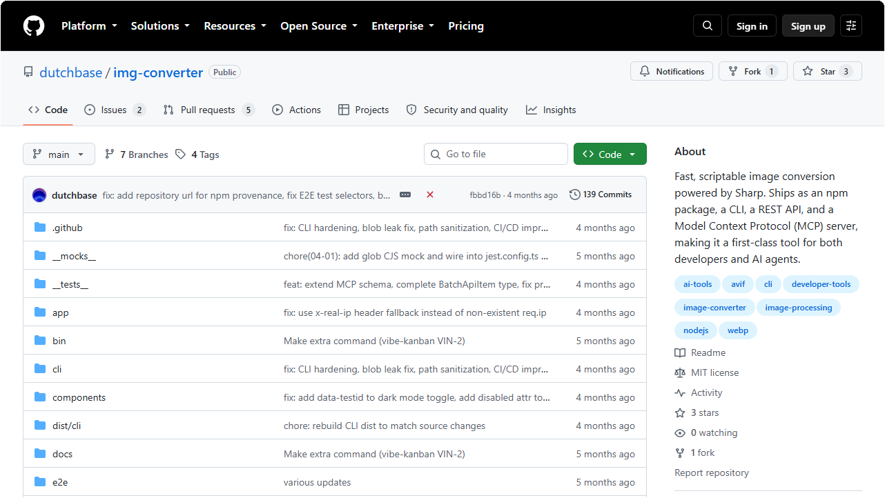
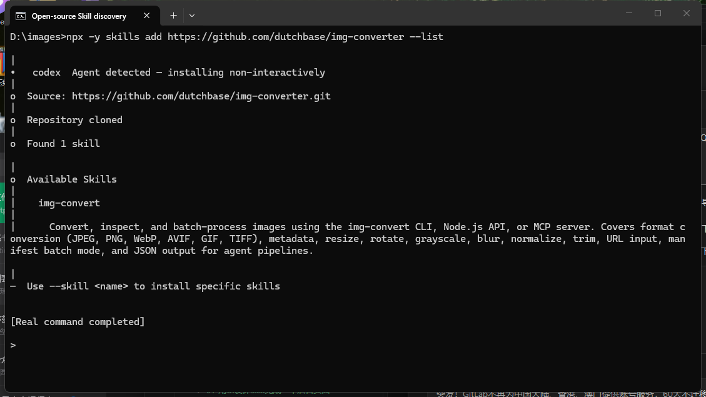
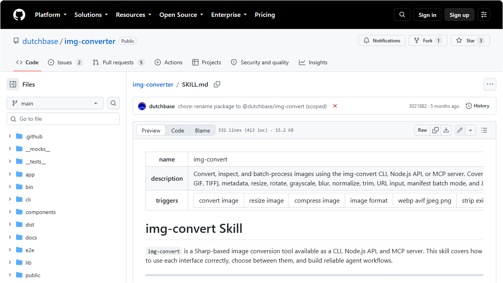
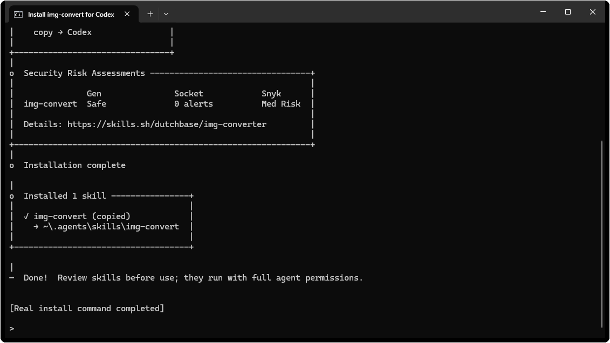
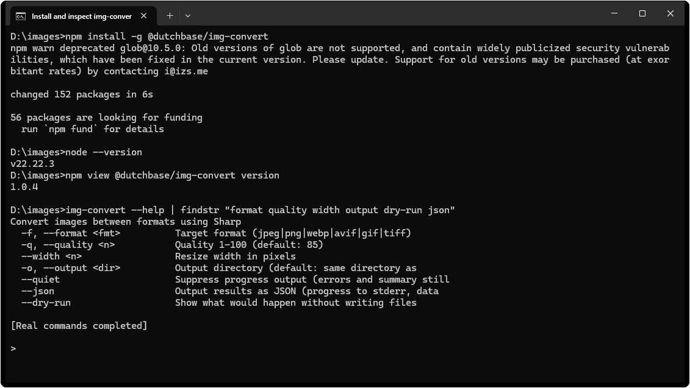
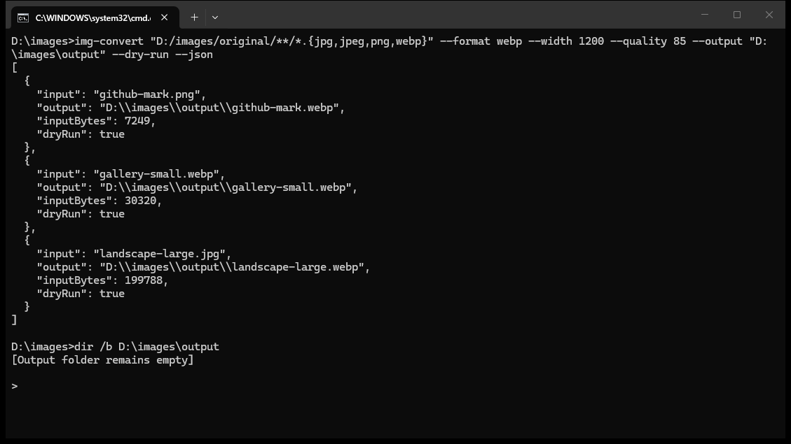
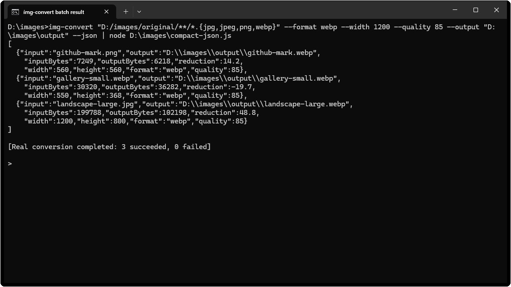
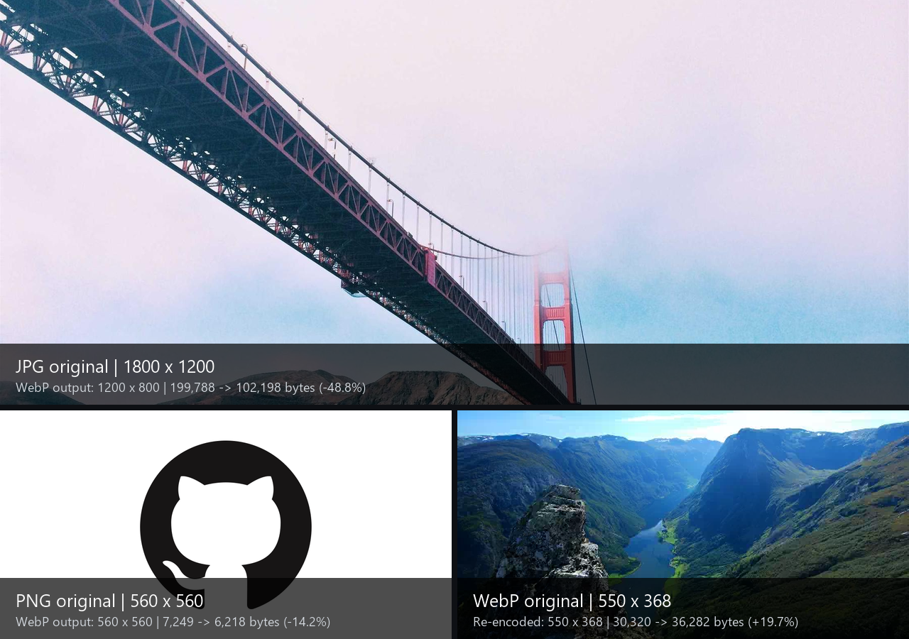

# 用 Codex 批量压缩图片并转换为 WebP（合并版）：img-convert Skill 安装、dry-run 与结果核对

> 本文在线版：[codexguide.io/guides/codex-batch-image-conversion-skill](https://codexguide.io/guides/codex-batch-image-conversion-skill)

> 核对依据：2026-08-17 在 Windows 11 24H2（26100.4652）上实测，环境为 Codex Desktop 26.810.7004.0、Codex CLI 0.147.0、Node.js 22.22.3、skills 1.5.22 和 img-convert 1.0.4。本文合并了原「真实案例复盘」里的《用开源 img-convert Skill 批量压缩图片》，两篇是同一次实测，旧网址已跳转到这里。2026-11-04 复查：npm 上 `@dutchbase/img-convert` 的最新版本仍是 1.0.4。

文章配图经常要做同几件事：限制宽度，转成 WebP，控制文件大小，最后确认原图没被覆盖。这套流程已经有开源工具和 Skill，不必从零写。

本文用 [dutchbase/img-converter](https://github.com/dutchbase/img-converter) 里的 `img-convert` Skill，把一个目录里的图片限制在 1200px 宽，转成质量 85 的 WebP，写到单独的输出目录。

## 先看结论

| 项目 | 结果 |
| --- | --- |
| 图片数量 | 3 张，全部成功，失败 0 |
| 总大小 | 237,357 → 144,698 字节，减少 92,659 字节，约 39.0% |
| 单张变化 | JPG −48.8%，PNG −14.2%，WebP **+19.7%** |
| 尺寸 | 1800×1200 的大图缩到 1200×800，两张小图保持原尺寸 |
| 原图 | 没有被覆盖或删除 |

要点：先 dry-run，输出目录和原图分开，处理完逐张看压缩比例。

## 这个 Skill 能做什么、来源和许可证

`img-convert` 基于 Sharp，仓库用 MIT 许可证。项目提供命令行工具、Node.js API、MCP 服务和一份 `SKILL.md`。本文只用最简单的组合：Codex 按 Skill 里的规则判断，再调用命令行工具处理本地图片。

按仓库 README（2026-11-04 查看），它能读取 JPEG、PNG、WebP、AVIF、GIF、TIFF、HEIC 和 SVG，能输出 JPEG、PNG、WebP、AVIF、GIF 和 TIFF；还能调整尺寸、压缩质量、旋转、裁边和读取图片信息。批量任务可以传 glob 路径，也可以用 JSON 清单。



> 图片来源：[dutchbase/img-converter](https://github.com/dutchbase/img-converter)。

安装前，先让 `skills` 命令读一遍仓库，确认里面确实有 `img-convert`：

```powershell
npx -y skills add https://github.com/dutchbase/img-converter --list
```

输出里应该有一个叫 `img-convert` 的 Skill。不要只看第三方介绍页就装，仓库里的 [SKILL.md](https://github.com/dutchbase/img-converter/blob/main/SKILL.md) 才是 Codex 实际会读到的内容。



> 图片来源：CodexGuide 实测。



> 图片来源：[dutchbase/img-converter SKILL.md](https://github.com/dutchbase/img-converter/blob/main/SKILL.md)。

## 安装 Skill 和命令行工具

先把 Skill 装到 Codex 的全局技能目录：

```powershell
npx -y skills add https://github.com/dutchbase/img-converter `
  --skill img-convert `
  --agent codex `
  --global `
  --yes
```

Skill 只告诉 Codex 怎么用工具，不会自动安装 `img-convert` 命令。还要装仓库发布的 npm 包：

```powershell
npm install -g @dutchbase/img-convert
```

实测时安装成功，npm 同时提示依赖的 `glob@10.5.0` 已弃用。这个警告没影响测试。用在生产目录或自动化流水线之前，要重新看一遍包版本、依赖审计结果和仓库更新情况，并且先拿可恢复的图片副本试。

当前 README 要求 Node.js 20.9.0 或更高，实测用的是 22.22.3。装完检查命令是否可用：

```powershell
node --version
img-convert --help
img-convert info --help
img-convert batch --help
```



> 图片来源：CodexGuide 实测。



> 图片来源：CodexGuide 实测。

## 写清处理规则

这次用的参数：

| 项目 | 设置 |
| --- | --- |
| 输入 | 指定目录中的 JPG、JPEG、PNG 和 WebP |
| 输出目录 | 新建的 `output` 目录 |
| 最大宽度 | 1200px |
| 输出格式 | WebP |
| 图片质量 | 85 |
| 原文件 | 保留，不覆盖、不删除 |

`img-convert` 默认保持宽高比，也不放大小图。宽度超过 1200px 的图会等比缩小，不到 1200px 的保持原尺寸。

输出目录一定要和原图目录分开。这样即使参数写错，原文件也还在。

## 先用 dry-run 预演

假设原图在 `D:\images\original`，先加 `--dry-run` 看看会处理哪些文件：

```powershell
img-convert "D:/images/original/**/*.{jpg,jpeg,png,webp}" `
  --format webp `
  --width 1200 `
  --quality 85 `
  --output "D:\images\output" `
  --dry-run `
  --json
```

glob 路径放在引号里，让 `img-convert` 自己展开文件列表。Windows 下的 glob 要用正斜杠 `/`；反斜杠可能被当成转义符，结果一张图都匹配不到。

预演后核对三件事：文件数量对不对，输出目录对不对，不同格式的同名文件（比如 `a.jpg` 和 `a.png`）会不会写成同一个 `a.webp`。



> 图片来源：CodexGuide 实测。

## 确认后执行批量转换

预演没问题，去掉 `--dry-run`：

```powershell
img-convert "D:/images/original/**/*.{jpg,jpeg,png,webp}" `
  --format webp `
  --width 1200 `
  --quality 85 `
  --output "D:\images\output" `
  --json
```

`--json` 会返回每张图的输入大小、输出大小、压缩比例、尺寸和保存路径。截图里的 `compact-json.js` 只调整了真实 JSON 的换行，字段和值没改。三张图全部转换成功，失败数为 0。



> 图片来源：CodexGuide 实测。

不同图片要不同尺寸或格式时，可以让 Codex 先生成一个 JSON 清单，再跑批处理：

```powershell
img-convert batch jobs.json --json
```

统一转换用 glob 就够了，不用先做清单。

## 让 Codex 调用 Skill 的提示词

装好后重启 Codex，再发下面这段任务：

```text
使用 img-convert Skill，先检查 D:\images\original 中会被处理的 JPG、JPEG、PNG 和 WebP 图片。
把宽度限制为 1200px，保持比例，不放大小图，统一转成质量 85 的 WebP，输出到 D:\images\output。
保留所有原文件。先 dry-run 并汇报文件数量和命名冲突，确认没有问题后再执行，最后给出处理成功数、失败数和总压缩比例。
```

这段话把检查、预演、执行、汇报写在了一起。Skill 本身也会提醒 Codex 先读陌生图片的信息，特别留意透明通道和动画图片。

## 实测结果：哪张变小、哪张变大

测试集是三张公开图片：一张 1800×1200 的 JPG，一张 560×560 的 PNG，一张 550×368 的 WebP。大图等比缩到 1200×800，两张小图保持原尺寸，说明 `--width 1200` 不会放大小图。

| 项目 | 处理前 | 处理后 |
| --- | --- | --- |
| 图片数量 | 3 | 3 |
| 总文件大小 | 237,357 字节 | 144,698 字节 |
| 最大宽度 | 1800px | 1200px |
| 文件格式 | JPG、PNG、WebP | WebP |
| 失败数量 | - | 0 |

总大小减少 92,659 字节，整体压缩率约 39.0%。原图目录没被覆盖，三个 WebP 都写进了独立的 `output` 目录。

但「统一转 WebP」不等于每张都变小：JPG 减少 48.8%，PNG 减少 14.2%，原本就压缩过的 WebP 重新编码后反而**增大 19.7%**。批量任务结束后要专门检查负压缩率，不能只看成功数。变大的那张，可以直接保留原文件，或者降低质量参数单独再跑一次。



> 图片来源：CodexGuide 实测。

## 完成后检查

- 原图的数量、名称和内容没有变化。
- 输出图片都在单独的目录里。
- 横图和竖图保持原始比例，小于 1200px 的图没有被放大。
- 透明区域没有意外变黑。
- 动画图片没有在你不知情的情况下只剩第一帧。
- 同名输入没有悄悄覆盖同一个 WebP 文件。
- 失败的文件和原因已经单独列出。
- 压缩比例为负的文件已经处理（保留原图或单独重跑）。

## 常见问题

**能不能直接覆盖原图？** 技术上可以把输出目录指向原目录，但不建议。先输出到新目录，检查完再自己替换。

**和用 MCP 有什么区别？** 这个项目也提供 MCP 服务，可以把转换做成 Codex 直接调用的工具，不用拼命令行。本文只用了 Skill 加命令行，配置更少。MCP 怎么接，见 [Codex MCP 入门](../09-MCP与外部工具/01-Codex-MCP入门-config与mcp-login.md)。

**想把自己的图片规则也做成 Skill？** 见 [从零创建 Codex Skill](./04-从零创建Codex-Skill.md)。

## 参考资料

- [dutchbase/img-converter](https://github.com/dutchbase/img-converter)
- [img-convert SKILL.md](https://github.com/dutchbase/img-converter/blob/main/SKILL.md)
- [@dutchbase/img-convert（npm）](https://www.npmjs.com/package/@dutchbase/img-convert)
- [MIT License](https://github.com/dutchbase/img-converter/blob/main/LICENSE)
