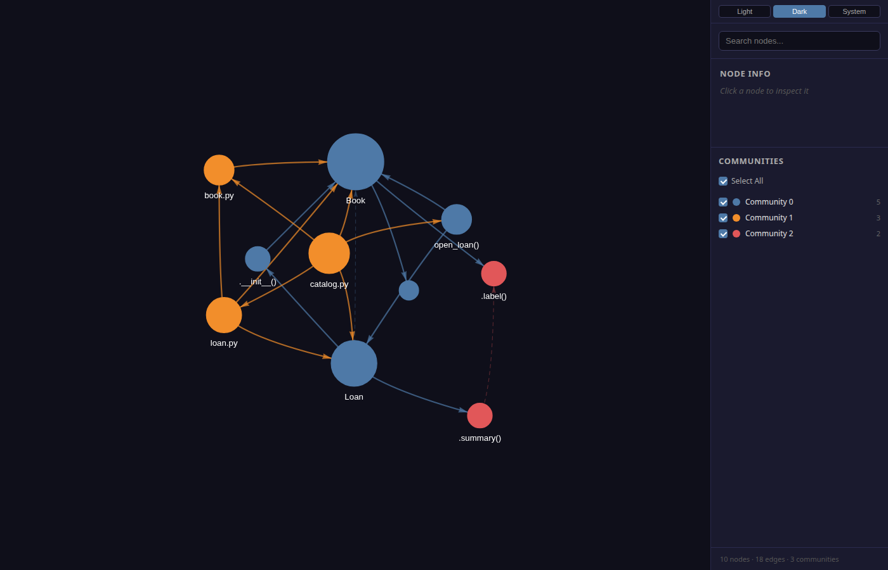

# Codex 安装 graphify：把代码库变成可查询的知识图谱，用 $graphify 建图，再用 query、path、explain 代替 grep

> 核对依据：第三方仓库 [Graphify-Labs/graphify](https://github.com/Graphify-Labs/graphify) 默认分支 `v8` 的 README、[Release v0.9.115](https://github.com/Graphify-Labs/graphify/releases/tag/v0.9.115)、PyPI [graphifyy 0.9.115](https://pypi.org/project/graphifyy/)，以及装下来的 `~/.codex/skills/graphify/SKILL.md`。2026-11-22 的 GitHub API：`stargazers_count` 151,631，`forks_count` 14,566，`license.spdx_id` 为 Apache-2.0，未归档，`pushed_at` 为 2026-11-21T21:27:31Z（北京时间 11-22 05:27）。Release 发布时间 2026-11-21T21:27:32Z。PyPI `requires_python` 为 `>=3.11.5,<3.15`。同一天安装了 `uv 0.13.9` 和 `codex-cli 0.171.0`。没有打开交互式 Codex，没有登录，没有调用付费的 Graphify Cloud。

graphify 是 Graphify Labs 维护的第三方项目，不是 OpenAI 的内置功能。它把一个目录里的代码、文档、PDF、图片或视频收成一张可以反复查询的知识图谱。代码走本地 tree-sitter。文档和媒体的语义提取才会用到模型。

要一张可点击的架构图并做健康检查，看 [Floorplan](./24-Codex安装Floorplan插件-把代码库画成可点击的架构地图并做健康检查.md)。要按符号和调用链用 MCP 读大仓库，看 [Serena 与 codebase-memory-mcp](./04-Codex代码智能MCP-Serena与codebase-memory-mcp怎么装怎么选.md)。graphify 的位置是：CLI 加一份 Codex skill，产出 `graph.json`，用 `query`、`path`、`explain` 缩小要读的范围。

## 先说结论：它解决什么，和 Floorplan、Serena 怎么选

适合已经会在 Codex 里改一个仓库、又反复问「这两处怎么连」的人。不适合把第一次建图当成必须步骤：小问题直接搜索更快。装下来的技能文件自己也写了这句界限：没有现成图谱时，一次有目标的查找用普通搜索即可。

| | graphify | Floorplan | Serena |
|---|---|---|---|
| 是什么 | 第三方 CLI 和 skill，Apache-2.0 | 第三方 Codex 插件，MIT | 第三方 MCP，基于语言服务器 |
| 产出 | `graphify-out/graph.json`、`GRAPH_REPORT.md`、`graph.html` | 可缩放的架构地图，另有健康检查 | 符号、引用和编辑用的工具 |
| 在 Codex 里怎么碰到它 | README 写 `$graphify`；本次安装结束语写 `/graphify .` | `$floorplan` 或一句话 | MCP 工具 |
| 代码离开本机吗 | README 写代码只在本地解析。本次 `--code-only` 的报告是 0 token，没有抓包 | 作者写地图在本机，不需要单独的 API key | 看你把 MCP 接到哪里 |

三者可以同时存在。本文没有在同一个仓库上比较查询质量。

## 安装：uv 或 pipx 装 graphifyy，再 graphify install --platform codex

README 写 Python 3.11.5–3.14，并推荐 uv 或 pipx。PyPI 的 `requires_python` 是 `>=3.11.5,<3.15`。包名是 **graphifyy**（两个 y）。其他叫 `graphify*` 的 PyPI 包，README 写明没有关联。命令名仍是 `graphify`。

2026-11-22 在 Linux、Python 3.12.3 上，实际执行的是：

```bash
uv tool install graphifyy
graphify --version
```

`uv tool install` 的输出里有 `+ graphifyy==0.9.115`。`graphify --version` 输出 `graphify 0.9.115`。pipx 和 pip 是 README 写的替代，本文没有再装一遍。

然后在 `/tmp` 里执行用户级安装，避免写进业务仓库：

```bash
graphify install --platform codex
```

输出的关键行是：

```text
references       ->  ~/.codex/skills/graphify/references
skill installed  ->  ~/.codex/skills/graphify/SKILL.md

Done. Open your AI coding assistant and type:

  /graphify .
```

用户级安装只放了技能文件，没有改某个项目的 `AGENTS.md`。

项目级安装是另一条命令，README 写的是 `graphify install --project --platform codex`。2026-11-22 在一个新建的示例目录里跑了这条，它额外做了三件事：把技能复制到该目录的 `.codex/skills/graphify/`，把一节说明写入该目录的 `AGENTS.md`，并写了 `.codex/hooks.json`。结束语要求：

```text
Project-scoped install. Add to version control:
  git add .codex/ AGENTS.md
```

`hooks.json` 里的 PreToolUse 命令是 `graphify hook-check`。安装输出写明这是有意的空操作：Codex Desktop 会拒绝 PreToolUse 上的 additionalContext，所以引导来自 `AGENTS.md`。本文没有打开桌面端核对这句话。

**调用名不一致。** README 的平台表和后文都写 Codex 用 `$graphify`，不用 `/graphify`。安装结束语和技能文件的标题、用法块写的却是 `/graphify .`。本文没有打开 Codex 会话，没有验证哪一个字符串会触发技能。按 README 先试 `$graphify`。如果当前 Codex 只认技能面板里的名字，再对照你装到的那份 `SKILL.md`。

安装结束语还附了一条 Graphify Cloud 的注册地址，带追踪参数。README 把 Cloud 和本地免费建图分开：Cloud 是托管的持续图谱。本文没有注册，没有把它当成安装步骤。

## 在本机建图：三个产出文件，以及 $graphify 没有在会话里跑过

README 写在 Codex 里对当前目录建图用 `$graphify .`。技能文件把同一步写成 `/graphify .`，并说明它会跑完整流水线，默认包含 HTML。

本文没有打开 Codex，所以没有在会话里发送 `$graphify` 或 `/graphify`。下面是同一版 CLI 在示例目录上的结果。示例是新建的四份文件，不在本知识库里：`README.md`，以及 `src/book.py`、`src/loan.py`、`src/catalog.py`。`Book` 被 `Loan` 用到，`open_loan()` 创建两者。

先按安装结束语的形式直接跑 `graphify .`，退出码 1。stderr 原文：

```text
error: no LLM API key found (2 doc/paper/image file(s) need semantic extraction). Set GEMINI_API_KEY or GOOGLE_API_KEY (gemini), MOONSHOT_API_KEY (kimi), ANTHROPIC_API_KEY (claude), OPENAI_API_KEY (openai), DEEPSEEK_API_KEY (deepseek), or pass --backend. A code-only corpus needs no key. Or pass --code-only to index just the code (local AST, no key) and skip the non-code files.
[graphify extract] scanning /tmp/graphify-shelf
[graphify extract] found 4 code, 2 docs, 0 papers, 0 images
```

两份「文档」是示例自己的 `README.md`，以及项目级安装写下的 `AGENTS.md`。没有 API key 时，带文档的目录不会建完。这和 README 的隐私一节一致：代码可以离线，文档要模型。

接着只索引代码：

```bash
graphify extract . --code-only
```

输出：

```text
[graphify extract] --code-only: skipping 2 non-code file(s) (2 docs, 0 papers, 0 images) — no LLM extraction
[graphify extract] found 4 code, 0 docs, 0 papers, 0 images
[graphify extract] AST extraction on 4 code files...
[graphify extract] wrote /tmp/graphify-shelf/graphify-out/graph.json: 10 nodes, 18 edges, 3 communities
[graphify extract] next: run `graphify cluster-only /tmp/graphify-shelf` to generate GRAPH_REPORT.md and name communities
```

这一步只有 `graph.json`，没有报告和 HTML。再跑（不调用模型命名）：

```bash
GRAPHIFY_BACKEND=none graphify cluster-only . --no-label
```

输出：`Done - 3 communities. GRAPH_REPORT.md, graph.json and graph.html updated.`

三个给人看的文件这时都在 `graphify-out/`：

| 文件 | 这次里面有什么 |
|---|---|
| `graph.json` | 10 个节点、18 条边 |
| `GRAPH_REPORT.md` | 标题是 `Graph Report - graphify-shelf  (2026-11-22)`。因为加了 `--no-label`，社区名保持 `Community 0` |
| `graph.html` | 可交互的图。下面的截图来自这个文件 |

报告里的抽取比例是：`89% EXTRACTED · 11% INFERRED · 0% AMBIGUOUS`，`Token cost: 0 input · 0 output`。INFERRED 有 2 条边。

在 Codex 会话里建图时，技能会不会自动加上 `--code-only` 或 `--no-label`，本文没有看到。有文档又没有 API key 时，先预期和上面一样的报错，再决定是只索引代码，还是配置 README 列出的某个后端。

## 看图：graph.html 和 GRAPH_REPORT.md

报告把连接最多的节点写成 God Nodes：

1. `Book`，8 条边
2. `Loan`，6 条边
3. `open_loan()`，3 条边

它标出的一条跨文件关系是 `Loan --uses--> Book`，标签 **INFERRED**，来源 `src/loan.py` 到 `src/book.py`。`open_loan() --calls--> Book` 和 `open_loan() --calls--> Loan` 是 **EXTRACTED**。没有发现 import cycle。3 个社区里 2 个因为节点少于 3 个，报告把它们标成 thin 并省略。这是一份 10 个节点的例子，社区名没有经模型改写。

`graph.html` 用本机 Chrome 无头模式打开本地文件后截下。画面里没有账号，HTML 里也没有用户主目录。



图 1. 2026-11-22，Linux，graphify 0.9.115。对新建目录先 `--code-only` 抽取，再 `cluster-only --no-label`。右侧写明 10 个节点、18 条边、3 个社区。没有点击节点，Node info 仍是空的。

## 用图代替 grep：query、path、explain

这三个子命令直接读 `graph.json`，这次都不需要 API key。README 写：每条边带 **EXTRACTED**（源码里写明的）或 **INFERRED**（graphify 推断的）。`path` 的置信度取路径上最弱的一跳。名字对上多个节点时退出码 3，对不上时退出码 4。

`graphify query "what connects Book to Loan"` 退出码 0。它从 `Book` 和 `Loan` 做 BFS，深度 2，找到全部 10 个节点。摘两条边：

```text
EDGE open_loan() --calls [EXTRACTED context=call]--> Book at=src/catalog.py:L5
EDGE Loan --uses [INFERRED]--> Book at=src/loan.py:L4
```

`graphify path "open_loan()" "Book"`：

```text
Shortest path (1 hops):
  open_loan() --calls [EXTRACTED]--> Book
Path confidence: EXTRACTED (weakest hop 1: calls)
```

`graphify path "Loan" "Book"` 是一条 INFERRED，分数 0.95。反向的 `graphify path "Book" "Loan"` 没有有向路径，退出码仍是 0，并提示可以加 `--undirected`。加上之后，它把刚才那条 `uses` 反过来显示。所以「退出码 0」只说明命令跑完，不说明一定有一条有向路径。

`graphify explain "Book"` 打印节点 `src_book_book`，源文件 `src/book.py` 第 1 行，社区 `Community 0`，度数 8，并列出 8 条连接。其中 `Loan [uses] [INFERRED 0.95]`，其余列出的 `imports`、`calls`、`method`、`contains` 为 EXTRACTED。

把这些命令放进 Codex 之后，项目级 `AGENTS.md` 会要求先查询再 grep。那是 graphify 写进去的第三方规则，不是 Codex 官方规则。查询结果对不上时，仍要打开它标出的那几行源码。

## 隐私和成本：代码本地解析，文档才会用模型

README 的隐私一节，对照这次运行：

- **代码**：tree-sitter 本地处理。`--code-only` 不需要 API key。这次报告的 token 成本是 0。本文没有抓包，不能把「0 token」写成「没有任何出站请求」。
- **视频和音频**：README 写用本地 faster-whisper。本次没有安装 `video` extra，没有测。
- **文档、PDF、图片**：交给当前助手做语义提取，或在无头 `graphify extract` 时使用某个 API key。这次 `graphify .` 因为两份 Markdown 没有 key 而失败，和这句一致。
- **查询日志**：README 写 `query`、`path`、`explain` 会记到 `~/.cache/graphify-queries.log`，默认不存完整子图。可以用 `GRAPHIFY_QUERY_LOG_DISABLE=1` 关掉。本文没有打开这个日志文件做核对。

`GRAPHIFY_BACKEND=none` 在 README 里用来关掉全部 LLM 后端。这次 cluster 命名用了它，再加 `--no-label`，所以社区保持 `Community N`。

### multi_agent 已经是开的，和 README 那句不要混

README 写：Codex 用户还要在 `~/.codex/config.toml` 的 `[features]` 里设 `multi_agent = true`，才能并行提取。

2026-11-22 的 [Configuration Reference](https://learn.chatgpt.com/docs/config-file/config-reference) 对 `features.multi_agent` 的说明是：启用 multi-agent 协作工具（`spawn_agent`、`send_input`、`resume_agent`、`wait_agent`、`close_agent`），**stable，默认开启**。

同一天 `codex-cli 0.171.0` 的 `codex features list`（空配置和已有用户目录各看了一次，这一行相同）：

```text
multi_agent                              deprecated         true
multi_agent_v2                           stable             false
```

阶段用词和文档不一致：文档写 stable，CLI 写 deprecated。有效值都是 true，也就是当前开着。`multi_agent_v2` 是另一行，有效值 false。graphify README 没有提到 v2。本文不要求读者手写 `multi_agent = true`，也不把 v2 写成安装前提。子代理本身怎么用，见 [Codex 使用 Subagents](../11-自动化与高级工作流/09-Codex使用Subagents并行处理任务.md)。

技能文件和项目 `AGENTS.md` 里有面向编码助手的步骤（先查询再读文件、把规则写进子代理提示）。那些是第三方技能的指示。写本文时没有按那些步骤改知识库，也没有执行技能里的自动升级。

## 常见问题

**找不到 graphify 命令。** README 写 uv 装完后如果找不到，运行 `uv tool update-shell`。本文把 `~/.local/bin` 放进 PATH 后可以直接运行，没有碰到这条。pip 安装的 PATH 问题看 README 指向的安装文档，本文没有用 pip 复现。

**Python 版本。** 低于 3.11.5 或高于 README 写的 3.14（PyPI 上限到 3.15 之前）时不要装。本文是 3.12.3。

**大仓库。** README 写 `export html` 默认最多渲染 5,000 个节点，再大就聚合成社区视图，并用 `--node-limit` 调整。本文的图只有 10 个节点，没有碰到这个上限。没有 Leiden extra 时，README 写聚类会静默改用 networkx Louvain。本文没有单独核对用的是哪一个算法。

**要不要提交 graphify-out。** 见文首的常见问题。生成文件会在每次建图时整个重写。团队若决定共享同一份 `graph.json`，按 README 的 Team setup 另做约定。默认不要把 `graphify-out/` 提交进业务仓库。

**Cloud 和 MCP。** README 另有 `codex mcp add graphify --url https://api.graphify.com/mcp`，以及本地的 `graphifyy[mcp]`。这是托管或另开的服务器，不是 `graphify install --platform codex` 的一部分。本文没有连接。

## 参考资料

- [Graphify-Labs/graphify](https://github.com/Graphify-Labs/graphify)（README，默认分支 v8）
- [Release v0.9.115](https://github.com/Graphify-Labs/graphify/releases/tag/v0.9.115)
- [graphifyy on PyPI](https://pypi.org/project/graphifyy/)
- [docs.graphify.com](https://docs.graphify.com)
- [Codex Configuration Reference](https://learn.chatgpt.com/docs/config-file/config-reference)（`features.multi_agent`）
