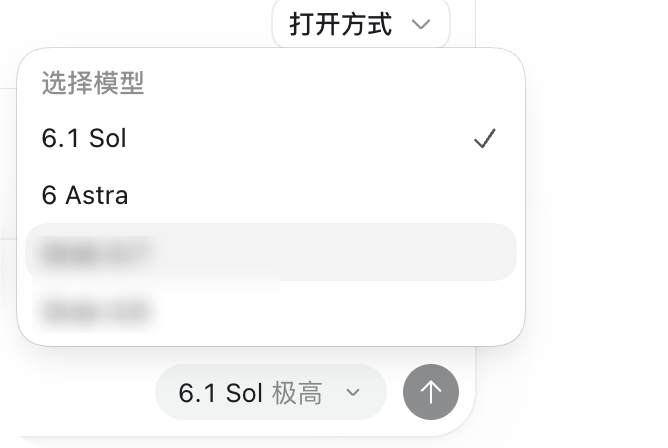
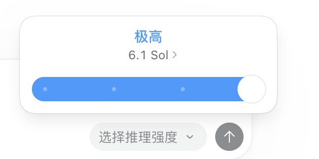

# Codex 模型怎么选（2026-11 更新）：GPT-6.2 Astra 与 Sol 上线后，Sol、Terra、Luna、Astra 和推理强度怎么搭配

> 本文在线版：[codexguide.io/guides/codex-model-reasoning-effort](https://codexguide.io/guides/codex-model-reasoning-effort)

> 2026-11-18 更新：按 2026-11-17 的 [Models](https://learn.chatgpt.com/docs/models)、[Model selection](https://learn.chatgpt.com/docs/model-selection)、[Pricing](https://learn.chatgpt.com/docs/pricing)、[Speed](https://learn.chatgpt.com/docs/agent-configuration/speed) 和 [Changelog](https://learn.chatgpt.com/codex/changelog) 重写选择表。日常编码的起点改为 GPT-6.2 Sol，最难的项目改为 GPT-6.2 Astra。谁能用、怎么切换、Enterprise 怎么打开，见 [Codex 用 GPT-6.2 Astra 和 Sol](./29-Codex使用GPT-6.2-Astra与Sol-怎么选-切换方法-Ultrafast与额度.md)。倍率、5 小时估算和「觉得被多扣」见 [用量额度](./08-Codex用量额度怎么看-5小时与每周限制-Fast倍率与credits.md)。
>
> 2026 年 10 月 14 日起，用 ChatGPT 登录的 Codex 不再提供 GPT-5.5。当时的替代是付费套餐用 GPT-6.1 Sol，Free 和 Go 在桌面端用 GPT-6 Luna。用 API Key 登录的会话不受影响。GPT-6.1 Sol 仍在定价和速度页里，新的日常起点以 Model selection 页的 GPT-6.2 Sol 为准。

打开模型菜单时，先看任务落在官方的哪一组起步组合里，再决定要不要往上加推理强度。GPT-6.2 谁能用、App 和 CLI 怎么切、Ultrafast 的套餐资格，这篇不重复，只保留选择表、组合和速度档。

**我的用法**会这样分。下面这一列是使用建议，官方起步组合在后面单独一张表里：

- 日常改代码、补测试、常规调试，用 GPT-6.2 Sol，推理强度先用客户端当前档。
- 修 bug、加功能，或要写一份给人审的文档，对照官方组合可以用 GPT-6.2 Sol + 中（Medium）。
- 跨模块调试、方案取舍、正确性复核，把 GPT-6.2 Sol 升到高或极高；仍然缺关键判断时再换 GPT-6.2 Astra。
- 根据材料写说明、看截图和图表、在桌面应用里改记录、改完能核对的小修复，先试 GPT-6.1 Terra + 中。
- 小改动、抽字段，用 GPT-6 Luna + 轻度。要在多个应用里找更新、在约束清楚时排优先级，Luna 可以用到极高。
- 最难的端到端工作用 GPT-6.2 Astra。简报已经写清楚、要做成能直接用的成品时，官方组合从轻度起步。

这套选法看的是完成一次任务的总成本，返工也算在里面。

## 先分清三个开关：模型、推理强度、速度

Codex 的高级菜单里有三组设置。它们各管一件事。

- **模型**决定能力、速度和基础消耗的大致区间。
- **推理强度**决定模型在这一题上投入多少计算。档位越高，复杂任务可能做得越好，但也更慢、更费 token。桌面端、Work 网页和 IDE 扩展里，低档叫 Light；CLI 里叫 Low。往上是 Medium、High、Extra High。2026-10 的中文桌面端把这四档显示为轻度、中、高、极高。这次没有新的中文菜单截图，界面用词以你现在的客户端为准。
- **速度**是用更多额度换更快出 token。Fast 支持 GPT-6.2 Astra、GPT-6.2 Sol，以及 GPT-6.1 Sol、GPT-6.1 Terra、GPT-6 Astra、GPT-6 Sol、GPT-6 Luna。Ultrafast 在 GPT-6.2 两款、GPT-6 Astra 和 GPT-6.1 Sol 上可用，套餐资格各不相同。

另外还有两个名字，不要和速度档叠在一起：

- **Max** 给当前模型更多时间，在单次任务里把推理做深。深度比速度和用量更重要时再用。
- **Ultra** 用子代理把能拆开的工作并行做。GPT-6 Luna 支持到 Max，不支持 Ultra。CLI 里先 `/model` 选模型，再选 More reasoning… 看它有没有 Max 或 Ultra。桌面端滑杆里看不到 Ultra 时，官方写的路径是 Settings > Configuration，打开 Ultra in model picker slider。

任务只是返回得慢，去看速度档。把推理强度调高，通常会让它想得更久。Fast、Ultrafast 的倍数和日期见 [用量额度](./08-Codex用量额度怎么看-5小时与每周限制-Fast倍率与credits.md)。

## GPT-6.2 Astra、Sol、Terra、Luna 分别适合什么

下面这张菜单截图是 **2026 年 10 月**拍摄的，属于 GPT-6.1 时代，画面里还没有 GPT-6.2 Astra 和 GPT-6.2 Sol。本文沿用原图，没有换图。



Models 页「各模型擅长什么」和 Model selection 页的排序，当前推荐的是这四款：

| 模型 | 更适合 | 官方还写了什么 |
|---|---|---|
| GPT-6.2 Astra | 最难的端到端工作：持续推理、跨代码或应用做判断 | Codex 详情卡的入口是 App 和 CLI。默认上下文 272,000 token，上限 100 万 |
| GPT-6.2 Sol | 日常工作：改代码、写文档、把几份材料收成计划 | 同一入口。默认上下文 500,000 token，上限同样是 100 万。credits 单价低于 Astra |
| GPT-6.1 Terra | 日常写作和视觉：看懂图片和屏幕、在支持的应用里完成目标明确的操作、范围明确的修复 | 需要 Codex CLI 0.159.0 或更高。详情卡没有列 IDE 扩展。不支持阿联酋推理驻留 |
| GPT-6 Luna | 结果已经写清楚的重复工作：抽取、分类、转换、结构化摘要 | 推理强度最多到 Max，没有 Ultra |

Model selection 页按工作类型给了一列从强到弱的顺序。3D 与设计、软件工程、数据分析、做交付物、电脑操作、研究决策，六行都是：GPT-6.2 Astra，GPT-6.2 Sol，GPT-6.1 Terra，GPT-6 Luna。页面说明这是高层估计，依据包括基准、独立运行的任务示例和用户反馈。本文不展开分数。

这张表没有 GPT-6.1 Sol，也没有 GPT-6 Astra。两款仍出现在 Pricing、Speed 和 Models 的详情卡里。菜单里看得到，就可以继续用；新任务的起点按上面四款选。GPT-6.1 Sol 的 credits 单价和 GPT-6.2 Sol 相同，Model selection 的修 bug、加功能组合已经改到 GPT-6.2 Sol。

Enterprise 和 Edu 里，GPT-6.2 两款、GPT-6.1 Sol、GPT-6 Sol、GPT-6 Luna、GPT-6 Astra 都有「默认关闭、管理员打开」的说明，各条的原文在工作区模型文档里。菜单里没有的模型，不要写进 `config.toml`。打开方式和 Ultrafast 的额外权限见 [GPT-6.2 一文](./29-Codex使用GPT-6.2-Astra与Sol-怎么选-切换方法-Ultrafast与额度.md)。

## 性价比：credits 单价

按 Pricing 页，Standard 速度下每 100 万 token 的 credits 单价如下。查询日期 2026-11-18。5 小时消息估算、Fast／Ultrafast 倍数和美元单价不在这里重复，见 [GPT-6.2 一文](./29-Codex使用GPT-6.2-Astra与Sol-怎么选-切换方法-Ultrafast与额度.md) 和 [用量额度](./08-Codex用量额度怎么看-5小时与每周限制-Fast倍率与credits.md)。

| 模型 | 输入 | 缓存输入 | 输出 |
|---|---:|---:|---:|
| GPT-6.2 Astra | 200 | 10 | 1,000 |
| GPT-6 Astra | 250 | 25 | 1,250 |
| GPT-6.2 Sol | 50 | 2.5 | 250 |
| GPT-6.1 Sol | 50 | 2.5 | 250 |
| GPT-6.1 Terra | 25 | 1.25 | 125 |
| GPT-6 Luna | 2.5 | 0.25 | 12.5 |

GPT-6.2 Sol 和 GPT-6.1 Sol 的 credits 单价相同。GPT-6.2 Astra 低于 GPT-6 Astra。Luna 的输入和输出单价是 GPT-6.2 Sol 的二十分之一，Terra 是 Sol 的一半。单价只说明 token 贵不贵。推理强度、上下文、工具调用、输出长度和失败重试都会改变一次任务的消耗。

> 一次可用结果的总成本 = 模型消耗 + 重试次数 + 人工复核时间 + 出错风险。

这是使用时的算法，不是官方公式。Luna 一次做对，当然划算。它连续跑偏、而 GPT-6.2 Sol 一次通过测试时，Sol 更省。

速度档另计。GPT-6.2 的 Fast 是内含 2 倍、credits 2 倍；上表里其余已列出、且支持 Fast 的型号，内含是 2.5 倍、credits 是 2 倍。Ultrafast 对 GPT-6.2 的内含是 6 倍。生成速度（例如 GPT-6.2 Astra 的 Fast 大约 1.5 倍、Ultrafast 最多大约 4.5 倍）和这些计费倍数不是同一列数字。

## 推理强度怎么选，以及官方的 8 组起步组合

Models 页写：GPT-6.2 Astra 和 GPT-6.2 Sol 从客户端当前档起步，再按任务调整。Luna 从 High 起步。GPT-6 Astra 从 Light（配置里的 `low`）起步。结果不够再逐级上调。不同代模型的同名档位不能直接对比。

桌面端的四档仍是轻度、中、高、极高。下图是原文配图，不是 2026-11 新截的 GPT-6.2 界面。



| 档位（界面 / 官方） | 适合的任务 | 什么时候不该用 |
|---|---|---|
| 轻度 / Light（CLI 为 Low） | 搜索文件、解释一段代码、范围写死的机械修改 | 任务包含多个依赖或隐含约束 |
| 中 / Medium | 需要一些规划，同时还要顾速度 | 已经出现互相冲突的根因 |
| 高 / High | 追查逻辑、核对假设、处理边界；指南里还包括跨系统追一个原因 | 验收标准很清楚、修改只是重复劳动 |
| 极高 / Extra High | 多步骤、多来源，或几个原因可能互相影响 | 当作每天的默认档 |

GPT-6.2 指南把 Medium、High、Extra High 写成调查深度，见 [提示词怎么写给 GPT-6.2](../02-核心概念与任务方法/10-Codex提示词怎么写给GPT-6.2-推理强度-子代理-视觉参考与精简AGENTS.md.md)。目标、上下文、边界和验收仍见 [提示词怎么写](../02-核心概念与任务方法/09-Codex提示词怎么写-目标上下文边界与官方示例.md)。

### 官方 8 组

Model selection 页的起步组合如下。页面要求先用建议的模型和推理强度，再按你的套餐里实际有什么、这次任务吃多少额度来调。

| 官方组合 | 对应的工作 |
|---|---|
| GPT-6 Luna · Low | 小改文件、抽取字段，预期结果已经清楚 |
| GPT-6 Luna · Extra high | 在多个应用里找更新、排后续事项的优先级、在清楚约束下解决问题 |
| GPT-6.1 Terra · Medium | 在桌面应用里导航、更新记录、做你能核对的小修复 |
| GPT-6.2 Sol · Medium | 在现有代码库里修 bug、加功能，或起草给人审的文档 |
| GPT-6.2 Sol · Extra high | 多步骤任务，中途需要测试和修改 |
| GPT-6.2 Astra · Low | 把一份清楚的简报做成能直接用的成品 |
| GPT-6.2 Astra · Medium | 规划和执行复杂项目，并在新信息出现时调整做法 |
| GPT-6.2 Astra · Extra high | 开放问题：要权衡取舍，并检验假设 |

同一页要求用同一份输入做比较，保留仍然达到质量线的最轻设置。写代码和界面时跑回归测试；交互应用还要在桌面和手机上看渲染结果。比较时把返工时间算进去，再单独变一次推理强度，模型和输入保持不变。

### 我的用法

官方 8 组是起点。我自己的默认值放在 GPT-6.2 Sol，推理强度用客户端当前档；文档和跨文件调试再升到中或高。Luna 只留给「结果格式已经写在题目里」的工作。这列不是官方强制档位。

| 场景 | 我怎么选 | 什么时候升级 |
|---|---|---|
| 摘要、抽取、格式转换、批量改写 | GPT-6 Luna + 高 | 连续漏掉约束时换 GPT-6.2 Sol |
| 按材料写说明、看截图、在应用里改记录、小范围修复 | GPT-6.1 Terra + 中 | 改动跨模块，或两轮仍不通过测试时换 GPT-6.2 Sol |
| 日常功能、补测试、审 PR | GPT-6.2 Sol + 当前档或中 | 多步骤且要边测边改时升到极高 |
| 开放式、要权衡的难题 | GPT-6.2 Astra，从轻度或中开始 | 结果不够再升；不要把 Ultrafast 当成推理档 |

## 把规划和执行分开

强模型做少量高价值判断，便宜模型执行已经说清楚的步骤。这是使用建议。

1. 用 GPT-6.2 Sol，推理强度调到高，只输出计划、风险、受影响文件和验收条件，先不改代码。
2. 人工确认计划。边界已经写死的步骤交给 GPT-6 Luna + 高。
3. 批量改名、摘要、变更说明初稿，同样交给 Luna。
4. 改完后，再用 GPT-6.2 Sol 做一次只读复核。

规划时可以用：

```text
先不要修改文件。请分析这个需求涉及的代码路径，列出：
1. 需要修改的文件和原因；
2. 实施顺序；
3. 每一步的验收条件；
4. 可能的回归风险和测试方案。
计划中不要使用“视情况而定”。遇到不确定的信息，写明要先验证什么。
```

执行时把已经确认的计划当成约束：

```text
按下面已经确认的计划执行。只处理第 2、3 步，不扩大范围。
完成后运行计划中指定的测试，并报告实际结果。
如果计划与代码现状冲突，停止修改并说明冲突。
```

仓库级实现如果还要频繁重新规划，直接让 GPT-6.2 Sol 做完往往更省。能拆开的调查可以交给子代理，机制见 [Codex 使用 Subagents 并行处理任务](../11-自动化与高级工作流/09-Codex使用Subagents并行处理任务.md)。

## 写进配置

桌面端、CLI 和 IDE 扩展读同一份 `config.toml`。Models 页给 app 或 CLI 的示例是：

```toml
model = "gpt-6.2-sol"
```

同一段写明：这份配置还要给 IDE 扩展用时，改选每个客户端都能用的模型，页面举例是 `gpt-6.1-sol`。GPT-6.2 的详情卡把 Codex 入口写成 App 和 CLI。扩展菜单里没有 GPT-6.2 时，不要靠这行配置硬切。

推理强度按任务在客户端里调。需要写进配置时，字段仍是 `model_reasoning_effort`（例如 `"medium"`）。主要做写作、看图和电脑操作时：

```toml
model = "gpt-6.1-terra"
```

Terra 需要 Codex CLI 0.159.0 或更高。Free、Go，或专门做抽取和批量改写的配置：

```toml
model = "gpt-6-luna"
```

只对一次命令生效：

```bash
codex --model gpt-6.2-sol
codex exec -m gpt-6.2-sol "Review the current changes"
codex -m gpt-6.1-terra
```

2026-11-18 在 Linux 的 `codex-cli 0.169.1` 上，`--help` 有 `-m, --model`。未登录时，`-m gpt-6.2-sol` 和 `-m gpt-6.2-astra` 的启动摘要会打印对应模型名，请求随后因 401 结束，没有回复。`/model` 写在 Models 文档里，不在 `--help` 里。本文没有登录，没有交互菜单。

配置、自定义 Agent、定时任务或脚本里如果还写着 `gpt-5.5`，换成账号能选到的模型。用 ChatGPT 登录时，Models 页对 GPT-5.5 退役的替代仍是：付费套餐用 `gpt-6.1-sol`（管理员已打开时），Free 和 Go 用 `gpt-6-luna`。API Key 会话不在这次退役范围内。改完新开一个会话，用 `/status` 确认实际模型。

更长上下文要另设 `model_context_window`。Models 页写 GPT-6.2 两款最多 100 万 token；不设置时，Codex 默认上下文是 Astra 272,000、Sol 500,000。本文没有写过这个字段的数值。

## 参考资料

- [Models - OpenAI Codex](https://learn.chatgpt.com/docs/models)
- [Model selection - OpenAI](https://learn.chatgpt.com/docs/model-selection)
- [Pricing - OpenAI Codex](https://learn.chatgpt.com/docs/pricing)
- [Speed - OpenAI Codex](https://learn.chatgpt.com/docs/agent-configuration/speed)
- [Changelog - OpenAI Codex](https://learn.chatgpt.com/codex/changelog)
- [Introducing GPT-6.2 Astra and Sol](https://openai.com/index/introducing-gpt-6-2-astra-sol/)
- [Config basics - OpenAI Codex](https://learn.chatgpt.com/docs/config-file/config-basic)
- [Subagents - OpenAI Codex](https://learn.chatgpt.com/docs/agent-configuration/subagents)
- [Codex 用 GPT-6.2 Astra 和 Sol](./29-Codex使用GPT-6.2-Astra与Sol-怎么选-切换方法-Ultrafast与额度.md)
- [Codex 用量额度怎么看](./08-Codex用量额度怎么看-5小时与每周限制-Fast倍率与credits.md)
- [Codex 使用 GPT-6.1 Terra](./14-Codex使用GPT-6.1-Terra-适用任务-切换方法与额度.md)
