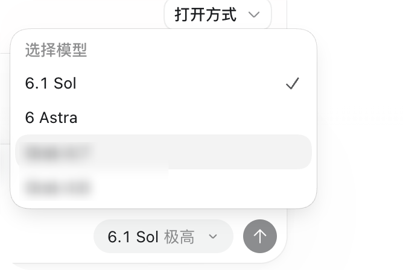
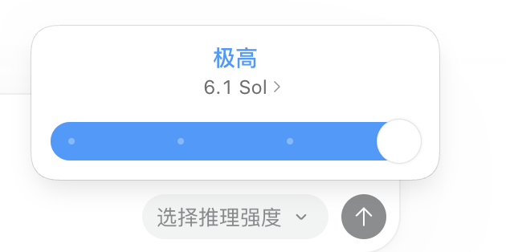

# Codex 模型怎么选：推理强度和 GPT-6.1 Sol

> 本文在线版：[codexguide.io/guides/codex-model-reasoning-effort](https://codexguide.io/guides/codex-model-reasoning-effort)

> 2026 年 10 月 14 日起，用 ChatGPT 登录的 Codex 不再提供 GPT-5.5。付费套餐改用 GPT-6.1 Sol，Free 和 Go 在桌面端改用 GPT-6 Luna。用 API Key 登录的会话不受影响。

打开 Codex 的模型菜单，很多人会先挑最强的模型，再把推理强度拉到最高。这样是不是最省事？

偶尔跑一个短任务，这样选确实省心。长期这么用，等待时间和消耗都会涨。一味挑便宜模型也未必省钱，任务失败后重跑两次，再花半小时人工收拾，省下的额度很快就补回去了。

**我的用法**会这样分（不是官方规定，官方只建议从各模型的默认或起步档开始，再按任务上调）：

- 日常改代码、补测试、常规调试，用 GPT-6.1 Sol，推理强度先用客户端默认档。
- 跨模块调试、方案取舍、正确性复核，用 GPT-6.1 Sol + 高，不够再升极高。
- 摘要、分类、抽取、格式转换和批量改写，用 GPT-6 Luna + 高。
- 最难的端到端工作再考虑 GPT-6 Astra，从轻度起步。
- 极高留给少数困难、多步骤、深度比速度和用量更重要的任务。

这套选法看的是完成一次任务的总成本，返工也算在里面。

## 先分清三个开关

Codex 的高级菜单里有三组设置：模型、推理强度和速度。它们各管一件事。

- **模型**决定能力、速度和基础消耗的大致区间。
- **推理强度**决定模型在这一题上投入多少计算。档位越高，复杂任务可能做得越好，但也更慢、更费 token。
- **速度**是用更多额度换更快返回。Fast 支持多款现役模型；Ultrafast 只支持 GPT-6 Astra 和 GPT-6.1 Sol，而且只对部分套餐开放。

任务只是返回得慢，去看速度档，别顺手把推理强度调高，那通常只会让它想得更久。

桌面端的推理强度只有四档：轻度、中、高、极高，对应官方文档的 Light、Medium、High、Extra High。CLI 里 Light 常对应 Low。CLI 可以用 `/model` 同时选择模型和推理强度。

## GPT-6.1 Sol、Luna、Astra 分别适合什么

桌面端的模型菜单长这样，可选模型因套餐而异：



| 模型 | 更适合 | 不建议直接交给它 |
|---|---|---|
| GPT-6.1 Sol | 复杂编码、agent 工作流、跨模块修改、多阶段调试、最终复核 | 大量机械改写、简单摘要 |
| GPT-6 Luna | 文件摘要、分类抽取、批量转换、变更说明初稿 | 需要持续判断的仓库级修改 |
| GPT-6 Astra | 最难的端到端任务 | 日常开发，成本明显更高 |

Astra 能力最强，GPT-6.1 Sol 接近它，成本低得多。所以付费套餐的日常主力是 GPT-6.1 Sol，Astra 只在 Sol 确实不够时再上。

Enterprise 和 Edu 的 GPT-6.1 Sol 默认关闭，需要管理员打开。菜单里看不到某个模型时，先问管理员，别在配置里写一个菜单里没有的模型名。

菜单里可能还能看到 GPT-5.6 Sol、Terra、Luna 等上一代模型，切换期内仍可使用。新写的脚本和配置，建议直接用 GPT-6.1 Sol 或 GPT-6 Luna。

## 性价比不能只看单价

按 OpenAI 当前公布的价目，Standard 速度下每 100 万 token 的 credit 单价如下：

| 模型 | 输入 | 缓存输入 | 输出 |
|---|---:|---:|---:|
| GPT-6 Astra | 250 | 25 | 1,250 |
| GPT-6.1 Sol | 50 | 2.5 | 250 |
| GPT-6 Luna | 2.5 | 0.25 | 12.5 |

GPT-6 Luna 的输入和输出单价是 GPT-6.1 Sol 的二十分之一，Astra 则是 Sol 的五倍。Plus 和标准 Business 每 5 小时的本地消息估算也差得很远：GPT-6.1 Sol 约 15–160 条，GPT-6 Luna 约 350–3,000 条，GPT-6 Astra 约 5–45 条。这些条数会随任务变化，剩余额度以用量面板或 CLI 的 `/status` 为准。

单价只说明 token 贵不贵，不能直接说明哪个模型完成一次任务更便宜。推理强度、上下文长度、工具调用、输出长度和失败重试都会改变最终消耗。实际选择时，可以按这笔账来算：

> 一次可用结果的总成本 = 模型消耗 + 重试次数 + 人工复核时间 + 出错风险。

Luna 一次做对，当然最划算。如果它连续跑偏，而 GPT-6.1 Sol 一次通过测试，Sol 反而更省。

速度档另外计费。相对同一模型的 Standard，Fast 的套餐内用量按 2.5 倍计，已购 credits 和企业按量按 2 倍计；Ultrafast 分别是 8 倍和 6 倍，而且只对 500 美元的 Pro 和符合条件的 Enterprise、Edu 开放。Fast 适合等待时间确实碍事的时候，别把它留成所有任务的默认值。

## 推理强度怎么选

官方建议：GPT-6.1 Sol 从客户端默认档起步，Luna 从高（High）起步，Astra 从轻度（Light；配置里写作 `low`）起步，结果不够再逐级上调。

桌面端的推理强度控件长这样，一共四档：



| 档位（界面 / 官方） | 适合的任务 | 什么时候不该用 |
|---|---|---|
| 轻度 / Light | 搜索文件、解释一段代码、范围写死的机械修改 | 任务包含多个依赖关系或隐含约束 |
| 中 / Medium | 需要一些规划，同时还要顾速度 | 已经出现相互冲突的根因 |
| 高 / High | 追查逻辑、核对假设、处理边界条件 | 验收标准很清楚、修改只是重复劳动 |
| 极高 / Extra High | 多步骤、多来源或需要权衡的困难工作 | 日常默认使用，性价比通常不好 |

需要并行处理的大任务，与其指望更高的档位，不如把工作拆开交给子 Agent。

不同代模型的同名档位不能直接对比。熟悉的任务可以先降一档试，看结果再加。

高档位也救不了模糊需求。任务没有验收标准时，先写清目标、不能改什么、怎样算做完，这比从中拉到高更有用。

## 把规划和执行分开

**我常用的**省额度办法，是让强模型做少量高价值判断，再让便宜模型执行已经说清楚的工作。

1. 用 GPT-6.1 Sol，推理强度调到高，阅读需求和关键代码，只输出计划、风险、受影响文件和验收条件，先不改代码。
2. 人工确认计划。边界已经写死的步骤交给 GPT-6 Luna + 高。
3. 批量改名、摘要、变更说明初稿，同样交给 Luna。
4. 改完后，再用 GPT-6.1 Sol 做一次只读复核，看遗漏、回归和测试缺口。

规划时可以用：

```text
先不要修改文件。请分析这个需求涉及的代码路径，列出：
1. 需要修改的文件和原因；
2. 实施顺序；
3. 每一步的验收条件；
4. 可能的回归风险和测试方案。
计划中不要使用“视情况而定”。遇到不确定的信息，写明要先验证什么。
```

执行时把已经确认的计划当成约束：

```text
按下面已经确认的计划执行。只处理第 2、3 步，不扩大范围。
完成后运行计划中指定的测试，并报告实际结果。
如果计划与代码现状冲突，停止修改并说明冲突。
```

这套方法的前提是任务已经拆清楚。仓库级实现如果还需要频繁重新规划，直接让 GPT-6.1 Sol 做完往往更省。

子 Agent 也可以各用各的模型。官方示例把只读探索的 Agent 设为 `gpt-6-luna`，审查 Agent 设为 `gpt-6.1-sol`。刚开始用时手动切换更直观，流程稳定后再写成自定义 Agent，做法见 [Codex 使用 Subagents 并行处理任务](https://codexguide.io/guides/codex-subagents-parallel-work)。

## 写进配置

桌面端、CLI 和 IDE 扩展读同一份 `~/.codex/config.toml`。账号里有 GPT-6.1 Sol 时，可以这样写：

```toml
model = "gpt-6.1-sol"
```

推理强度在客户端里按任务调整即可；需要时也可在配置里写 `model_reasoning_effort`（例如 `"medium"`）。Free、Go，或者专门做抽取和批量改写的配置，可以写成：

```toml
model = "gpt-6-luna"
```

只想对一次命令生效，用 `--model`：

```bash
codex --model gpt-6.1-sol
codex exec -m gpt-6.1-sol "Review the current changes"
```

如果配置、自定义 Agent、定时任务或脚本里还写着 `gpt-5.5`，记得换成账号能选到的模型。改完新开一个会话，用 `/status` 确认实际用的是哪个模型。

## 四套可以直接照用的组合

下面是**我的推荐组合**，方便照着试；不是官方强制档位表。官方对起步档的说法是：Sol 用客户端默认档，Luna 从高，Astra 从轻度。

| 场景 | 推荐组合 | 升级条件 |
|---|---|---|
| 摘要、抽取、格式转换、批量改写 | GPT-6 Luna + 高 | 连续遗漏约束时换 GPT-6.1 Sol |
| 日常功能开发、补测试 | GPT-6.1 Sol + 默认档 | 涉及多个模块或两轮仍未通过测试时升到高 |
| 复杂调试、架构规划、高风险修改 | GPT-6.1 Sol + 高 / 极高 | 仍缺关键证据时先补材料，不急着拉到最高 |
| 最难的端到端任务 | GPT-6 Astra + 轻度起步 | 结果不够再逐级上调 |

我的日常默认值放在 GPT-6.1 Sol + 默认档。大多数任务里它已经够用，也留出了升级空间。Luna 留给那些“结果格式已经写在题目里”的工作。

## 用自己的任务做一次小测

公开价目和跑分只能帮你缩小范围，真正决定默认模型的，应该是你自己的任务。

挑两个过去做过、结果可验证的任务，一个小改动，一个跨文件问题。用同一段提示词，让 GPT-6.1 Sol 和 GPT-6 Luna 各跑一次，记下是否一次通过、大致耗时、追问次数和你亲手改了多少。

如果 Luna 在简单任务里稳定一次通过，就让它继续做这类工作。如果跨文件任务里它经常重试，就把这部分交给 Sol。默认模型不需要永远固定，它只要符合你最近一个月最常做的事。

## 参考资料

- [Models - OpenAI Codex](https://learn.chatgpt.com/docs/models)
- [Pricing - OpenAI Codex](https://learn.chatgpt.com/docs/pricing)
- [Speed - OpenAI Codex](https://learn.chatgpt.com/docs/agent-configuration/speed)
- [Config basics - OpenAI Codex](https://learn.chatgpt.com/docs/config-file/config-basic)
- [Subagents - OpenAI Codex](https://learn.chatgpt.com/docs/agent-configuration/subagents)
- [Changelog - OpenAI Codex](https://learn.chatgpt.com/docs/changelog)

想继续系统学习 Codex，可以访问 [CodexGuide 教程网站](https://codexguide.io)。
