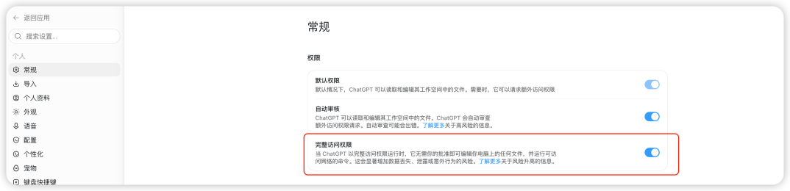
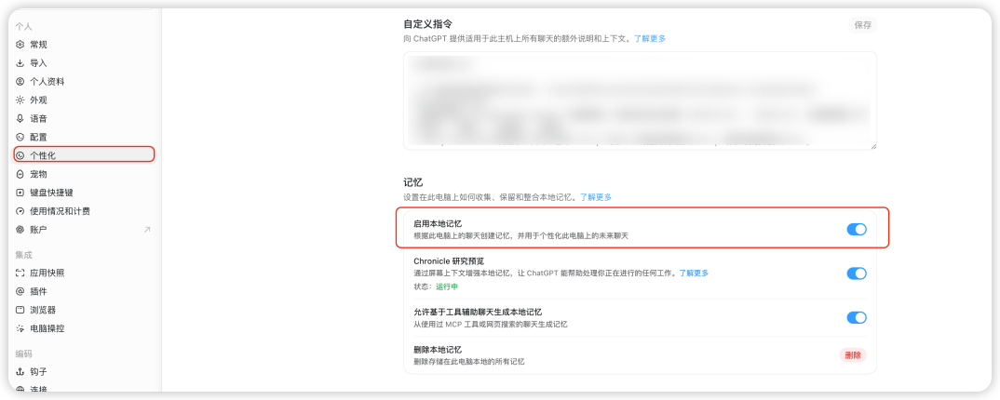
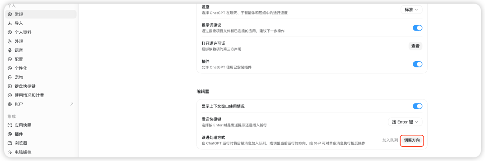

# Codex 桌面端设置怎么调（2026-11 更新）：权限模式、个人指令与 Memories、Follow-up behavior

> 本文在线版：[codexguide.io/guides/codex-desktop-collaboration-settings](https://codexguide.io/guides/codex-desktop-collaboration-settings)

> 核对依据：官方文档 [Settings](https://learn.chatgpt.com/docs/reference/settings)、[Permissions](https://learn.chatgpt.com/docs/permission-modes)、[Memories](https://learn.chatgpt.com/docs/customization/memories)、[Prompting](https://learn.chatgpt.com/docs/prompting) 和 [Codex 手册](https://learn.chatgpt.com/docs/codex-manual.md) 中的配置参考，2026-11-10 核对。文中截图是 2026-10 在 macOS 中文界面截取的，账号信息和自定义指令内容已打码；**2026-11-10 没有重新截图**，界面文字以你当前版本为准。官方文档用英文名称，下文同时写中英文。2026-11-10 起，原《Codex 任务总跑偏？先检查这 5 个设置》合并到本文。

这篇写给已经装好 ChatGPT 桌面端、准备让 Codex 读项目、改文件、跑命令的读者。开工前花几分钟把下面几项看一遍，能少很多「它怎么顺手改了别的文件」「我补一句话它怎么没听」的情况。

## 先看结论

| 检查项 | 在哪里 | 建议 |
|---|---|---|
| 选的是 Codex | 左上角下拉菜单 | 要改文件、跑命令时选 Codex |
| 权限模式 | 输入框下方的权限控件；CLI 用 `/permissions` | 大多数情况用 **Ask for approval** |
| 个人指令 | 设置 > 个性化（Personalization） | 写几条长期规则，存进这台电脑的全局 AGENTS.md |
| Memories | 设置 > 个性化 | 默认关闭，按需打开 |
| Follow-up behavior | 设置 > 常规（General） | 选默认 Steer 还是 Queue |

打开设置：macOS 按 <kbd>Cmd</kbd>+<kbd>,</kbd>，Windows 按 <kbd>Ctrl</kbd>+<kbd>,</kbd>，也可以从 App 菜单进入。

## 先切到 Codex

桌面端把 ChatGPT 和 Codex 放在同一个 App 里，左上角的下拉菜单可以切换。中文界面里，ChatGPT 的说明是「创建、学习和探索」，Codex 是「构建、调试并发布」。


两边能力有重叠。讨论方案、查资料、整理需求可以先在 ChatGPT 里做；要进入本地文件夹或仓库，读写文件、跑命令和测试时，切到 Codex。

## 权限模式：Ask for approval、Approve for me、Full access

权限决定 Codex 能自己做什么、什么要先过审。官方 [Permissions](https://learn.chatgpt.com/docs/permission-modes) 页把它拆成两层：

- **沙箱（sandbox）**：能访问哪些文件和网络资源。
- **审批（approvals）**：什么时候停下来问你，什么时候交给自动审核。

桌面端和 IDE 扩展在**输入框下方的权限控件**里切换，CLI 输入 `/permissions`。菜单里可能出现的选项：

| 模式 | 中文界面（2026-10 截图） | 做什么 |
|---|---|---|
| **Ask for approval** | 默认权限 | 在当前工作区里读写文件；要越过这个边界时先问你。官方建议大多数工作从这里开始 |
| **Approve for me** | 自动审核 | 工作区边界不变，越界请求交给自动审核，不再逐条问你 |
| **Full access** | 完整访问权限 | 不需要你批准就能改电脑上的任何文件、运行能联网的命令，风险最高 |

另外还可能有组织或你自己定义的权限配置（permissions profiles）。哪些选项出现，取决于 App 版本、运行环境、本地配置和组织要求；某个模式被禁用或不显示，通常是组织策略的原因。



注意 Approve for me **不会扩大沙箱**：它只是把「要不要越界」的决定交给自动审核。Full access 才会去掉这层边界。官方文档还提到，对获批用于网络安全工作的模型开启 Full access 前，桌面端会显示针对该模型的风险提示，并建议改用 Approve for me。

怎么选：

- 第一次进一个陌生项目：Ask for approval，先只读看结构和 Git 状态。
- 熟悉的项目、重复性的改动：可以考虑 Approve for me，少一些打断。
- 生产数据库、账号设置、公开发布、花钱的操作：保留人工确认，不要用 Full access 跑。

沙箱和审批的原理、常见组合，见 [权限沙箱与审批：什么时候放行，什么时候收紧](../02-核心概念与任务方法/06-权限沙箱与审批-什么时候放行什么时候收紧.md)。

## 个人指令与 Memories

两者都在 **设置 > 个性化（Personalization）**，但不是一回事。



**个人指令**是你主动写下的长期规则。官方文档写明，Codex 的个人指令存在这台电脑的**全局 `AGENTS.md`**（`~/.codex/AGENTS.md`）里，**按电脑生效**；仓库里的 AGENTS.md 也会同时作用。中文界面的说明是「向 ChatGPT 提供适用于此主机上所有聊天的额外说明和上下文」。可以先写四条：

```text
开始修改前先读取仓库规则和相关文件。
只处理当前任务需要的范围，不顺手改无关文件。
完成后说明改动了哪些文件、跑了哪些验证命令、还有哪些风险。
提交、推送、发布或删除重要数据前先问我。
```

项目专属的规则（构建命令、目录约定）写进仓库的 AGENTS.md，写法见 [AGENTS.md 怎么写](../10-配置模型与权限安全/07-AGENTS.md怎么写-项目规则继承关系与验收标准.md)。

**Memories** 会从过去的聊天里提取有用的信息，带到之后的工作里。官方文档写明**本地 Codex Memories 默认关闭**，在个性化里打开 **Enable Codex memories**（中文界面截图里是「启用本地记忆」）；也可以在 `config.toml` 里打开：

```toml
[features]
memories = true
```

存储位置、按对话控制等细节，见 [Codex Memories 记忆功能](../11-自动化与高级工作流/12-Codex-Memories记忆功能-开启方式-存储位置与按对话控制.md)。

两样都不要放密钥、Cookie、客户资料和私人聊天原文。

## 「个性」选项已经不改变风格了

旧版设置里可以在「亲和」和「务实」两种个性之间选。官方配置参考现在写明：

- `personality` 是为兼容保留的设置，**`friendly` 和 `pragmatic` 不再选择风格**；
- Codex **不再提供 `/personality` 命令**；
- 只有 `personality = "none"` 还有作用：去掉模型内置说明里的 Personality 一节，不影响你自己写的指令。

ChatGPT 网页版另有 **Settings > Personalization > Base style and tone** 可以选回复风格，但那是 ChatGPT 的设置。在 Codex 里想让回复短一点、先给结论，直接写进个人指令或当次任务：

```text
先给处理结果，再列验证情况和剩余风险。解释控制在能让我复核改动的程度。
```

## General：Enter 发送、防休眠、Follow-up behavior

**设置 > 常规（General）** 里有三项和日常协作有关：

- **Enter 发送**：可以选按 Enter 直接发送，或者要求 <kbd>Cmd</kbd>+<kbd>Enter</kbd>（Windows、Linux 是 <kbd>Ctrl</kbd>+<kbd>Enter</kbd>）才发送，方便写多行提示。
- **Prevent sleep while running**（macOS 和 Linux）：本地任务跑的时候不让电脑睡眠，你走开它也能继续。
- **Follow-up behavior**：Codex 正在工作时你又发了一条消息，默认怎么处理。



Follow-up behavior 的两个选项（中文界面里叫「跟进处理方式」）：

| 选项 | 中文界面 | 效果 | 适合 |
|---|---|---|---|
| **Steer** | 调整方向 | 把消息加进当前这一轮 | 发现它改错文件、漏了条件、要补新信息 |
| **Queue** | 加入队列 | 消息留到下一轮 | 不该打断当前工作的后续任务 |

排队的消息显示在输入框上方，可以编辑、调整顺序、发送或删除。设置项里还会显示一个快捷键，用来对单条消息临时使用另一种方式，不改默认值。CLI 里，Codex 工作时按 Enter 是 Steer，按 Tab 是 Queue。

## 开工前的检查清单

找一个有 Git 的小项目，按顺序过一遍：

- [ ] 左上角选的是 **Codex**
- [ ] 权限模式是 **Ask for approval**（或你有意选择的模式）
- [ ] 个人指令里写了修改范围、汇报方式、哪些操作要先问
- [ ] Memories 按需打开或保持关闭
- [ ] Follow-up behavior 的默认值符合你的习惯
- [ ] 让 Codex 先只读检查，再给一个可以撤销的小改动

可以用这句话试：

```text
先读取 README、仓库规则和 Git 状态，不要修改文件。说明完成这项小改动需要哪些文件、命令和权限，等我确认后再执行。
```

执行中再补一条范围限制，看它是马上调整（Steer）还是排到下一轮（Queue）。结束后看 `git diff` 和验证命令。改动范围、审批节点和验证结果都清楚，这套设置就可以用于日常任务了。

## 常见问题

**设置里的「个性」还有用吗？**

`friendly` 和 `pragmatic` 不再选择风格，`/personality` 命令已移除。想调风格，写进个人指令。

**Approve for me 会不会让 Codex 能改工作区以外的文件？**

不会扩大沙箱，只是把越界请求交给自动审核。Full access 才会去掉边界。

**个人指令存在哪里？换一台电脑还在吗？**

存在这台电脑的 `~/.codex/AGENTS.md`，按电脑生效，换电脑要重新写。

**Memories 默认是开的吗？**

不是，本地 Memories 默认关闭。

## 相关阅读

- [权限沙箱与审批：什么时候放行，什么时候收紧](../02-核心概念与任务方法/06-权限沙箱与审批-什么时候放行什么时候收紧.md)
- [AGENTS.md 怎么写：项目规则、继承关系与验收标准](../10-配置模型与权限安全/07-AGENTS.md怎么写-项目规则继承关系与验收标准.md)
- [Codex Memories 记忆功能：开启方式、存储位置与按对话控制](../11-自动化与高级工作流/12-Codex-Memories记忆功能-开启方式-存储位置与按对话控制.md)
