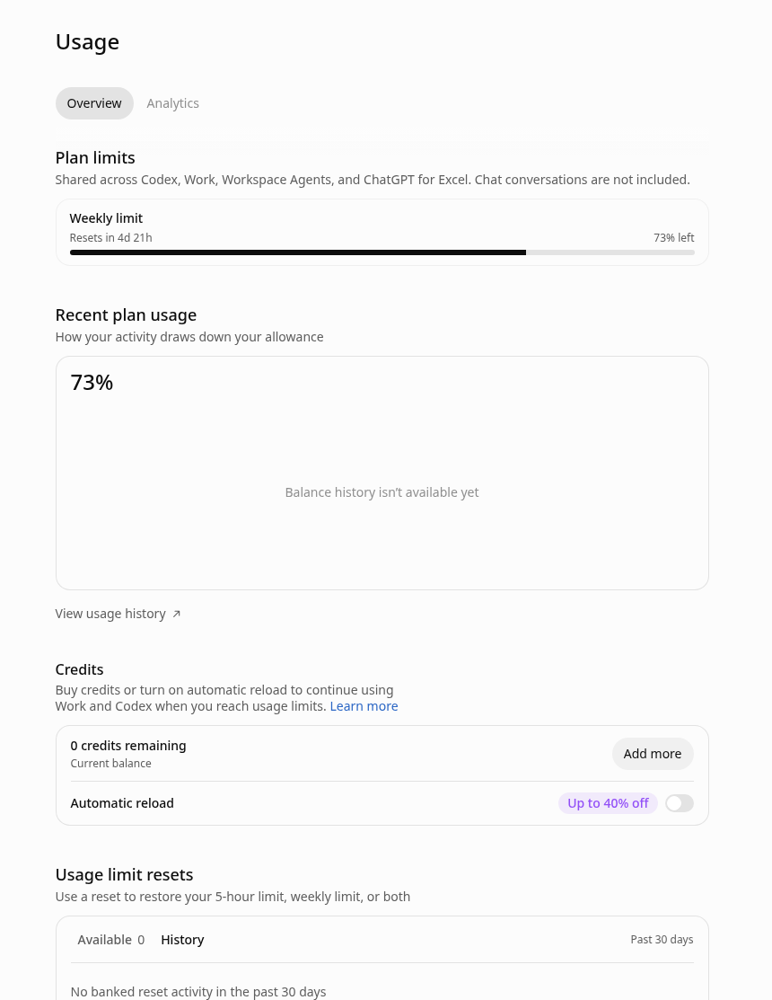
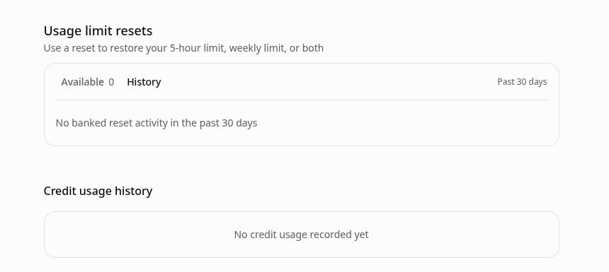

# Codex 用量额度怎么看（2026-11 更新）：GPT-6.2 的 Fast 2x、Ultrafast 6x 倍率和 credits 单价，Plus 每 5 小时能发多少条

> 本文在线版：[codexguide.io/guides/codex-usage-limits-credits](https://codexguide.io/guides/codex-usage-limits-credits)

> 核对依据：OpenAI Help Center 的 Codex 套餐与用量、个人计划 credits，以及 learn.chatgpt.com 的 [Pricing](https://learn.chatgpt.com/docs/pricing) 和 [Speed](https://learn.chatgpt.com/docs/agent-configuration/speed)。倍率、credits 单价和 5 小时估算以定价页为准，查询日期 2026-11-18。文中「我的用法」是使用建议，不是官方规定。模型怎么选见 [Codex 模型怎么选](./01-Codex模型怎么选-推理强度Low-Medium-High有什么区别.md)，GPT-6.2 的切换和资格见 [GPT-6.2 Astra 与 Sol](./29-Codex使用GPT-6.2-Astra与Sol-怎么选-切换方法-Ultrafast与额度.md)。

打开 Usage，看到百分比往下掉，很多人会问三件事：

1. **我到底还有多少可以用？**
2. **为什么「只发了几条」就掉这么快？**
3. **要不要买 credits，还是被多扣了？**

2026-10-29 起，Pro 与 Business Premium 的 Work / Codex 内含额度有一次上调，各档差在哪见 [用量上调](./17-Codex用量上调-Pro100与Pro500翻倍-Pro200取消降额.md)。12 月起 Plus、Pro、Business 的共用额度见 [用量合并](./20-Codex和ChatGPT用量合并-12月起共用额度按token计算.md)。本文仍讲面板怎么读，以及 2026-11-17 定价页上的倍率和单价。

本文只解决「怎么读额度、倍率怎么算、觉得不对怎么查」。若界面是 **Selected model is at capacity**、或要分清容量满／额度用尽／重置类型，见 [Codex「Selected model is at capacity」与额度重置](../15-故障排查与常见问题/01-Codex模型容量不足与额度重置排查.md)。

## 先打开正确的面板

桌面端：**Settings → Usage**（有的说明写作 Usage & billing）。CLI 会话里可用 `/status` 看当前剩余与重置相关信息。

Overview 大致分三块（具体卡片以你的套餐为准）：

1. **Plan limits**：套餐内含额度（例如 Weekly limit、有时还有 5-hour limit），以及 **Resets in…**。
2. **Credits**：余额、Add more、Automatic reload。
3. 更下方常有 **Usage limit resets**（banked reset）与 credit 使用记录——那是重置／扣费履历，不是「再给你一档免费额度」。

官方写明：适用套餐里，**Codex、ChatGPT Work、Workspace Agents、ChatGPT for Excel** 等可共用同一份主用量／credits 池；**普通 Chat 对话不计入**这份共享池。面板上也会有类似说明。

**读百分比时注意标签**：有的界面写「left／剩余」，有的写「used／已用」。看错方向，会把「还剩 74%」当成「已经用了 74%」。

## 5 小时与每周：两扇门，不是两套独立配额

官方（Managing usage with GPT-6 Astra…）说明：视套餐而定，用量可同时受 **五小时窗** 与 **每周窗** 约束。**两档都有时，两边都要有剩余** 才能继续用共享池。

| 窗口 | 管什么 | 常见误解 |
|---|---|---|
| 5 小时窗 | 一段短窗口内的内含用量 | 「一定要满 5 小时才重置」——不对；窗内额度可能提前用完 |
| 每周窗 | 这一周主用量上限 | 「周额度还有就一定能继续」——若 5 小时窗已空，仍可能被拦住 |

**5 小时新窗何时开始**：上一窗结束后，你在 Work／Codex **再发第一条消息**时，新窗才开始——不是墙上时钟一到就自动开一扇新门。

**Pro 特例（当前公开说明）**：Pricing 写 **Pro 方案目前没有 5 小时限制**，但仍有套餐内含用量；以 Settings → Usage 为准。Plus、Business Standard 等通常要同时看两档。

额度**不是固定「还能发 N 条」**。下一节的本地消息区间只是**估算**。云端任务往往比本地短消息更吃额度。**不要把别人截图里的数字背成自己的上限。**

## 什么会加快消耗

同一句话，换模型、加文件、开 Fast，扣法可以差很多。官方反复强调影响因素包括：

- **模型**：更强的模型通常更吃额度。GPT-6.2 Astra 的 credits 单价高于 GPT-6.2 Sol，也高于 Luna。
- **任务形态**：长上下文、多步工具调用、大仓库、长时间会话，比「改一行」贵得多。
- **推理强度**：更高 effort 可能多用额度，且**不保证**结果更好。
- **速度档**：Fast／Ultrafast 相对 Standard 有倍率（见下节）。
- **运行位置**：云端任务可能比本地消息更吃内含额度。
- **工具与上下文**：MCP、过多无关文件、臃肿的 `AGENTS.md` 都会抬高消耗。

另有几条容易漏算、但官方写明的：

- **ChatGPT Voice 在 Work／Codex 桌面里启动的任务**，走同一份共享池；Connected Voice 通话时长在适用计费下另计。Pricing 写桌面 Voice 使用现有 Codex 用量预算，每分钟 0.05 美元；Business、Edu、Enterprise 的 credits 计费以及 Plus、Pro 使用额外 credits 时，每分钟 1.25 credits。普通 Chat Voice 有单独限制，**不消耗** Codex 用量。
- **Auto-review 安全检查**（用 ChatGPT 账号登录时）**免费，不计入**套餐用量；其他 Codex／Work 活动仍计入。
- **图片生成**计入同一类通用用量，且相对类似无图回合，内含额度大约按 **3–5 倍**更快消耗（随画质／尺寸变）。
- 用 **API Key** 跑 Codex 时，按 **API 价**计费，**不适用** ChatGPT 套餐面板上的倍率叙事。

### 我的用法：大任务前先看一眼 Usage

不是官方强制步骤：

1. 开大改、长云端任务之前，先看 **哪一档更紧**、何时重置。
2. 先选模型和推理档，跑一小步验收，再决定要不要加努力度或开 Fast。
3. 需要「更快」时再开 Fast；默认长期开着，等于把内含额度按更高倍率烧。

## Fast 与 Ultrafast：倍率怎么读

依据 Pricing 的 Speed multipliers 和 Speed 页。倍率相对**同一模型的 Standard**。Credits／PAYG 指已购买的 credits，以及 Enterprise 按量。以官方定价页为准，查询日期 **2026-11-18**。

帮助中心 [Managing usage with GPT-6 Astra](https://help.openai.com/en/articles/20001516-managing-usage-with-gpt-6-astra-in-work-and-codex) 文首已经写 GPT-6.2 Astra 和 Sol 当天正在推出，但同一页的 Ultrafast 一节仍只写 GPT-6 Astra 与 GPT-6.1 Sol，并写 Plus、Pro 100 美元、Pro 200 美元和 Business 在发布时不含 Ultrafast、购买 credits 也不会打开它。这和 2026-11-17 的 Changelog、What's new、Speed 不一致：后三处写 Pro 200 美元可以把 Ultrafast 用在 GPT-6.2 Sol。本文的资格和倍率采定价页、Speed 和 Changelog。

### Fast

| 模型 | 套餐内含用量 | credits／PAYG |
|---|---|---|
| GPT-6.2 Astra、GPT-6.2 Sol | **2 倍** | **2 倍** |
| GPT-6.1 Sol、GPT-6.1 Terra | **2.5 倍** | **2 倍** |
| GPT-6 Astra、GPT-6 Sol、GPT-6 Luna | **2.5 倍** | **2 倍** |

Speed 页写 Fast 支持上表这些模型。用 ChatGPT 登录时，CLI 和 IDE 扩展也可以用 Fast。

**生成速度和计费倍率是两列数**。Speed 页写：对 GPT-6.2 Astra 和 GPT-5.6，Fast 的出 token 速度大约是 Standard 的 **1.5 倍**。这句没有写 GPT-6.2 Sol，也不要把它填进上表的 2 倍或 2.5 倍里。

CLI 可用 `/fast` 开关，再输入一次回到 Standard。Speed 页写明 CLI 会记住这次选择。配置参考里，`[features].fast_mode` 默认是 true，作用是打开 Fast 选择以及 `service_tier = "fast"` 这条路径；本文没有改过这个键，也没有把 `service_tier` 写成一份已验证的默认配置。受管客户端里，`requirements.toml` 的 `features.fast_mode` 可以把 Fast 钉住开或关，那不是一条普通的起始默认。0.169.1 的 `--help` 没有列出 `/fast`，斜杠命令来自 Speed 文档。本文没有登录，没有在交互会话里切换速度。

### Ultrafast

| 模型 | 套餐内含用量 | credits／PAYG |
|---|---|---|
| GPT-6.2 Astra、GPT-6.2 Sol | **6 倍**（全程） | **3 倍**，到 2027-02-28；**6 倍**，从 2027-03-01（太平洋时间）起 |
| GPT-6 Astra | **8 倍** | **6 倍** |
| GPT-6.1 Sol | **8 倍** | **6 倍** |

脚注写的是：GPT-6.2 两款里，用已购买 credits 支付的合格超额，以及合格的 Enterprise 按量，在 2027 年 2 月 28 日之前按 Standard 的 3 倍计，3 月 1 日起按 6 倍计。**套餐内含始终是 6 倍。** GPT-6.1 Terra、GPT-6 Sol、GPT-6 Luna 不在这张 Ultrafast 表里。

Speed 页的生成速度：GPT-6.2 两款的 Ultrafast 最多大约是 Standard 的 **4.5 倍**。Codex 里 GPT-6 Astra 的 Ultrafast 最多大约是它自己 Standard 的 **8 倍**。这些都是出 token 的速度，不是上表的计费倍数。

谁能开，按 Changelog、What's new 和 Speed：

- Pro 每月 200 美元：Ultrafast 可以用在 **GPT-6.2 Sol**。
- Pro 每月 500 美元：GPT-6.2 两款都可以。先扣内含，再扣 credits。
- Enterprise、Edu：两款都可以，但要符合条件的协议（Enterprise 为 credits 或按美元用量；Edu 为 credits），并且所有者另外打开这项权限。默认关闭。
- GPT-6 Astra 和 GPT-6.1 Sol 的 Ultrafast：Speed 页写的是 Pro 500 美元和符合条件的 Enterprise、Edu。

数据驻留：GPT-6.2 Astra、GPT-6.2 Sol 和 GPT-6 Astra 的 Ultrafast 只支持美国。GPT-6.1 Sol 还支持欧洲（EEA 和瑞士）。

CLI 用 `/ultrafast`，再输入一次回到 Standard。选择会被记住。

把「开了 Fast 所以掉得快」当成计费故障之前，先按上表算一遍倍率是否解释得通。GPT-6.2 的 Fast 是 2 倍，不要再套旧的统一 2.5 倍。

## GPT-6.2 的 credits 单价与 Plus、Business 的 5 小时消息估算

下面同样来自定价页，查询日期 2026-11-18。credits 是 Standard 速度下每 100 万 token 的单价。它和套餐内含的「还能发多少条」不是同一个数。

| 模型 | 输入 | 缓存输入 | 输出 |
|---|---:|---:|---:|
| GPT-6.2 Astra | 200 credits | 10 credits | 1,000 credits |
| GPT-6.2 Sol | 50 credits | 2.5 credits | 250 credits |
| GPT-6 Astra | 250 credits | 25 credits | 1,250 credits |
| GPT-6.1 Sol | 50 credits | 2.5 credits | 250 credits |
| GPT-6.1 Terra | 25 credits | 1.25 credits | 125 credits |
| GPT-6 Luna | 2.5 credits | 0.25 credits | 12.5 credits |

按美元用量计费时，同一页写 GPT-6.2 Astra 为每 100 万 token 输入 8 美元、缓存输入 0.40 美元、输出 40 美元；GPT-6.2 Sol 为 2 美元、0.10 美元、10 美元。发布文把同一组数字写成标准 API 价格。用 API Key 时走 API 价格。

Plus 和 Standard Business 的**本地消息**估算（每 5 小时）。Pricing 写明这不是固定条数上限，云端任务可能更吃额度。Pricing 写 Pro 目前没有 5 小时限制；帮助中心把这一点写成 Pro 100、Pro 200 和 Pro 500。同一篇帮助文章里的估算表还没有 GPT-6.2 和 GPT-6.1 Terra，停在 Astra 5–45、GPT-6.1 Sol 15–160 等旧行。下表以 Pricing 页为准。

| 模型 | Plus | Standard Business |
|---|---|---|
| GPT-6.2 Astra | 6–50 | 6–50 |
| GPT-6.2 Sol | 17–180 | 17–180 |
| GPT-6 Astra | 5–45 | 5–45 |
| GPT-6.1 Sol | 15–160 | 15–160 |
| GPT-6.1 Terra | 35–285 | 35–285 |
| GPT-6 Sol | 15–150 | 15–150 |
| GPT-6 Luna | 350–3,000 | 350–3,000 |

本地消息和云端对话共用套餐额度，每周限制也可能同时存在。采用灵活定价的 Enterprise／Edu 没有固定速率限制，用量随 credits 扩展；没有灵活定价的 Enterprise 和 Edu，多数功能的按席位限制与 Plus 相同。

## Credits：内含用完之后的续航，不是另一套「周额度」

依据个人计划 credits 说明（Help 12642688）与 Pricing：

- **先扣套餐内含**，撞限后才从 **credit 余额**继续（账号支持时）。
- Plus／Pro 等可在撞限后或 **Settings → Usage**（Codex 应用里也可能写作 Usage & Billing）查看余额、**Add more**、以及可选的 **Automatic reload**。
- Credits 可在支持的功能间共用（如 Codex、Work、Word／Excel／PowerPoint 等，以你计划为准）。
- **Usage credits 和 ChatGPT wallet 是两笔余额**。兑换礼品卡本身不会变成 usage credits。帮助中心写：在 ChatGPT 网站上符合条件的一次性购买，结账时可能使用钱包里的美元；如果结账页没有显示使用了钱包，不要假定这次购买会扣钱包。自动充值买的是 usage credits，不会给钱包充值。
- 一条「使用 credits 前先问我」的保存指令**不会**多出一步扣费确认。内含用完后如果继续用 Work 或 Codex，账户里已有的 credits 可以被自动使用。
- credits 自购买起 **12 个月**有效。帮助中心另写：2026-11-13 之后在日本购买的 credits，180 天到期。未使用的不滚入下一期。一般不可转让、没有现金价值。退款以法律、合同或已确认的账单异常、未经授权的使用、服务故障为准。
- 任务开始时余额为正、并发耗尽后结束，余额可能短暂为负；之后的购买／自动充值可能先抵负再加可用额度。
- Free／Go：**部分**账号可能看到买 credits；看不到 Add credits 就表示当前账号还不可买。买 credits **不会**提高套餐内含上限。

**Credits 与重置别混**：

| | Credits | 付费即时重置／banked reset |
|---|---|---|
| 作用 | 内含用完后按量续用 | 刷新适用的套餐额度窗口 |
| 会不会改周重置日 | 一般不因买 credits 而改 | 付费即时重置／完整 banked 会影响周日程 |
| 详解 | 本文 | [容量不足与额度重置](../15-故障排查与常见问题/01-Codex模型容量不足与额度重置排查.md) |

企业／Edu／Business：多为工作区级 credits 或合同内 USD 计费；成员找管理员，不要套用个人 Plus 的购买路径。

## 觉得「被多扣」时怎么查

官方建议：接近或已撞限时，看 **哪一档耗尽**、**credits 余额**、**显示的重置时间**；CLI 用 `/status`。认为计数有误，或到了显示的重置时间仍不能用，再联系 Support，并附截图与时间（含时区）。**Support 不会手动清零**用量限制。

### 我的用法：自查顺序

1. **确认账号／工作区**：个人与公司工作区、多个登录，额度是分开的。
2. **确认读的是哪一档**：5 小时空了，不等于周额度少了；Pro 没有 5 小时窗时，以面板实际卡片为准。
3. **还原设置**：当时的模型、推理档、是否 Fast／Ultrafast、本地还是云端、有无大量工具、MCP 或大上下文。GPT-6.2 的 Fast 按 2 倍估算，Ultrafast 的内含按 6 倍估算。
4. **对照官方「会加快消耗」的项**：长任务、图片、Voice 启动的任务、多会话并发等。
5. **刷新 Usage**，看 credit history／近期活动（企业有时还有 Personal Analytics／成员成本可见性；美元估值是规划用，不是账单）。
6. **仍无法解释**：联系 Support，带上客户端与版本、模型与速度档、怀疑的额度或余额、界面显示的重置时间、脱敏截图、大致时间与时区。

不要把第三方重置日历、论坛里的美元单价，或单次任务的主观感觉，当成官方计费结论。倍率以定价页为准。

## 想让额度更耐用

Pricing 把「让限制更耐用」写成可操作建议，核心是减上下文、减无关工具、匹配输出规模：

- 提示写清楚，但去掉多余背景。
- 只挂相关文件；能缩小范围就缩小。
- 约定受众、格式、长度；必做与可选项分开。
- 大仓库用嵌套 `AGENTS.md` 控制注入量，避免一份巨型说明每轮都塞进上下文。GPT-6.2 指南还要求 `AGENTS.md` 只留仓库推不出来的要求，见 [提示词怎么写给 GPT-6.2](../02-核心概念与任务方法/10-Codex提示词怎么写给GPT-6.2-推理强度-子代理-视觉参考与精简AGENTS.md.md)。
- 不用的 MCP 先关掉。每个 MCP 都会抬高消息上下文。

**我的用法**：同一目标拆成「探索 → 改代码 → 收尾」几轮短任务，往往比一条超长 agent 回合更省、也好回滚。需要速度时再开 Fast。需要最强模型时，先用较低推理档，不够再加。

企业／Edu：若工作区是 **credits 池或 USD token 计费**，成员先看管理员给的限额与重置周期。桌面端若出现 **Usage & billing** 或成员成本可见性，其中的美元数字是规划估算，不是发票。

## 少踩坑

1. **先读面板标签**。left 和 used 弄反，后面的判断都会偏。
2. **两档都有时，先看是哪一扇门关上了**，再决定等 5 小时还是等一周。
3. **Fast 是用额度换速度**。GPT-6.2 按 2 倍计，更早的几款 Fast 内含按 2.5 倍计。
4. **Ultrafast 的 3 倍只覆盖 credits／PAYG，而且有截止日期**。内含用量一直是 6 倍。
5. **换模型或新开聊天不会恢复**已经耗尽的共享内含额度。
6. 界面是 at capacity 时，先看 [容量不足与额度重置](../15-故障排查与常见问题/01-Codex模型容量不足与额度重置排查.md)。

## 参考资料

- [Using Codex with your ChatGPT plan](https://help.openai.com/en/articles/11369540-using-codex-with-your-chatgpt-plan-usage-limits-and-troubleshooting)
- [Managing usage with GPT-6 Astra in Work and Codex](https://help.openai.com/en/articles/20001516-managing-usage-with-gpt-6-astra-in-work-and-codex)
- [Using Credits for Flexible Usage in ChatGPT (Personal plans)](https://help.openai.com/en/articles/12642688-using-credits-for-flexible-usage-in-chatgpt-personal-plans)
- [Speed（Fast／Ultrafast）](https://learn.chatgpt.com/docs/agent-configuration/speed)
- [Pricing（估算区间、倍率表、credits 单价）](https://learn.chatgpt.com/docs/pricing)
- [Codex 模型怎么选](./01-Codex模型怎么选-推理强度Low-Medium-High有什么区别.md)
- [Codex 用 GPT-6.2 Astra 和 Sol](./29-Codex使用GPT-6.2-Astra与Sol-怎么选-切换方法-Ultrafast与额度.md)
