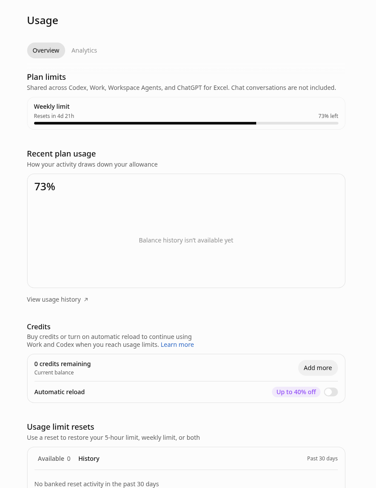

# Codex 用量额度怎么看：5 小时与每周限制、Fast 倍率和 credits，以及觉得被多扣时怎么查

> 本文计划路径：[codexguide.io/guides/codex-usage-limits-credits](https://codexguide.io/guides/codex-usage-limits-credits)

> 核对依据：OpenAI Help Center 的 Codex 套餐与用量、个人计划 credits、以及 learn.chatgpt.com 的 Pricing／Speed。文中「我的用法」是使用建议，不是官方规定。

打开 Usage，看到百分比往下掉，很多人会问三件事：

1. **我到底还有多少可以用？**
2. **为什么「只发了几条」就掉这么快？**
3. **要不要买 credits，还是被多扣了？**

本文只解决「怎么读额度、倍率怎么算、觉得不对怎么查」。若界面是 **Selected model is at capacity**、或要分清容量满／额度用尽／重置类型，见姊妹篇《[Codex「Selected model is at capacity」与额度重置](https://codexguide.io/guides/codex-model-at-capacity-usage-reset)》（知识库路径 `15-故障排查与常见问题/01-Codex模型容量不足与额度重置排查.md`）。

## 先打开正确的面板

桌面端：**Settings → Usage**（有的说明写作 Usage & billing）。CLI 会话里可用 `/status` 看当前剩余与重置相关信息。

Overview 大致分三块（具体卡片以你的套餐为准）：

1. **Plan limits**：套餐内含额度（例如 Weekly limit、有时还有 5-hour limit），以及 **Resets in…**。
2. **Credits**：余额、Add more、Automatic reload。
3. 更下方常有 **Usage limit resets**（banked reset）与 credit 使用记录——那是重置／扣费履历，不是「再给你一档免费额度」。

官方写明：适用套餐里，**Codex、ChatGPT Work、Workspace Agents、ChatGPT for Excel** 等可共用同一份主用量／credits 池；**普通 Chat 对话不计入**这份共享池。面板上也会有类似说明。

**读百分比时注意标签**：有的界面写「left／剩余」，有的写「used／已用」。看错方向，会把「还剩 74%」当成「已经用了 74%」。

## 5 小时与每周：两扇门，不是两套独立配额

官方（Managing usage with GPT-6 Astra…）说明：视套餐而定，用量可同时受 **五小时窗** 与 **每周窗** 约束。**两档都有时，两边都要有剩余** 才能继续用共享池。

| 窗口 | 管什么 | 常见误解 |
|---|---|---|
| 5 小时窗 | 一段短窗口内的内含用量 | 「一定要满 5 小时才重置」——不对；窗内额度可能提前用完 |
| 每周窗 | 这一周主用量上限 | 「周额度还有就一定能继续」——若 5 小时窗已空，仍可能被拦住 |

**5 小时新窗何时开始**：上一窗结束后，你在 Work／Codex **再发第一条消息**时，新窗才开始——不是墙上时钟一到就自动开一扇新门。

**Pro 特例（当前公开说明）**：**Pro 100／Pro 200／Pro 500** 在 Work 与 Codex **暂无 5 小时限制**，但仍有套餐内含用量；以 Settings → Usage 为准。Plus、Business Standard 等通常要同时看两档。

额度**不是固定「还能发 N 条」**。官方 Pricing 给出的本地消息区间只是**估算**（例如 Plus 上 Astra 约 5–45、Luna 约 350–3,000／五小时窗），随模型、任务、设置变化；云端任务往往比本地短消息更吃额度。**不要把别人截图里的数字背成自己的上限。**

## 什么会加快消耗

同一句话，换模型、加文件、开 Fast，扣法可以差很多。官方反复强调影响因素包括：

- **模型**：Astra 通常比 Luna 更吃额度；同一任务换更轻量的模型，往往更耐用。
- **任务形态**：长上下文、多步工具调用、大仓库、长时间会话，比「改一行」贵得多。
- **推理强度**：更高 effort 可能多用额度，且**不保证**结果更好。
- **速度档**：Fast／Ultrafast 相对 Standard 有倍率（见下节）。
- **运行位置**：云端任务可能比本地消息更吃内含额度。
- **工具与上下文**：MCP、过多无关文件、臃肿的 `AGENTS.md` 都会抬高消耗。

另有几条容易漏算、但官方写明的：

- **ChatGPT Voice 在 Work／Codex 桌面里启动的任务**，走同一份共享池；Connected Voice 通话时长在适用计费下另计。普通 Chat Voice 有单独限制，**不消耗** Codex 用量。
- **Auto-review 安全检查**（用 ChatGPT 账号登录时）**免费，不计入**套餐用量；其他 Codex／Work 活动仍计入。
- **图片生成**计入同一类通用用量，且相对类似无图回合，内含额度大约按 **3–5 倍**更快消耗（随画质／尺寸变）。
- 用 **API Key** 跑 Codex 时，按 **API 价**计费，**不适用** ChatGPT 套餐面板上的倍率叙事。

### 我的用法：大任务前先看一眼 Usage

不是官方强制步骤：

1. 开大改、长云端任务之前，先看 **哪一档更紧**、何时重置。
2. 先选模型和推理档，跑一小步验收，再决定要不要加努力度或开 Fast。
3. 需要「更快」时再开 Fast；默认长期开着，等于把内含额度按更高倍率烧。

## Fast 与 Ultrafast：倍率怎么读

依据 learn.chatgpt.com 的 **Speed** 与 **Pricing**（相对同一模型的 Standard）：

| 速度档 | 套餐内含用量 | 已购 credits／企业按量 |
|---|---|---|
| Fast | **2.5×** | **2×** |
| Ultrafast（Astra／GPT-6.1 Sol，适用时） | **8×** | **6×** |

**Fast**：在支持的模型上加速（文档举例含 GPT-6.1 Sol、GPT-6 Astra、GPT-6 Sol、GPT-6 Luna 等，以你账号可见为准）。CLI 可用 `/fast` 开关；也可用 `config.toml` 持久化（`service_tier = "fast"` 与 `[features].fast_mode = true`）。桌面端、CLI、IDE 扩展在 ChatGPT 登录下可用。

**Ultrafast**：更低延迟的 Astra／GPT-6.1 Sol。当前公开说明里，面向 **Pro $500** 与符合条件的 **Enterprise／Edu**；**Plus、Pro $100、Pro $200、Business** 等自助套餐在发布时**不包含**，**单靠买 credits 也不会解锁**。Pro $500 上：先按 8× 吃内含，内含用尽后再按 6× 吃 credits。

把「开了 Fast 所以掉得快」当成计费故障之前，先算一遍倍率是否解释得通。

## Credits：内含用完之后的续航，不是另一套「周额度」

依据个人计划 credits 说明（Help 12642688）与 Pricing：

- **先扣套餐内含**，撞限后才从 **credit 余额**继续（账号支持时）。
- Plus／Pro 等可在撞限后或 **Settings → Usage**（Codex 应用里也可能写作 Usage & Billing）查看余额、**Add more**、以及可选的 **Automatic reload**。
- Credits 可在支持的功能间共用（如 Codex、Work、Word／Excel／PowerPoint 等，以你计划为准）。
- **Usage credits ≠ ChatGPT wallet**。礼品卡进的是钱包美元余额，**不会自动变成** usage credits。
- 一般 **购买后 12 个月有效**；未使用过期不滚动；通常 **不可转让、无现金价值**；退款以当地法律／合同／经确认的异常为准。
- 任务开始时余额为正、并发耗尽后结束，余额可能短暂为负；之后的购买／自动充值可能先抵负再加可用额度。
- Free／Go：**部分**账号可能看到买 credits；看不到 Add credits 就表示当前账号还不可买。买 credits **不会**提高套餐内含上限。

**Credits 与重置别混**：

| | Credits | 付费即时重置／banked reset |
|---|---|---|
| 作用 | 内含用完后按量续用 | 刷新适用的套餐额度窗口 |
| 会不会改周重置日 | 一般不因买 credits 而改 | 付费即时重置／完整 banked 会影响周日程 |
| 详解 | 本文 | 姊妹篇《容量不足与额度重置》 |

企业／Edu／Business：多为工作区级 credits 或合同内 USD 计费；成员找管理员，不要套用个人 Plus 的购买路径。

## 觉得「被多扣」时怎么查

官方建议：接近或已撞限时，看 **哪一档耗尽**、**credits 余额**、**显示的重置时间**；CLI 用 `/status`。认为计数有误，或到了显示的重置时间仍不能用，再联系 Support，并附截图与时间（含时区）。**Support 不会手动清零**用量限制。

### 我的用法：自查顺序

1. **确认账号／工作区**：个人与公司工作区、多个登录，额度是分开的。
2. **确认读的是哪一档**：5 小时空了 ≠ 周额度被「偷」；Pro 无 5 小时窗时，以面板实际卡片为准。
3. **还原设置**：当时模型、推理档、是否 Fast／Ultrafast、本地还是云端、有无大量工具／MCP／大上下文。
4. **对照官方「会加快消耗」的项**：长任务、图片、Voice 启动的任务、多会话并发等。
5. **刷新 Usage**，看 credit history／近期活动（企业有时还有 Personal Analytics／成员成本可见性；美元估值是规划用，不是账单）。
6. **仍无法解释**：联系 Support，带上：客户端与版本、模型与速度档、怀疑的额度／余额、界面显示的重置时间、脱敏截图、大致时间与时区。不要连续点 banked／付费重置「试一下」。

不要把第三方「重置日历」、论坛里的美元单价，或单次任务的主观感觉，当成官方计费结论。

## 想让额度更耐用（官方方向 + 我的用法）

Pricing 把「让限制更耐用」写成可操作建议，核心是减上下文、减无关工具、匹配输出规模：

- 提示写清楚，但去掉多余背景。
- 只挂相关文件；能缩小范围就缩小。
- 约定受众、格式、长度；必做与可选项分开。
- 大仓库用嵌套 `AGENTS.md` 控制注入量，避免一份巨型说明每轮都塞进上下文。
- 不用的 MCP 先关掉——每个 MCP 都会抬高消息上下文。

**我的用法**：同一目标拆成「探索 → 改代码 → 收尾」几轮短任务，往往比一条超长 agent 回合更省、也好回滚。需要速度时再开 Fast；需要最强模型时，先试较低推理档，不够再加。

企业／Edu：若工作区是 **credits 池或 USD token 计费**，成员先看管理员给的限额与重置周期，不要套用个人 Plus 的「Buy credits／instant reset」路径。桌面端若出现 **Usage & billing**／成员成本可见性，其中的美元数字是规划估算，不是发票。

## 少踩坑

1. **先读面板标签**：left／used 弄反，后面全错。
2. **两档都有时，先看是哪一扇门关上了**，再决定等 5 小时还是等一周。
3. **Fast 是用额度换速度**；默认长期开着，账单／百分比会「看起来不对」。
4. **买 credits ≠ 解锁 Ultrafast 或新模型**；模型可见性跟计划与工作区权限走。
5. **换模型／新开聊天不会恢复**已耗尽的共享内含额度。
6. **at capacity 先走姊妹篇**，别在有剩余时误买重置。

## 参考资料

- [Using Codex with your ChatGPT plan](https://help.openai.com/en/articles/11369540-using-codex-with-your-chatgpt-plan-usage-limits-and-troubleshooting)
- [Managing usage with GPT-6 Astra in Work and Codex](https://help.openai.com/en/articles/20001516-managing-usage-with-gpt-6-astra-in-work-and-codex)
- [Using Credits for Flexible Usage in ChatGPT (Personal plans)](https://help.openai.com/en/articles/12642688-using-credits-for-flexible-usage-in-chatgpt-personal-plans)
- [Speed（Fast／Ultrafast 倍率）](https://learn.chatgpt.com/docs/agent-configuration/speed)
- [Pricing（估算区间、倍率表、撞限后选项）](https://learn.chatgpt.com/docs/pricing)
- 姊妹篇：[容量不足与额度重置](https://codexguide.io/guides/codex-model-at-capacity-usage-reset)

想继续系统学习 Codex，可以访问 [CodexGuide 教程网站](https://codexguide.io)。
