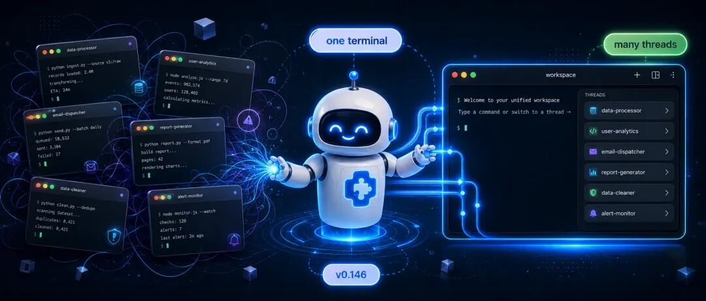
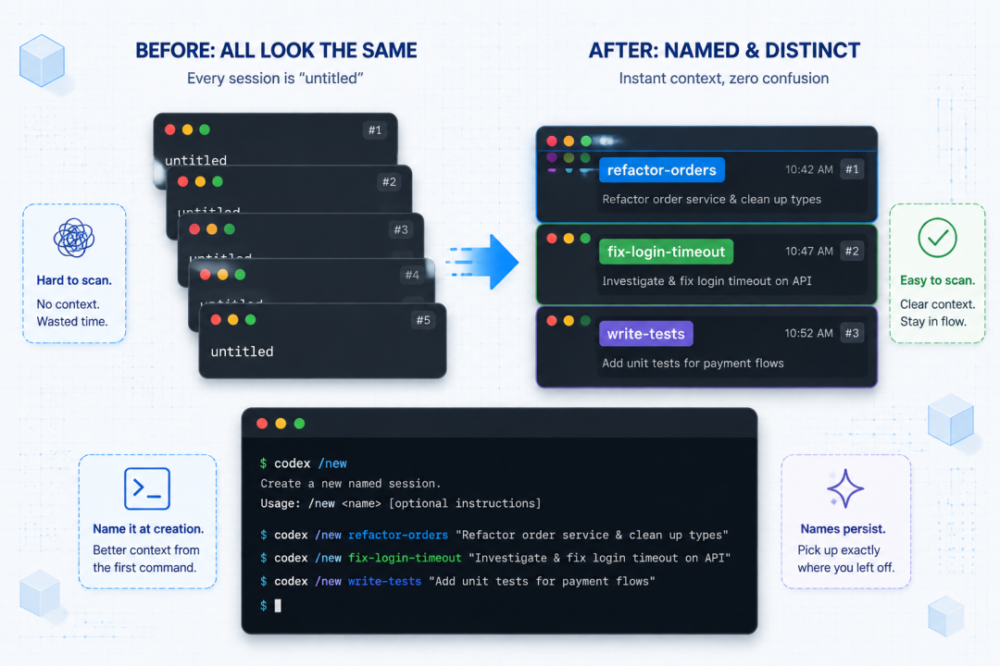

# Codex CLI 管理多条任务线：命名、切换与 fork

> 本文在线版：[codexguide.io/guides/codex-cli-manage-multiple-sessions](https://codexguide.io/guides/codex-cli-manage-multiple-sessions)

当你同时处理重构、排错和测试时，不必为每条任务线开一个终端窗口。Codex CLI 可以保存会话、给会话命名、在会话之间切换，并从已有会话 fork 出一条独立分支。

## 先给会话命名

在当前会话中输入 `/rename`，给它一个能表达任务的名字，例如 `订单模块重构`。名称只帮助识别，不会改变任务目标，也不会扩大权限。

## 保存、切换和归档

`codex resume` 会打开已保存的交互会话列表，也可以按会话 ID 或名称恢复。`codex resume --last` 可以继续最近一次会话。归档只是从常用列表中收起，不会删除转录内容。

## 从当前节点 fork

`/fork` 会从当前聊天复制出一条新会话，原会话保持不变。终端里也可以使用 `codex fork`，或用 `codex fork --last` 从最近会话分叉。

fork 复制的是上下文，不是 Git 分支，也不会自动合并两条会话后续产生的文件修改。涉及写入时，给每条分支独立 worktree，或只允许其中一条执行修改。

## 一套实用的多线安排

主线负责实现和最终验证，辅助会话只读分析日志、测试和代码结构，实验会话从主线 fork 用来比较替代方案。每条会话写清输入、输出和是否允许修改文件。

会话名称、命令和界面可能随 CLI 版本变化，遇到差异以当前 `codex --help` 和官方文档为准。

参考：[Codex CLI command reference](https://learn.chatgpt.com/docs/developer-commands?surface=cli)、[Slash commands](https://learn.chatgpt.com/docs/developer-commands?surface=cli)。
