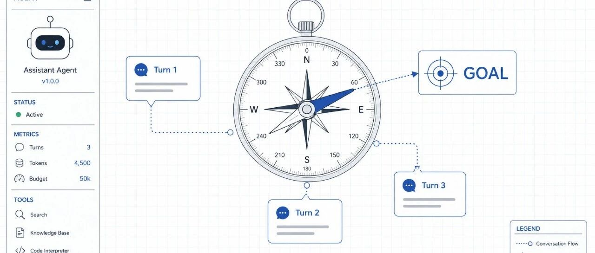
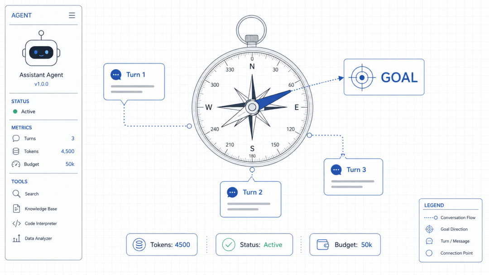
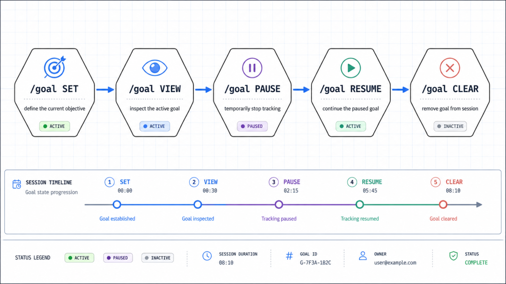
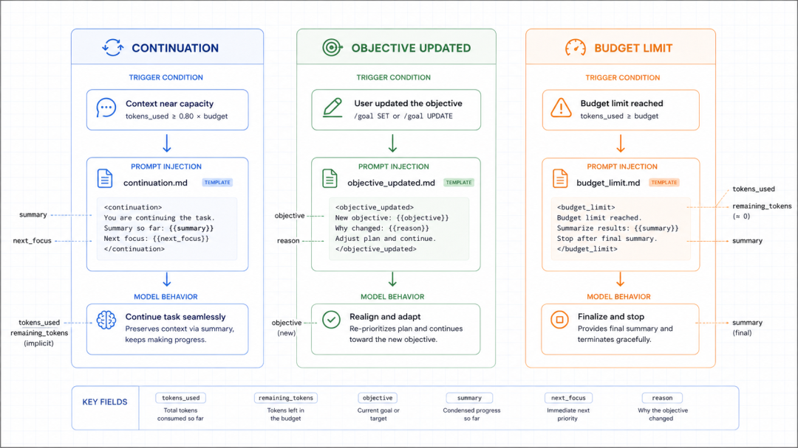

# Codex CLI 长任务如何恢复：保存、继续与检查会话

> 本文在线版：[codexguide.io/guides/codex-cli-resume-long-task](https://codexguide.io/guides/codex-cli-resume-long-task)

长任务中断后，最重要的不是让 Codex“接着猜”，而是恢复原会话并重新确认目标、修改范围和验证状态。会话历史不能替代 Git、测试和人工检查。



## 保存现场

结束终端前记录当前目标、已经修改的文件、最后一次实际运行的检查。任务仍在运行时，先让 Codex 汇报进度，停在可检查的节点再关闭终端。

## 恢复已有会话

在项目目录运行：

```bash
codex resume
codex resume --last
```

恢复后先只读检查当前会话目标、`git status` 和最近的 diff，不要马上继续大范围修改。


## 目标变化时重新确认

需求变化时明确哪些约束被替换，哪些仍然有效。需要完全不同方向的尝试时用 `/fork`，需要继续同一条主线时用 `codex resume`。



## 恢复后的验收顺序

1. 查看 `git status`，确认工作区正确。
2. 查看 `git diff`，排除无关修改。
3. 运行失败过的最小测试，再扩大到完整检查。
4. 记录命令、结果和仍未覆盖的边界。



会话历史只能说明讨论过什么，不能证明代码现在正确。原目标被替换、工作区被其他人改动或历史混入敏感内容时，开新会话通常更稳妥。



参考：[Codex CLI command reference](https://learn.chatgpt.com/docs/developer-commands?surface=cli)、[Long-running work](https://learn.chatgpt.com/docs/long-running-work)。
