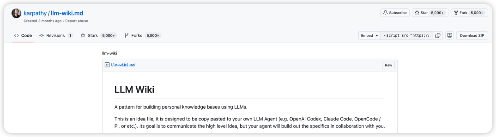
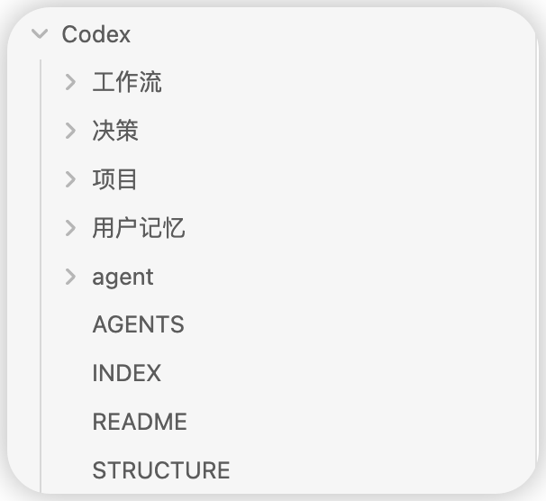

# Codex 任务收尾怎么做（2026-11 更新）：AGENTS.md、Memories 与 Markdown 交接记录各管什么

> 本文在线版：[codexguide.io/guides/codex-task-closeout-memory-system](https://codexguide.io/guides/codex-task-closeout-memory-system)

> 2026-11-12 更新：补充 AGENTS.md、Memories 和交接记录三层分工，按官方 [Memories](https://learn.chatgpt.com/docs/customization/memories) 和 [AGENTS.md](https://learn.chatgpt.com/docs/agent-configuration/agents-md) 文档核对了相关说法。文中目录结构和对账动作是个人实践，不是 OpenAI 官方方案。

这篇写给长期维护多个项目、已经发现「任务做完了，下一次还要重新解释」的读者。

你会搭一套本地 Markdown 收尾流程，记录三样东西：

- 本轮已经证实的状态；
- 选择方案的理由；
- 下次可以复用的步骤。

同时，密钥、私人内容和没有证据的推测不进长期记录。

## 先看结论

- **三层各管一件事**：
  - `AGENTS.md`：必须遵守的规则；
  - Codex Memories：自动生成的回忆线索；
  - Markdown 交接记录：有证据的状态、决策和下一步。
- **Memories 不能代替交接记录**：默认关闭，后台生成，不会在对话结束时立刻更新，而且官方明确说不要把它当作必须遵守的规则的唯一来源。
- **收尾记录写到证据能支持的那一步为止**：本地测试通过、已合并、已部署、线上已验证是四种不同状态，不要提前升级。
- **先出写入计划，确认后再写**。审核过几次真实任务后，再把稳定的规则写进 `AGENTS.md` 或做成 Skill。

## 聊天摘要不能代替任务状态

普通摘要能说明刚才讨论了什么，但不一定能回答项目现在处于哪个阶段。

本地测试通过、代码已经合并、服务已经部署、公开页面已经验证，这是四种不同的状态。收尾记录应该写到证据能支持的位置，不能提前升级。

比如只跑了本地测试，就记录测试命令和结果。没有检查远端分支和线上页面，就保留「未推送」「未部署」。

## AGENTS.md、Memories 和交接记录：三层分工

Codex 现在有两种官方机制和「记住东西」有关：`AGENTS.md` 和 Memories。它们和你自己写的交接记录不是一回事。

| | AGENTS.md | Codex Memories | Markdown 交接记录 |
|---|---|---|---|
| 谁来写 | 你（或让 Codex 起草、你审） | Codex 后台自动生成 | 你和 Codex 按收尾流程写 |
| 什么时候生效 | 每次开始工作前读取 | 开启后，在后续对话里注入已有记忆 | 你让 Codex 读时才生效 |
| 适合放 | 命令、目录约定、验收标准、禁止事项 | 过往对话里的有用背景 | 当前状态、证据、决策理由、下一步 |
| 能否审查 | 能，通常进版本库 | 能看文件，但官方建议当作生成状态，不靠手改 | 能，完全由你控制 |
| 默认状态 | 有文件就读 | **默认关闭** | 需要自己建 |

**AGENTS.md**：官方文档写明，Codex 在做任何工作前都会读取 `AGENTS.md`，可以把全局规则和项目规则分层叠加。合并后的内容超过 `project_doc_max_bytes`（默认 32 KiB）时，后面的文件就不再加入。所以它适合放短而稳定的规则，不适合当流水账。写法见 [AGENTS.md 怎么写](../10-配置模型与权限安全/07-AGENTS.md怎么写-项目规则继承关系与验收标准.md)。

**Memories**：官方对本地 Codex 记忆的描述有几个要点：

- 本地 Codex 记忆**默认关闭**。桌面应用在 **Settings > Personalization** 里打开 **Enable Codex memories**；用配置的话在 `config.toml` 写 `[features] memories = true`。
- 开启后，Codex 会把符合条件的旧对话整理成本地记忆文件：跳过进行中或很短的会话，生成的记忆字段会脱敏密钥，**在后台更新，而不是每次对话结束就立刻更新**。
- 对话要闲置足够久才会被总结；Codex 剩余额度低于设定阈值时，也可能跳过这次后台生成。
- 记忆存在 Codex home（默认 `~/.codex`）下的 `memories/` 或 `memories_v2/`。官方建议把这些文件当作**生成的状态**：排障或分享前可以检查，但不要靠手改它们来控制。
- 官方原话的意思是：团队必须遵守的规则放在 `AGENTS.md` 或进版本库的文档里，**Memories 是辅助回忆层，不是这些规则的唯一来源**。

开启方式、`/memories` 按对话控制、配置键和额度消耗，详见 [Codex Memories 记忆功能](./12-Codex-Memories记忆功能-开启方式-存储位置与按对话控制.md)。

**交接记录**：剩下的部分——「这个项目现在到哪一步了、证据在哪、为什么选了方案 B、下一步做什么」——Memories 不保证及时、准确地记下来，AGENTS.md 又不该塞这些，就需要你自己的 Markdown 交接记录。下面的方法讲的就是这一层。

## LLM Wiki 提供了一个可借鉴的结构

Andrej Karpathy 在 2026 年 4 月 4 日发布了 LLM Wiki 构想，提出让 Agent 持续维护相互连接的 Markdown 知识库。原始资料、整理后的 Wiki 和规则文件各管一块，新材料进来后还要处理来源、矛盾和更新。



这个构想没有规定唯一的目录。下面的结构是一套个人实践，用来管理 Codex 任务收尾，不代表 Karpathy、OpenAI 或 Obsidian 的官方方案。

## 用目录区分写入责任

先建一个很小的本地目录：

```text
Codex/
├── AGENTS.md
├── INDEX.md
├── 项目/
├── 工作流/
├── 决策/
└── 用户记忆/
```



各部分的分工：

- `INDEX.md`：只放入口和关键词，免得每次扫描整个目录；
- `项目/`：当前可核验的状态和下一步；
- `工作流/`：能重复使用的操作顺序；
- `决策/`：备选方案、最终选择和什么情况下要重新评估；
- `用户记忆/`：只放稳定的偏好和授权边界。

这里的 `AGENTS.md` 规定读取顺序、写入位置、敏感信息和冲突怎么处理。项目私有的规则放在项目里，个人规则留在用户目录，不要把本机习惯复制进公开仓库。

> 「用户记忆」目录和 Codex Memories 不是一回事：前者是你自己写、自己审的 Markdown，后者是 Codex 自动生成的文件。两者可以同时用，但不要让 Codex 去改 `memories/` 或 `memories_v2/` 里的文件。

## 任务结束时走完五步

一次重要任务完成后，按下面的顺序收尾：

1. 提取本轮新确认的事实，记下证据位置。
2. 区分本地、提交、远端、部署和线上验证这几种状态。
3. 判断内容属于项目、工作流、决策、用户记忆，还是应该进 `AGENTS.md`。
4. 写入前检查重复、冲突、过时内容和敏感信息。
5. 只更新本轮真正影响到的少数文件。

一次性的命令输出、可以直接从代码读到的细节、没有验证的猜测，通常不值得长期保存。记录只提供线索，下一次任务仍要重新核对真实项目和外部服务。

**什么时候该升级进 AGENTS.md**：同一条要求在交接记录里出现了两三次，比如「这个仓库用 pnpm」「改完必须跑 `pnpm test`」，就把它挪进项目的 `AGENTS.md`，交接记录里删掉。

## 写入前先判断动作

为了防止知识库不断堆重复内容，可以给每条候选信息分配一个动作：

| 动作 | 什么时候用 |
|---|---|
| `ADD` | 当前没有对应记录，需要新建 |
| `UPDATE` | 已有事实变了，更新原记录 |
| `NOOP` | 内容已经存在，不重复写 |
| `MARK_OUTDATED` | 旧结论失效，但要保留变化痕迹 |
| `MERGE_REQUIRED` | 多处记录重复或冲突，需要人工合并 |
| `ASK_USER` | 涉及敏感信息或无法判断归属 |

举个例子：项目记录原来写着「功能尚未部署」，新任务只看到公开页面出现了新入口。当前证据只能支持「公开页面可见」。接口能不能用、要不要登录、后端是否已经切换，还要继续验证。

## 先生成计划，再允许写入

第一次用这套方法时，不要让 Codex 直接批量更新知识库，先让它出写入计划：

```text
请为本轮任务做一次记忆收尾，先不要写入文件。

1. 列出本轮新确认的事实和证据来源。
2. 分开记录本地修改、测试、提交、远端、部署和线上验证。
3. 判断每条内容应进入项目、工作流、决策、用户记忆、AGENTS.md，或不写入。
4. 标记 ADD、UPDATE、NOOP、MARK_OUTDATED、MERGE_REQUIRED 或 ASK_USER。
5. 检查密码、密钥、Cookie、账号信息和私人聊天原文。
6. 不要修改 ~/.codex/memories 或 memories_v2 下的文件。
7. 列出拟修改的文件，等我确认后再执行。
```

审核过几次真实任务后，再把稳定的规则写进 `AGENTS.md` 或做成 Skill。目录和字段跟着实际问题调整，不需要一开始就搭复杂系统。

## 本地文件仍有隐私边界

文件存在本地，不代表模型处理过程完全离线。内容会不会发到云端、怎样保存、谁能访问，取决于产品、账号、插件和连接方式。

如果开了 Codex Memories，还要注意：官方说生成的记忆字段会脱敏密钥，但仍建议**不要把密钥存进记忆**，分享 Codex home 目录或记忆文件前先检查一遍。用了 MCP 工具或网页搜索的对话如果不想进入记忆，可以设置 `memories.disable_on_external_context = true`，桌面应用里对应 **Allow memories from tool-assisted chats** 开关。

长期记录至少守住下面几条：

- 不保存 API Key、Token、Cookie 和密码；
- 不把完整私人聊天或客户资料写进通用记忆；
- 共享项目的事实以项目文档和版本记录为准；
- 删除、发布、费用和账号操作保留人工确认；
- 用旧记录之前，重新检查当前文件和外部状态。

## 怎样验证这套系统

选一个刚完成、有 Git 记录的任务，让 Codex 只生成收尾计划，然后逐条检查：

- 事实是否有证据；
- 状态是否提前升级；
- 文件归属是否合理；
- 有没有敏感信息。

写入后，新开一个不带聊天上下文的任务，让它先读 `INDEX.md` 和相关项目记录，再检查 Git 和真实文件。它能指出旧记录和现场的差异，并从正确的位置继续，就说明收尾记录起作用了。

长任务中途的交接（比如跨天、跨会话继续同一件事），可以配合 [Codex 长任务工作流](./05-Codex长任务工作流.md) 一起用。

## 参考资料

- [Andrej Karpathy 的 LLM Wiki 原始构想](https://gist.github.com/karpathy/442a6bf555914893e9891c11519de94f)
- 官方：[Codex AGENTS.md](https://learn.chatgpt.com/docs/agent-configuration/agents-md)
- 官方：[Memories](https://learn.chatgpt.com/docs/customization/memories)
- [Obsidian Create a vault](https://help.obsidian.md/vault)
