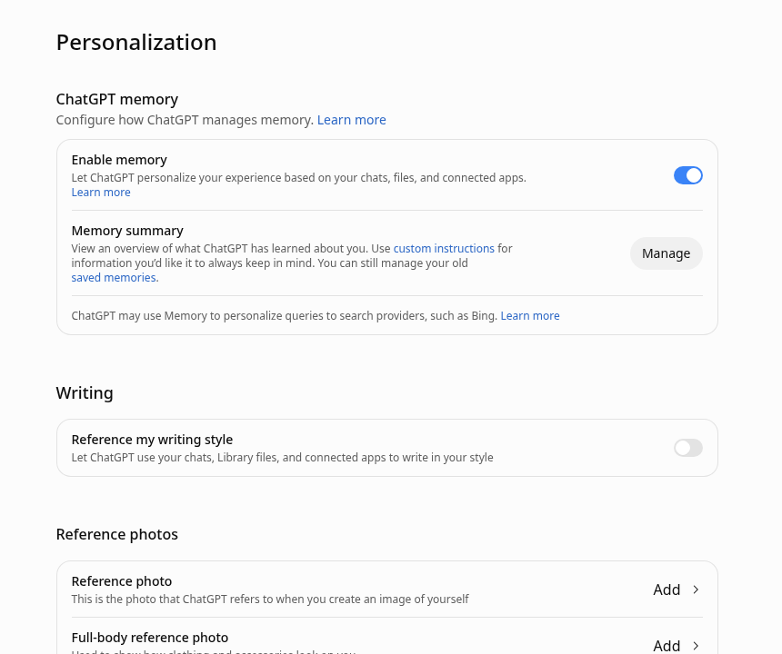
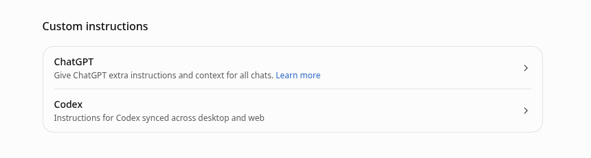
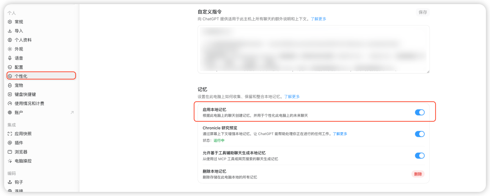

# Codex Memories 记忆功能怎么用：开启方式、~/.codex/memories 存储位置、/memories 按对话控制，以及避免后台生成消耗额度

> 本文在线版：[codexguide.io/guides/codex-memories](https://codexguide.io/guides/codex-memories)

> 核对依据：learn.chatgpt.com《Memories》、Developer commands（`/memories`）、Configuration Reference（`features.memories` 与 `memories.*`）（2026-10-22 抓取）。文中「我的用法」是操作建议，不是官方规定。社区 issue 只作已知坑对照，不附带未证实的修复结论。本机未完整走通桌面端记忆 UI 与目录实拍。

Codex 可以把以前对话里有用的信息带到之后的任务里。这个能力叫 **Memories（本地记忆）**，**默认关闭**。打开之后，它会在后台从**符合条件**的旧对话里抽出记忆文件；生成过程要调模型，**可能消耗额度**——即使你当时没有在打字。

这篇按官方 Memories 页组织：它和 ChatGPT 网页记忆、`AGENTS.md` 有什么区别；怎么开；怎么生成、存在哪；怎样用 `/memories` 按对话控制；怎样用配置省额度、控隐私；删除会清掉什么；什么必须写进 `AGENTS.md`。

## Memories 是什么（以及不是什么）

官方定位：让 ChatGPT 与 Codex **把早先工作里有用的上下文带到后续工作**。但分两条线：

| 表面 | 用什么记忆 |
|---|---|
| ChatGPT 网页 | ChatGPT memory（在 Settings → Personalization 管理） |
| 本地 Codex（桌面 App、CLI、接本机的 IDE 扩展） | **单独的本地记忆库**与本地控件 |
| ChatGPT Work | 用账号／工作区可用的记忆设置；**不用**本地 Codex 记忆库，也没有本地记忆控件 |

**Computer History**（文档说明为 macOS 桌面功能）会把允许范围内的应用与网站活动整理成记忆和时间线，供 ChatGPT／Codex 引用。删 Codex 记忆时，本机若提供该功能，会**一并清空 Computer History**（见后文删除一节）。






**不是什么：**

1. **不是团队强制规则库。** 官方原话要点：必须遵守的团队指引放在 `AGENTS.md` 或入库文档；把 Memories 当成**有帮助的回忆层**，不要当成「永远生效的唯一规则来源」。
2. **不是对话刚结束就立刻落盘。** 会跳过仍在进行或很短的会话，并等对话闲置足够久再后台更新，避免总结还在进行中的工作。
3. **不是「开了功能就免费」。** 记忆生成会走模型调用；额度不足时可能跳过，也可能在闲置时仍消耗（社区多份报告）。

和自建 Markdown「任务收尾记忆库」也不一样：后者是你手写状态与证据（见知识库《[Codex 任务收尾系统](https://codexguide.io/guides/codex-task-closeout-memory-system)》）；本文讲的是 **Codex 官方本地 Memories**。

## 开启：桌面端、CLI／config.toml、IDE

本地 Memories **默认关闭**。

### 桌面端（ChatGPT desktop）

1. 打开 **Settings → Personalization**
2. 打开 **Enable Codex memories**（针对当前选中的机器）
3. （可选）用 **Allow memories from tool-assisted chats** 决定：用过 MCP 或网页搜索等工具辅助的对话，能不能参与后续记忆生成

同一页还有 **Delete Codex memories**（确认后重置本机记忆库；见后文）。



同一页若还出现 **Chronicle Research Preview** 等开关，以你客户端当前可见项为准；本文只覆盖 Memories 相关开关，不展开该预览功能。

### CLI 与配置文件

在用户级 `config.toml`（默认 `~/.codex/config.toml`，随 `CODEX_HOME`）写入：

```toml
[features]
memories = true
```

也可用 CLI 功能开关持久化（官方 Developer commands：`codex features enable`／`disable` 会写回 `$CODEX_HOME/config.toml`）：

```bash
codex features enable memories
codex features list
```

配置参考写明：`features.memories` 用于启用 Memories，**默认关闭**。

临时单次也可以用全局标志 `--enable memories`（等价于 `-c features.memories=true`）；要长期生效，仍以 `config.toml`／`codex features enable` 为准。

### IDE 扩展

IDE 扩展使用**所连接 Codex 主机**上的本地记忆库。主机已开启记忆时，对话级控件与 CLI 相同（`/memories` 一类）。

若 slash 里看不到 `/memories`，先确认本机已按上面步骤打开 Memories（官方：See Configure local memories if the command isn’t available）。

## 记忆怎么生成：会跳过什么、为何不立刻更新

开启后，Codex 可以把**符合条件**的过往对话里的有用上下文，变成本地记忆文件。官方要点：

1. **跳过仍在进行中的会话，以及很短的会话**
2. **生成字段里会对密钥打码（redact secrets）**——仍建议分享 `CODEX_HOME` 前人工复查
3. **在后台更新**，不是每条对话一结束就立刻重写记忆
4. **要等对话闲置足够久**，才避免总结还在进行中的工作
5. **剩余额度百分比低于配置门槛时，可跳过后台生成一轮**，避免额度快见底时还去烧配额

配置参考给出的相关默认（数值以你本机版本的 Configuration Reference 为准）：

| 键 | 作用（官方摘要） | 文档默认／范围 |
|---|---|---|
| `memories.min_rollout_idle_hours` | 对话至少闲置多久才考虑生成 | 默认 `6`，限制在 `1`–`48` |
| `memories.max_rollout_age_days` | 考虑多新的对话 | 默认 `30`，限制在 `0`–`90` |
| `memories.max_rollouts_per_startup` | 每次启动处理候选上限 | 默认 `16`，上限 `128` |
| `memories.min_rate_limit_remaining_percent` | 开始生成前要求的最低剩余额度百分比 | 默认 `25`，限制在 `0`–`100` |

因此：「刚聊完立刻去 `~/.codex/memories/` 找新文件」常常什么都没有——多半还在等闲置窗口，或被额度门槛／短会话规则跳过。这是预期行为，不是一定坏了。

## 存在哪里：`~/.codex/memories/` 与 `CODEX_HOME`

Codex 把记忆存在 **Codex home** 下。默认是 `~/.codex`；若设置了环境变量 `CODEX_HOME`，则以该目录为准（详见官方 Config and state locations）。

主记忆文件在：

```text
~/.codex/memories/
```

官方描述其内容包括：**摘要、持久条目、近期输入，以及来自过往对话的佐证材料**。

**官方建议：把这些文件当作生成出来的状态（generated state）。** 排障或分享 `CODEX_HOME` 之前可以打开查看，但**不要把手工编辑当成主要控制手段**。

社区在讨论清理时，曾列出本机上出现过的文件名（例如 `MEMORY.md`、`raw_memories.md` 等，见 [openai/codex#30299](https://github.com/openai/codex/issues/30299)）。那是用户环境观察，**不是**官方保证的稳定目录契约；以你本机实际文件与当前文档为准。

**查看时的隐私注意（我的用法）：**

- 目录里可能含项目路径、仓库名、对话摘要。贴论坛／开 issue 前先打码路径与人名。
- 官方：不要把密钥写进记忆；生成侧会打码，但复查仍必要。
- 整份 `~/.codex` 打包给别人等于交出认证周边状态与记忆——默认不要这么做。

目前官方 CLI **没有**单独的 `codex memory list／delete` 一类管理命令；社区在 [openai/codex#30299](https://github.com/openai/codex/issues/30299)（仍 open）里请求查看、清理、按范围删除等能力。现阶段重置主要靠桌面端 **Delete Codex memories**，或按官方指引把文件当生成状态处理——**不要**把「手改 MEMORY.md」当成产品支持的主路径。

## 按对话控制：`/memories`

桌面 App 的 Codex 输入框与 Codex TUI 都支持 slash 命令 **`/memories`**（已列入官方 Developer commands）。

用途（官方摘要）：配置记忆的**使用**与**生成**——在不离开当前界面的情况下，决定当前对话：

1. **能不能读取／注入已有本地记忆**
2. **能不能被用作后续记忆生成的输入**

也可以选择保持记忆行为关闭（命令说明里的选项表述）。

要点：

- **对话级选择不改全局设置**（Memories 专页原文）。
- 全局开关仍是 Personalization 里的 Enable Codex memories，或 `[features] memories`。
- IDE：主机已启用记忆时，使用与 CLI 相同的对话级控件。

Developer commands 里「Configure memories with `/memories`」的步骤：输入 `/memories` → 选择是否使用已有记忆、是否生成新记忆，或关闭记忆行为。以你客户端当时弹出的选项文案为准。

**我的用法：** 含密钥、客户数据、或大量 MCP／网页检索噪声的对话，用 `/memories` 关掉「参与生成」；需要沿用本机偏好的长线工程对话，再打开「使用已有记忆」。敏感对话不要指望「反正会打码」就默认允许写入。

## 配置键：生成、注入、外部上下文、额度与模型

功能总开关：

```toml
[features]
memories = true
```

记忆相关细项写在 `[memories]`（也可写成带点的扁平键，视你现有 config 风格而定）。官方 Memories 页与 Configuration Reference 列出的常用项：

```toml
[memories]
# 新创建的对话是否可作为记忆生成输入；false 时不再把新线程送去生成
generate_memories = true

# 是否把已有记忆注入后续会话；false 则只存／生成侧受其他键约束，但不会注入
use_memories = true

# true：用过 MCP、网页搜索、tool search 等外部上下文的对话不参与生成
# 旧键名 memories.no_memories_if_mcp_or_web_search 仍可作为别名
disable_on_external_context = false

# 剩余额度百分比低于该值则跳过后台生成（默认 25）
min_rate_limit_remaining_percent = 25

# 可选：覆盖「逐对话抽取」与「全局合并」所用模型
# extract_model = "…"
# consolidation_model = "…"
```

默认值摘要（Configuration Reference，2026-10-22）：

| 键 | 默认 |
|---|---|
| `generate_memories` | `true`（在功能已开启的前提下） |
| `use_memories` | `true` |
| `disable_on_external_context` | `false` |
| `min_rate_limit_remaining_percent` | `25` |
| `max_raw_memories_for_consolidation` | `256`（上限 `4096`） |
| `max_unused_days` | `30`（限制在 `0`–`365`） |

桌面 Personalization 里的 **Allow memories from tool-assisted chats**，与配置里「外部上下文是否参与生成」是同一类控制；改 UI 或改 `disable_on_external_context` 前先想清楚：工具辅助对话里常常混有检索片段与第三方数据。

## 省额度与隐私：后台生成为什么「偷偷」耗用量

记忆生成是**真实的模型采样请求**，不是纯本地字符串拼接。社区里两份常被引用的报告：

1. [openai/codex#19732](https://github.com/openai/codex/issues/19732)（closed／completed）：报告桌面端闲置时 5 小时／周额度仍在掉；本地日志显示记忆子系统在 `~/.codex/memories` 下发起采样。报告者将 `generate_memories = false`（保留 `use_memories = true`）并重载后，观察窗口内闲置消耗停止。这是**用户环境报告**，不是官方「已永久修好」的保证。
2. [openai/codex#19105](https://github.com/openai/codex/issues/19105)（closed／not_planned）：报告开启 Memories 后闲置时周额度下降不成比例，最终选择关闭功能。

官方已提供的控制面：

| 目标 | 做法 |
|---|---|
| 完全不用本地记忆 | `[features] memories = false`，或桌面关闭 Enable Codex memories |
| 仍可读旧记忆，但不再把新对话送去生成 | `memories.generate_memories = false` |
| 生成保留，但快没额度时跳过 | 提高 `min_rate_limit_remaining_percent`（默认已是 25） |
| 工具／搜索过的对话不进生成 | `disable_on_external_context = true`，或桌面关掉 Allow memories from tool-assisted chats |
| 单次对话禁止读或禁止贡献 | `/memories` |

额度面板怎么读、5 小时窗与周限额如何并存，见《[Codex 用量额度怎么看](https://codexguide.io/guides/codex-usage-limits-credits)》。怀疑「闲置仍在扣」时：先看 Usage，再查是否开了 Memories／`generate_memories`，再对照上面两则社区 issue 的症状——**不要**把 issue 评论里的私有脚本或未合并补丁写成标准修复。

另有社区请求：开启 `memories = true` 时，会话里应明确「只读／可写」等有效状态，避免配置显示已启用、提示里却出现只读指令的矛盾感（[openai/codex#19195](https://github.com/openai/codex/issues/19195)，仍 open）。以你当前客户端实际行为为准；排障时可结合 `/status` 与官方文档，而不是假设「功能开了就等于模型可写记忆」。

## 删除与重置

桌面端 **Settings → Personalization → Delete Codex memories**，确认后重置**当前选中机器**的记忆库。

官方明确：在本机上，若提供 **Computer History**，删除 Codex 记忆时**也会清空 Computer History**。点删除前想清楚：这不是「只清一条摘要」。

CLI 侧目前没有对等的官方一键删除命令（见上节 #30299）。不要用「随便删几个文件」代替官方删除流程，除非你清楚自己在做排障，并已备份。

## 什么写进 Memories，什么必须写进 AGENTS.md

| 内容 | 放哪里 |
|---|---|
| 构建／测试命令、目录边界、禁止动的路径、完成定义、必须先问人的操作 | **`AGENTS.md`（或入库文档）** |
| 模型、沙箱、审批、功能开关 | **`config.toml`** |
| 「上次这个仓库我偏好用某种排错顺序」之类可回忆、可过期的偏好 | Memories 可以辅助；**关键约定仍应落盘到 AGENTS.md** |
| 密钥、token、客户隐私、未证实的猜测 | **两边都不要写**；记忆侧即使打码也不能代替你的判断 |

AGENTS.md 的写法与继承关系见《[AGENTS.md 怎么写](https://codexguide.io/advanced/agents-md)》；开工前设置检查见《[Codex 设置检查清单](https://codexguide.io/guides/codex-settings-checklist)》（个性化里的记忆开关也属于「先设好再干活」的一类项）。

**我的用法：** 团队红线只信任 Git 里的 `AGENTS.md`；Memories 当作「减少重复口述」的加速层。换机器、清记忆、关功能后，项目仍应靠仓库规则跑得起来。

## 快速对照清单

1. 需要跨对话回忆 → 打开 Enable Codex memories 或 `[features] memories = true`
2. 只要读、不要后台烧额度 → `generate_memories = false`，保留 `use_memories = true`
3. 额度紧 → 提高 `min_rate_limit_remaining_percent`；对照 Usage 面板
4. 工具／搜索噪声大 → `disable_on_external_context = true`
5. 单次敏感对话 → `/memories` 关掉使用或生成
6. 必须遵守的规则 → 写进 `AGENTS.md`，不要只靠记忆
7. 要清空 → Delete Codex memories（并知道会连带 Computer History）

## 参考

- [Memories（官方）](https://learn.chatgpt.com/docs/customization/memories)
- [Developer commands · `/memories`](https://learn.chatgpt.com/docs/developer-commands)
- [Configuration Reference · `features.memories`／`memories.*`](https://learn.chatgpt.com/docs/config-file/config-reference)
- 社区报告（症状对照，非修复手册）：[openai/codex#19732](https://github.com/openai/codex/issues/19732)、[#19105](https://github.com/openai/codex/issues/19105)、[#30299](https://github.com/openai/codex/issues/30299)、[#19195](https://github.com/openai/codex/issues/19195)
