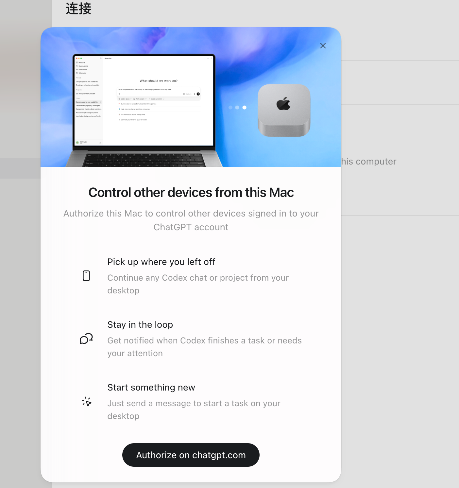
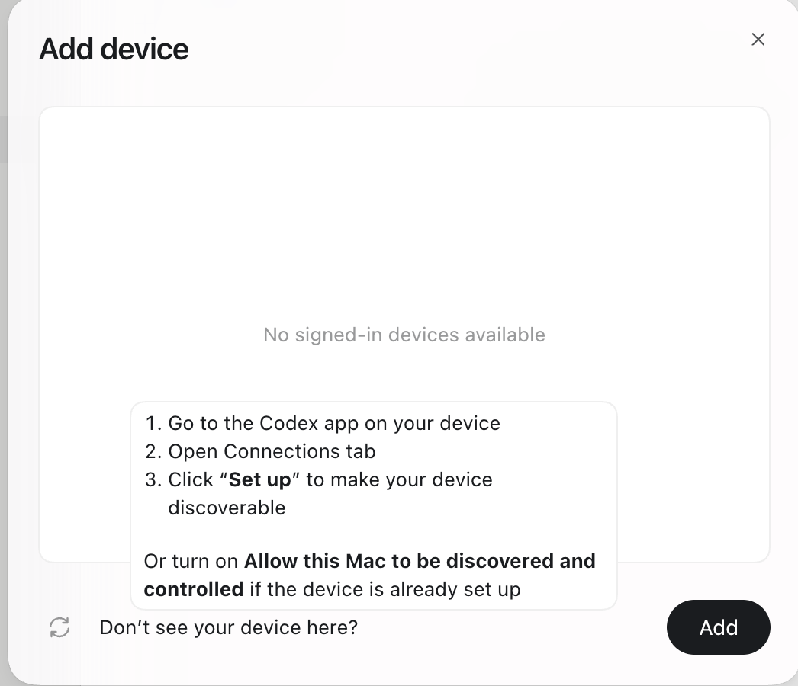
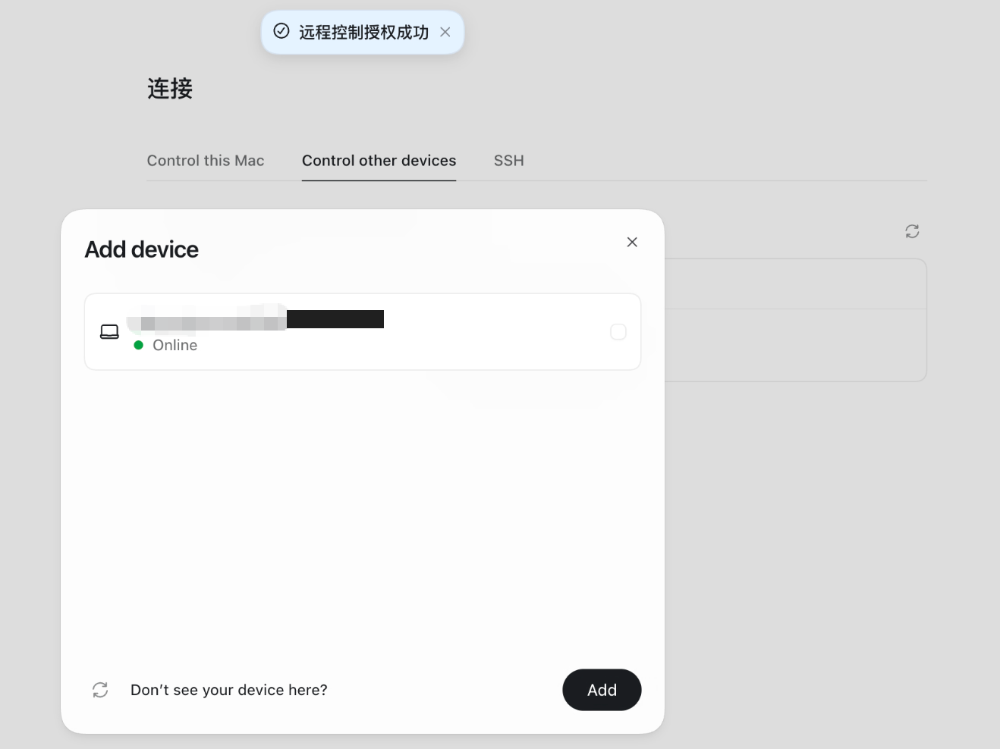
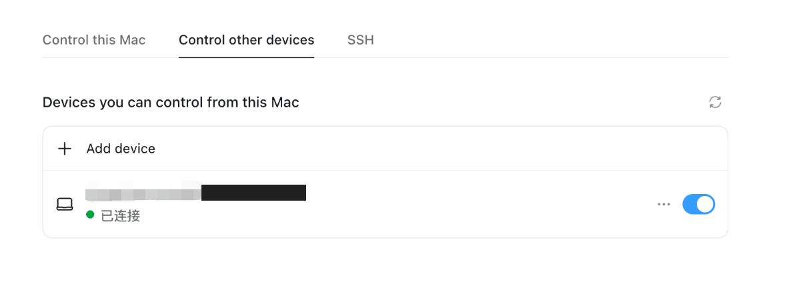
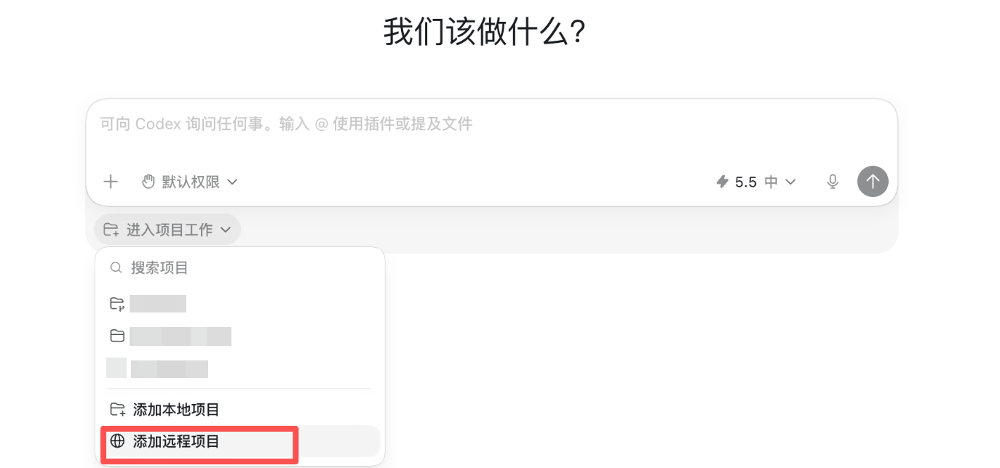
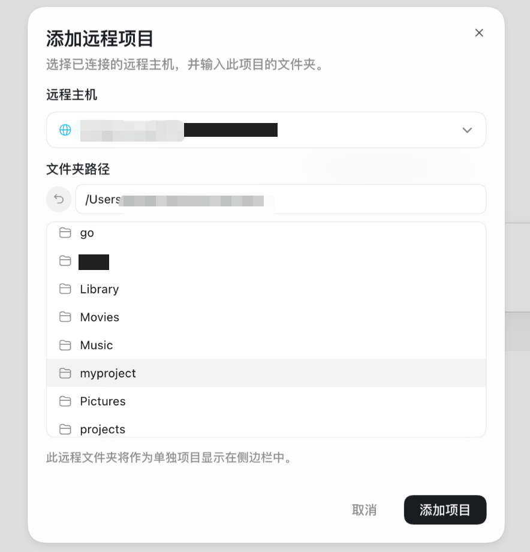

# Codex 远程连接：用手机或另一台电脑控制 Mac / Windows，SSH 远程项目和跨设备交接（Handoff）一篇讲清

> 本文在线版：[codexguide.io/guides/codex-remote-control-mac](https://codexguide.io/guides/codex-remote-control-mac)

> 核对依据：learn.chatgpt.com《[Remote connections](https://learn.chatgpt.com/docs/remote-connections)》《[Codex on mobile](https://learn.chatgpt.com/docs/mobile)》（与 developers.openai.com 同源主题）。文中「我的用法」是操作建议，不是官方强制规定。菜单文案随桌面端／移动端版本变化，以你当前界面为准。

站内原先有两篇：一篇讲 Mac／Windows 主机配对与 SSH，一篇偏手机遥控器叙事。标题抢同一组关键词，配对入口也和 2026 年 10 月文档不一致。**本文以 `/guides/codex-remote-control-mac` 为主页面合并两者**；旧页 `/guides/codex-mobile-remote-collaboration` 应 301 到这里（见 frontmatter `redirect_from`）。知识库侧：`12-官方工具与集成/01-Codex远程控制另一台Mac.md` 保持主路径；`12-官方工具与集成/07-Codex移动端远程协作.md` 合并后应变为 `status: redirected`（本次只出主文预览，不另造完整 redirect 文件）。

## 1. 远程到底在干什么

把一台常开、已登录同一 ChatGPT 账号与 workspace 的 Mac 或 Windows 电脑当作**主机**。你在手机、另一台桌面端上发任务、看进度、批命令；**代码、终端、插件和桌面操作仍在主机上发生**。

官方列出你能远程做的事：

- 在主机的项目里开新聊天，或继续已有聊天
- 追加指令、回答提问、中途纠偏
- 批准命令与其他需确认的操作
- 查看输出、diff、测试结果、终端日志和截图
- 在任务完成或需要你时收到通知
- 在已连接主机与聊天之间切换

**环境来自主机，不来自手机。** 仓库与本地文档、shell、MCP／Skills、浏览器与 Computer Use、已登录网站与桌面应用，以及沙箱／审批规则，都以主机侧配置为准。跨设备可达性走 OpenAI 的 secure relay，并不等于把机器直接挂到公网。

### 和 Work Cloud「本地电脑访问」先分清

工作区若开启 **Local computer access with Work Cloud**，符合条件的 ChatGPT Work 对话可以在桌面、手机、网页间延续：云端协调任务，在线且已连接的电脑执行需要本地资源的步骤。那是另一条产品路径。

官方写明：下面的远程主机配对与 SSH 说明，适用于既有的主机连接工作流；查看 Work Cloud 类对话所需设置可能不同；**该功能不改变 Codex on mobile 连接主机的方式**。仅启用同步之后新建的任务适用；旧任务保持原先「仅本地」或「纯云且无本地文件」模式。电脑在新一轮开始时不可用时，符合条件的任务可能落到云容器继续——云容器碰不到那台电脑上的文件与工具，也不套用本地执行的企业要求；**同一轮对话中不能从本地执行切到云**。

本文后半只讲：**手机／另一台桌面端 ↔ 已配对主机**，以及 **SSH 远程项目** 与 **Handoff**。

## 2. 开始前准备什么

主机须跑最新 **ChatGPT 桌面端**（macOS 或 Windows），保持唤醒、联网，并登录你要用的同一账号与 workspace。控制端可以是最新 ChatGPT **iOS／Android**，或在功能放开时另一台 Mac／Windows 桌面端。可用性可能随 rollout 与工作区策略变化。

清单：

1. 账号侧具备 Codex 访问权限。
2. 手机与主机 App 都更新到最新。iOS 上看不到 **Codex**（或旧标签 **Remote**）时，先更新 ChatGPT。
3. **配对从主机上的桌面端发起**；Codex CLI 与 IDE 扩展里没有这套扫码入口。
4. 需要时完成 MFA、SSO 或 passkey。
5. 公司／团队 workspace：管理员可能要先开启 **Remote Control** 访问。

**2026-06-08 之后若一直没用过旧连接**：更新两端 App 后重新配对。自该日起用过的连接可继续保持配对。

官方把「连什么」分成三类，按场景选：

| 主机类型 | 适合 | 注意 |
| --- | --- | --- |
| 日常笔记本／台式 | 接着本机已有项目、凭据、插件 | 睡眠、断网、关 App 会停远程；当主机时尽量插电并在 Connections 里保持唤醒 |
| 常开专用机 | 长任务、需要随时可连 | 事先装好仓库、凭据、MCP、Skills 与工具 |
| SSH／托管远程环境 | 代码本就在 devbox／远程机 | 先让桌面端连上该环境；手机仍连这台桌面端主机，ChatGPT 在远程环境里用其依赖与策略 |

Mac 笔记本：盖开且供电时远程可保持；**合盖时还要外接显示器**；选择 Sleep 仍会停远程。Windows：会话保持解锁；若开 Computer Use，它占前台输入，适合「主机桌面专用于任务，你用手机或另一台机器盯进度与审批」。浏览器或桌面类任务，在常开机或远程主机上启用 Computer Use，并按需安装 Chrome 扩展。

## 3. 用手机配对主机

在**被控主机**上打开 ChatGPT 桌面端：

1. 进入 **Settings → Connections → Control this Mac or PC**，点 **Set up** 或 **Add**。批准远程访问并完成要求的验证。
2. 用手机扫描桌面端显示的二维码；二维码会打开 ChatGPT，完成手机与该主机的配对。
3. 确认同一账号与 workspace，完成 MFA／SSO／passkey。成功后，主机出现在 iOS 的 **Codex**（旧版仍可能叫 **Remote**）里。
4. 回到主机 **Settings → Connections** 管理已连设备；按需打开保持唤醒、启用 Computer Use、安装 Chrome 扩展。

**我的用法**：每台手机、每台要当控制端的桌面端，都要和每台想控制的主机分别配对。家里 Mac mini 常开当主机时，在 Connections 里打开「保持唤醒／插电时防止睡眠」一类选项，避免人在外面电脑已睡。

手机侧（对照 [Codex on mobile](https://learn.chatgpt.com/docs/mobile)）可以：

- 选 **Cloud** 与环境，或选**已连接电脑**与项目，再描述任务开工
- 打开任务看进度，随时追加指令，不必回到工位
- 在主机执行敏感命令前审批准许或拒绝
- 查看回复、改动文件、diff 与测试结果
- 在 Cloud 与多台已连接主机之间切换；任务完成或需要你时收通知

审批停住时，价值往往在「人不必守在键盘前」：长任务最怕卡在权限上干等。手机流量与算力压力也小——模型与 shell 仍在主机。

旧文写过「侧边栏 Set up Codex mobile」「电脑上打开 Codex App」——以当前官方路径 **Settings → Connections → Control this Mac or PC** 为准；若你界面仍有旧入口，更新 App 后再对照菜单。一对多：每个要控制该主机的手机／桌面端，都要各自扫码配对。

## 4. 用另一台 Mac 或 Windows 控制主机

Connections 里三个方向要分清（控制是**单向**的）：

| 标签 | 作用 |
| --- | --- |
| **Control this Mac or PC** | 允许别的设备控制**本机** |
| **Control other devices** | 允许**本机**去控制别的已配对主机 |
| **SSH** | 把桌面端连到 SSH 主机上的远程项目 |

要让 A 控制 B：B 在 **Control this Mac or PC** 允许被连；A 在 **Control other devices** 添加 B。只配通一个方向。互控就要反着再配一遍。同一台机器可以同时「允许被控」和「去控别人」。

在功能可用的设备上：**Settings → Connections → Control other devices → Set up／Add**，完成授权与添加。添加前若列表为空，多半是被控端还没打开「允许其他设备连接」——不是单纯 bug。配反了通常不报错，但控制关系会反过来；实测时先写清「谁发指令、谁跑环境」。

配对与添加设备时，界面大致如下（本机名／路径已打码；菜单文案随版本变化）：











连上设备后，还要告诉 Codex **在远程机器的哪个文件夹干活**：

1. 新建（或打开）对话，在输入区附近的项目入口里选**添加远程项目**（文案以当前桌面端为准）。
2. 选刚才连上的远程主机，浏览其文件系统，选中项目目录，添加。
3. 该远程目录会作为独立项目出现在侧边栏；之后对它发的指令，在被控端读文件、跑命令、改代码。控制端主要发号施令、看结果、批审批。






**我的用法**：笔记本当控制端、插电 Mac mini／工作室台式当被控端时，先在被控端装好仓库、凭据、MCP 与 Skills，再配对。临时用笔记本当主机可以，但合盖或睡眠会断线——长任务不如常开机。

也可以「手机在常开主机上开聊 → 稍后在另一台已登录桌面端上继续同一条聊天」。在功能可用的 Mac／Windows 上，用 **Settings → Connections → Control other devices** 添加那台主机即可。一台设备可以同时允许被远程访问，又去控制别的设备。

## 5. SSH 远程项目

项目在公司的 Linux／devbox，而不在另一台 Mac／Windows 桌面时，走 **Settings → Connections → SSH**。远程项目聊天在远程文件系统与 shell 上读改跑。

1. 在跑桌面端的机器上写好 `~/.ssh/config` 的**具体主机别名**（Codex 用 OpenSSH 解析，**忽略仅含通配的 Host 模式**）：

```text
Host devbox
  HostName devbox.example.com
  User you
  IdentityFile ~/.ssh/id_ed25519
```

2. 本机确认：`ssh devbox` 能进。
3. 远程主机安装并登录 Codex；桌面端经 SSH 用远程用户的 login shell 拉起 remote Codex app server，因此远程 `PATH` 里要有 `codex`。
4. 桌面端 **Settings → Connections** 添加／启用该 SSH 主机，再选远程项目目录。

安全预期与日常 SSH 相同：可信密钥、最小权限账户、不要把未认证的监听暴露到公网。远程连接用 SSH 启停远程 app server；**不要把 app-server 传输层直接暴露在共享或公网**。跨网优先 VPN／mesh，而不是裸奔 app server。

## 6. 跨设备交接（Handoff）

**Handoff** 把已有聊天及其 **Git 状态**，在本机与已连接远程主机之间移交：本机开干 → 到远程机的 worktree 续跑 → 再交回来，都是典型用法。

前提：

- 目标主机已连接；
- 两边都为**同一 Git 仓库**保存了项目（若项目是仓库子目录，两边保存同一子目录）；
- 列表里只会出现有匹配已存项目的目标。

步骤（桌面端）：

1. 打开该聊天。
2. 在聊天页脚点当前运行位置，选目标主机；交回本机时选 **This computer**。
3. 核对目标与分支，点 **Hand off**。

Codex 会在目标主机**创建或复用 worktree**，转移聊天与 Git 状态，并把聊天切到该主机。**若聊天正在跑，Handoff 会先打断当前回复再转移。** 也可以在**另一条**聊天里让 Codex 把命名聊天交到某主机；**不能** Handoff「正在下指令的这条」自身；**不支持** Handoff 到 Codex 云环境。

Worktree 并行、交回 Local、`.worktreeinclude` 等细节见站内《[Codex Worktree 教程](https://codexguide.io/guides/codex-worktree-parallel-chats)》（id：`worktree-parallel-chats`）。远程连接这篇只交代：Handoff 依赖「已连接主机 + 匹配项目」，并且会动 Git／worktree。

## 7. 安全与使用边界

- 只配对你拥有且信任的设备；二维码用于完成绑定与验证流程，不要随手给别人扫。
- 沙箱、权限与审批规则在远程会话上仍然生效；涉及真实仓库时仍要自己看 diff、命令与测试。
- 主机睡眠、断网或退出桌面端，远程会话会断；长任务优先常开主机并保持唤醒。
- Windows + Computer Use：前台占用指针与键盘；需要后台时改用 CLI、结构化 MCP 或浏览器扩展等路径（Computer Use 专文另述）。

## 8. 故障排查（官方五类）

| 现象 | 先查什么 |
| --- | --- |
| 手机上看不到主机 | 主机桌面端是否在跑；是否已允许其他设备连接；两端是否同一账号与 workspace；若自 **2026-06-08** 后未用过该连接，更新两端并重新配对 |
| 重新登录后 Remote Control 关了 | 登出只会关掉 Remote Control，**不会清掉已有配对**；登入后再打开 Remote Control。打开后点 Add 报错时，重启主机上的 ChatGPT 桌面端再试 |
| 审批请求不出现 | iOS 打开 **Codex**（旧版 **Remote**）；核对账号／workspace；重新扫码或从主机重跑设置；workspace 用户请管理员确认已开 Remote Control |
| 远程会话断开 | 主机是否睡眠、断网或关了 App；工作时保持唤醒与联网 |
| 认证卡住设置 | 完成设置流程里的账号／workspace 认证（SSO、MFA、passkey）；仍失败则请管理员确认 Remote Control 已启用 |

## 9. 延伸阅读

- 官方：[Remote connections](https://learn.chatgpt.com/docs/remote-connections)、[Codex on mobile](https://learn.chatgpt.com/docs/mobile)
- 公告参考：[Work with Codex from anywhere](https://openai.com/index/work-with-codex-from-anywhere/)
- 站内：Computer Use 桌面应用、桌面端任务工作流；Worktree／Handoff 细节见 `worktree-parallel-chats`
