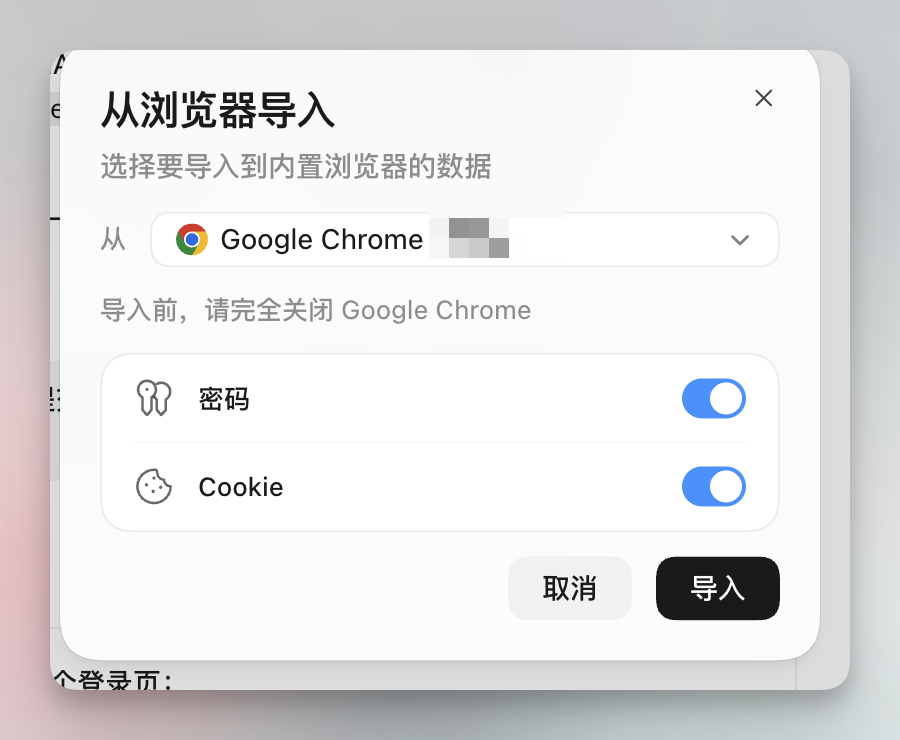
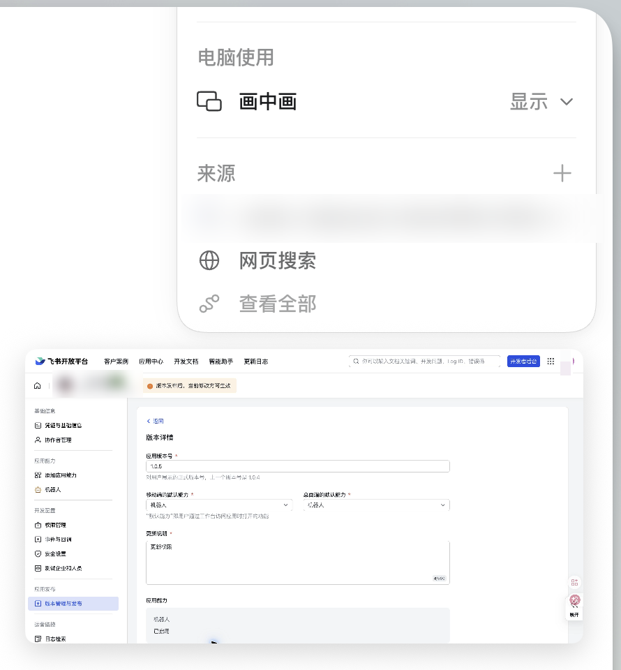

# Codex 浏览器操作与登录态：内置浏览器、浏览器扩展和 Computer Use 怎么选

> 本文在线版：[codexguide.io/guides/codex-browser-login-state](https://codexguide.io/guides/codex-browser-login-state)

> 核对依据：OpenAI 官方文档 [Browser](https://learn.chatgpt.com/docs/browser)、[Browser extension](https://learn.chatgpt.com/docs/chrome-extension) 和 [Computer Use](https://learn.chatgpt.com/docs/computer-use)，以及作者在 macOS 中文界面的 ChatGPT 桌面端里的两张实际截图（账号、应用名称和来源已打码）。核对日期 2026-10-26。本次改写删掉了旧版里无法核实的社区案例和已过时的模型、定价信息。

Codex 操作网页有三种入口：**内置浏览器**、**浏览器扩展**和 **Computer Use**。三者看起来都能“点网页”，但登录态、操作范围和限制都不一样，选错了容易在任务中途卡在登录页或权限弹窗上。

这三种入口都在 ChatGPT 桌面端里用。官方文档写明，内置浏览器在 Codex CLI 和 IDE 扩展里不可用。

## 先说结论：怎么选

| 任务 | 用哪个 | 怎么调用 |
|---|---|---|
| 预览本地开发的页面（localhost）、看公开网页 | 内置浏览器 | `@Browser` |
| 需要你已登录的账号、已打开的标签页 | 浏览器扩展 | `@Chrome`、`@Edge`、`@Brave Browser`、`@Opera`、`@Vivaldi` |
| 活儿在浏览器之外，比如桌面应用、系统设置 | Computer Use | `@Computer` 或 `@应用名` |
| 目标服务有插件或 MCP | 优先用插件或 MCP | 在任务里说明使用哪个插件 |

官方文档的建议是：有专门的插件或 MCP 服务器时，优先用这种结构化接入来读数据和做重复操作；只有需要看界面、操作界面时才用 Computer Use。本地开发的网页先用内置浏览器。

## 内置浏览器：独立的浏览器环境

内置浏览器用的是一份和你平时浏览器**分开**的配置，不会自动共享你已有的标签页和登录会话。任务需要账号时，可以直接在内置浏览器里登录。

适合：

- 预览本地开发的页面，在页面上批注，让 Codex 按批注改代码
- 看公开网页、查资料
- 不想让 Codex 接触你平时浏览器里的账号和数据

常用操作（来自官方文档）：

- 新建标签页：点 **New tab**，或按 <kbd>Cmd</kbd>+<kbd>T</kbd>（Windows、Linux 上是 <kbd>Ctrl</kbd>+<kbd>T</kbd>）。
- 在任务里写 `@Browser`，或者直接让 Codex 用浏览器。
- 下载的文件默认保存到系统的“下载”文件夹，可以在 **Settings > Browser** 里改位置，或打开 **Ask where to save downloads**。

### 导入你常用浏览器的数据

**Settings > Browser** 里可以管理浏览器数据，以及设备上可用的配置导入功能。下图是我在 macOS 上看到的导入弹窗：可以从 Google Chrome 导入密码和 Cookie，导入前需要完全关闭 Chrome。

*图 1：“从浏览器导入”弹窗，导入前要完全关闭 Google Chrome（账号已打码）*

Cookie 就是网站的登录凭据，导入后内置浏览器也能直接打开需要登录的网站。导入前想清楚哪些网站的登录态要交给 Codex 用。官方文档只说导入功能视设备而定，没有说明导入后是否持续同步；需要最新的登录状态时，直接在内置浏览器里重新登录更稳妥。

### 权限设置

在 **Settings > Browser > Agent permissions** 里，可以设置浏览、下载、上传的默认权限，并给特定网站设置例外。

官方文档写明的几条限制：

- 提交信息、购买、修改权限、删除数据这类敏感操作前，会先请你确认。
- 内置浏览器**不能自动上传文件**。
- 给网站授权只代表允许 Codex 和这个网站交互，不代表网站内容可信。网页上的指令可能有误导或恶意。

## 浏览器扩展：用你自己的浏览器和登录态

浏览器扩展让 Codex 在你平时用的浏览器里工作，直接使用你已经登录的账号。支持 Google Chrome、Microsoft Edge、Brave、Opera 和 Vivaldi。

适合：

- 需要你的账号、Cookie 或已经打开的标签页的任务，比如在公司后台改配置
- 需要登录后才能复现的问题

### 安装

1. 在 ChatGPT 桌面端打开 **Settings > Computer Use**。浏览器不在主列表里时，展开 **More browsers**。
2. 选中你的浏览器，按提示安装需要的插件。
3. 点浏览器旁边的 **Install**，在扩展商店里安装 ChatGPT 扩展，并查看浏览器的权限提示。
4. 回到 **Computer Use**，确认浏览器显示 **Manage**。
5. 新建一个 Codex 对话，用 `@` 选择你的浏览器。要用安装了扩展的那个浏览器配置（profile）。

**Computer Use** 里浏览器旁边的开关控制它是否出现在 `@` 菜单里。

### 网站权限

Codex 第一次要使用某个网站时会询问你，有四个选项：

- **Allow once**：只允许这一次
- **Allow for this site**：以后用这个网站不再询问
- **Allow for all sites**：用任何网站都不再询问。官方标为**高风险**，只在你信任 Codex 使用浏览器里任何网站时才选
- **Decline**：不允许

在 **Settings > Computer Use** 里点浏览器旁边的 **Manage**，可以管理允许列表和禁止列表。这几种浏览器共用同一份网站权限。财务、人事这类后台可以直接放进禁止列表。

读取浏览器历史记录时，Codex 每次都会单独询问，没有“始终允许”的选项。

### 扩展申请的权限

官方文档列出的 Chrome 权限提示里，第一项是 **Access the page debugger**（访问页面调试器），另外还有读取和更改所有网站上的数据、读取和更改浏览历史、管理下载等。官方文档说明，这些权限让扩展有能力操作浏览器；实际使用网站和历史记录前，Codex 仍然会走自己的确认、设置和允许/禁止列表。

### 一次真实使用：走后台的发布流程

我用浏览器扩展让 Codex 走了一遍飞书开放平台的应用版本发布流程。它在我已经打开的标签页里找到之前停留的页面，接着进入版本详情，每一步都在对话里说明自己在做什么，遇到权限相关的选择时停下来让我确认。

任务进行时，桌面端界面上出现一个小窗，实时显示 Codex 正在操作的页面，不用在 Codex 和浏览器之间来回切换。侧边栏的“电脑使用”分区里有“画中画”一项，可以设置是否显示这个小窗。

*图 2：上方是侧边栏的“画中画”显示设置，下方小窗显示 Codex 正在操作的页面（应用名称和来源已打码）*

画中画小窗目前没有出现在官方文档里，以上只是我在自己界面上看到的情况，不同版本和账号可能不一样。

### 浏览器扩展常见问题

**连不上浏览器**：先确认目标网站不在禁止列表里，再按官方的排查顺序：

1. 更新 ChatGPT 桌面端。装了多个 ChatGPT 或 Codex 桌面端时，每个都更新，或者删掉不用的。
2. 重启浏览器。
3. 在 **Settings > Computer Use** 里确认浏览器显示 **Manage**。如果还显示 **Install**，重新走一遍安装；浏览器不在 `@` 菜单里时，打开它的开关。
4. 确认用的是安装了扩展的那个浏览器配置。用多个配置时，在当前配置里也安装并启用扩展。
5. 新开一个 Codex 对话再试。
6. 重启 ChatGPT 桌面端；还不行就在 **Settings > Computer Use** 里重装扩展。
7. 仍然不行，在桌面端运行 `/feedback`，联系支持时附上对话 ID。

**上传文件卡住**：在 Chrome 里打开 **管理扩展程序**，进入 ChatGPT 扩展的 **详情**，打开 **允许访问文件网址**（Allow access to file URLs），然后重新开始任务。

## Computer Use：浏览器之外的桌面应用

Computer Use 让 Codex 看屏幕、点击、输入，操作桌面应用。支持 macOS 和 Windows，需要先安装 Computer Use 插件；macOS 上要授予“屏幕录制”和“辅助功能”权限。

适合：

- 测试 Codex 正在开发的桌面应用
- 只在图形界面里出现的问题
- 需要点界面才能改的应用设置
- 跨多个应用的流程

在任务里写 `@Computer` 或 `@应用名`，并说清楚要操作哪个应用、哪个窗口、哪段流程。

### macOS 和 Windows 不一样

- **macOS**：官方文档把“在后台运行一个范围明确的任务、你继续做别的事”列为适合的场景之一。
- **Windows**：Computer Use 在当前桌面的前台运行，**不能在后台运行**。任务进行时它会移动鼠标指针、打字、占用前台。想让它不打扰你，可以在虚拟机里运行 ChatGPT 桌面端，或者用另一台设备。

### 它做不了的事

官方文档写明：

- 不能操作终端应用，也不能操作 ChatGPT 本身。
- 不能以管理员身份认证，也不能替你批准系统的安全和隐私权限弹窗。

## 安全上要守住的几条

三种入口都适用：

- **网页内容不可信**。网页上可能有误导或恶意的指令，授权一个网站不等于信任它的内容。
- **一次只给一个明确目标**。不需要的敏感应用和网站先关掉。
- **敏感操作你在场**。涉及账号、安全、隐私、网络、支付、凭据的设置，官方建议你在场逐步确认。
- **在指令里写清楚禁区和停止点**。例如“不要改账号和订阅设置”“提交前停下来等我确认”，并要求它报告确切的网址和页面上的确认信息，而不是只说“完成了”。
- **用了你的浏览器，就等于用你的账号操作**。网站会把它批准过的点击、提交当作你本人的操作。

关于数据：官方文档说明，OpenAI 不会单独保存浏览器扩展操作的完整记录，只有进入对话上下文的内容（页面文字、截图、工具调用、消息等）才会被保存，并适用你的 ChatGPT 数据控制设置。

## 进阶：让 Codex 看控制台和网络请求

桌面端的内置浏览器和 Chrome 扩展都支持 **Developer mode**：在 **Settings > Browser** 的 Developer mode 下打开 **Enable full CDP access**，Codex 就能查看控制台输出、网络请求、DOM 和样式，分析 JavaScript 性能。完整 CDP 权限可能暴露浏览器的敏感内部信息，Codex 使用前会请你明确批准；组织管理员也可以禁用这个设置。

在终端或 IDE 里工作、用不了桌面端时，可以改用 [Chrome DevTools MCP](../09-MCP与外部工具/06-Codex接入Chrome-DevTools-MCP-控制台网络与性能排查.md)。

## 小结

- 本地页面和公开网页用内置浏览器 `@Browser`；要用你的登录态用浏览器扩展 `@Chrome`；浏览器之外用 Computer Use `@Computer`。有插件或 MCP 时优先用它们。
- 内置浏览器和你平时的浏览器分开，可以直接登录，也可以在设置里导入；浏览器扩展直接用你的账号，网站权限按域名管理，“允许所有网站”是高风险选项。
- 三种入口都只在 ChatGPT 桌面端可用；敏感操作留人工确认，网页内容不要当可信指令。

想把浏览器扩展用在上线前的验收上，见 [Codex 做上线前端到端验收](../06-测试调试与质量保障/01-Codex做上线前端到端验收.md)；Computer Use 的完整用法见 [Codex 使用 Computer Use 操作桌面应用](./03-Codex使用Computer-Use操作桌面应用.md)。
