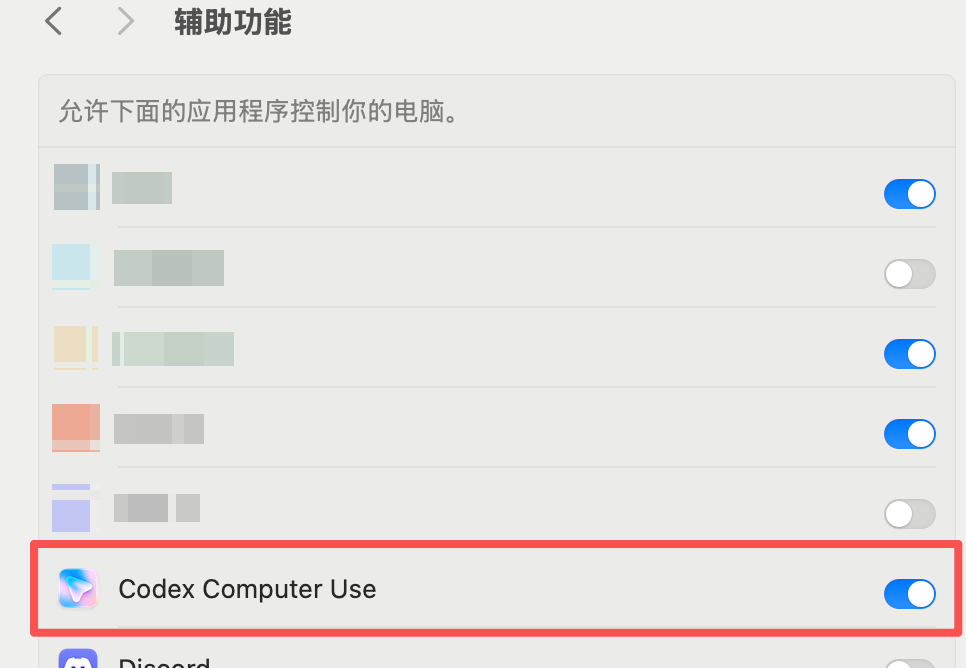
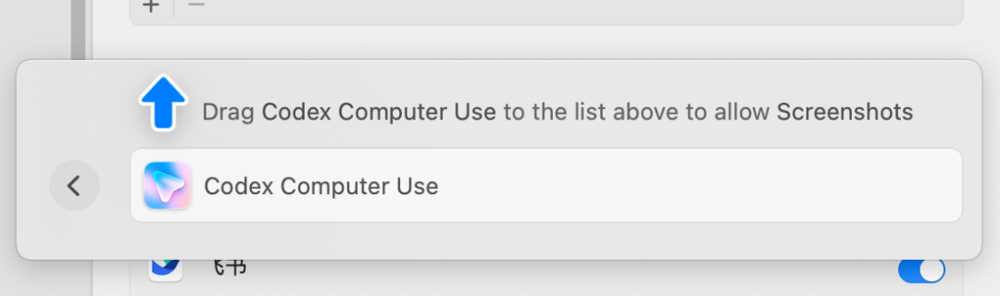
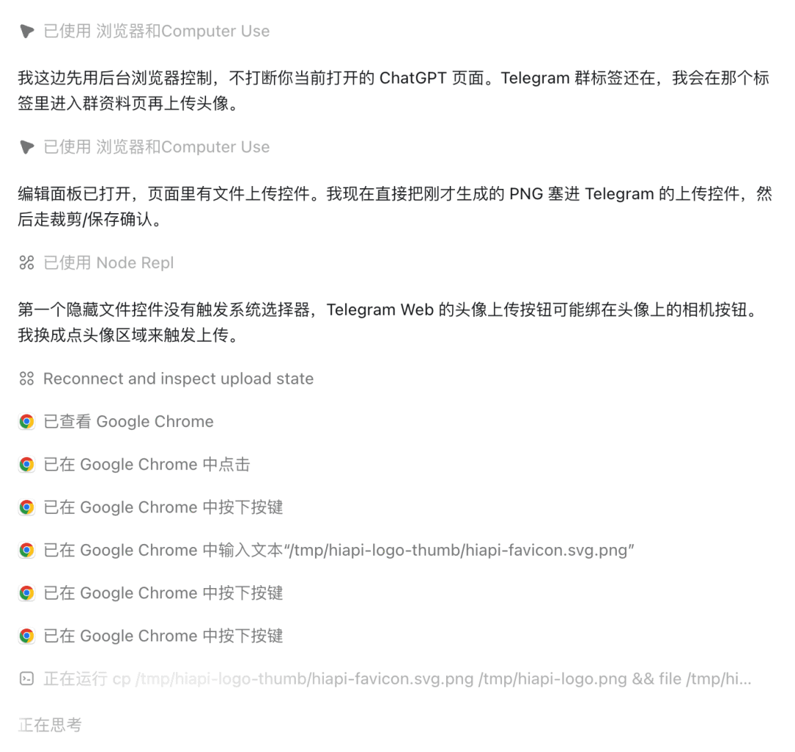

# Codex 使用 Computer Use 操作桌面应用（2026-10 更新）：安装授权、Win/macOS 差异，以及高风险场景的停手规则

> 本文在线版：[codexguide.io/guides/codex-computer-use-desktop-apps](https://codexguide.io/guides/codex-computer-use-desktop-apps)

> 核对依据：learn.chatgpt.com《Computer Use》，2026-10-23 核对。文中截图来自 macOS 中文界面，已打码无关应用。Windows 部分未实测，按官方文档整理。

**2026-10 更新说明**：补了安装与授权的逐项清单、应用授权和 Always allow 的管理方式、Windows 的 `config.toml` 应用列表、macOS 锁屏使用（locked use），以及一份停手规则。

## 什么时候用它

Computer Use 让 Codex 看屏幕、点击窗口、输入文字，适合命令行和结构化集成都搞不定的任务。官方列的典型场景：

- 测试 Codex 正在开发的 macOS、Windows 应用、iOS 模拟器流程或其他桌面应用；
- 需要用你自己浏览器的任务；
- 复现只在图形界面里出现的 bug；
- 要点进界面才能改的应用设置；
- 查看某个应用或数据源里的信息，而它没有对应插件；
- 在 macOS 上，你做别的事的同时让它在后台跑一个范围明确的任务；
- 跨多个应用的一段流程。

先考虑别的办法的情况：

| 情况 | 优先用 |
| --- | --- |
| 本地开发中的网页 | 内置浏览器（官方建议先用它） |
| 目标应用有专门的插件或 MCP 服务 | 插件或 MCP，数据访问和重复操作更稳定 |
| 只是读写文件、跑命令 | 正常的文件和 shell 操作 |

如果任务靠截图和视觉判断，模型选择器里有 GPT-6 Astra 时，官方建议用它。

## 安装与授权清单

### 1. 装插件

1. 打开 ChatGPT 桌面 App，选 ChatGPT 后在切换器里切到 **Work**，或者直接选 **Codex**。
2. 打开 **Plugins → Computer Use**，有提示就点 **Install plugin**；出现 **Enable** 就点它。
3. 打开 Computer Use 的 server 和 skill 两个开关，点 **Try now** 开始。

官方说明在受支持地区，macOS 和 Windows 的 ChatGPT Work 和 Codex 都能用。


### 2. 给系统权限（macOS）

按系统提示授予两项权限：

- **屏幕录制（Screen Recording）**：让它看到目标应用；
- **辅助功能（Accessibility）**：让它能点击、输入、导航。





如果之后它看不到或控制不了某个应用，回到 **系统设置 → 隐私与安全性**，检查这两项里的 Codex Computer Use。

Windows 不需要这两项，但目标应用必须在活动桌面上可见。

### 3. 管理应用授权

打开 App 的 **Settings → Computer use**，可以看到：

- 已连接的浏览器控制项，带 **Manage** 操作；
- **Always-allowed apps**：你允许以后免问直接用的应用。

任务中第一次用某个应用时，Codex 会弹窗问你是否允许，可以选 **Always allow**。不想再自动放行，从这个列表里移除即可。

### 4. 三套权限不要混

| 权限 | 管什么 | 在哪里设 |
| --- | --- | --- |
| 系统权限 | 能不能看屏幕、能不能操作（macOS） | 系统设置 → 隐私与安全性 |
| 应用授权 | 允许它用哪些应用 | 任务中的弹窗、Settings → Computer use |
| 文件与命令 | 读写文件、跑 shell | 任务的沙箱和审批设置 |

给了其中一项，不会自动扩大另一项。工作区管理员还可以限制 Computer Use 能访问哪些应用，以及能不能保存授权。

## Windows 和 macOS 的区别

| | Windows | macOS |
| --- | --- | --- |
| 运行方式 | 只能在活动桌面前台运行，会接管指针和键盘 | 可以在你做别的事时后台跑范围明确的任务 |
| 系统权限 | 保持目标应用在活动桌面可见 | 屏幕录制 + 辅助功能 |
| 离开电脑时 | 保持设备解锁并联网；可以用手机远程查看进度 | 可开启 locked use，锁屏后仍能执行 |
| 不想被占用桌面 | 把 ChatGPT 桌面 App 放进 Windows 虚拟机 | — |
| 免问应用列表 | 存在 `$CODEX_HOME/config.toml` | Settings → Computer use |

### Windows 的应用列表

Windows 上，持久化的应用授权写在 `$CODEX_HOME/config.toml`：

```toml
[computer_use.windows]
always_allowed_app_ids = ["mspaint.exe"]
```

应用标识用 Windows Computer Use 报告的那个：桌面应用一般是可执行文件名，打包应用是 app user model ID。不在列表里的应用会弹窗询问。撤销授权在 **Settings → Computer Use → Always allow** 里移除。

这份列表和管理员强制的 `requirements.toml` 是两回事。管理员可以用 `[features].computer_use = false` 直接禁用 Computer Use。旧的 `$CODEX_HOME/computer-use/config.toml` 里的允许列表会自动迁移，其中的 `denied` 列表不再属于当前策略。

### macOS 的 locked use

locked use 只在 macOS 上有，默认关闭。开启方法：**Settings → Computer Use**，打开 locked use。之后从已连接的设备发起任务，Mac 锁屏后也能用。

开启时会安装一个 Apple 授权插件，参与 macOS 的解锁流程。官方列了几条保护措施：

- 授权窗口很短，只针对当前这次解锁；
- 只有 ChatGPT 在进行中的 Computer Use 回合里能自动解锁，其他应用和本地进程不行；
- 临时解锁期间会遮住所有显示器；
- 检测到本地键盘或鼠标输入，会立刻重新锁屏，并暂停自动解锁，直到你手动解锁。

这项功能等于给一个程序开了解锁电脑的口子，即使范围很窄。确实需要再开。

## 开始一个任务

在提示里写 `@Computer` 或 `@应用名`，或者直接说用 Computer Use，并写清楚具体的应用、窗口和流程。例如官方示例：

```text
Open @Chrome and verify the checkout page still works after the latest changes.
```

一次只给一个应用、一个目标。

## 停手规则：这些场景必须停下来

官方的安全建议，加上本站的整理：

**它本来就做不了的**（官方写明）：

- 操作终端应用或 ChatGPT 本身；
- 以管理员身份认证；
- 批准系统的安全和隐私权限弹窗。

**你必须在场、逐步确认的**：

- 账号、安全、隐私、网络、支付、凭据相关的设置；
- 需要输入密码、密钥的任务。官方建议除非你在场并能逐步批准，否则避免这类任务。

**立即取消任务的**：

- 它开始操作错误的窗口；
- 页面内容看起来在诱导它做别的事。网页可能有恶意或误导内容，官方提醒，在你已登录的网站上，它点的按钮、提交的表单，网站都会算成你本人的操作。

**开始前就该做的**：

- 关掉和任务无关的敏感应用；
- 只给真正信任的应用开 Always allow；
- 不想让它用你日常的浏览器，就让它换一个浏览器；
- Windows 上，任务期间别碰那个桌面，要用就先停掉任务。

你随时可以停止任务或接管电脑。

## 它会看到什么

任务进行时，Computer Use 能看到目标应用的屏幕内容、截图，能操作窗口、菜单、键盘输入和剪贴板。打开的页面和文件，都可能被当作上下文处理。截图也受你的 ChatGPT 数据控制设置约束。



## 怎么验收

- 让 Codex 说明做了哪些操作，必要时保留截图或应用里的结果；
- 通过桌面应用做的修改，存盘并被项目跟踪之前，可能不会出现在审阅面板里；
- 涉及代码的，回到仓库跑测试、看 diff；
- 它在界面上看到「成功」，不等于后台状态也对了，关键结果自己再确认一次。

## 相关阅读

- [Codex 浏览器操作与登录态功能](./02-Codex浏览器操作与登录态功能.md)
- [Codex 沙箱与主机权限风险](../10-配置模型与权限安全/08-Codex沙箱与主机权限风险.md)
- [Codex 远程控制另一台 Mac](./01-Codex远程控制另一台Mac.md)

## 参考

- [OpenAI：Computer Use](https://learn.chatgpt.com/docs/computer-use)
