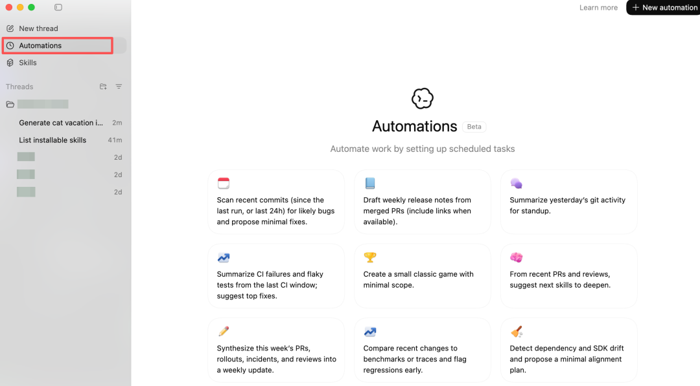
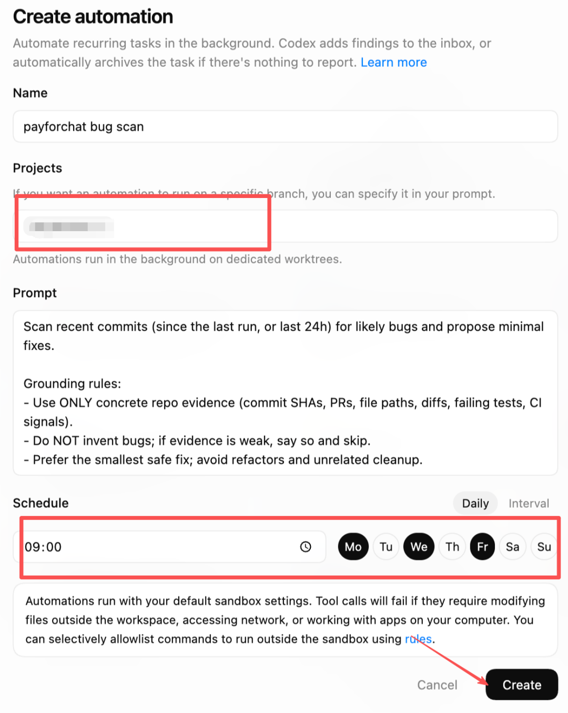
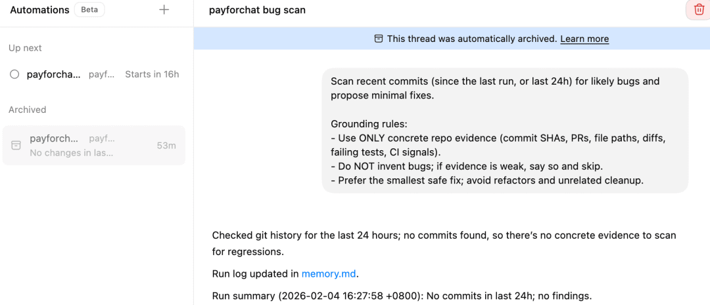

# Codex 定时任务（Scheduled tasks）怎么用：创建、在 Scheduled 查看结果、跑在本地还是 worktree，以及和 codex exec + cron 怎么分工

> 本文在线版：[codexguide.io/guides/codex-automations-scheduled-tasks](https://codexguide.io/guides/codex-automations-scheduled-tasks)

> 核对依据：OpenAI／ChatGPT Learn《[Scheduled tasks](https://learn.chatgpt.com/docs/automations)》（文档路径仍含 automations）。文中「我的用法」是操作顺序建议，不是官方强制流程。界面文案会随客户端变化；旧截图里若写 Automations，以你当前侧边栏 **Scheduled** 为准。

按计划在后台跑检查、出简报、盯一下 PR——这就是 **Scheduled tasks（定时任务）**。桌面端旧界面常叫 Automations；现行文档标题是 Scheduled tasks，收件箱式列表在侧边栏 **Scheduled**。

这篇只加厚「App／网页里的定时任务」这一条线。`codex exec` 写进脚本、crontab、CI 的做法见姊妹篇《[Codex 自动化与定时任务：从手动流程到 CI 执行](https://codexguide.io/guides/codex-automation-ci-scheduled-tasks)》，**不做 301 合并**。

## 1. 先分清三种方式

| 方式 | 谁调度 | 跑在哪 | 适合 |
|---|---|---|---|
| **桌面端定时任务** | ChatGPT／Codex 桌面 App 的 Scheduled | 本机项目目录，或 Git 仓库的独立 worktree | 要读本地文件、改仓库；电脑要醒着、App 要开着 |
| **网页／手机定时任务** | ChatGPT 网页或移动端的 Scheduled | 云端会话：上传文件、已连接工具、Skill／插件 | 不依赖本机文件夹；合格套餐还可接 Gmail／Slack／GitHub **事件触发** |
| **`codex exec` + cron／CI** | 你自己的 crontab、CI、脚本 | 你指定的机器或流水线 | 要进 shell 管道、要 JSON／产物文件、要服务器级调度 |

官方还写明：**CLI 与 IDE 扩展没有 Scheduled 管理界面**——它们适合先测提示词、Skill 或工作区改动，真正建任务、看运行历史仍回网页或桌面端。

工作区若已开通团队任务（Team Tasks），管理员另有云端服务账号与连接器权限文档；个人本机定时任务仍按本文走。

**我的用法：** 任务必须摸本机仓库 → 桌面端 Scheduled；只要连接器／上传上下文、或要事件触发 → 网页 Scheduled；必须挂进已有 CI／crontab、或要机器在无人登录桌面 App 时也能跑 → 去姊妹篇写 `codex exec`。

## 2. 在桌面端创建一条定时任务

打开桌面端侧边栏 **Scheduled**（旧版可能仍显示 Automations）。可从模板开始，也可新建空白任务。创建时至少核对：名称、项目、提示词、计划；模型和推理强度可保持默认，也可显式指定。



| 字段 | 应写内容 | 检查重点 |
|---|---|---|
| Name | 能区分用途的任务名 | 不要只写 Daily Task |
| Projects | 允许读写的项目目录；同一任务可挂多个项目 | 避免把无关或敏感目录一起选中 |
| Prompt | 数据范围、动作、完成标准、无数据时如何结束 | 无人值守时提示词要「耐用」 |
| Schedule | 日期、星期、时刻；高级计划可写 RRULE | 核对本机时区与工作日 |
| Model／推理强度 | 默认，或显式选定 | 若仍指向已退役模型，见第 7 节 |
| 运行位置（Git 仓库） | 本地项目 **或** 独立后台 worktree | 见第 3 节 |



也可以在 Chat／Codex 对话里直接让 ChatGPT **创建或更新**定时任务：说清做什么、何时跑、每次回到当前对话还是开新对话。官方示例包括：部署未完成时从当前对话排一次跟进；或建一条独立任务，按周期检查某个项目。

检查最近提交可以这样写（只读、空数据也要收束）：

```text
检查当前项目过去 24 小时内的新提交。
只报告有代码证据支持的潜在问题，并给出文件路径和相关差异。
不要自动修改文件。
如果没有新提交，明确记录没有可检查内容并结束任务。
```

最后一句很重要：没有数据时要如实结束，不能为了「交差」假设存在问题。

上线长期任务前，先在普通对话里**手动跑一遍**同一提示词，确认范围、模型和工具行为；再观察至少一次真正的定时触发，确认时区与本机条件。

## 3. 跑在本地项目还是 worktree

桌面端、且项目是 **Git 仓库**时，官方允许二选一：

- **本地项目（local project）**：直接在你正在用的 checkout 里跑。方便，但可能改到你还没提交的文件。
- **独立 worktree**：后台单独一份 checkout。定时任务的改动与未完成的本地工作隔离；同一任务也可挂到多个项目。

**非 Git 项目**没有 worktree 选项，任务直接在项目目录跑。

项目级定时任务要求：到点时**电脑要开机、桌面 App 要在跑、所选项目路径仍在磁盘上**。系统休眠、退出 App、挪走项目目录或登录失效，都会让这次运行落空。

频繁计划若选用 worktree，可能积累很多目录。官方建议：归档不再需要的运行结果，**不要随便 pin（固定）运行**，除非你故意要保留对应 worktree。并行聊天场景下的 worktree／Handoff 细节见《[Codex Worktree 教程](https://codexguide.io/guides/codex-worktree-parallel-chats)》；定时任务这条线只需记住「隔离 vs 直接改主工作区」的取舍。

**我的用法：** 提示词会改文件、或你白天还在同一仓库干活 → 优先 worktree；纯只读汇报且你接受它读主目录 → 本地项目即可。

## 4. 对话内定时，还是独立（standalone）任务

| | **对话内定时** | **独立定时任务（standalone）** |
|---|---|---|
| 上下文 | 回到**同一条聊天**，沿用已有上下文 | 每次按**已保存提示词**开新聊天 |
| 计划粒度 | 可支持按**分钟**间隔的跟进循环，也可按日／周 | 常规日／周等；高级可用自定义／RRULE |
| 结果呈现 | 续写原对话 | 各次运行在 Scheduled 里分开呈现 |
| 典型用途 | 盯长操作直到结束；固定节奏的复查循环；依赖当前研究／分诊上下文 | 每次应独立；同一任务跨多个项目；发现项要当「收件箱条目」 |

对话内定时时，提示词仍要写耐用：每次该做什么、怎样判断有没有值得汇报的事、何时停止或向你提问。

自定义节奏不够用时，可编辑 **RFC 5545 RRULE**。官方举例：

```text
RRULE:FREQ=MONTHLY;BYMONTHDAY=1;BYHOUR=9;BYMINUTE=0
```

（每月 1 日 09:00；具体时区以客户端／本机为准。）

## 5. 在 Scheduled 里看结果

侧边栏 **Scheduled** 用来查看任务状态与最近运行。官方把它写成类似**收件箱**：有发现（findings）的运行会出现在这里，并用**未读**提示你留意。

独立任务每次跑完在 Scheduled 里留一条运行记录；对话内定时则更多是对话本身被续写——仍建议定期打开 Scheduled，核对活跃／暂停／已完成状态。



检查时看：读到的是否是对的项目与时间窗、输出能否回到证据、空数据是否安静结束。这与「有问题才报警」的运维习惯一致。

## 6. 结合 Skills 与插件

官方明确：定时任务可以配合 **Skills**，做更复杂、可复用的工作；在 ChatGPT Work 网页，或桌面端的 ChatGPT Work／Codex 上创建的定时任务，还可以使用 **插件（plugins）**。

建议把「动作说明、工具与上下文」放进 Skill，再在任务提示词里**点名或调用**该 Skill，而不是完全依赖自动选工具。桌面端可在提示词里用 `$skill-name` **显式触发** Skill。

官方还提到：Skill 本身也可以创建或更新定时任务——例如某个「看护 PR」的 Skill，用 GitHub 插件建一条定时检查 PR 状态、处理新 review 的任务。Skill 怎么写、怎么禁用与打包，见《[从零创建 Codex Skill](https://codexguide.io/guides/create-codex-skill)》。

网页端定时任务可用上传文件、已连接工具、该聊天可用的 Skill／插件；**不会**在两次运行之间保留本机文件夹或 worktree。耐用说明放进任务提示词或附加 Skill；源材料放在可访问的项目、上传或已连接服务里。

## 7. 运行条件、沙箱与模型迁移

**本机条件（桌面端）：** 电脑开机、App 运行、项目路径可用。网页端任务不依赖本机文件夹，但依赖账号、工作区权限与已连接应用。

**无人值守权限：** 定时任务按你的**默认沙箱设置**跑。从能完成任务的最小权限起；只有必要时再开网络或更广的文件访问。官方权限说明摘要：

- **read-only**：改文件、访问网络或操作本机应用会失败 → 可考虑改为 workspace-write  
- **workspace-write**：改工作区外文件、访问网络或操作本机应用会失败 → 可用规则白名单个别命令  
- **full access**：后台定时任务风险更高（可能改文件、跑命令、访问网络且不问你）→ 官方建议倾向 workspace-write，并用规则限定可提权命令  

组织策略允许时，定时任务使用 `approval_policy = "never"`；若管理员禁止该值，则回退到你所选权限模式的审批行为。管理环境还可在 `requirements.toml` 等处强制约束。细则见官方 sandboxing／Permissions 文档。

**事件触发（网页／手机，合格套餐）：** 可在 Gmail、Slack、GitHub 等支持事件到达时跑任务。**桌面端、CLI、IDE 不可用**；一条任务可挂多个事件触发，但**不能**与基于时间的计划混用。连接应用并授权后再建任务；Slack 需把 `@ChatGPT` 加进所监视频道；GitHub 连接须能访问目标仓库。短时间多条匹配事件可能合并进一次运行；可在 Scheduled 里看挂起事件或选 Run now。工作区管理员可用「允许事件触发定时任务」类权限控制。

**模型迁移：** 官方文档写明——**GPT-5.5 已于 2026-10-14 中午 PDT（19:00 UTC）从「ChatGPT 登录的 Codex」退役**。请复查仍使用 GPT-5.5 的定时任务；若套餐与工作区提供访问，改为 **`gpt-6.1-sol`（GPT-6.1 Sol）**。OpenAI API 以及用 **API Key** 认证的 Codex 会话不受该条影响。其它套餐替换型号见官方「GPT-5.5 retirement」说明——**本文不另编模型清单**。若任务指向任何已退役模型，更新为当前可用替代。

## 8. 不想一直开着桌面端：改用 codex exec + cron

桌面端 Scheduled 的前提是本机 App 在跑。若你需要：

- 服务器／CI 上调度，不依赖图形界面登录  
- 把输出接进 `jq`、邮件、工单等脚本管道（尤其 `--json`／`-o`）  
- 与现有 crontab、GitHub Actions 等调度器统一  

应改用 **`codex exec`**，而不是硬撑桌面端定时任务。步骤、参数与示例见：

→ 《[Codex 自动化与定时任务：从手动流程到 CI 执行](https://codexguide.io/guides/codex-automation-ci-scheduled-tasks)》

两篇分工：**本文** = App／网页 Scheduled（含 worktree、对话内定时、事件触发、Scheduled 收件箱）；**那篇** = `codex exec` + 脚本／cron／CI。互相链接，不 301。

## 9. 适合与不适合

适合：规则稳定、数据来源明确、结果可复核——例如近 24h 提交简报、只读日志归类、固定格式的变更摘要。

不适合作为第一版无人值守：需要临场判断、会自动提交／改生产配置、直接给外部联系人发消息等副作用大或错误成本高的动作。先只读验证，再逐步放权。

官方示例方向包括：扫近期会话改进个人 Skill、按目录出 24h exec briefing、用 Skill + 定时任务修自己最近引入的 bug——都强调范围清楚、能停、能汇报。

## 参考资料

- [Scheduled tasks](https://learn.chatgpt.com/docs/automations)（旧锚点 automations 仍有效）  
- [Codex App](https://learn.chatgpt.com/docs/app)  
- 姊妹篇：[Codex 自动化与定时任务：从手动流程到 CI 执行](https://codexguide.io/guides/codex-automation-ci-scheduled-tasks)（`codex exec` + cron／CI）  
- [从零创建 Codex Skill](https://codexguide.io/guides/create-codex-skill)  
- [Codex Worktree 教程](https://codexguide.io/guides/codex-worktree-parallel-chats)  

本文按 2026-10-22 可访问的 Scheduled tasks 文档核对。界面若仍显示 Automations，以 Scheduled 为准；事件触发与模型可用性随套餐／工作区变化。
