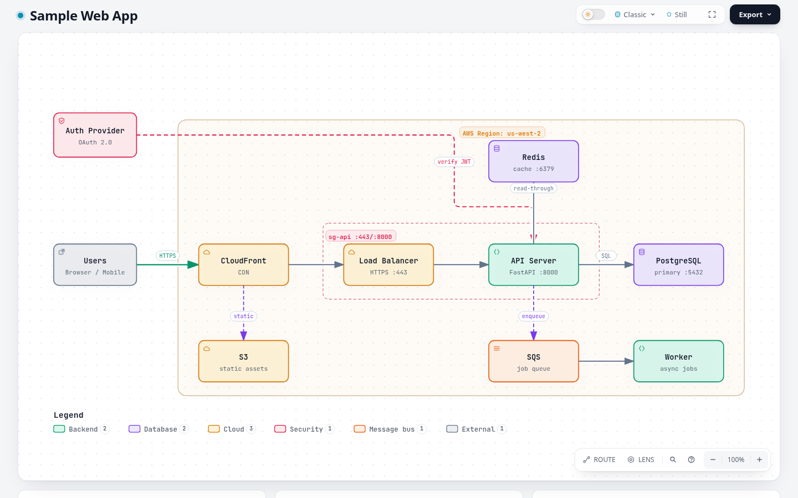

# Codex 使用 Archify 生成架构图（2026-11 更新）：新装法、10 种图表和 doctor 校验

> 本文在线版：[codexguide.io/guides/codex-archify-architecture-diagrams](https://codexguide.io/guides/codex-archify-architecture-diagrams)

> 核对依据：[tt-a1i/archify](https://github.com/tt-a1i/archify) 的 README、[llms.txt](https://github.com/tt-a1i/archify/blob/main/llms.txt)、[CHANGELOG](https://github.com/tt-a1i/archify/blob/main/CHANGELOG.md) 和 GitHub Release v3.2.0。2026-11-01 在空目录里执行了列出、项目级安装、`doctor`，以及用安装包自带示例做的 `render` 和 `visual-check`。没有登录 Codex，所以没有让 Codex 扫描仓库后出图。

Archify 是第三方 Agent Skill，许可证 Apache-2.0。它把一段说明、一个问题或一个仓库画成可以单独打开的 HTML。它不是 Codex 的官方功能。

2026-11-01 通过 GitHub API 查询：约 92,155 stars、6,285 forks，最近推送 2026-10-31 14:53（北京时间）。稳定版 v3.2.0 的 CHANGELOG 标题日期是 2026-10-18，GitHub Release 的发布时间是 2026-10-19 00:43 UTC。star 数会变。

这类图最容易好看但和代码对不上。仍建议分成三段：先让 Codex 写出能回链到文件的说明，再出图，再核对节点和连线。下面的安装和 doctor 是本环境跑过的；「让 Codex 读仓库」那一段是用法，不是本次的运行记录。

## 试用和正式安装不是同一条命令

README 里这条现在放在 **To try without installing** 下面：

```bash
npx skills use tt-a1i/archify@archify --agent codex
```

它是试用不安装。正式安装以仓库根目录的 [llms.txt](https://github.com/tt-a1i/archify/blob/main/llms.txt) 为准，顺序是先列出、确认只有一个 skill、再安装、再 doctor。

1. 只列出，不安装：

```bash
npx -y skills@latest add https://archify.si --list --full-depth
```

上游要求：列表里必须恰好有一个名为 `archify` 的 skill，否则停下来。

2. 安装到 Codex。全局安装：

```bash
npx -y skills@latest add https://archify.si --skill archify --agent codex --global --copy --yes
```

去掉 `--global` 就是只装当前项目。`--copy` 是复制文件，不是符号链接。`--yes` 只跳过你已经确认过的范围提示。

3. 用安装结果里的路径做校验。全局安装常见落点是代理已经会扫描的 `skills/archify`；项目级安装常见落点是 `.agents/skills/archify`：

```bash
node <安装路径>/bin/archify.mjs doctor
```

2026-11-01 的核对用的是项目级安装（没有加 `--global`），目录是一个新建的空项目。`--list` 的结果是 Found 1 skill，名字是 `archify`。随后的安装摘要写着复制到项目的 `.agents/skills/archify`，目标是 Codex，203 个文件，结束语是 Installation complete。全局那条命令本次没有再跑。安装程序还提示：Review skills before use; they run with full agent permissions。第三方 Skill 能读项目并运行自己的脚本。装之前先看仓库、依赖和最近提交。安全检查的一般做法见 [HOL Guard](./01-Codex插件安全检查-HOL-Guard.md)。

## 用 doctor 看渲染器是否齐全

在上述项目级安装上执行 `node .agents/skills/archify/bin/archify.mjs doctor`。Node.js 是 v22.23.4。输出的每一项都是 `[ok]`，包括 10 个图种的 renderer、schema 和 example，以及 explainer。结尾是：

```text
Archify is ready.
```

同一安装里的 `skill-release.json` 写着 `version` 为 `3.2.0`，`channel` 为 `stable`。`archify.mjs --help` 的 Types 行是：

```text
architecture, workflow, sequence, dataflow, lifecycle, erd, tree, class, timeline, waterfall, explainer
```

旧文只列了前 5 种。那张「5 类技术图」的配图已经删掉。

## 10 种图表怎么选

| 类型 | 适合表达 |
|---|---|
| architecture | 服务、数据库、缓存和外部系统的边界 |
| workflow | 审批、构建、事故处理和工具调用的步骤 |
| sequence | 一次请求里调用的先后关系 |
| dataflow | 数据从哪来、怎么变换、存到哪、谁消费 |
| lifecycle | 任务、订单或发布状态怎么变 |
| erd | 实体和关系 |
| class | 类和接口 |
| tree | 层级结构 |
| timeline | 按时间排列的事件 |
| waterfall | 有时长证据的阶段 |

explainer 是另一种产物：一页说明，结论在前，每块面板回答一个问题。CHANGELOG 的 3.2.0 写明它可以包含散文、表格、步骤、清单、图表、代码和经过校验的图。别人不安装 Archify 也能打开生成的 HTML。

技能说明里把 Share Cards、Route/Reach cards 写成用户明确要求时才做的输出。本次渲染出的页面上能看到 Export 和 ROUTE，没有逐项点开这些菜单，所以不描述菜单里的每一项。

## 先让 Codex 写一份有代码依据的说明

不要直接要求画整座系统。先要一份能回到文件和符号的说明。这是建议的提示，不是本次会话的输出：

```text
先扫描当前项目，不要生成图。
列出应用入口、核心模块、数据存储、外部服务和一条主要请求路径。
每个判断给出文件路径和关键符号。
无法从代码确认的部署信息单独列出，不要猜测。
```

人先看这份说明：删掉不必上图的实现细节，补上只有仓库外才知道的事实，并写清这张图要回答的问题。代码结构本身还可以用 [Serena 或 codebase-memory-mcp](../09-MCP与外部工具/04-Codex代码智能MCP-Serena与codebase-memory-mcp怎么装怎么选.md) 辅助阅读；那两个工具不负责出 Archify 的 HTML。

## 生成图并检查节点和连线

说明确认之后，再让 Codex 调用 Archify，指定图种、主路径和不要猜测的部分。复杂系统拆成多张图：总览只画边界，时序图解释一个请求，数据流图解释一批数据。

本环境没有登录 Codex，没有走上面这段对话。为了核对渲染器，使用的是安装包自带的 `examples/web-app.architecture.json`：

```bash
node <安装路径>/bin/archify.mjs render architecture \
  <安装路径>/examples/web-app.architecture.json \
  ./out/web-app.html
node <安装路径>/bin/archify.mjs visual-check ./out/web-app.html --out-dir ./out/visual
```

`render` 写出约 846 KB 的 HTML。`visual-check` 的结果是 automated browser evidence pass，并导出了 PNG。下图就是其中一张浅色 1440×900 的画面，内容是示例里的 Sample Web App，不是某个业务仓库的扫描结果。



图一　Archify 3.2.0 用安装包内 `examples/web-app.architecture.json` 渲染的 architecture 图，再由 `visual-check` 导出。图中是示例「Sample Web App」，不是 Codex 阅读业务仓库后的结果。

出图之后，让 Codex 给每个节点和每条连线列证据：节点对应哪段代码、哪份配置或哪条已经确认的外部事实；箭头是调用、事件还是数据。打不开来源的节点，标成未确认，不要留在最终图里。

## 输出的 HTML 怎么分享、怎么放进仓库

产物是单文件 HTML，接收的人不必安装 Archify。可编辑的 JSON 源文件适合留在仓库里；HTML 和 PNG 可以当成构建产物。代码结构变了就重新生成，并用 Git diff 看说明有没有一起改。

CHANGELOG 对 explainer 还写了 PNG、WebP、JPG 长图和打印 PDF。本次只确认了 architecture 示例的 HTML 和 visual-check 的 PNG。

## 更新检查与隐私

README 写明：Archify 可能对一个固定的稳定版清单发 GET，只为了显示可选的更新提醒；它不会下载或安装更新。成功检查后大约等 24 小时（上下 20%）再查；使用中的失败会在 6 小时、然后 24 小时后重试。服务端看到的是普通 HTTP 元数据（IP 和时间），不接收版本、Agent、项目数据、提示词、账号或设备 ID、ETag。是否更新由你决定。

关掉联网和提醒状态的写入：

```bash
export ARCHIFY_UPDATE_CHECK_DISABLED=1
```

安装包里的 `scripts/check-update.mjs` 在该变量等于 `1` 时直接视为已禁用。`skill-release.json` 里的清单地址是 `https://tt-a1i.github.io/archify/skill-updates/archify/stable.json`。本次 doctor 和 render 没有为了写这篇去观察那次请求的报文。

## 适用范围与限制

Archify 适合 README、技术方案和架构评审里的展示图。很小的流程用 Mermaid 更轻。要精确品牌排版时，用设计工具。

生成结果不能证明系统真的具备图上的能力。依据仍是代码、配置和运行环境。图上的部署区域、端口和外部服务，只有说明里已经确认的才保留。

Skill 的写法见 [从零创建 Codex Skill](../07-Skills实战/04-从零创建Codex-Skill.md)。

## 常见问题

**doctor 不是 Archify is ready？** 看第一条失败项。本次在 Node.js v22.23.4 上全部是 `[ok]`。Node 低于安装检查写的 `>=18` 时，先升级 Node。

**图和代码不一致怎么办？** 先改说明里的证据，再重新 render。不要只在 HTML 上改字。

**可以装别的代理吗？** llms.txt 列出的开关 id 包括 `cursor`、`codex`、`claude-code`、`opencode`、`github-copilot`。本文只跑了 `--agent codex`。

## 参考资料

- [tt-a1i/archify](https://github.com/tt-a1i/archify)
- [llms.txt](https://github.com/tt-a1i/archify/blob/main/llms.txt)
- [CHANGELOG.md](https://github.com/tt-a1i/archify/blob/main/CHANGELOG.md)
- [Release v3.2.0](https://github.com/tt-a1i/archify/releases/tag/v3.2.0)
