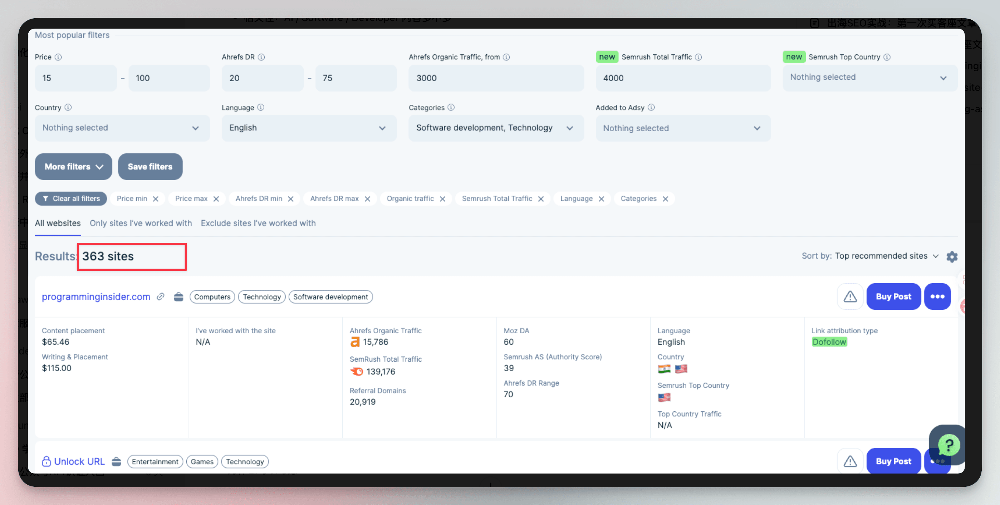
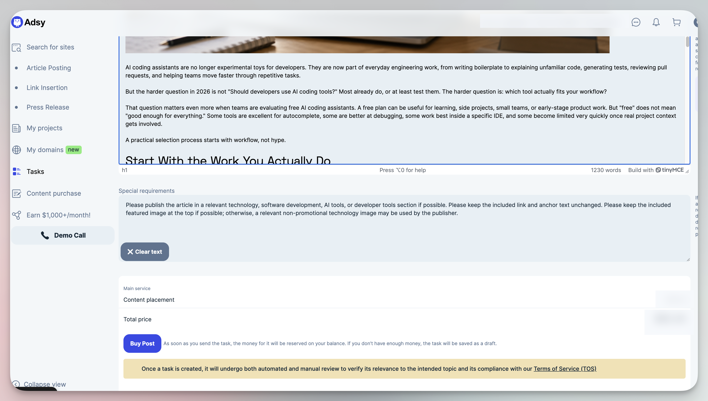
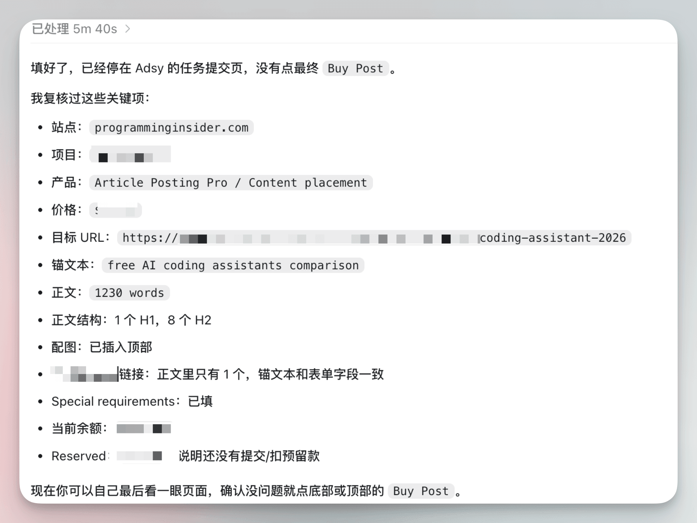
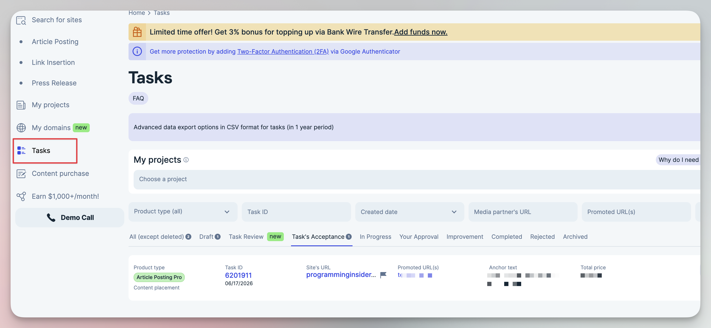

# 用 Codex 做出海 SEO 外链：第一次购买客座文章，含 Google 付费链接规范

> 本文在线版：[codexguide.io/cases/codex-guest-post-case](https://codexguide.io/cases/codex-guest-post-case)

> 核对依据：Google Search Central《[Spam policies for Google web search](https://developers.google.com/search/docs/essentials/spam-policies)》（Link spam）、《[Qualify outbound links](https://developers.google.com/search/docs/crawling-indexing/qualify-outbound-links)》，以及 2019 年博文《[Evolving "nofollow"](https://developers.google.com/search/blog/2019/09/evolving-nofollow-new-ways-to-identify)》。平台字段与操作步骤来自作者在 Adsy 上的第一次实操记录。文中「我的用法」是操作建议，不是 Google 或平台的强制规定。

站内原先有两篇几乎同一流程的案例：一篇偏「客座文章外链实验」并带发布后验收，一篇偏「出海 SEO／第一次购买」并写明平台名 Adsy。**本文以 `/cases/codex-guest-post-case` 为主页面合并两者**；旧页 `/guides/codex-chu-hai-seo-shi-zhan` 应 301 到这里（见 frontmatter `redirect_from`）。知识库侧：`14-真实案例复盘/03-Codex协助客座文章外链实验.md` 保持主路径；`14-真实案例复盘/05-Codex协助出海SEO实战.md` 合并后应变为 `status: redirected`（本次只出主文预览，不另造完整 redirect 文件）。

这篇记录第一次实际购买客座文章时，Codex 怎样整理筛选条件、检查提交字段、控制浏览器做复核，以及发布后该怎么验收——并补上 Google 对付费链接的标注要求。**正文不编造曝光、点击或排名数字**；原文没有写明的结果，这里也不补。

## 1. 先读 Google：付费链接怎么标

客座文章如果涉及金钱、商品、服务或其他补偿，发布方发出的链接通常属于 Google 所说的 **paid links／paid placements**。Search Central 在出站链接说明里要求：广告或付费放置用 `rel="sponsored"` 标记；以前推荐的 `rel="nofollow"` **仍然可接受**，但 **优先用 `sponsored`**。也可以写成空格或逗号分隔的多值，例如 `rel="sponsored nofollow"`。

Spam policies 的 **Link spam** 一节写得更直白：

- **以操纵排名为目的买卖链接**属于链接垃圾。包括：用钱换链接或含链接的帖子、用商品／服务换链接、送测产品换带链接的稿件等。
- **软文／原生广告／客座文章**里，收了钱却让链接传递排名信用，或使用**优化过的锚文本**，也是举例中的违规形态。
- Google 同时说明：购买与出售链接作为广告与赞助，是网络经济的一部分；**只要用 `rel="nofollow"` 或 `rel="sponsored"` 限定，就不构成这类违规。**

对买家意味着三件事：

1. **不要把「平台写了 Dofollow」当成政策绿灯。** 卖方声明和发布页 HTML 经常不一致；以源码为准。
2. **若发布页把你的链接标成 `sponsored` 或 `nofollow`，这往往更符合 Google 对有偿链接的要求**，而不是「被坑了」。是否仍愿意下单，属于你自己的实验设计，不是「必须追到裸 dofollow」。
3. **期望靠付费客座批量堆传递排名信用的 dofollow**，本身就撞上 link spam 的描述。本案例按「小预算熟悉流程 + 核对字段 + 事后验收」来写，不当作推荐违规操作的教程。

**我的用法**：下单前就在 Special requirements 或备注里写清栏目期望；发布后用浏览器开发者工具或「查看网页源代码」搜承接页 URL，看 `<a>` 上的 `rel`。Codex 适合帮你把这一步写成检查清单并在浏览器里执行。

## 2. 先用小预算熟悉平台

这次选的平台是 **Adsy**，可以购买客座文章和内容发布。目标只是先用一笔小钱把流程跑通，不追求一次买到「全平台最强站」。

第一次进这类平台，最容易被指标绕晕：价格、DR、DA、Ahrefs Organic Traffic、Semrush Total Traffic、国家、语言、分类、链接是否标成 Dofollow，都堆在列表里。

Codex 先给出筛选条件。针对自己的站点，先把语言限定为英文，分类限定在 Software development 和 Technology，再给价格设上限。目标很明确：**先缩到更相关、预算还能接受的范围**，而不是按推荐排序扫全站。

**这一步里，人要做的是定边界。**

例如这次是给 Codex 工具站做外链，不想买太泛娱乐、金融、生活方式的站。Codex 做的是把这些边界翻译成平台上的筛选条件，并解释每个指标大概代表什么。人拍板「相关／不相关」和「贵不贵」；模型负责把边界落成可执行的筛选。

## 3. 看指标，也看这个站像不像真的相关



筛完仍可能剩下几百个站，平台推荐排序不够用。Codex 再做一轮初筛：看价格、流量、DR、DA、Dofollow 声明，也会继续搜索这个站有没有 developer tools、software development、与 Codex／编码助手相关的内容。

这里有一个很实用的判断：

**一个站不能只看指标，还要看它平时发什么。** 如果满屏都是 crypto、loan、casino、trading 这类高商业化内容，即使 DR 看起来很高，也要谨慎——它可能更像卖链接的内容农场。

这一步里，人要判断业务价值。Codex 可以把九百多个候选缩成几个优先级，但最后为什么选某一个站，还是要回到项目目标：站点聚焦 Codex 教程和使用决策时，不应该为了一个便宜链接去买完全不相关的站。

## 4. 文章不是随便写一篇就行



确定网站以后，下一步是准备 guest post。

承接页是一篇 Codex 开发者教程时，客座文章也围绕「开发者如何从真实工作流判断编码助手是否适合自己」来写，并把 Codex 的使用场景自然写进正文。旧版案例里也曾用描述性锚文本（例如与「free AI coding assistants comparison」同类的写法），而不是生硬堆品牌词——原则是一样的：**锚文本描述承接页内容，链接出现在正常叙述里，而不是硬塞。**

文章写完后，Codex 再检查提交细节：

- 目标 URL 与正文里的链接一致
- 锚文本与平台字段一致
- 正文满足平台最低字数
- Special requirements 写清楚：希望发在 software development、developer tools 或相近栏目

很多新手第一次买客座文章时，大方向已经想清楚了，最后却栽在这些小字段上：URL 填了首页而不是承接页、锚文本和正文不一致、图片位置放错、浏览器翻译插件把中文残留混进英文正文。

**Codex 的作用很具体：它会写文章，也会做提交前检查。** 最后让它把提交页逐项复核一遍；需要时通过浏览器把源码里的正文再清理一次，确认没有明显问题，再提交订单。

配图也可以走一小套流程：先判断要不要图 → 生成与主题一致的图 → 上传图床 → 把图片地址插进正文。目的是让稿件看起来完整，并减少发布方随便配一张无关图的概率。作者侧也曾把图像生成接到内部内容生产链路里；这和平台下单是分开的步骤，按你自己的工具链选择即可。

## 5. 人负责判断，Codex 负责执行和检查



人和 Codex 怎么分工：

- **人**：为什么要买这条外链、预算多少、能接受什么风险、什么类型的站和产品相关，以及是否接受「有偿链接可能被标成 sponsored／nofollow」。
- **Codex**：读平台、解释字段、设计筛选、初筛候选、查内容相关性、写英文稿、生成／插入配图、复核提交字段、用浏览器把重复操作走完。

有 Codex 辅助能降低上手成本，也能减少因为不熟平台而犯的低级错误。它把平台里零碎、容易漏的步骤整理出来，再一项项执行——但**不能替你承担 Google 政策风险，也不能替你决定这笔钱值不值得花。**

## 6. 提交之后：Reserved 与 Tasks



提交成功后，钱会先进入 **Reserved**，不是立刻最终扣完。任务会出现在 Adsy 的 **Tasks** 列表里；这个页面后面就是验收入口。等文章发布后，还要从这里回来看发布 URL 和任务状态。

客座文章有没有「效果」，不能看提交完了就结束。后面至少要记录：发布 URL、链接在 HTML 里的实际 `rel`、是否像能被收录，以及承接页在 Google Search Console 里的曝光、点击、平均排名有没有变化——**只记你自己账号里真实出现的数字，没有数据就留空，不要补写。**

## 7. 发布后还要做一次验收

等对方发布以后，再做一轮验收。

**第一步：打开发布 URL。** 页面应能正常访问（常见是返回 200），正文不能变成拼接稿，标题、配图、段落结构基本正常。然后确认 Codex 相关承接页的链接还在，锚文本和目标地址正确。

**第二步：看链接属性。** 平台列表可能显示 Dofollow，但**最终以发布页实际 HTML 为准**。检查链接有没有被改成 `nofollow`、`sponsored`，或被跳转层包住。对照第 1 节：有偿链接出现 `sponsored`／`nofollow` 时，先按 Google 规范理解，再决定是否在平台任务里沟通修改。若链接被删、锚文本被改、目标页被改错，回到 Tasks 沟通。

**第三步：看基本收录可能。** 先看页面是不是 `noindex`，再过几天用文章标题或 `site:` 查询，看有没有被搜索引擎发现。这个阶段不要急着看排名——外链从发布到被发现，再到可能影响目标页，通常需要时间。

**4 到 8 周后**，再看承接页数据。重点比较曝光、查询词和平均排名的变化。如果数据完全没变化，不代表这条外链一定没用，但至少说明它不是短期明显有效的动作。如果发布页质量一般、没有收录、也没有带来任何相关查询变化，后续就不应继续批量买同类站。反过来，如果发布页正常收录，目标页开始出现更多相关查询，就把筛选条件与站点类型记下来，后面用类似方法找更相关的站。

这次实验说明：Codex 可以把外链筛选、提交检查和后续验收串起来，但**发布后的数据与政策判断仍然要人持续盯。**

## 8. 上线检查清单（可直接丢给 Codex）

把下面整段交给 Codex，让它按项勾选（把尖括号换成你的真实值）：

```text
请按清单核对这次客座文章订单，不要改写我的业务结论：
1. 筛选：语言=英文；分类含 Software development / Technology；价格 ≤ <上限>；排除娱乐／金融／博彩类站。
2. 候选站：打开站点首页与最近文章，判断是否与 Codex／开发者工具相关；列出疑似内容农场的理由。
3. 稿件：正文链接 URL = <承接页>；锚文本与平台字段一致；字数 ≥ 平台下限；无中文残留；配图 URL 可访问。
4. Special requirements：写明希望栏目（software development / developer tools 等）。
5. 提交页字段与正文逐项对照后，才允许建议点击购买。
6. 发布后：打开 <发布 URL>，确认 HTTP 状态、正文结构、承接页链接；在 HTML 中定位该 <a>，记录 rel= 的实际值（sponsored / nofollow / 无 / 其他）。
7. 对照 Google Search Central：有偿链接优先 rel="sponsored"，nofollow 仍可接受；不要把「未标注的付费 dofollow」写成合规目标。
8. GSC：只汇报我提供或你在已授权账号里读到的数字；没有数据就写「无实测」，禁止编造涨跌。
```

## 9. 合并说明（给维护者）

| 项 | 处理 |
| --- | --- |
| 主路径 | `14-真实案例复盘/03-Codex协助客座文章外链实验.md` |
| 主 URL | `/cases/codex-guest-post-case` |
| 并入后 redirected | `14-真实案例复盘/05-Codex协助出海SEO实战.md` → `status: redirected`，`redirect_to: /cases/codex-guest-post-case` |
| 旧 URL | `/guides/codex-chu-hai-seo-shi-zhan` → 301／308 到主 URL（已写入 `redirect_from`） |
| 本次预览 | 无截图；原文配图路径见 factcheck，上线前再核验打码与 alt |

