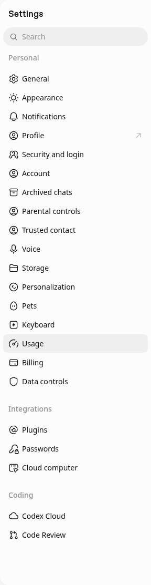
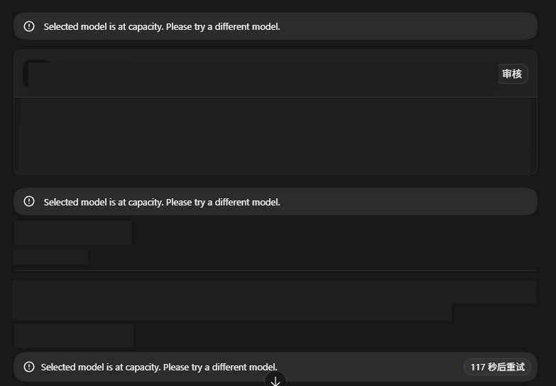
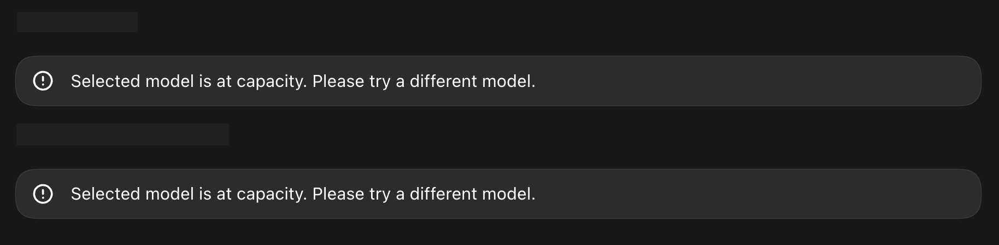
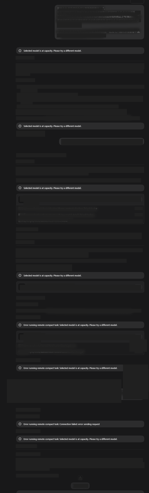
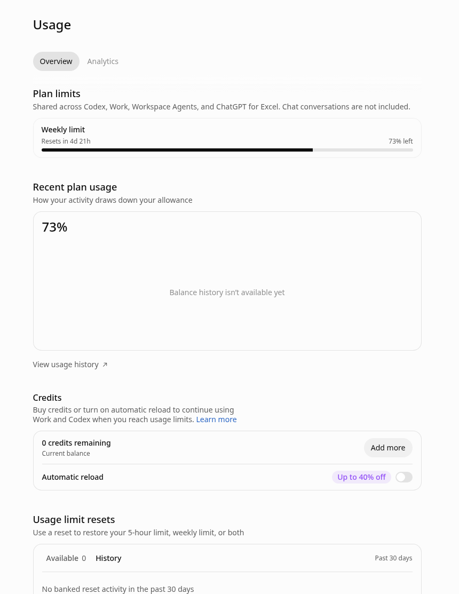
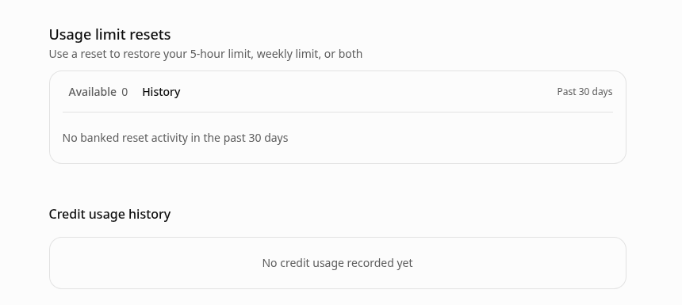

# Codex「Selected model is at capacity」与额度重置：怎么判断、怎么等、怎么少踩坑

> 本文计划路径：[codexguide.io/guides/codex-model-at-capacity-usage-reset](https://codexguide.io/guides/codex-model-at-capacity-usage-reset)

> 核对依据：OpenAI Help Center 的 Codex 套餐与用量说明、付费周重置、banked reset，以及 learn.chatgpt.com 的 Pricing。文中「我的用法」是排查顺序建议，不是官方规定。

任务做到一半，界面弹出：

> Selected model is at capacity. Please try a different model.

很多人会立刻去做三件事：狂点重试、把所有模型挨个换一遍、或者以为额度没了去买重置。这三件事有时碰巧有用，但多数时候先分错了问题。

**容量满、额度用完、重置还没到，是三件不同的事。** 混在一起，要么白等，要么在额度还没用完时误买重置，要么把服务故障当成自己的账号问题。

本文只解决「怎么判断、怎么等、怎么少踩坑」。套餐额度怎么读、Fast／credits 怎么算、觉得被多扣怎么查，见计划中的姊妹篇《Codex 用量额度怎么看》（知识库路径 `10-配置模型与权限安全/10-Codex用量额度怎么看-5小时与每周限制-Fast倍率与credits.md`，计划网址 `/guides/codex-usage-limits-credits`）。

## 先做 60 秒分流

打开桌面端 **Settings → Usage**（侧栏在 Personal 分组里，当前选中项会高亮）。有的说明写作 Usage & billing；CLI 正在跑会话时，输入 `/status`。

看清楚两样东西：

1. **还有没有剩余额度**（5 小时窗、每周窗，或你套餐显示的其他主额度）。
2. **下一次自动刷新时间**写在哪里。

然后对照下表：

| 你看到的情况 | 更可能是什么 | 先做什么 |
|---|---|---|
| 文案是 at capacity / Please try a different model；Usage 里额度仍明显有剩余 | 服务侧容量或路由，不是「额度清零」 | 等一会儿再试、换模型、新开会话；同时看 [status.openai.com](https://status.openai.com/) |
| 明确写到了 usage limit／额度用尽；面板某一档到 0% 或显示已耗尽 | 用量耗尽 | 看是 5 小时还是每周；等重置，或用账号提供的 reset／credits／升级选项 |
| 刚买过或刚点过 reset，百分比还没变，或下周重置日期变了 | 重置生效与日程变更 | 刷新 Usage；确认账号／工作区对不对；弄清「立即生效」和「新一周从下次请求算起」 |

Work 与 Codex 在多数个人／商务套餐里**共用**同一份主用量。换模型**不会**把共享池加满；它只可能避开某一个暂时满载的模型入口。

## 情况一：Selected model is at capacity

界面提示你**当前选中的模型暂时接不下新请求**，并建议换一个模型。它说的是服务侧容量／准入，不是「周额度已经变成 0」。

OpenAI 工程师 @thsottiaux 公开写过：团队加了算力并做了一系列改动，显著降低这类提示；**当它仍出现时，任务最终应能自行继续，而不是一直卡死**（2026-10-15，[Day 11](https://x.com/i/status/2110750421367287996)）。这是产品说明，不是「你一定等得到成功」。额度明显有剩余却仍报 at capacity 时，**先按容量问题处理**，不要一上来就买重置。

界面上常见的样子是任务进行中突然出现英文提示，有时还会带自动重试倒计时（对话内容已打码，仅保留报错文案）：

工具刚跑完、正要继续时也可能同一条提示再冒出来：

长会话里还可能连续多次出现，甚至夹杂 remote compact 相关错误——仍应先按「容量／路由」而不是「额度清零」来分流：

### 我的用法：容量提示时的顺序

不是官方强制步骤，按这个顺序通常更省事：

1. **看状态页**：[status.openai.com](https://status.openai.com/) 是否标了 Codex、ChatGPT Work 或相关组件异常。有公告就跟着公告走，别反复改本地配置。
2. **等自动重试结束一轮**。客户端若在倒计时重试，先让它跑完；工程师说明过这类提示最终应能自行继续。
3. **换一个仍可用的模型试一次短任务**（例如从 Astra 换到 GPT-6.1 Sol，或换到 Luna）。目的是验证「是不是某一个模型入口满了」，不是指望换模型恢复额度。
4. **新开一个会话／线程**再发同样的短请求。有人只在某一个线程里反复失败，新会话却正常——这更像路由或会话状态问题，而不是额度。
5. **确认登录的是同一个、正确的个人或工作区账号**，然后完全退出并重启桌面端或 CLI。
6. **仍然所有模型、所有入口都失败，且 Usage 明确还有剩余**：用客户端的 Help → Feedback（或等价入口）上传诊断，记下 **Feedback ID**；联系 Support 时带上时间（含时区）、客户端、模型名和该 ID。不要为了「试一下」连续点掉 banked reset 或付费重置。

普通 Chat 能用、只有 Codex／Work 任务失败，并不能单独证明是账号被封——历史上也出现过 Codex／Work 侧降级而 Chat 仍可用的情况。以 Status 和 Usage 为准。

## 情况二：用量耗尽（不是 at capacity）

### 怎么确认

官方建议：接近或已经碰到 Codex 限制时，打开 Settings 或用量面板，看**哪一档额度耗尽**、credits 余额、以及显示的重置时间；CLI 会话里用 `/status`。

Usage 的 Overview 页大致长这样：上方是 Plan limits（本例为 Weekly limit、剩余百分比与 Resets in 倒计时），下方是 Credits（余额与 Add more／Automatic reload）。界面写明额度在 Codex、Work、Workspace Agents 与 ChatGPT for Excel 之间共享，不含普通 Chat。

常见结构（具体是否两档并存、卡片文案以你的套餐和面板为准）：

- **5 小时窗**：控制一段短窗口内能用多少。上一窗结束后，你在 Work／Codex **再发第一条消息**时，新窗才开始。你可能在一周额度还很多时，先撞上 5 小时限制。
- **每周窗**：控制这一周主用量的上限。
- **两档都有时**：要**两边都还有剩余**才能继续用共享池。

当前公开说明里：**Pro 100／Pro 200／Pro 500 在 Work 与 Codex 暂无 5 小时限制**，但仍有套餐内用量；Plus 等套餐通常同时看 5 小时与每周。以 Settings → Usage 为准，不要背死别人截图里的数字。

用量和任务有关：模型、上下文、推理强度、速度档（Fast／Ultrafast）、工具调用、本地还是云端，都会改变同一句话的消耗。所以「我只发了几条」不能直接否定面板读数——细节留给姊妹篇。

### 撞到限制时官方允许什么

- 若在**正在进行的一轮（turn）**中途撞到限制，Codex **可以继续完成这一轮**，但仍受公平使用约束。
- 这一轮结束后，看横幅或 Usage 页给出的选项：等重置、使用已有 reset、购买 credits（Plus／Pro 等支持时）、升级，或按企业流程找管理员。
- **OpenAI Support 不会手动重置** ChatGPT 或 Codex 用量。认为计数有误，或到了显示的重置时间仍不能用，再联系 Support 并附截图与时间。

换模型、新开聊天、`/init` 项目说明，**都不会**把已耗尽的共享用量加回来。官方也写明：新开聊天不会重置用量限制。

## 情况三：重置——四种别混

官方把「一次性重置」和「周期自动刷新」分开。一次性重置**不会永久提高**套餐上限，也**不是** API credits。

| 类型 | 是什么 | 你要不要点一下 | 常见坑 |
|---|---|---|---|
| 周期自动刷新 | 套餐自带的 5 小时／每周（等）到期刷新 | 不用；看面板时间 | 把 at capacity 当成「在等周刷新」 |
| Banked reset（账户里存着的重置） | 活动或推荐等发放的、可稍后使用的一次重置 | 要；在 Usage 里确认后再用 | 没用掉就过期；额度几乎没用时可能提示暂不需要 |
| 付费即时重置（Paid instant reset） | Plus／Pro 个人账号在符合条件时购买 | 付款后立即生效，不能存着 | 有剩余额度时买也会立刻刷新并改周日程 |
| 自动／全球类活动重置 | 公告直接打到符合条件的账号，不进 banked 余额 | 通常不用手动领 | History 里可能看不到；不能当成「人人都有」 |

### Banked reset 怎么用（官方要点）

同一 Usage 页往下还能看到 **Usage limit resets**：说明可用 reset 恢复 5-hour limit、weekly limit 或两者；并显示 Available 数量与近 30 天 History。下面这张是 Available 为 0、近 30 天无 banked reset 记录的例子。

1. 桌面端打开 **Settings → Usage**（网页端打开 Usage；官方写明移动端目前没有这套控件）。
2. 在 **Usage limit resets** 里查看 Available；若有可用重置，再点进摘要（界面也可能写作 “1 reset available”／“Full reset”），看清覆盖哪些额度、何时过期，再确认。
3. CLI 可用 `/usage` 里的 Redeem reset；若版本没有该项，改用桌面或网页。

补充规则（来自官方 banked reset 说明）：

- 手动从 Usage 兑换时，所覆盖额度里至少有一档 **剩余不足 80%**，否则会提示当前不需要重置，重置仍留在账户里。
- 完整 banked reset 恢复的是当前套餐的主 Codex 额度：例如 Go 的月额度；Plus／Business Standard 的 5 小时与每周；Pro 各档的每周。已是 100% 的那一档不会被「再开一轮」。
- 只有成功恢复至少一档合格额度时，这次 banked reset 才算用掉。
- 用量百分比可能短暂延迟；先刷新或重开 Usage，确认账号／工作区，**不要**为了验证再点一次重置。

若开启了桌面端「允许助手使用重置」，还须主 5 小时或每周额度剩余 **≤10%**，且每次都要你确认。不想让助手代点，就关掉该选项。

### 付费即时重置

符合条件的 **Plus／Pro 个人账号**可在桌面 Usage 购买，或在撞上周限制后的应用内横幅购买。官方写明：**不适用于 Free、Go、Business、Enterprise、Edu**；同套餐也不保证每个账号都能买。

- 付款后**立即**恢复适用的 5 小时与每周用量；**不能存、不能预约**；有剩余额度时买也会马上生效。
- 新的一周从重置后你在 Work／Codex 的**第一次请求**起算；下次自动周重置是该请求后的 **7 天**。
- 这是把正常周额度提前拉过来，不是另加额度，也不是充 credits；一般**不退款**。
- 只撞 5 小时限制时，通常不会出现「周限制」付费横幅；符合条件时仍可到桌面 Usage 找 Buy an instant reset。

**我的用法**：周额度只剩一点、又确定还要连续赶工，才考虑付费重置；若几小时内就会自动刷新，先等。credits 是限额用完后的按量续用；即时重置会立刻恢复套餐额度并改周日程。

### 活动发放的自动重置

OpenAI 偶尔会给符合条件的用户做一次性自动刷新或发放 banked reset。资格与过期以当时公告为准，**以后不保证还有**。Support 不负责审查「本该」是否领到免费活动重置，也不补发或延期。

工程师动态里也会出现「今日 limit reset」一类通知（如 2026-10-17 的 [Day 13](https://x.com/i/status/2111492673890824348)）。那是当时的活动，不是日常排障步骤；日常仍看 Settings → Usage。

另有与按钮无关的「有效用量」改进：例如通过子 agent 复用上下文、延长缓存、改善路由（[Day 12](https://x.com/i/status/2111244596131111253)）。它不会在 at capacity 时多出按钮；任务怎么更耐用，见姊妹篇。

## 少踩坑

1. **先读 Usage／`/status`。** at capacity 且额度充足 → 不当成额度耗尽。
2. **付费重置不能存粮。** 想先用完再买，就等接近用完再付款。
3. **Banked reset 过期不补。** 额度很满时强行点，可能根本扣不掉。
4. **Support 不手动清零。** 争议请带截图、重置时间、客户端、模型、Feedback ID、时区。
5. **企业／Edu 找管理员**，不要套用 Plus 的购买重置路径。
6. **API Key 会话按 API 计费**，不走 ChatGPT 套餐的 Usage 面板；本文针对 ChatGPT 登录的 Codex／Work。

排障顺序可以记成：`at capacity` → Status／等待／换模型／新会话；`usage limit` → 看是 5h 还是 weekly → 等刷新或按规则用 reset／credits；刚重置数字不对 → 先刷新 Usage、核对账号，不要连续再点重置。

## 参考资料

- [Using Codex with your ChatGPT plan](https://help.openai.com/en/articles/11369540-using-codex-with-your-chatgpt-plan-usage-limits-and-troubleshooting)
- [Paid weekly Work and Codex rate limit resets](https://help.openai.com/en/articles/20001507-paid-weekly-work-and-codex-rate-limit-resets)
- [How resets work in Codex（banked／自动／付费）](https://help.openai.com/en/articles/20001498-how-banked-codex-resets-work)
- [Managing usage with GPT-6 Astra in Work and Codex](https://help.openai.com/en/articles/20001516-managing-usage-with-gpt-6-astra-in-work-and-codex)
- [Pricing（用量估算与撞限后选项）](https://learn.chatgpt.com/docs/pricing)
- [OpenAI Status](https://status.openai.com/)

想继续系统学习 Codex，可以访问 [CodexGuide 教程网站](https://codexguide.io)。
