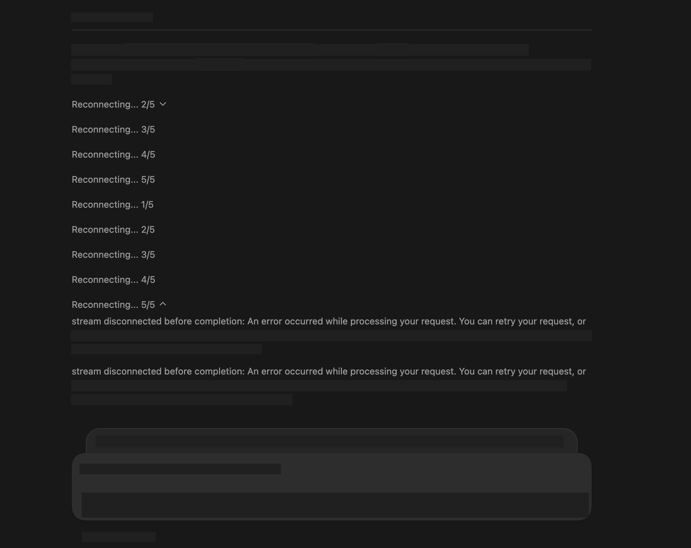

# Codex 一直显示 Reconnecting 怎么办：大请求先回退 HTTP 再重试，WebSocket 大小上限已提到 128 MB，Cloud 会话会自动重连

> 本文在线版：[codexguide.io/guides/codex-reconnecting-network-troubleshooting](https://codexguide.io/guides/codex-reconnecting-network-troubleshooting)

> 核对依据：2026-11-19 打开的 [Troubleshooting](https://learn.chatgpt.com/docs/reference/troubleshooting)，2026-11-21 再次返回 HTTP 200。这一页仍然写桌面端和 CLI 可以携带不同的 Codex 版本，反馈仍是在输入框输入 `/`，日志路径也与下文第 7 节一致。这一页没有「128 MB」或「Cloud 自动重连」的段落。0.170.0 的立刻回退来自 [rust-v0.170.0](https://github.com/openai/codex/releases/tag/rust-v0.170.0)。上限数字来自 Charlie Marsh 2026-11-20 的串帖，见第 5 节；[#60841](https://github.com/openai/codex/pull/60841) 与 [#60840](https://github.com/openai/codex/pull/60840) 只证明客户端怎么读上限、怎么回退，不证明当前上限是 128 MB。[更新日志](https://learn.chatgpt.com/codex/changelog) 2026-11-21 已收录 11-20 的 CLI 0.171.0。`stream_max_retries`、`supports_websockets` 和 `CODEX_CA_CERTIFICATE` 沿用本文 2026-10-22 对 Configuration Reference、Advanced Configuration、Environment variables 的阅读；后来的发布说明没有改这些默认值，本文这次没有把整份配置参考重读一遍。[status.openai.com](https://status.openai.com/) 2026-11-21 可以打开。文中「我的用法」是排查顺序建议，不是官方规定。**本环境没有国内代理、公司 CA、Cloud 环境和真机 Mac，也没有制造一次断线，没有构造一条超限请求。** `tested_cli_version` 仍是 2026-11-19 核对过的 0.170.0。2026-11-21 另装了 `codex-cli 0.171.0`，只跑了 `codex --version`，没有复现 Reconnecting。

发了一条提示，界面却在转：`Reconnecting... 2/5`，下面挂着 `stream disconnected before completion: websocket closed by server before response.completed`；有人会连到 `5/5`，再看到 `Falling back from WebSockets to HTTPS transport`。睡眠唤醒、换网或公司网关后，请求也可能直接失败。这些在 openai/codex [#18960](https://github.com/openai/codex/issues/18960)、[#13041](https://github.com/openai/codex/issues/13041)、[#14297](https://github.com/openai/codex/issues/14297)、[#3355](https://github.com/openai/codex/issues/3355) 里反复出现——**是社区症状，不是 OpenAI 正式故障公告**。

本文只解决一件事：**按固定顺序排查**，避免一上来就改代理、换证书、或照搬未核实的第三方说法。

## 先说结论：先分清服务端、本机网络还是证书

128 MB 只解释「请求大到过了 WebSocket 上限」这一类。短提示反复 `Reconnecting`，仍然先看服务端，再看本机网络、代理和证书。Cloud 会话的自动重连是另一条路径，不要套到本机的 `x/5` 上。官方没有说明「要享受 128 MB 上限，需不需要升级客户端」。

**推荐顺序（先读这一段）**：

1. **Status**（服务端）→ 2. **本机网络／睡眠唤醒** → 3. **代理／TUN／系统代理** → 4. **公司 CA（`CODEX_CA_CERTIFICATE`）** → 5. **WebSocket 回退与自定义 provider** → 6. **客户端版本** → 7. **Feedback ID 与日志**。

额度用完、模型容量不足是另一类问题，见《[容量不足与额度重置](./01-Codex模型容量不足与额度重置排查.md)》（id：`model-at-capacity-usage-reset`）。磁盘被 Crashpad 撑满见《[桌面端 Crashpad 磁盘](./02-Codex桌面端占满磁盘-Crashpad崩溃转储排查与清理.md)》（id：`desktop-crashpad-disk-space`）。安装、登录和网络的自检命令见 [Codex doctor](./04-Codex-doctor自检-安装配置登录与网络排查.md)。自定义 provider 和 `openai_base_url` 见 [自定义模型提供商](../10-配置模型与权限安全/11-Codex自定义模型提供商-model_providers与openai_base_url.md)。Cloud 环境本身怎么创建，见 [Codex Cloud 云端环境](../12-官方工具与集成/12-Codex-Cloud云端环境-创建发布环境-联网与密钥设置.md)。0.170.0 里和重连写在一起的发布说明，见 [Codex CLI 0.170.0](../12-官方工具与集成/29-Codex-CLI-0.170-TUI实时语音-同名MCP与Cloud重连.md)。0.169.0 起终端里的可选 Cloud 连接，见 [Codex CLI 0.169.0](../12-官方工具与集成/25-Codex-CLI-0.169-侧边对话标签页任务搜索与终端Cloud连接.md)。

## 先看懂报错：三句话分别是什么意思


下面是桌面端一次典型现场：先反复 `Reconnecting... x/5`，随后出现 `stream disconnected before completion`（对话与 Request ID 已打码，仅保留报错链路）：



| 你看到的文案 | 大致含义 | 先别做什么 |
|---|---|---|
| `Reconnecting... x/5` | 当前流式传输断了，客户端在按流重试预算重连。Configuration Reference 里自定义 provider 的 `stream_max_retries` **默认 5**，与界面「x/5」一致 | 不要在第一次出现时就狂改代理 |
| `stream disconnected before completion: websocket closed by server before response.completed` | Responses 的 WebSocket 在收到 `response.completed` 之前被关掉（社区日志常见表述） | 不要据此断言「一定是本机坏了」——服务端、边缘策略、代理中断都可能 |
| `Falling back from WebSockets to HTTPS transport` | WebSocket 重试用尽后，客户端尝试改走 HTTPS（SSE／HTTP）路径。官方遥测里也有 `transport.fallback_to_http` 一类计数 | 回退成功后能正常答，说明 HTTPS 通路往往是通的；问题更集中在 WS 段 |

配套默认值（写在 **自定义 `model_providers.*`** 上，见 Configuration Reference／Advanced Configuration）：

| 键 | 默认 | 作用 |
|---|---|---|
| `stream_max_retries` | `5` | SSE／流中断重试次数 |
| `request_max_retries` | `4` | 对 provider 的 HTTP 请求重试次数 |
| `stream_idle_timeout_ms` | `300000`（5 分钟） | 流空闲超时 |

**重要边界**：内置 OpenAI provider **不能**用 `[model_providers.openai]` 覆盖。官方 Advanced Configuration 写明：要改内置 OpenAI 的 base URL，用顶层 `openai_base_url`，不要新建／覆盖保留 ID `openai`。后面「强制 HTTPS」一节用的是**另起一个自定义 provider ID**，不是改 `[model_providers.openai]`。

## 1. 先排除服务端：Status 与近期 issue

**我的用法**：同一时间很多人同时报 `Reconnecting`／`websocket closed` 时，先打开 [status.openai.com](https://status.openai.com/)，看 **Codex**（Web／API／CLI／VS Code extension）以及 ChatGPT／Responses 相关组件，再决定动不动本机。

- Status 有公告或「Monitoring／Investigating」：跟着公告走；本机狂改代理通常浪费时间。
- Status 全绿，但 openai/codex 上同一小时内涌入同类 issue：仍可能是边缘／区域性问题；把时间点记下来，继续本机核对，同时准备 Feedback。
- 只有你一台机器、同一网络下浏览器能开 chatgpt.com、别的设备 Codex 正常：再往下查本机代理与证书。

社区对照（**症状，不是官方根因结论**）：[#18960](https://github.com/openai/codex/issues/18960)（open）App 重连至 5/5 后报 `websocket closed by server before response.completed`；[#13041](https://github.com/openai/codex/issues/13041)（closed）WS 升级后被 **1008 Policy** 关掉并回退 HTTPS；[#14297](https://github.com/openai/codex/issues/14297)（duplicate）「回复前总要 5 次 Reconnecting」；[#3355](https://github.com/openai/codex/issues/3355)（open）睡眠离网后请求 `chatgpt.com/backend-api/codex/responses` 重试耗尽失败。

## 2. 本机网络：睡眠唤醒、换网、基础连通

在改代理之前，先确认「机器醒着、链路通」：

1. 笔记本刚开盖／刚切 Wi‑Fi／刚连 VPN：等 10～30 秒让路由与 DNS 稳定，再发一条**短**提示试一次。
2. 浏览器能否打开 [chatgpt.com](https://chatgpt.com/) 与 [status.openai.com](https://status.openai.com/)（仅作连通性参考，不等于 Codex 流式通道一定可用）。
3. 若症状几乎只在「睡眠后第一条」出现，对照 [#3355](https://github.com/openai/codex/issues/3355)：先新开一回合或重启客户端。官方有实验性 `features.prevent_idle_sleep`（默认关）——先读 Configuration Reference，再决定是否适合你的续航策略。

官方 Troubleshooting 对「卡住」也建议：确认是否在等审批、终端跑 `git status`、必要时用更短提示**新开聊天**清掉半死不活的流状态。

## 3. 代理／TUN／SOCKS：只写能核实的边界

国内与公司环境里，代理是高频怀疑对象。这里必须分清两件事：

1. **Codex 自己连 OpenAI／ChatGPT 后端**用的出站通道（受系统代理、代理客户端、VPN／TUN、公司网关影响）。
2. **沙箱里命令的联网**（`features.network_proxy`、权限配置文件的 `permissions.*.network`）——那是另一套「沙箱代理」，**不负责**解释「对话流 Reconnecting」。本篇不展开沙箱联网。

### 官方公开环境变量页写了什么、没写什么

[Environment variables](https://learn.chatgpt.com/docs/config-file/environment-variables) 列出的稳定公开变量里，与网络／TLS 直接相关的是：

- `CODEX_CA_CERTIFICATE`、`SSL_CERT_FILE`（见下一节）
- 诊断用 `RUST_LOG`（以及需显式 `log_dir` 才生成的明文 `codex-tui.log`）

**该页没有把 `HTTP_PROXY`／`HTTPS_PROXY`／`ALL_PROXY`／`SOCKS_PROXY` 列为 Codex 专用公开变量。** 因此本文**不会**声称「官方规定 Codex 只认某某代理协议」或「官方说不支持 SOCKS5」。第三方站点上未标注出处的「Codex 不识别 socks5」一类说法，**不要照搬**。

### 我的用法：本机核对代理时的最小动作

（需在你自己的 Mac／Windows／WSL 上验证；本环境无国内代理实验室。）

1. **分清代理形态**：系统 HTTP／HTTPS 代理、代理软件 **TUN**、或仅终端环境变量——桌面 App、CLI、IDE 读到的路径可能不同。
2. **同一时间只改一处**：先确认系统代理／规则覆盖相关域名；不要同时切 TUN、改 hosts、清证书。
3. **CLI 与桌面分开试**：有代理的终端里短提示一次，再只开桌面试一次。一侧正常一侧不行，更像「该入口没吃到代理／证书」。
4. **WSL2**：在 WSL 内与 Windows 主机上分别试——代理常只配在一侧。
5. **认证型代理**：在代理客户端完成认证与分流；不要把账号密码写进对话或 Git。

短提示若总是 `5/5` 后才 HTTPS 成功，记下现象进入第 5 节，而不是无限调规则。

## 4. 公司网络与证书：`CODEX_CA_CERTIFICATE`／`SSL_CERT_FILE`

公司 TLS 检查（中间人解密）时，客户端必须信任公司根证书，否则 HTTPS 与 WebSocket 都可能在握手或中途失败。

官方原文要点（Environment variables → Authentication and network）：

| 变量 | 作用 |
|---|---|
| `CODEX_CA_CERTIFICATE` | 指向 PEM CA 包；用于 **HTTPS、登录和 WebSocket** 客户端；**优先于** `SSL_CERT_FILE` |
| `SSL_CERT_FILE` | 未设置 `CODEX_CA_CERTIFICATE` 时的回退 PEM CA 路径 |

示例（路径换成你们 IT 提供的 PEM；不要把私钥当 CA）：

```bash
export CODEX_CA_CERTIFICATE="/path/to/corp-root-cas.pem"
# 可选回退：
# export SSL_CERT_FILE="/path/to/corp-root-cas.pem"
```

桌面端／IDE 若不是从该 shell 启动，需要把同样变量写进**启动该应用的环境**（系统用户环境、启动脚本、或 IT 托管的配置）。改完后**完全退出并重启**客户端再测。

诊断时可配合：

```bash
RUST_LOG=codex_core=debug,codex_api=debug codex -c log_dir=./.codex-log
# 另开终端：
tail -F ./.codex-log/codex-tui.log
```

官方说明：明文 `codex-tui.log` 是**显式设置 `log_dir` 后的 opt-in**；`codex exec` 非交互模式默认把信息打到终端而不是单独 TUI 日志文件。分享日志前按 Troubleshooting 要求先检查敏感信息。

## 5. WebSocket 回退：看懂它，再决定要不要强制 HTTPS

### 正常回退长什么样

社区与客户端日志里的常见路径是：

1. 默认走 Responses **WebSocket**；
2. 连接失败或中途关闭 → 消耗 `stream_max_retries`（默认 5）；
3. 出现 `Falling back from WebSockets to HTTPS transport`；
4. HTTPS 路径若通，回合可以继续。

因此：**「先 Reconnecting 几次再开始答」不一定等于坏掉**——尤其在代理对 WSS 不友好、但对 HTTPS 友好的网络上（[#14297](https://github.com/openai/codex/issues/14297)、[#19821](https://github.com/openai/codex/issues/19821) 一类讨论）。0.170.0 没有把这条社区路径改写成「所有断线都不再重试」。若回退后稳定可用，你可以：

- 接受「每次多等一轮回退」（体验差但能工作）；或
- 用下一小节的**社区配置写法**跳过 WS（需本机验证）。

若 **HTTPS 也失败**，或回退前就反复丢回合，回到 Status／代理／证书，而不是只盯着 WebSocket。

### 上限由服务端在握手里声明，工程师说已经从 16 MB 提到 128 MB

先分清三层来源。不要把它们写成同一句话。

**发布说明里有的。** 2026-11-18 的 [rust-v0.170.0](https://github.com/openai/codex/releases/tag/rust-v0.170.0) 写：

> Oversized WebSocket requests now fall back to HTTP without unnecessary retries. (#60840, #60841)

对象是过大的 WebSocket 请求，不是每一次 `Reconnecting`。回退发生在多余重试之前。发布说明没有写字节数，也没有改 `stream_max_retries` 的默认 5。

**代码能证明的。** [#60841](https://github.com/openai/codex/pull/60841) 于 2026-11-11T18:59:28Z 合并，标题是 “Honor advertised WebSocket message size limits”。正文写：从握手响应里读取 `x-codex-websocket-max-message-bytes`，在发送前检查序列化请求的字节长度；超过服务器声明的上限，就走已有的 HTTP 回退，而不先把这条过大的消息上传上去。缺了这个头，或者头无效，就忽略。这只证明客户端会读**服务器在握手里声明的那个数**。它没有把这个数写成 16 MB 或 128 MB。

[#60840](https://github.com/openai/codex/pull/60840) 于 2026-11-11T18:58:52Z 合并，标题是 “Fall back to HTTP immediately for oversized WebSocket requests”。正文写：在任何文本帧到达之前就收到关闭码 `1009`，表示请求超过了对端的消息大小上限；再换一条 WebSocket 重试解决不了这个上限，于是直接换 HTTP，包括预热阶段。已经收到过文本帧之后的大小关闭，以及其他关闭码，仍按普通的流重试。

**工程师在串帖里说的。** OpenAI 的 Charlie Marsh（@charliermarsh）于 2026-11-20T18:44:03Z 发了[主帖](https://x.com/charliermarsh/status/2123849871480463669)。2026-11-21 打开该页，主帖公开计数是 1,009 赞、28 转发、12 引用、60 回复、146 收藏。展示数没有从页面里再核对。主帖原文是：Codex 用 WebSocket 发模型请求，以便随时间增量发送；WebSocket 大小上限已从 16 MB 提到 128 MB（8 倍），大回合从而避免回退 HTTP；如果请求仍然超过上限，现在大约快 5 倍。

同一串帖里的后文，2026-11-21 从页面数据里读到的原话要点是：

- 以前回合太大时，会先把请求的大部分经 WebSocket 上传，服务器才能以「太大」拒绝，然后客户端再重试。上传和重试都花时间，而这件事情本来就会失败。
- 一旦因为大回合落回 HTTP，就停在 HTTP 上，失去增量发送，于是之后每次模型请求都要重新上传这个「大回合」。
- 先把上限明显提高，整体 HTTP 回退率下降大约 20%。他注明分母包含所有回退原因，例如连接失败和超时，所以这是一个很大的比例。
- 服务端现在会立刻告诉客户端「请求太大」，从而跳过那些无谓的上传再重试。对其他已知再回退 HTTP 也不会成功的 HTTP 状态码，也用了类似规则。
- 这需要客户端和服务端两边的一些优化；净效果应是大回合明显更快、更省。
- 他希望以后把 WebSocket 上限提到和 HTTP 一样的 1 GB。这是计划，不是已经生效的数字。

串帖没有写从哪个客户端版本起生效，也没有回答「要不要升级客户端才能受益」。本文也不替他回答。能并排放的只有：上限的**数字**来自这篇串帖；上限**由握手响应头声明、超限则不先上传就回退 HTTP** 来自 #60841。串帖没有出现响应头的名字，所以不能把「128 MB 就是 `x-codex-websocket-max-message-bytes` 现在的值」写成已经证实的等式。它是对照之后的合理解读，不是发布说明里的句子。

**还没进稳定版发布说明的后续改动。** [#62749](https://github.com/openai/codex/pull/62749) 于 2026-11-20T12:23:32Z 合并，[#62771](https://github.com/openai/codex/pull/62771) 于 2026-11-20T14:27:18Z 合并。两者都晚于 0.171.0 的发布时间 2026-11-20T00:44:47Z。#62749 处理的是上传写到一半失败时，仍能读到服务器的「消息过大」回复；#62771 是写入阻塞时也读取服务器消息。它们已经合进主干。本文不写它们进了哪个版本。

所以：一条特别大的请求不再把 `1/5` 到 `5/5` 走满就出现 HTTP 回退，和 0.170.0 的发布说明一致。短提示仍然数到 `5/5`，先回到 Status、代理和证书，不要解释成「重试次数被改没了」或「还没升到能用 128 MB 的那一版」。本文没有构造一条超限请求，没有看到回退日志。关闭 WebSocket 仍然不是官方修复，见下一小节。

### 社区实践：自定义 provider 关闭 WebSocket（官方字段 + 社区用法）

Configuration Reference 为自定义 provider 提供了布尔字段 **`supports_websockets`**（该 provider 是否支持 Responses API 的 WebSocket 传输）。社区在 [#18960](https://github.com/openai/codex/issues/18960) 等讨论里验证过类似写法：新建一个**非保留 ID** 的 provider，设 `supports_websockets = false`，并把 `model_provider` 指过去，从而一开始就走 HTTPS。

**再次强调**：这是社区在 issue 里验证的配置组合；**不是** OpenAI 文档里的「官方推荐修复步骤」。内置 `openai` ID 不可覆盖；下面用自定义 ID 举例：

```toml
# ~/.codex/config.toml —— 社区常用写法，请本机验证后再长期使用
model_provider = "openai_https"

[model_providers.openai_https]
name = "OpenAI (HTTPS)"
wire_api = "responses"
requires_openai_auth = true
supports_websockets = false
```

保存后重启 CLI／桌面端，再发短提示：若不再出现满额 `Reconnecting... 5/5` 且能完成回合，说明你的环境更适合 HTTPS 传输。若仍然失败，问题多半不在「要不要 WS」，而在代理、证书或服务端。

组织网关优先按官方 gateway／`openai_base_url` 文档配置，不要随意改生产地址。0.170.0 的「过大请求立刻回退」是客户端自己的路径。它不要求你新建一个 `supports_websockets = false` 的 provider。社区写法仍然只在你想跳过 WebSocket、并且接受「这不是官方推荐修复」时再考虑。

### 自定义 provider 上的重试与超时（可选）

只在确认走自定义 provider 时调整；**不能**用 `[model_providers.openai]` 改内置默认。可在该表下设置 `request_max_retries`（默认 4）、`stream_max_retries`（默认 5）、`stream_idle_timeout_ms`（默认 300000）。先保持默认；把重试加很大**修不好**坏代理，只会让失败更慢。

## 5.1 Cloud 会话：自动重连，正在恢复的回合还在

这一节只适用于 **Cloud 会话**。本机对话里的 `Reconnecting... x/5` 仍按上面的 Status、网络、代理、证书和 WebSocket 顺序查。

0.170.0 的原文是：

> Improved automatic reconnection for Cloud conversations and preserved active recovery turns when clients reconnect. (#60969, #61014)

#60969 的标题是 “Reconnect idle Cloud conversations after transient stream loss”。#61014 的标题是 “Preserve active recovery turns when clients reconnect”。

合在一起：Cloud 会话的自动重连有改进；空闲会话在短暂断流后会重连；客户端重新连上时，正在进行的恢复回合会被保留。发布说明没有写重连要等多少秒，也没有写本机 `Reconnecting 5/5` 会因此消失。

终端里从 0.169.0 开始可以开可选的 Cloud 连接，步骤不在这篇重复，见 [Codex CLI 0.169.0](../12-官方工具与集成/25-Codex-CLI-0.169-侧边对话标签页任务搜索与终端Cloud连接.md)。环境、联网和密钥见 [Codex Cloud 云端环境](../12-官方工具与集成/12-Codex-Cloud云端环境-创建发布环境-联网与密钥设置.md)。本文没有 Cloud 环境，没有把一条恢复中的回合断开再接上。

## 6. 客户端版本：0.170 与 0.171 分别写了什么，128 MB 要不要升级没有官方答案

官方 Troubleshooting 写明：ChatGPT 桌面端与 Codex CLI **可能携带不同的 Codex 版本**，功能与修复到达时间可能不一致。2026-11-21 这一页仍返回 HTTP 200；2026-11-19 读到的那句版本差异，本文没有逐字重读，不把它改写成已经消失。

和这条排障直接相关的稳定版说明是：

- **0.170.0**（2026-11-18）：过大的 WebSocket 请求立刻回退 HTTP（#60840、#60841）；Cloud 会话改进自动重连，并在客户端重连时保留正在恢复的回合。同名 MCP 可跨环境使用是实验性的，见 [Codex CLI 0.170.0](../12-官方工具与集成/29-Codex-CLI-0.170-TUI实时语音-同名MCP与Cloud重连.md)。
- **0.171.0**（2026-11-20，发布时刻 2026-11-20T00:44:47Z）：[更新日志](https://learn.chatgpt.com/codex/changelog) 2026-11-21 已收录。和网络回退无关的条目里，有一条企业 MCP 登录修复：身份提供者只发 ID token、不发 refresh token 时也能登录（#62129）。它不改变本节的排查顺序。默认模型和终端工作区见 [Codex CLI 0.171.0](../12-官方工具与集成/30-Codex-CLI-0.171-默认GPT-6.2-Sol-终端工作区默认开启与exec-remote.md)。

如果现象像「过大的请求把 WebSocket 重试走满」，0.170.0 的发布说明已经把「立刻改走 HTTP」写进了这一版。版本早于 0.170.0 时，发布说明没有把这条行为算进去。版本已经是 0.170.0 或 0.171.0、短提示仍然数满 `5/5`，回到第 1 到第 4 节。那更像网络、代理或证书。

128 MB 这一档不要用同样的句子。串帖说客户端和服务端都做了优化，但没有写最低版本，也没有回答要不要升级。#60841 能证明的是客户端会读取握手里的上限；0.170.0 的发布说明点名了这个 PR。上限数字本身是 2026-11-20 的服务端说明。官方没有说明只升级其中一侧够不够。#62749 和 #62771 已在主干，晚于 0.171.0 发布，不把它们算进 0.170.0 或 0.171.0。

`codex update` 的帮助写的是更新到最新版。2026-11-21 查询，npm 的 `latest` 仍是 `0.171.0`（该版本发布时间 2026-11-20T00:51:29.762Z）。同一天还有 `0.173.0-alpha.4`，本文不采用 alpha。要钉住正式版，用 `npm install -g @openai/codex@0.171.0`。本文 2026-11-19 在 Linux 上核对过 `codex-cli 0.170.0`；2026-11-21 另装 0.171.0 后 `codex --version` 为 `codex-cli 0.171.0`。没有在这台机器上复现 Reconnecting。

```bash
codex --version
```

macOS 上查看桌面端捆绑的 CLI（官方给出的兼容路径）：

```bash
/Applications/Codex.app/Contents/Resources/codex --version
```

若只有一侧重连、另一侧正常：先把落后的一侧更新到当前渠道最新版，再对比现象。IDE 扩展同理——改完网络相关配置后按扩展提示 **Restart**。

## 7. 收集证据再反馈：Feedback ID、日志、会话

官方 Troubleshooting「Feedback and logs」：

1. 在消息输入框输入 `/`，按客户端指引提交反馈；在已有聊天里触发时可选择是否附带该会话。提交后会得到可分享给团队的**会话／反馈标识**。
2. 到 [openai/codex](https://github.com/openai/codex) 搜索是否已有同类 issue（优先跟帖 [#18960](https://github.com/openai/codex/issues/18960)、[#3355](https://github.com/openai/codex/issues/3355) 等），避免空洞新帖。
3. 公开评论建议只带**元数据**：客户端与 `codex --version`、OS、代理形态（系统代理／TUN／无代理，勿贴账号密码）、是否公司 TLS、是否已设 `CODEX_CA_CERTIFICATE`、完整报错原文、发生时间（含时区）、Feedback／session ID、HTTPS 回退后是否成功。
4. 日志位置（默认）：
   - App 日志（macOS）：`~/Library/Logs/com.openai.codex/YYYY/MM/DD`
   - 会话：`$CODEX_HOME/sessions`（默认 `~/.codex/sessions`）
   - 归档：`$CODEX_HOME/archived_sessions`
5. 需要明文 TUI 日志时：显式 `log_dir` + `RUST_LOG`（见第 4 节）。**分享前先检查敏感信息。**

## 一页检查清单

1. 打开 [status.openai.com](https://status.openai.com/)：Codex／相关组件是否异常。  
2. 刚睡眠／换网／切 VPN：等链路稳定，短提示重试；对照 [#3355](https://github.com/openai/codex/issues/3355)。  
3. 分清代理形态（系统代理 vs TUN vs 仅终端变量）；同一时间只改一处；CLI 与桌面分开验证。  
4. 公司 TLS：设 `CODEX_CA_CERTIFICATE`（优先）或 `SSL_CERT_FILE`，重启客户端。  
5. 看是否出现 `Falling back from WebSockets to HTTPS`：回退成功 → 网络对 HTTPS 更友好。过大请求从 0.170.0 的发布说明起会立刻走 HTTP。工程师于 2026-11-20 说上限已从 16 MB 提到 128 MB；这不改变自定义 provider 上 `stream_max_retries` 的默认 5，也没有官方句子说明必须先升级客户端。社区自定义 provider + `supports_websockets = false` 仍须本机验证，不是官方推荐修复。  
6. Cloud 会话另看 0.170.0：短暂断流后的自动重连，以及重连时正在恢复的回合还在。本机 `x/5` 不要直接套这条。  
7. 不要用 `[model_providers.openai]` 覆盖内置 provider；改 base URL 用 `openai_base_url`。  
8. `codex --version` 与桌面捆绑版本对齐。要判断是不是旧客户端对过大 WebSocket 的多余重试，发布说明从 0.170.0 写起。128 MB 是否还要再升一版，官方没有回答。  
9. `/` 反馈拿到 ID；跟帖 issue 时只贴元数据与打码日志。

## 小结

- `Reconnecting... x/5` 与本文沿用的默认 `stream_max_retries = 5` 一致，常常是流重试。0.170.0 没有在发布说明里改这个默认值。  
- **先 Status，再本机网络，再代理，再公司 CA，再谈 WebSocket 与版本。**  
- 证书：官方支持 `CODEX_CA_CERTIFICATE`／`SSL_CERT_FILE` 覆盖 HTTPS、登录与 WebSocket。  
- 过大的 WebSocket 从 0.170.0 的发布说明起立刻回退 HTTP，不再做多余重试。普通断线仍可能先重试再回退。  
- 2026-11-20 工程师说 WebSocket 上限已从 16 MB 提到 128 MB。#60841 证明客户端读取握手响应头 `x-codex-websocket-max-message-bytes`。两句话不要合成「发布说明写了 128 MB」。官方没有说明要不要升级客户端。  
- Cloud 会话从 0.170.0 起改进自动重连，并在客户端重连时保留正在进行的恢复回合。  
- 强制关 WS 属于**社区配置实践**（使用官方字段 `supports_websockets`），须本机验证。  
- 官方公开环境变量页**未**把 SOCKS／HTTP 代理变量写成 Codex 专用项。未核实的「不支持某某协议」不要当成结论。  
- 反馈带 Feedback ID 与可复核元数据；日志先脱敏。

参考：

- [Troubleshooting（Feedback and logs；版本差异）](https://learn.chatgpt.com/docs/reference/troubleshooting)  
- [rust-v0.170.0](https://github.com/openai/codex/releases/tag/rust-v0.170.0)  
- [rust-v0.171.0](https://github.com/openai/codex/releases/tag/rust-v0.171.0)  
- [更新日志](https://learn.chatgpt.com/codex/changelog)（2026-11-21 已收录 CLI 0.171.0）  
- [Charlie Marsh 串帖](https://x.com/charliermarsh/status/2123849871480463669)（2026-11-20T18:44:03Z）  
- [openai/codex#60841](https://github.com/openai/codex/pull/60841)、[#60840](https://github.com/openai/codex/pull/60840)  
- [openai/codex#62749](https://github.com/openai/codex/pull/62749)、[#62771](https://github.com/openai/codex/pull/62771)（2026-11-20 合入主干，不归属到某个稳定版）  
- [Environment variables（`CODEX_CA_CERTIFICATE`／`SSL_CERT_FILE`／`RUST_LOG`／`log_dir`）](https://learn.chatgpt.com/docs/config-file/environment-variables)  
- [Configuration Reference／Advanced Configuration（`stream_max_retries`、`supports_websockets`、`openai_base_url`）](https://learn.chatgpt.com/docs/config-file/config-reference)  
- [OpenAI Status](https://status.openai.com/)  
- 社区症状（非官方手册）：[openai/codex#18960](https://github.com/openai/codex/issues/18960)、[#13041](https://github.com/openai/codex/issues/13041)、[#14297](https://github.com/openai/codex/issues/14297)、[#3355](https://github.com/openai/codex/issues/3355)

2026-11-21 打开并读过的是 Charlie Marsh 串帖页面、#60841、#60840、#62749、#62771、rust-v0.171.0 和更新日志里的 0.171.0 条目。Troubleshooting 与 status.openai.com 当天返回 HTTP 200，没有逐段重读。Environment variables 与 Configuration Reference 的链接仍指向 2026-10-22 写本文时用过的页面；这次没有重读整页，所以默认重试次数没有按新版本改写。#19821 的讨论正文没有重读。串帖页面里的互动计数以当天嵌入数据为准，展示数未核对。
