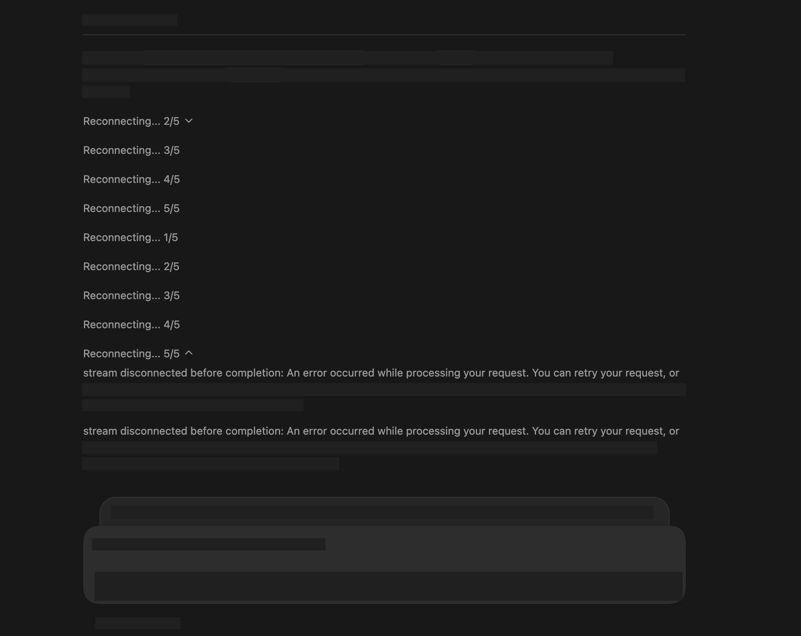

# Codex 一直显示 Reconnecting 怎么办：stream disconnected 的常见原因和排查顺序（国内代理、公司证书、WebSocket 回退）

> 本文在线版：[codexguide.io/guides/codex-reconnecting-network-troubleshooting](https://codexguide.io/guides/codex-reconnecting-network-troubleshooting)

> 核对依据：learn.chatgpt.com 的 Troubleshooting、Environment variables、Configuration Reference／Advanced Configuration；[status.openai.com](https://status.openai.com/)；openai/codex 上与重连相关的 **issue 讨论**（#18960、#13041、#14297、#3355 等，只作症状对照）。文中「我的用法」是排查顺序建议，不是官方规定。**本预览环境没有国内代理／公司 CA／真机 Mac 实验室**，代理与证书步骤标为需本机验证（`client_validation_pending: true`）。

发了一条提示，界面却在转：`Reconnecting... 2/5`，下面挂着 `stream disconnected before completion: websocket closed by server before response.completed`；有人会连到 `5/5`，再看到 `Falling back from WebSockets to HTTPS transport`。睡眠唤醒、换网或公司网关后，请求也可能直接失败。这些在 openai/codex [#18960](https://github.com/openai/codex/issues/18960)、[#13041](https://github.com/openai/codex/issues/13041)、[#14297](https://github.com/openai/codex/issues/14297)、[#3355](https://github.com/openai/codex/issues/3355) 里反复出现——**是社区症状，不是 OpenAI 正式故障公告**。

本文只解决一件事：**按固定顺序排查**，避免一上来就改代理、换证书、或照搬未核实的第三方说法。

**推荐顺序（先读这一段）：**

1. **Status**（服务端）→ 2. **本机网络／睡眠唤醒** → 3. **代理／TUN／系统代理** → 4. **公司 CA（`CODEX_CA_CERTIFICATE`）** → 5. **WebSocket 回退与自定义 provider** → 6. **客户端版本** → 7. **Feedback ID 与日志**。

额度用完、模型容量不足是另一类问题，见《[容量不足与额度重置](./01-Codex模型容量不足与额度重置排查.md)》（id：`model-at-capacity-usage-reset`）。磁盘被 Crashpad 撑满见《[桌面端 Crashpad 磁盘](./02-Codex桌面端占满磁盘-Crashpad崩溃转储排查与清理.md)》（id：`desktop-crashpad-disk-space`）。

## 先看懂报错：三句话分别是什么意思


下面是桌面端一次典型现场：先反复 `Reconnecting... x/5`，随后出现 `stream disconnected before completion`（对话与 Request ID 已打码，仅保留报错链路）：



| 你看到的文案 | 大致含义 | 先别做什么 |
|---|---|---|
| `Reconnecting... x/5` | 当前流式传输断了，客户端在按流重试预算重连。Configuration Reference 里自定义 provider 的 `stream_max_retries` **默认 5**，与界面「x/5」一致 | 不要在第一次出现时就狂改代理 |
| `stream disconnected before completion: websocket closed by server before response.completed` | Responses 的 WebSocket 在收到 `response.completed` 之前被关掉（社区日志常见表述） | 不要据此断言「一定是本机坏了」——服务端、边缘策略、代理中断都可能 |
| `Falling back from WebSockets to HTTPS transport` | WebSocket 重试用尽后，客户端尝试改走 HTTPS（SSE／HTTP）路径。官方遥测里也有 `transport.fallback_to_http` 一类计数 | 回退成功后能正常答，说明 HTTPS 通路往往是通的；问题更集中在 WS 段 |

配套默认值（写在 **自定义 `model_providers.*`** 上，见 Configuration Reference／Advanced Configuration）：

| 键 | 默认 | 作用 |
|---|---|---|
| `stream_max_retries` | `5` | SSE／流中断重试次数 |
| `request_max_retries` | `4` | 对 provider 的 HTTP 请求重试次数 |
| `stream_idle_timeout_ms` | `300000`（5 分钟） | 流空闲超时 |

**重要边界：** 内置 OpenAI provider **不能**用 `[model_providers.openai]` 覆盖。官方 Advanced Configuration 写明：要改内置 OpenAI 的 base URL，用顶层 `openai_base_url`，不要新建／覆盖保留 ID `openai`。后面「强制 HTTPS」一节用的是**另起一个自定义 provider ID**，不是改 `[model_providers.openai]`。

## 1. 先排除服务端：Status 与近期 issue

**我的用法：** 同一时间很多人同时报 `Reconnecting`／`websocket closed` 时，先打开 [status.openai.com](https://status.openai.com/)，看 **Codex**（Web／API／CLI／VS Code extension）以及 ChatGPT／Responses 相关组件，再决定动不动本机。

- Status 有公告或「Monitoring／Investigating」：跟着公告走；本机狂改代理通常浪费时间。
- Status 全绿，但 openai/codex 上同一小时内涌入同类 issue：仍可能是边缘／区域性问题；把时间点记下来，继续本机核对，同时准备 Feedback。
- 只有你一台机器、同一网络下浏览器能开 chatgpt.com、别的设备 Codex 正常：再往下查本机代理与证书。

社区对照（**症状，不是官方根因结论**）：[#18960](https://github.com/openai/codex/issues/18960)（open）App 重连至 5/5 后报 `websocket closed by server before response.completed`；[#13041](https://github.com/openai/codex/issues/13041)（closed）WS 升级后被 **1008 Policy** 关掉并回退 HTTPS；[#14297](https://github.com/openai/codex/issues/14297)（duplicate）「回复前总要 5 次 Reconnecting」；[#3355](https://github.com/openai/codex/issues/3355)（open）睡眠离网后请求 `chatgpt.com/backend-api/codex/responses` 重试耗尽失败。

## 2. 本机网络：睡眠唤醒、换网、基础连通

在改代理之前，先确认「机器醒着、链路通」：

1. 笔记本刚开盖／刚切 Wi‑Fi／刚连 VPN：等 10～30 秒让路由与 DNS 稳定，再发一条**短**提示试一次。
2. 浏览器能否打开 [chatgpt.com](https://chatgpt.com/) 与 [status.openai.com](https://status.openai.com/)（仅作连通性参考，不等于 Codex 流式通道一定可用）。
3. 若症状几乎只在「睡眠后第一条」出现，对照 [#3355](https://github.com/openai/codex/issues/3355)：先新开一回合或重启客户端。官方有实验性 `features.prevent_idle_sleep`（默认关）——先读 Configuration Reference，再决定是否适合你的续航策略。

官方 Troubleshooting 对「卡住」也建议：确认是否在等审批、终端跑 `git status`、必要时用更短提示**新开聊天**清掉半死不活的流状态。

## 3. 代理／TUN／SOCKS：只写能核实的边界

国内与公司环境里，代理是高频怀疑对象。这里必须分清两件事：

1. **Codex 自己连 OpenAI／ChatGPT 后端**用的出站通道（受系统代理、代理客户端、VPN／TUN、公司网关影响）。
2. **沙箱里命令的联网**（`features.network_proxy`、权限配置文件的 `permissions.*.network`）——那是另一套「沙箱代理」，**不负责**解释「对话流 Reconnecting」。本篇不展开沙箱联网。

### 官方公开环境变量页写了什么、没写什么

[Environment variables](https://learn.chatgpt.com/docs/config-file/environment-variables) 列出的稳定公开变量里，与网络／TLS 直接相关的是：

- `CODEX_CA_CERTIFICATE`、`SSL_CERT_FILE`（见下一节）
- 诊断用 `RUST_LOG`（以及需显式 `log_dir` 才生成的明文 `codex-tui.log`）

**该页没有把 `HTTP_PROXY`／`HTTPS_PROXY`／`ALL_PROXY`／`SOCKS_PROXY` 列为 Codex 专用公开变量。** 因此本文**不会**声称「官方规定 Codex 只认某某代理协议」或「官方说不支持 SOCKS5」。第三方站点上未标注出处的「Codex 不识别 socks5」一类说法，**不要照搬**。

### 我的用法：本机核对代理时的最小动作

（需在你自己的 Mac／Windows／WSL 上验证；本环境无国内代理实验室。）

1. **分清代理形态**：系统 HTTP／HTTPS 代理、代理软件 **TUN**、或仅终端环境变量——桌面 App、CLI、IDE 读到的路径可能不同。
2. **同一时间只改一处**：先确认系统代理／规则覆盖相关域名；不要同时切 TUN、改 hosts、清证书。
3. **CLI 与桌面分开试**：有代理的终端里短提示一次，再只开桌面试一次。一侧正常一侧不行，更像「该入口没吃到代理／证书」。
4. **WSL2**：在 WSL 内与 Windows 主机上分别试——代理常只配在一侧。
5. **认证型代理**：在代理客户端完成认证与分流；不要把账号密码写进对话或 Git。

短提示若总是 `5/5` 后才 HTTPS 成功，记下现象进入第 5 节，而不是无限调规则。

## 4. 公司网络与证书：`CODEX_CA_CERTIFICATE`／`SSL_CERT_FILE`

公司 TLS 检查（中间人解密）时，客户端必须信任公司根证书，否则 HTTPS 与 WebSocket 都可能在握手或中途失败。

官方原文要点（Environment variables → Authentication and network）：

| 变量 | 作用 |
|---|---|
| `CODEX_CA_CERTIFICATE` | 指向 PEM CA 包；用于 **HTTPS、登录和 WebSocket** 客户端；**优先于** `SSL_CERT_FILE` |
| `SSL_CERT_FILE` | 未设置 `CODEX_CA_CERTIFICATE` 时的回退 PEM CA 路径 |

示例（路径换成你们 IT 提供的 PEM；不要把私钥当 CA）：

```bash
export CODEX_CA_CERTIFICATE="/path/to/corp-root-cas.pem"
# 可选回退：
# export SSL_CERT_FILE="/path/to/corp-root-cas.pem"
```

桌面端／IDE 若不是从该 shell 启动，需要把同样变量写进**启动该应用的环境**（系统用户环境、启动脚本、或 IT 托管的配置）。改完后**完全退出并重启**客户端再测。

诊断时可配合：

```bash
RUST_LOG=codex_core=debug,codex_api=debug codex -c log_dir=./.codex-log
# 另开终端：
tail -F ./.codex-log/codex-tui.log
```

官方说明：明文 `codex-tui.log` 是**显式设置 `log_dir` 后的 opt-in**；`codex exec` 非交互模式默认把信息打到终端而不是单独 TUI 日志文件。分享日志前按 Troubleshooting 要求先检查敏感信息。

## 5. WebSocket 回退：看懂它，再决定要不要强制 HTTPS

### 正常回退长什么样

社区与客户端日志里的常见路径是：

1. 默认走 Responses **WebSocket**；
2. 连接失败或中途关闭 → 消耗 `stream_max_retries`（默认 5）；
3. 出现 `Falling back from WebSockets to HTTPS transport`；
4. HTTPS 路径若通，回合可以继续。

因此：**「先 Reconnecting 几次再开始答」不一定等于坏掉**——尤其在代理对 WSS 不友好、但对 HTTPS 友好的网络上（[#14297](https://github.com/openai/codex/issues/14297)、[#19821](https://github.com/openai/codex/issues/19821) 一类讨论）。若回退后稳定可用，你可以：

- 接受「每次多等一轮回退」（体验差但能工作）；或
- 用下一小节的**社区配置写法**跳过 WS（需本机验证）。

若 **HTTPS 也失败**，或回退前就反复丢回合，回到 Status／代理／证书，而不是只盯着 WebSocket。

### 社区实践：自定义 provider 关闭 WebSocket（官方字段 + 社区用法）

Configuration Reference 为自定义 provider 提供了布尔字段 **`supports_websockets`**（该 provider 是否支持 Responses API 的 WebSocket 传输）。社区在 [#18960](https://github.com/openai/codex/issues/18960) 等讨论里验证过类似写法：新建一个**非保留 ID** 的 provider，设 `supports_websockets = false`，并把 `model_provider` 指过去，从而一开始就走 HTTPS。

**再次强调：** 这是社区在 issue 里验证的配置组合；**不是** OpenAI 文档里的「官方推荐修复步骤」。内置 `openai` ID 不可覆盖；下面用自定义 ID 举例：

```toml
# ~/.codex/config.toml —— 社区常用写法，请本机验证后再长期使用
model_provider = "openai_https"

[model_providers.openai_https]
name = "OpenAI (HTTPS)"
wire_api = "responses"
requires_openai_auth = true
supports_websockets = false
```

保存后重启 CLI／桌面端，再发短提示：若不再出现满额 `Reconnecting... 5/5` 且能完成回合，说明你的环境更适合 HTTPS 传输。若仍然失败，问题多半不在「要不要 WS」，而在代理、证书或服务端。

组织网关优先按官方 gateway／`openai_base_url` 文档配置，不要随意改生产地址。

### 自定义 provider 上的重试与超时（可选）

只在确认走自定义 provider 时调整；**不能**用 `[model_providers.openai]` 改内置默认。可在该表下设置 `request_max_retries`（默认 4）、`stream_max_retries`（默认 5）、`stream_idle_timeout_ms`（默认 300000）。先保持默认；把重试加很大**修不好**坏代理，只会让失败更慢。

## 6. 客户端版本：App 与 CLI 可能不同步

官方 Troubleshooting 写明：ChatGPT 桌面端与 Codex CLI **可能携带不同的 Codex 版本**，功能与修复到达时间可能不一致。

```bash
codex --version
```

macOS 上查看桌面端捆绑的 CLI（官方给出的兼容路径）：

```bash
/Applications/Codex.app/Contents/Resources/codex --version
```

若只有一侧重连、另一侧正常：先把落后的一侧更新到当前渠道最新版，再对比现象。IDE 扩展同理——改完网络相关配置后按扩展提示 **Restart**。

## 7. 收集证据再反馈：Feedback ID、日志、会话

官方 Troubleshooting「Feedback and logs」：

1. 在消息输入框输入 `/`，按客户端指引提交反馈；在已有聊天里触发时可选择是否附带该会话。提交后会得到可分享给团队的**会话／反馈标识**。
2. 到 [openai/codex](https://github.com/openai/codex) 搜索是否已有同类 issue（优先跟帖 [#18960](https://github.com/openai/codex/issues/18960)、[#3355](https://github.com/openai/codex/issues/3355) 等），避免空洞新帖。
3. 公开评论建议只带**元数据**：客户端与 `codex --version`、OS、代理形态（系统代理／TUN／无代理，勿贴账号密码）、是否公司 TLS、是否已设 `CODEX_CA_CERTIFICATE`、完整报错原文、发生时间（含时区）、Feedback／session ID、HTTPS 回退后是否成功。
4. 日志位置（默认）：
   - App 日志（macOS）：`~/Library/Logs/com.openai.codex/YYYY/MM/DD`
   - 会话：`$CODEX_HOME/sessions`（默认 `~/.codex/sessions`）
   - 归档：`$CODEX_HOME/archived_sessions`
5. 需要明文 TUI 日志时：显式 `log_dir` + `RUST_LOG`（见第 4 节）。**分享前先检查敏感信息。**

## 一页检查清单

1. 打开 [status.openai.com](https://status.openai.com/)：Codex／相关组件是否异常。  
2. 刚睡眠／换网／切 VPN：等链路稳定，短提示重试；对照 [#3355](https://github.com/openai/codex/issues/3355)。  
3. 分清代理形态（系统代理 vs TUN vs 仅终端变量）；同一时间只改一处；CLI 与桌面分开验证。  
4. 公司 TLS：设 `CODEX_CA_CERTIFICATE`（优先）或 `SSL_CERT_FILE`，重启客户端。  
5. 看是否出现 `Falling back from WebSockets to HTTPS`：回退成功 → 网络对 HTTPS 更友好；可考虑社区自定义 provider + `supports_websockets = false`（本机验证）。  
6. 不要用 `[model_providers.openai]` 覆盖内置 provider；改 base URL 用 `openai_base_url`。  
7. `codex --version` 与桌面捆绑版本对齐并升级。  
8. `/` 反馈拿到 ID；跟帖 issue 时只贴元数据与打码日志。

## 小结

- `Reconnecting... x/5` 与默认 `stream_max_retries = 5` 一致，常常是流重试，而不是「配置一定坏了」。  
- **先 Status，再本机网络，再代理，再公司 CA，再谈 WebSocket 策略与版本。**  
- 证书：官方支持 `CODEX_CA_CERTIFICATE`／`SSL_CERT_FILE` 覆盖 HTTPS、登录与 WebSocket。  
- WebSocket → HTTPS 回退是客户端已有路径；强制关 WS 属于**社区配置实践**（使用官方字段 `supports_websockets`），须本机验证。  
- 官方公开环境变量页**未**把 SOCKS／HTTP 代理变量写成 Codex 专用项——不要传播未核实的「不支持某某协议」结论。  
- 反馈带 Feedback ID 与可复核元数据；日志先脱敏。

参考：

- [Troubleshooting（Feedback and logs；版本差异）](https://learn.chatgpt.com/docs/reference/troubleshooting)  
- [Environment variables（`CODEX_CA_CERTIFICATE`／`SSL_CERT_FILE`／`RUST_LOG`／`log_dir`）](https://learn.chatgpt.com/docs/config-file/environment-variables)  
- [Configuration Reference／Advanced Configuration（`stream_max_retries`、`supports_websockets`、`openai_base_url`）](https://learn.chatgpt.com/docs/config-file/config-reference)  
- [OpenAI Status](https://status.openai.com/)  
- 社区症状（非官方手册）：[openai/codex#18960](https://github.com/openai/codex/issues/18960)、[#13041](https://github.com/openai/codex/issues/13041)、[#14297](https://github.com/openai/codex/issues/14297)、[#3355](https://github.com/openai/codex/issues/3355)
